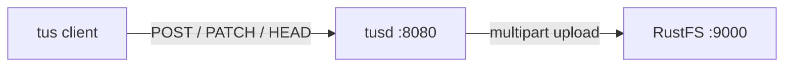

In dieser Anleitung verbinden Sie [tusd](https://github.com/tus/tusd) — die offizielle Referenzimplementierung des tus-Protokolls für fortsetzbare Uploads — mit **RustFS** als S3-Speicher-Backend. Sie betreiben tusd gegen einen RustFS-Bucket, legen einen Upload mit dem tus-Protokoll an, senden die Datei in zwei Teilen mit einer Unterbrechung dazwischen, setzen am gemeldeten Offset fort und prüfen das zusammengesetzte Objekt im Bucket. Der Ablauf wurde mit `tusproject/tusd:v2.10.1` gegen `rustfs/rustfs-x86-musl:v2.3.1` verifiziert.

Sie benötigen Docker oder eine lokale tusd-Binärdatei. Diese Bereitstellung ist für lokale Integrationstests gedacht, nicht für den Produktivbetrieb.

## Architektur



tusd speichert jeden laufenden Upload als Teile eines mehrteiligen Uploads im Bucket. Ein Client, der die Verbindung verliert, fragt den Server mit `HEAD` nach dem zuletzt committeten Offset und setzt dort fort. Bereits empfangene Daten werden nie ein zweites Mal gesendet.

## 1. tusd starten

Legen Sie den Bucket an und starten Sie tusd mit dem S3-Backend. Ersetzen Sie alle Verbindungsplatzhalter. Die AWS-Region muss gesetzt sein, auch wenn RustFS sie ignoriert:

```bash
rc mb rustfs/tus-uploads

docker run -d --name tusd --network oo-rustfs_default -p 8080:8080 \
  -e AWS_ACCESS_KEY_ID=<your-access-key> \
  -e AWS_SECRET_ACCESS_KEY=<your-secret-key> \
  -e AWS_REGION=us-east-1 \
  tusproject/tusd:latest \
  -s3-bucket tus-uploads \
  -s3-endpoint http://<your-rustfs-endpoint>:9000
```

Prüfen Sie, dass der Server gesund ist:

```bash
curl -s -o /dev/null -w "%{http_code}\n" http://localhost:8080/health
```

```text
200
```

## 2. Den Upload anlegen

Legen Sie einen Upload von 6 MiB an und lesen Sie den Header `Location`:

```bash
curl -s -D - -o /dev/null -X POST http://localhost:8080/files/ \
  -H "Upload-Length: 6291456" -H "Tus-Resumable: 1.0.0" \
  | grep -i "^Location:"
```

```text
Location: http://localhost:8080/files/b7338250daa9...+NGVmNDRhZjEt...
```

Die Upload-URL enthält die Datei-ID und ein Nachrichtenauthentifizierungs-Tag. Entfernen Sie Schema und Host, bevor Sie sie erneut senden. Der Server gibt den `Host` zurück, den er empfangen hat, und der ist vom nächsten Client aus möglicherweise nicht erreichbar.

## 3. In Teilen mit einer Unterbrechung hochladen

Senden Sie die ersten 2,5 MB und stoppen Sie dann. An dieser Stelle würde ein mobiler Client die Verbindung verlieren:

```bash
head -c 2500000 demo.bin > part1.bin

curl -s -o /dev/null -w "%{http_code}\n" -X PATCH "http://localhost:8080${LOC}" \
  -H "Upload-Offset: 0" -H "Tus-Resumable: 1.0.0" \
  -H "Content-Type: application/offset+octet-stream" \
  --data-binary @part1.bin
```

```text
204
```

Fragen Sie den Server, wie viel er tatsächlich hat. Das ist der Kern des fortsetzbaren Uploads:

```bash
curl -s -X HEAD "http://localhost:8080${LOC}" \
  -H "Tus-Resumable: 1.0.0" -D - -o /dev/null | grep -i upload-offset
```

```text
Upload-Offset: 2500000
```

## 4. Fortsetzen und abschließen

Setzen Sie ab Offset 2500000 mit den restlichen Bytes fort:

```bash
tail -c 3791456 demo.bin > part2.bin

curl -s -o /dev/null -w "%{http_code}\n" -X PATCH "http://localhost:8080${LOC}" \
  -H "Upload-Offset: 2500000" -H "Tus-Resumable: 1.0.0" \
  -H "Content-Type: application/offset+octet-stream" \
  --data-binary @part2.bin
```

```text
204
```

Laden Sie den fertigen Upload über tusd herunter und vergleichen Sie die Prüfsummen mit der Quelle:

```bash
curl -s -o download.bin "http://localhost:8080${LOC}"
sha1sum demo.bin download.bin
```

```text
d9016032ced6c7515b67a0c556e006c4b25a5858  demo.bin
d9016032ced6c7515b67a0c556e006c4b25a5858  download.bin
```

## 5. Objekte in RustFS prüfen

Listen Sie den Bucket auf:

```bash
rc ls rustfs/tus-uploads/ -r
```

Der Bucket enthält das zusammengesetzte Objekt plus eine Metadatendatei `.info` je Upload, sowohl laufende als auch abgeschlossene:

```text
b7338250daa9a1a79c1343502b57b28f       6 MiB
b7338250daa9a1a79c1343502b57b28f.info  378 B
```

Der Objektschlüssel ist die Upload-ID, und der Objektkörper ist die hochgeladene Datei Byte für Byte. Jeder S3-Client kann abgeschlossene Uploads daher direkt aus dem Bucket lesen.


## 6. Stoppen oder zurücksetzen

Um den Server abzubauen und die Bucket-Objekte zu behalten:

```bash
docker rm -f tusd
```

Um die gespeicherten Uploads zu löschen:

```bash
rc rm rustfs/tus-uploads/ --recursive --force
```

## Fehlerbehebung

### `CreateMultipartUpload ... A region must be set when sending requests to S3`

tusd baut seinen S3-Client aus der AWS-Umgebung, und die Region ist für die Endpunktauflösung zwingend. Exportieren Sie `AWS_REGION=us-east-1` neben den Zugangsdaten, wie in Schritt 1.

### `PATCH` antwortet mit `404` oder verbindet sich mit dem falschen Host

Die URL `Location` gibt den Header `Host` der Erstellungsanfrage zurück. Wenn Client und Server unterschiedliche Hostnamen verwenden (Container-Name gegenüber veröffentlichtem Port), entfernen Sie Schema und Host aus der URL und senden Sie den Pfad an die Adresse, die der Client erreichen kann.

### Der Upload verschwindet nach einem Server-Neustart

Das S3-Backend behält `.info`-Dateien im Bucket, daher überstehen Uploads Neustarts. Wenn Sie tusd gegen einen leeren Bucket betreiben, den ein anderer Prozess aufräumt, gehen die Metadaten verloren. Schützen Sie das Präfix `tus-uploads` vor Aufräumjobs.

## Nächste Schritte

- Lesen Sie die [S3-Kompatibilitätshinweise](/de/administration/protocols/s3), bevor Sie weitere tusd-Backends einsetzen.
- Erstellen Sie dedizierte Produktions-Zugangsdaten über die [Zugriffsschlüssel-Verwaltung](/de/security-compliance/iam/access-token).
- Folgen Sie der [Dokumentation zum tus-Protokoll](https://tus.io/protocols/resumable-upload) für Creation-with-Upload, Termination und Prüfsummen-Erweiterungen, die tusd zusätzlich zum Kernprotokoll unterstützt.
