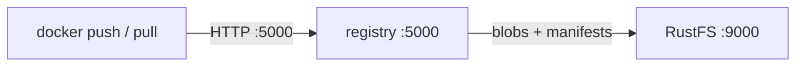

In dieser Anleitung verbinden Sie die quelloffene [Docker Registry](https://github.com/distribution/distribution) (distribution) mit **RustFS** als S3-Speicher-Backend. Sie betreiben eine Registry, die alle Layer und Manifeste in einem RustFS-Bucket speichert, und pushen und pullen anschließend ein Image. Der Ablauf wurde mit `registry:2` gegen `rustfs/rustfs-x86-musl:v2.3.1` verifiziert.

Sie benötigen Docker auf dem Registry-Host.

## Architektur



Die Registry speichert jeden Blob (Layer und Konfigurationen) und jedes Manifest als Objekte unter `docker/registry/v2/` im Bucket. Der Container selbst ist zustandslos, daher lassen sich Registry-Knoten horizontal mit demselben Bucket skalieren.

## 1. Registry ausführen

Konfigurieren Sie den S3-Treiber ausschließlich über Umgebungsvariablen. `REGISTRY_STORAGE_S3_REGIONENDPOINT` richtet das AWS SDK auf RustFS aus:

```bash
docker run -d --name registry --network oo-rustfs_default -p 5000:5000 \
  -e REGISTRY_STORAGE=s3 \
  -e REGISTRY_STORAGE_S3_ACCESSKEY=<your-access-key> \
  -e REGISTRY_STORAGE_S3_SECRETKEY=<your-secret-key> \
  -e REGISTRY_STORAGE_S3_REGION=us-east-1 \
  -e REGISTRY_STORAGE_S3_BUCKET=registry-demo \
  -e REGISTRY_STORAGE_S3_REGIONENDPOINT=http://<your-rustfs-endpoint>:9000 \
  registry:2
```

Prüfen Sie, dass die v2-API bereit ist:

```bash
curl -s -o /dev/null -w "%{http_code}\n" http://localhost:5000/v2/
```


```text
200
```

## 2. Image pushen

Taggen Sie ein lokales Image für die Registry und pushen Sie es:

```bash
docker pull alpine:3.20
docker tag alpine:3.20 localhost:5000/rustfs-demo/alpine:3.20
docker push localhost:5000/rustfs-demo/alpine:3.20
```


```text
3.20: digest: sha256:c64c687cbea9300178b30c95835354e34c4e4febc4badfe27102879de0483b5e
```

## 3. Objekte in RustFS prüfen

```bash
rc ls rustfs/registry-demo/docker/registry/v2/repositories/rustfs-demo/alpine/ -r | head -4
```


```text
_repositories/rustfs-demo/alpine/_layers/sha256/25f1d6b1.../link
_repositories/rustfs-demo/alpine/_manifests/revisions/sha256/c64c687c.../link
_repositories/rustfs-demo/alpine/_manifests/tags/3.20/current/link
```

Jeder `_layers`-Link zeigt auf ein Blob-Objekt im selben Bucket. Die Image-Daten selbst liegen in RustFS, nicht auf dem Registry-Host.


## 4. Image zurück pullen

Entfernen Sie die lokale Kopie und pullen Sie von der Registry. Die Layer kommen aus RustFS zurück:

```bash
docker rmi localhost:5000/rustfs-demo/alpine:3.20
docker pull localhost:5000/rustfs-demo/alpine:3.20
```


```text
3.20: Pulling from rustfs-demo/alpine
Digest: sha256:c64c687cbea9300178b30c95835354e34c4e4febc4badfe27102879de0483b5e
Status: Downloaded newer image for localhost:5000/rustfs-demo/alpine:3.20
```

## 5. Anhalten oder zurücksetzen

```bash
docker rm -f registry
rc rm rustfs/registry-demo/ --recursive --force
```

## Fehlerbehebung

### Der Push schlägt mit `unknown` oder einem leeren Digest fehl

Stellen Sie sicher, dass `REGISTRY_STORAGE_S3_REGIONENDPOINT` gesetzt ist. Ohne diese Variable sendet die Registry Anfragen an das echte AWS. Prüfen Sie außerdem, dass der Bucket existiert.

### `InvalidAccessKeyId` beim Push

Zugriffsschlüssel und geheimer Zugriffsschlüssel müssen über `REGISTRY_STORAGE_S3_ACCESSKEY` und `SECRETKEY` übergeben werden. Die Registry liest in diesem Treiber nicht die AWS-Kette der Umgebungs-Zugangsdaten.

### Der Pull meldet `manifest unknown`, nachdem die Registry neu gestartet wurde

Manifeste und Blobs liegen im Bucket, ein Neustart kann sie also nicht verlieren. Prüfen Sie, dass beide Registry-Instanzen auf denselben `REGISTRY_STORAGE_S3_BUCKET` und denselben `REGIONENDPOINT` zeigen.

## Nächste Schritte

- Vergleichen Sie die Anleitung mit [Harbor](/de/developer/integration/registry/harbor), wenn Sie eine Oberfläche, RBAC oder Replikation auf demselben Bucket benötigen.
- Erstellen Sie dedizierte Produktions-Zugangsdaten über die [Zugriffsschlüssel-Verwaltung](/de/security-compliance/iam/access-token).
- Folgen Sie der [distribution-Dokumentation](https://distribution.github.io/distribution/) für die Abstimmung des Storage-Treibers und für Proxy-Caching-Setups.
