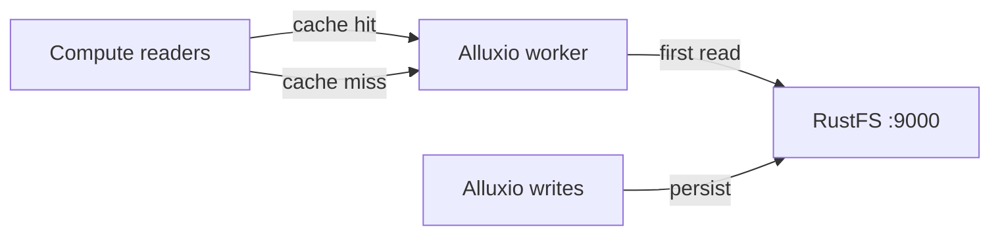

In dieser Anleitung verbinden Sie [Alluxio](https://github.com/Alluxio/alluxio) — die verteilte Datenorchestrierungsschicht — mit **RustFS** als Under Filesystem (UFS). Sie betreiben einen eigenständigen Alluxio-Cluster in Docker, hängen einen RustFS-Bucket ein, lesen ein Objekt über den Cache und schreiben eine Datei über Alluxio zurück in den Bucket. Der Ablauf wurde mit Alluxio 2.9.4 gegen `rustfs/rustfs-x86-musl:v2.3.1` verifiziert.

Sie benötigen Docker mit einer Kapazität von `--shm-size 2g` (der Worker verwendet eine tmpfs-Ramdisk).

## Architektur



Einmal gelesene Objekte werden in der Ramdisk des Workers gecacht. Wiederholte Lesevorgänge werden aus dem Speicher bedient. Schreibvorgänge über Alluxio landen im Bucket als gewöhnliche Objekte.

## 1. Master und Worker starten

Das Standalone-Image startet einen Prozess je Aufruf. Starten Sie zuerst den Master, dann den Worker:

```bash
docker run -d --name alluxio-master --hostname alluxio --network oo-rustfs_default \
  -p 19998:19998 -p 19999:19999 --shm-size 2g \
  -e ALLUXIO_JAVA_OPTS="-Dalluxio.master.hostname=alluxio -Dalluxio.worker.ramdisk.size=1G" \
  alluxio/alluxio:2.9.4 master

docker exec alluxio /entrypoint.sh worker &
```

```text
Capacity information for all workers:
    Total Capacity: 1024.00MB
```

Wenn der Worker sofort mit `tmpfs is smaller than the configured size` endet, wurde der Container ohne `--shm-size` gestartet.

## 2. Den RustFS-Bucket einhängen

Die Zugangsdatenoptionen müssen die vollständigen Schlüsselnamen `alluxio.underfs.s3.*` verwenden. Kurze Schlüssel `s3a.*` oder `aws.*` akzeptiert die CLI, der UFS-Client ignoriert sie aber:

```bash
docker exec alluxio alluxio fs mount \
  --option alluxio.underfs.s3.accessKeyId=<your-access-key> \
  --option alluxio.underfs.s3.secretKey=<your-secret-key> \
  --option alluxio.underfs.s3.endpoint=http://<your-rustfs-endpoint>:9000 \
  --option alluxio.underfs.s3.disable.dns.buckets=true \
  --option alluxio.underfs.s3.path.style.access=true \
  /rustfs s3://alluxio-demo/
```

```text
Mounted s3://alluxio-demo/ at /rustfs
```

`disable.dns.buckets` erzwingt pfadbasierte Adressierung (Path-Style), die der Endpunkt im IP-Stil verlangt.

## 3. Über den Cache lesen

Listen Sie den Mount auf und lesen Sie ein vorbereitetes Objekt:

```bash
docker exec alluxio alluxio fs ls /rustfs
docker exec alluxio alluxio fs cat /rustfs/rustfs-test.txt
```

```text
-rw-r--r--  rustfs  rustfs   15  PERSISTED ... /rustfs/rustfs-test.txt
hello from s3fs
```

`PERSISTED` bedeutet, dass die Quelle der Wahrheit in RustFS liegt. Der Worker cacht Blöcke nach dem ersten Lesevorgang.

## 4. Über Alluxio schreiben

Kopieren Sie eine lokale Datei in den Mount:

```bash
echo "written via alluxio cache to rustfs" > /tmp/rt.txt
docker cp /tmp/rt.txt alluxio:/tmp/rt.txt
docker exec alluxio alluxio fs copyFromLocal /tmp/rt.txt /rustfs/alluxio-write.txt
```

```text
Copied 'file:///tmp/rt.txt' to '/rustfs/alluxio-write.txt'
```

Prüfen Sie das Objekt in RustFS:

```bash
rc ls rustfs/alluxio-demo/
rc cat rustfs/alluxio-demo/alluxio-write.txt
```

```text
[2026-10-07 04:07:25]       36 B alluxio-write.txt
[2026-10-07 04:01:01]       15 B rustfs-test.txt
written via alluxio cache to rustfs
```


## 5. Stoppen oder zurücksetzen

```bash
docker exec alluxio alluxio fs unmount /rustfs
docker rm -f alluxio
rc rm rustfs/alluxio-demo/ --recursive --force
```

## Fehlerbehebung

### Der Worker endet mit `tmpfs is smaller than the configured size`

Der Worker legt seine Ramdisk in `/dev/shm` ab, das Docker standardmäßig auf 64 MB begrenzt. Starten Sie den Container mit `--shm-size 2g` oder senken Sie `alluxio.worker.ramdisk.size`.

### Der Mount gelingt, `fs ls` liefert aber `InvalidAccessKeyId`

Die Mount-Optionen verwendeten kurze Schlüsselnamen (`s3a.*`, `aws.*`). Der UFS-Client von Alluxio berücksichtigt nur die vollständigen Schlüssel `alluxio.underfs.s3.*` aus Schritt 2.

### `S3 client v2 does not support global bucket access`

Die pfadbasierte Adressierung ist aus. Fügen Sie `--option alluxio.underfs.s3.disable.dns.buckets=true` hinzu. Der RustFS-Endpunkt im IP-Stil verlangt das.

## Nächste Schritte

- Lesen Sie die [S3-Kompatibilitätshinweise](/de/administration/protocols/s3), bevor Sie weitere Alluxio-UFS-Typen einsetzen.
- Erstellen Sie dedizierte Produktions-Zugangsdaten über die [Zugriffsschlüssel-Verwaltung](/de/security-compliance/iam/access-token).
- Folgen Sie der [Alluxio-Dokumentation](https://docs.alluxio.io/os/user/stable/ufs/S3.html) für Cache-Policies, TTLs und mehrstufigen Speicher auf demselben Bucket.
