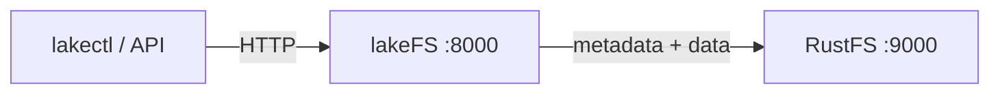

In dieser Anleitung verbinden Sie [lakeFS](https://github.com/treeverse/lakeFS) — die Git-ähnliche Versionierungsschicht für Data Lakes — mit **RustFS** als S3-Blockstore. Sie starten lakeFS, legen ein Repository an, dessen Storage-Namespace auf einen RustFS-Bucket zeigt, committen ein Objekt und prüfen, dass die Metadaten und Datendateien von lakeFS in RustFS liegen. Der Ablauf wurde mit `treeverse/lakefs:1.58.0` und `rustfs/rustfs-x86-musl:v2.3.1` verifiziert.

Sie benötigen Docker. Diese Bereitstellung ist für lokale Integrationstests gedacht, nicht für den Produktivbetrieb.

## Architektur



lakeFS speichert Repository-Metadaten und committete Datendateien im Blockstore unter dem Storage-Namespace. Der Bucket enthält ein Präfix `repo/` mit Metadaten `_lakefs/` und Objekten `data/`. lakeFS liest und schreibt sie über die S3-API.

## 1. Projektdateien anlegen

Legen Sie den Bucket an und danach die lakeFS-Konfiguration:

```bash
rc alias set rustfs http://<your-rustfs-endpoint>:9000 <your-access-key> <your-secret-key>
rc mb rustfs/lakefs-data
```

```yaml title="config.yaml"
database:
  type: local
  local:
    path: /lakefs/data

blockstore:
  type: s3
  s3:
    endpoint: http://rustfs:9000
    region: us-east-1
    force_path_style: true

auth:
  encrypt:
    secret_key: change-me-to-a-random-string

gateways:
  s3:
    domain_name: rustfs-gateway.local

logging:
  format: text
  level: info
```

`force_path_style: true` erzwingt pfadbasierte Adressierung (Path-Style) und ist erforderlich. Ohne diesen Wert baut lakeFS `lakefs-data.<hostname>` als Hostnamen, und jede Anfrage scheitert mit einem DNS-Fehler. Die Zugangsdaten kommen über die üblichen Umgebungsvariablen `AWS_ACCESS_KEY_ID` und `AWS_SECRET_ACCESS_KEY`.

Legen Sie die Umgebungsdatei für die Dienst-Zugangsdaten und den ersten Admin-Benutzer an und ersetzen Sie die Platzhalter:

```ini title=".env"
AWS_ACCESS_KEY_ID=<your-access-key>
AWS_SECRET_ACCESS_KEY=<your-secret-key>
LAKEFS_INSTALLATION_USER_NAME=admin
LAKEFS_INSTALLATION_ACCESS_KEY_ID=<your-lakefs-access-key>
LAKEFS_INSTALLATION_SECRET_ACCESS_KEY=<your-lakefs-secret-key>
LAKEFS_STATS_ENABLED=false
```

## 2. lakeFS starten

```bash
docker run -d --name lakefs --network oo-rustfs_default \
  -p 8000:8000 \
  -v "$PWD/config.yaml":/etc/lakefs/config.yaml:ro \
  --env-file .env \
  treeverse/lakefs:1.58.0 run
```

Warten Sie, bis `http://localhost:8000/api/healthcheck` `200` zurückgibt, und legen Sie dann ein Repository mit einem Storage-Namespace im Bucket an:

```bash
curl -s -u <your-lakefs-access-key>:<your-lakefs-secret-key> \
  -X POST http://localhost:8000/api/v1/repositories \
  -H "Content-Type: application/json" \
  -d '{"name": "rustfs-demo", "storage_namespace": "s3://lakefs-data/repo"}'
```

## 3. Ein Objekt committen

Laden Sie eine Datei auf den Branch `main` hoch und committen Sie sie:

```bash
echo "hello from lakefs on rustfs" > hello.txt

curl -s -u <your-lakefs-access-key>:<your-lakefs-secret-key> \
  -X POST "http://localhost:8000/api/v1/repositories/rustfs-demo/branches/main/objects?path=hello.txt" \
  --data-binary @hello.txt

curl -s -u <your-lakefs-access-key>:<your-lakefs-secret-key> \
  -X POST "http://localhost:8000/api/v1/repositories/rustfs-demo/branches/main/commits" \
  -H "Content-Type: application/json" \
  -d '{"message": "add hello"}'
```

Lesen Sie das Objekt über die Branch-Referenz zurück. Der Antwortkörper ist der committete Inhalt:

```bash
curl -s -u <your-lakefs-access-key>:<your-lakefs-secret-key> \
  "http://localhost:8000/api/v1/repositories/rustfs-demo/refs/main/objects?path=hello.txt"
```

## 4. Objekte in RustFS prüfen

Listen Sie den Bucket auf:

```bash
rc ls rustfs/lakefs-data/ -r
```

Die Ausgabe zeigt die Metadatenobjekte von lakeFS und die committete Datendatei unter dem Repository-Präfix:

```text
repo/_lakefs/19b2b26e37cb20fc6763c527f88eb5151891b04a2c8c9ddd32870c5c3f353281
repo/data/fueia10jdra000e1c480/daots7ojdra000e1c490
```


## 5. Die Bereitstellung stoppen oder zurücksetzen

Stoppen Sie lakeFS und behalten Sie die Daten:

```bash
docker rm -f lakefs
```

Die Repository-Metadaten und die Daten bleiben im Bucket `lakefs-data`, daher bringt ein Neustart von lakeFS mit derselben Konfiguration das Repository zurück. Um alles zu löschen, entfernen Sie den Bucket:

```bash
rc rb rustfs/lakefs-data --force
```

## Fehlerbehebung

### `failed to create repository: failed to access storage` mit einem DNS-Fehler

lakeFS verwendet Adressierung im Virtual-Hosted-Stil. Setzen Sie `force_path_style: true` unter `blockstore.s3`. Im Konfigurationsschema 1.x wird der ältere Schlüssel `path_style` beim Start abgelehnt.

### `missing required keys: [auth.encrypt.secret_key]`

lakeFS 1.x verlangt einen Verschlüsselungsschlüssel für die lokale Datenbank. Fügen Sie den Block `auth.encrypt.secret_key` wie in der Konfiguration oben hinzu.

### `mkdir /lakefs: permission denied`

Der Container läuft als Benutzer ohne Root-Rechte und kann das Datenbankverzeichnis nicht anlegen. Starten Sie den Container für lokale Tests mit `-u 0`, oder hängen Sie ein beschreibbares Verzeichnis am konfigurierten Pfad ein.

## Nächste Schritte

- Lesen Sie die [S3-Kompatibilitätshinweise](/de/administration/protocols/s3), bevor Sie weitere lakeFS-Operationen einsetzen.
- Erstellen Sie dedizierte Produktions-Zugangsdaten über die [Zugriffsschlüssel-Verwaltung](/de/security-compliance/iam/access-token).
- Folgen Sie der [lakeFS-Dokumentation zum S3-Blockstore](https://docs.lakefs.io/howto/using-s3.html), um das S3-Gateway für Werkzeuge zu konfigurieren, die das S3-Protokoll sprechen.
