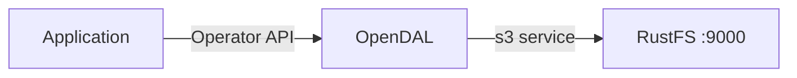

In dieser Anleitung verbinden Sie [Apache OpenDAL](https://github.com/apache/opendal) — die einheitliche Datenzugriffsschicht — über den Dienst `s3` mit **RustFS**. Sie betreiben das Python-Binding von OpenDAL gegen RustFS, schreiben und lesen ein Objekt, listen ein Präfix auf und löschen es. Der Ablauf wurde mit dem Python-Paket `opendal` 0.46 auf `python:3.12-slim` und `rustfs/rustfs-x86-musl:v2.3.1` verifiziert.

Sie benötigen Docker und Python 3.9 oder neuer. OpenDAL unterstützt denselben Dienst `s3` aus den Bindings für Rust, Java, Node.js und Go mit gleichwertigen Einstellungen.

## Architektur



Ein OpenDAL-`Operator`, der an den Dienst `s3` gebunden ist, stellt eine einheitliche API bereit — `write`, `read`, `stat`, `list`, `delete` — über den Bucket. Derselbe Code läuft gegen S3, RustFS oder jeden anderen unterstützten Dienst, wenn Sie die Verbindungseinstellungen ändern.

## 1. Das Projekt einrichten

Installieren Sie das Python-Binding:

```bash
pip install opendal
```

Legen Sie das Skript an und ersetzen Sie alle Verbindungsplatzhalter:

```python title="opendal_demo.py"
import opendal

op = opendal.Operator(
    "s3",
    endpoint="http://<your-rustfs-endpoint>:9000",
    bucket="my-bucket",
    access_key_id="<your-access-key>",
    secret_access_key="<your-secret-key>",
    region="us-east-1",
)
op.write("opendal-demo/hello.txt", b"hello from opendal against rustfs")
print("read-back:", op.read("opendal-demo/hello.txt"))
print("content_length:", op.stat("opendal-demo/hello.txt").content_length)
for entry in op.list("opendal-demo/"):
    print("listed:", entry.path)
op.delete("opendal-demo/hello.txt")
print("deleted:", not op.exists("opendal-demo/hello.txt"))
```

Die Namen der Zugangsdatenoptionen sind `access_key_id` und `secret_access_key`. Die kürzeren Namen `access_key` existieren nicht und schlagen mit einem Signaturfehler fehl. Pfadbasierte Adressierung (Path-Style) ist der Standard für Endpunkte außerhalb von AWS.

## 2. Die Demo ausführen

Führen Sie das Skript von einem Rechner aus, der RustFS erreichen kann:

```bash
python opendal_demo.py
```

```text
read-back: b"hello from opendal against rustfs"
content_length: 33
listed: opendal-demo/hello.txt
deleted: True
```

Der Rundlauf übt den vollständigen Objektlebenszyklus: `write` lädt die Bytes hoch, `read` holt sie zurück, `stat` liefert die Objektgröße, `list` zählt das Präfix auf und `delete` entfernt das Objekt.

## 3. Objekte in RustFS prüfen

Kommentieren Sie die letzte Zeile `op.delete` aus, führen Sie das Skript erneut aus und listen Sie das Präfix in RustFS auf:

```bash
rc ls rustfs/my-bucket/opendal-demo/ -r
```

```text
hello.txt
data/rows.csv
```


Die in der RustFS-Console sichtbaren Objekte sind genau die Pfade, die die OpenDAL-API geschrieben hat.

## 4. Stoppen oder zurücksetzen

OpenDAL ist eine Bibliothek und hält keinen eigenen Zustand. So räumen Sie die Demo-Objekte auf:

```bash
rc rm rustfs/my-bucket/opendal-demo/ --recursive --force
```

## Fehlerbehebung

### `failed to load signing credential`

Der Operator hat keine verwendbaren Zugangsdaten erhalten. Verwenden Sie die exakten Optionsnamen `access_key_id` und `secret_access_key`. Andere Schreibweisen werden stillschweigend ignoriert, und die Signierung schlägt dann fehl.

### Verbindungs- oder DNS-Fehler beim Schreiben

Prüfen Sie, dass der Endpunkt Schema und Port enthält und von der Anwendung aus erreichbar ist. Innerhalb eines Compose-Netzwerks lautet der Hostname `rustfs`. Vom Host aus verwenden Sie `http://localhost:9000`.

## Nächste Schritte

- Lesen Sie die [S3-Kompatibilitätshinweise](/de/administration/protocols/s3), bevor Sie weitere OpenDAL-Operationen einsetzen.
- Erstellen Sie dedizierte Produktions-Zugangsdaten über die [Zugriffsschlüssel-Verwaltung](/de/security-compliance/iam/access-token).
- Folgen Sie der [OpenDAL-Dokumentation](https://opendal.apache.org/docs/), um denselben Operator aus Rust, Java oder Node.js zu verwenden.
