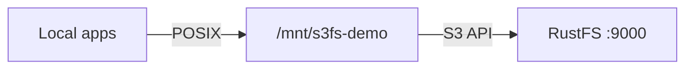

In dieser Anleitung verbinden Sie [s3fs-fuse](https://github.com/s3fs-fuse/s3fs-fuse) — das FUSE-basierte S3-Dateisystem — mit **RustFS**. Sie hängen einen Bucket als lokales Verzeichnis ein, schreiben Dateien über den Mount, hängen ihn aus und bestätigen, dass die Objekte im Bucket erhalten bleiben. Der Ablauf wurde mit s3fs v1.93 gegen `rustfs/rustfs-x86-musl:v2.3.1` auf Ubuntu 24.04 verifiziert.

Sie benötigen einen Linux-Host mit FUSE (Paket `fuse3`) und der Binärdatei `s3fs`.

## Architektur



Jede Datei, die unter dem Mount-Punkt entsteht, wird zu einem Objekt im Bucket, dessen Objektschlüssel der relative Pfad ist. Das ist eine einfache 1:1-Abbildung ohne Cache-Schicht.

## 1. Installieren

```bash
apt-get install -y s3fs
s3fs --version
```

```text
Amazon Simple Storage Service File System V1.93 ...
```

## 2. Die Zugangsdaten speichern

Schreiben Sie Zugriffsschlüssel und geheimen Zugriffsschlüssel in die Passwortdatei, die s3fs erwartet:

```bash
echo "<your-access-key>:<your-secret-key>" > ~/.passwd-s3fs
chmod 600 ~/.passwd-s3fs
```

## 3. Den Bucket einhängen

```bash
mkdir -p /mnt/s3fs-demo
s3fs s3fs-demo /mnt/s3fs-demo \
  -o passwd_file=~/.passwd-s3fs \
  -o url=http://<your-rustfs-endpoint>:9000 \
  -o endpoint=us-east-1 \
  -o use_path_request_style \
  -o allow_other -o umask=000
```

`use_path_request_style` wählt pfadbasierte Adressierung (Path-Style), die RustFS bereitstellt. `allow_other` erlaubt Benutzern ohne Root-Rechte, den Mount zu lesen.

## 4. Dateien schreiben und lesen

```bash
echo "hello from s3fs" > /mnt/s3fs-demo/s3fs-test.txt
dd if=/dev/urandom of=/mnt/s3fs-demo/blob.bin bs=1M count=5
cat /mnt/s3fs-demo/s3fs-test.txt
```

```text
hello from s3fs
```

## 5. Objekte und Persistenz prüfen

Hängen Sie aus und wieder ein. Die Objekte bleiben im Bucket:

```bash
fusermount -u /mnt/s3fs-demo
s3fs s3fs-demo /mnt/s3fs-demo -o passwd_file=~/.passwd-s3fs \
  -o url=http://<your-rustfs-endpoint>:9000 -o endpoint=us-east-1 \
  -o use_path_request_style
ls /mnt/s3fs-demo/
```

```text
blob.bin  s3fs-test.txt
```

Listen Sie den Bucket auf, um dieselben Objekte von der S3-Seite zu sehen:

```bash
rc ls rustfs/s3fs-demo/
```

```text
[2026-10-06 12:09:27]      5 MiB blob.bin
[2026-10-06 12:09:26]       16 B s3fs-test.txt
```


## 6. Stoppen oder zurücksetzen

```bash
fusermount -u /mnt/s3fs-demo
rc rm rustfs/s3fs-demo/ --recursive --force
```

## Fehlerbehebung

### `fuse: device not found` innerhalb eines Containers

Übergeben Sie `--device /dev/fuse --cap-add SYS_ADMIN` an `docker run`, oder `--privileged`, wenn der Mount-Helfer weiterhin scheitert.

### `Permission denied` beim Lesen des Mounts als anderer Benutzer

s3fs-Mounts gehören standardmäßig nur dem Benutzer, der sie eingehängt hat. Fügen Sie beim Einhängen `-o allow_other -o umask=000` (oder eine engere umask) hinzu.

### Der Mount gelingt, die Auflistung ist auf einem anderen Client aber leer

s3fs hat keinen Metadaten-Cache, der über Mounts hinweg geteilt wird, Clients und List-Operationen sind aber letztendlich konsistent. Hängen Sie neu ein oder listen Sie nach einigen Sekunden erneut auf.

## Nächste Schritte

- Lesen Sie die [S3-Kompatibilitätshinweise](/de/administration/protocols/s3), bevor Sie weitere FUSE-Optionen einsetzen.
- Erstellen Sie dedizierte Produktions-Zugangsdaten über die [Zugriffsschlüssel-Verwaltung](/de/security-compliance/iam/access-token).
- Folgen Sie der [s3fs-fuse-Dokumentation](https://github.com/s3fs-fuse/s3fs-fuse/wiki/Fuse-Over-https) für Leistungsoptionen wie `-o multipart` und `-o parallel_count`.
