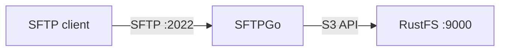

In dieser Anleitung verbinden Sie [SFTPGo](https://github.com/drakkan/sftpgo) — den SFTP-/WebDAV-/FTP-Server — mit **RustFS** als S3-Backend je Benutzer. Sie legen einen SFTP-Benutzer an, dessen Home-Verzeichnis ein Präfix eines RustFS-Buckets ist, laden Dateien über SFTP hoch und prüfen die Objekte im Bucket. Der Ablauf wurde mit SFTPGo 2.7.6 gegen `rustfs/rustfs-x86-musl:v2.3.1` verifiziert.

Sie benötigen Docker und einen SFTP-Client (`sftp` gehört zu OpenSSH).

## Architektur



SFTPGo bildet die virtuellen Pfade des Benutzers auf Bucket-Präfixe ab. Über SFTP hochgeladene Dateien werden zu Objekten unter dem konfigurierten `key_prefix`. Auf dem SFTPGo-Host selbst wird nichts gespeichert.

## 1. SFTPGo starten

```bash
docker run -d --name sftpgo --hostname sftpgo --network oo-rustfs_default \
  -p 2022:2022 -p 8080:8080 \
  -e SFTPGO_COMMON__TEMP_PATH=/tmp \
  drakkan/sftpgo:latest
```

`SFTPGO_COMMON__TEMP_PATH` ist wichtig: bei S3-Backends streamt SFTPGo Uploads über eine lokale Pipe-Datei, und der Standard-Temporärpfad existiert möglicherweise nicht oder ist nicht beschreibbar.

## 2. Den Admin-Benutzer anlegen

Das Image legt den Admin nicht automatisch an. Öffnen Sie einmal `http://localhost:8080/web/admin/setup` und senden Sie das Formular ab, oder steuern Sie es mit curl:

```bash
FORM=$(curl -s -c /tmp/sg-cookie.txt http://localhost:8080/web/admin/setup)
FT=$(echo "$FORM" | grep -oE "name=\"_form_token\" value=\"[^\"]+\"" | sed "s/.*value=\"//;s/\"//")
curl -s -b /tmp/sg-cookie.txt -X POST http://localhost:8080/web/admin/setup \
  --data-urlencode "username=admin" \
  --data-urlencode "password=<admin-password>" \
  --data-urlencode "confirm_password=<admin-password>" \
  --data-urlencode "_form_token=$FT" \
  -o /dev/null -w "setup: %{http_code}\n"
```

```text
setup: 302
```

## 3. Einen Benutzer mit S3-Backend anlegen

Holen Sie ein API-Token und legen Sie den Benutzer an. Drei Angaben sind wichtig: `home_dir` muss ein vorhandenes beschreibbares Verzeichnis im Container sein (`/tmp` funktioniert), `force_path_style` muss für RustFS `true` sein, damit pfadbasierte Adressierung (Path-Style) verwendet wird, und `access_secret` ist ein KMS-Objekt. Übergeben Sie das Geheimnis in `{"status": "Plain", "payload": ...}`:

```json title="sftpgo-user.json"
{
  "username": "demo",
  "password": "<user-password>",
  "home_dir": "/tmp",
  "status": 1,
  "permissions": { "/": ["*"] },
  "filesystem": {
    "provider": 1,
    "s3config": {
      "bucket": "sftpgo-demo",
      "region": "us-east-1",
      "access_key": "<your-access-key>",
      "access_secret": { "status": "Plain", "payload": "<your-secret-key>" },
      "endpoint": "http://<your-rustfs-endpoint>:9000",
      "key_prefix": "home/demo/",
      "force_path_style": true
    }
  }
}
```

```bash
TOKEN=$(curl -s "http://localhost:8080/api/v2/token" -u "admin:<admin-password>" \
  | python3 -c "import json,sys; print(json.load(sys.stdin)['access_token'])")
curl -s -X POST http://localhost:8080/api/v2/users \
  -H "Authorization: Bearer $TOKEN" -H "Content-Type: application/json" \
  --data-binary @sftpgo-user.json -o /dev/null -w "create-user: %{http_code}\n"
```

```text
create-user: 201
```

## 4. Dateien über SFTP hochladen und lesen

```bash
printf "uploaded via sftpgo to rustfs\n" > /tmp/sftp-test.txt
printf "up1\n" > /tmp/sftp-batch.txt
echo "put /tmp/sftp-test.txt" >> /tmp/sftp-batch.txt
echo "ls" >> /tmp/sftp-batch.txt

sshpass -p <user-password> sftp \
  -o StrictHostKeyChecking=no -o UserKnownHostsFile=/dev/null -P 2022 \
  demo@localhost < /tmp/sftp-batch.txt
```

```text
sftp> put /tmp/sftp-test.txt
Uploading /tmp/sftp-test.txt to /sftp-test.txt
sftp> ls
sftp-big.bin    sftp-test.txt
```

## 5. Objekte in RustFS prüfen

```bash
rc ls rustfs/sftpgo-demo/home/demo/ -r
rc cat rustfs/sftpgo-demo/home/demo/sftp-test.txt
```

```text
[2026-10-06 12:28:02]      4 MiB home/demo/sftp-big.bin
[2026-10-06 12:28:02]       30 B home/demo/sftp-test.txt
uploaded via sftpgo to rustfs
```

Der Objektschlüssel ist der virtuelle Pfad des Benutzers unter `key_prefix`. Das ist eine einfache Abbildung.


## 6. Stoppen oder zurücksetzen

```bash
docker rm -f sftpgo
rc rm rustfs/sftpgo-demo/ --recursive --force
```

## Fehlerbehebung

### `create resource error` oder `InvalidAccessKeyId` beim Upload

Prüfen Sie drei Punkte der Reihe nach: `force_path_style` muss `true` sein (das AWS-SDK von SFTPGo verwendet standardmäßig Adressierung im Virtual-Hosted-Stil, die an IP-Endpunkten scheitert), `access_secret` muss die KMS-Objektform verwenden, und `home_dir` muss auf ein beschreibbares Verzeichnis zeigen (SFTPGo leitet S3-Uploads darüber).

### `unknown command init` oder die Admin-Anmeldung wird abgelehnt

Das Admin-Konto existiert erst, nachdem das Web-Setup-Formular einmal abgesendet wurde. Wiederholen Sie Schritt 2. Verwenden Sie kein altes Browser-Cookie-Archiv wieder.

### Die API antwortet mit `405 Method Not allowed` auf das Token

Der Token-Endpunkt akzeptiert nur `GET` mit Basic Auth: `GET /api/v2/token`.

## Nächste Schritte

- Lesen Sie die [S3-Kompatibilitätshinweise](/de/administration/protocols/s3), bevor Sie weitere SFTPGo-Backends einsetzen.
- Erstellen Sie dedizierte Produktions-Zugangsdaten über die [Zugriffsschlüssel-Verwaltung](/de/security-compliance/iam/access-token).
- Folgen Sie der [SFTPGo-Dokumentation](https://github.com/drakkan/sftpgo/blob/main/README.md), um WebDAV- und FTP-Listener, Kontingente je Benutzer und Zwei-Faktor-Authentifizierung auf demselben Bucket hinzuzufügen.
