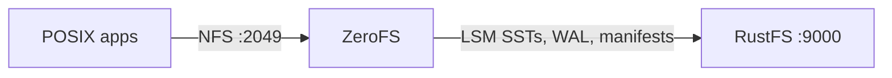

In dieser Anleitung verbinden Sie [ZeroFS](https://github.com/Barre/ZeroFS) — das log-strukturierte Dateisystem, das S3-Buckets als POSIX-Dateisysteme bereitstellt — mit **RustFS** als Objektspeicher-Backend. Sie betreiben ZeroFS mit seinem LSM-Baum, dessen Wurzel in einem RustFS-Bucket liegt, hängen das Dateisystem über NFS auf einem Linux-Host ein, schreiben Dateien über den Mount und prüfen, dass sie einen Neustart von ZeroFS als Objekte im Bucket überstehen. Der Ablauf wurde mit ZeroFS v2.3.5 (ghcr.io/barre/zerofs) gegen `rustfs/rustfs-x86-musl:v2.3.1` verifiziert.

Sie benötigen Docker und einen Linux-Host mit NFS-Client (`nfs-common`). Diese Bereitstellung ist für lokale Integrationstests gedacht, nicht für den Produktivbetrieb.

## Architektur



ZeroFS übersetzt Dateisystemoperationen in einen LSM-Schlüssel-Wert-Baum, der im Bucket liegt: Schreibvorgänge landen in einem Write-Ahead-Log, werden in SST-Segmente geleert, und die Compaction läuft im Hintergrund. Clients sehen einen gewöhnlichen Verzeichnisbaum über NFS (oder 9P/NBD).

## 1. Die Konfiguration erzeugen

Legen Sie den Bucket und die Konfigurationsdatei an und ersetzen Sie alle Verbindungsplatzhalter:

```bash
rc mb rustfs/zerofs-demo

docker run --rm -u root:root -v /opt/zerofs:/cfg -w /cfg \
  --entrypoint /bin/sh ghcr.io/barre/zerofs:latest -c "zerofs init"
```

Bearbeiten Sie danach `zerofs.toml`, sodass die Abschnitte für Speicher und AWS auf RustFS zeigen:

```toml title="zerofs.toml"
[cache]
dir = "/cache"
disk_size_gb = 5.0

[storage]
url = "s3://zerofs-demo/zerofs-data"
encryption_password = "${ZEROFS_PASSWORD}"

[servers.nfs]
addresses = ["0.0.0.0:2049"]

[servers.rpc]
addresses = ["0.0.0.0:7000"]

[aws]
access_key_id = "${AWS_ACCESS_KEY_ID}"
secret_access_key = "${AWS_SECRET_ACCESS_KEY}"
endpoint = "http://<your-rustfs-endpoint>:9000"
default_region = "us-east-1"
allow_http = "true"
```

Das Paar `endpoint` und `allow_http` lenkt ZeroFS von AWS auf RustFS um. Eigene Endpunkte verwenden pfadbasierte Adressierung (Path-Style), daher ist keine weitere Option nötig.

## 2. ZeroFS starten

Starten Sie den Server mit der Konfigurationsdatei, den Zugangsdaten und einem beschreibbaren Cache-Verzeichnis (das Image läuft als UID 1001):

```bash
mkdir -p /opt/zerofs/cache && chown -R 1001:1001 /opt/zerofs/cache

docker run -d --name zerofs --network oo-rustfs_default -p 2049:2049 \
  -e ZEROFS_PASSWORD=<encryption-password> \
  -e AWS_ACCESS_KEY_ID=<your-access-key> \
  -e AWS_SECRET_ACCESS_KEY=<your-secret-key> \
  -v /opt/zerofs/zerofs.toml:/zerofs.toml:ro \
  -v /opt/zerofs/cache:/cache \
  ghcr.io/barre/zerofs:latest run -c /zerofs.toml
```

```text
INFO zerofs::nfs: NFS server listening on 0.0.0.0:2049
```

## 3. Über NFS einhängen

Hängen Sie den Export auf dem Host mit den Optionen ein, die ZeroFS empfiehlt:

```bash
apt-get install -y nfs-common
mkdir -p /mnt/zerofs

mount -t nfs -o async,nolock,rsize=1048576,wsize=1048576,tcp,port=2049,mountport=2049,hard \
  127.0.0.1:/ /mnt/zerofs
```

Der Mount ist ein gewöhnliches POSIX-Dateisystem:

```bash
echo "written via zerofs nfs mount on rustfs" > /mnt/zerofs/hello.txt
dd if=/dev/urandom of=/mnt/zerofs/data/inner/blob.bin bs=1M count=8
```

## 4. Persistenz und Objekte in RustFS prüfen

Schreiben Sie ausstehende Schreibvorgänge in den Bucket, starten Sie ZeroFS neu und hängen Sie erneut ein:

```bash
docker exec zerofs zerofs flush -c /zerofs.toml
umount /mnt/zerofs
docker restart zerofs
mount -t nfs -o async,nolock,rsize=1048576,wsize=1048576,tcp,port=2049,mountport=2049,hard \
  127.0.0.1:/ /mnt/zerofs
```

Alles, was vor dem Neustart geschrieben wurde, ist noch da:

```bash
cat /mnt/zerofs/hello.txt
sha1sum /mnt/zerofs/data/inner/blob.bin
```

```text
written via zerofs nfs mount on rustfs
645faaefe499f9ebda8edceeeb1a6261999aece7  /mnt/zerofs/data/inner/blob.bin
```

Listen Sie den Bucket auf, um zu sehen, wo die Dateien tatsächlich liegen:

```bash
rc ls rustfs/zerofs-demo/ -r | head -4
```

```text
zerofs-data/compacted/01M40Q1RA0X3AVG76VC0SBYE58.sst
zerofs-data/manifest/0000000000000000.json
zerofs-data/wal/00000000000000000001.sst
```

Dateien werden nicht 1:1 gespeichert. Sie sind Schlüssel und Werte im LSM-Baum, und genau das erlaubt ZeroFS, einen Bucket als Dateisystem bereitzustellen.


## 5. Stoppen oder zurücksetzen

Um die Demo abzubauen und die Bucket-Objekte zu behalten:

```bash
umount /mnt/zerofs
docker rm -f zerofs
```

Um die gespeicherten Daten zu löschen (damit löschen Sie das Dateisystem selbst):

```bash
rc rm rustfs/zerofs-demo/ --recursive --force
```

## Fehlerbehebung

### `Failed to parse config file: missing field uid` bei `[servers.webui]`

ZeroFS v2.3.5 verlangt `uid` und `gid` im Abschnitt `[servers.webui]`, wenn er vorhanden ist. Fügen Sie entweder `uid = 1000` und `gid = 1000` hinzu oder löschen Sie den Abschnitt, wenn Sie die Weboberfläche nicht brauchen.

### `Permission denied` beim Anlegen des Cache-Verzeichnisses

Der Container läuft als UID 1001. Führen Sie nach dem Einhängen des Cache-Volumes `chown -R 1001:1001 <cache-dir>` aus, bevor Sie den Container starten.

### Der Mount scheitert oder hängt

Prüfen Sie, dass das NFS-Client-Paket installiert ist (`nfs-common`) und dass ZeroFS auf `0.0.0.0:2049` in einem Netzwerk lauscht, das Ihr Client erreichen kann. Die Optionen `port=2049,mountport=2049` sind wichtig, weil ZeroFS den mountd-Verkehr auf demselben Port bereitstellt.

### Schreibvorgänge verschwinden nach einem Container-Absturz

ZeroFS puffert Schreibvorgänge und leert sie periodisch. Führen Sie für die Demo `docker exec zerofs zerofs flush -c /zerofs.toml` aus. In der Produktion sollten Clients, die strenge Dauerhaftigkeit brauchen, fsync verwenden (oder den 9P-Mount, dessen fsync auf stabilen Speicher wartet).

## Nächste Schritte

- Lesen Sie die [S3-Kompatibilitätshinweise](/de/administration/protocols/s3), bevor Sie weitere ZeroFS-Backends einsetzen.
- Erstellen Sie dedizierte Produktions-Zugangsdaten über die [Zugriffsschlüssel-Verwaltung](/de/security-compliance/iam/access-token).
- Folgen Sie dem [ZeroFS-Konfigurationsleitfaden](https://www.zerofs.net/configuration) für Cache-Größe, 9P-/NBD-Bereitstellung und Hochverfügbarkeits-Replikation über denselben Bucket.
