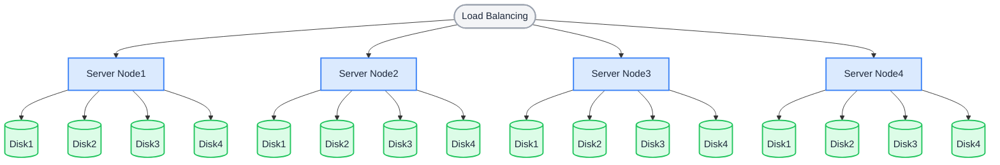

Der Modus mit mehreren Knoten und mehreren Datenträgern (MNMD) ist die Produktionsbereitstellung für Cluster, die sich über mehrere Server erstrecken. Mindestens **4 Server** mit jeweils mindestens einem Datenträger sind erforderlich, um einen verteilten Objektspeicher-Cluster sicher zu starten.

## Topologie und Planung

In der folgenden Architektur werden Anfragen über Lastverteilung auf die Server verteilt. Beim standardmäßigen Layout 12 + 4 für Erasure Coding wird jedes Objekt in 12 Datenshards und 4 Paritätsshards aufgeteilt, die auf verschiedenen Datenträgern verschiedener Server gespeichert werden:

- Der Cluster bleibt verfügbar und verliert keine Daten, wenn ein einzelner Server ausfällt oder zur Wartung heruntergefahren wird.
- Der Cluster toleriert den Verlust von bis zu 4 Datenträgern ohne Datenverlust.



Prüfen Sie vor der Installation die [Checklisten vor der Installation](../requirement/checklists/index.md) und stellen Sie sicher, dass jeder Punkt die Produktionsanforderungen erfüllt.

## Hostnamen

Ein RustFS-Cluster erfordert Hostnamen nach einem einheitlichen, fortlaufend nummerierten Muster (zum Beispiel `node1` bis `node4`). Fortlaufende Hostnamen richten Sie auf zwei Wegen ein:

**1. DNS-Konfiguration:**

Legen Sie DNS-Einträge an, sodass jeder fortlaufende Hostname auf den richtigen Knoten auflöst.

**2. Konfiguration von `/etc/hosts`:**

Tragen Sie auf jedem Knoten die folgenden Einträge in `/etc/hosts` ein:

```text title="/etc/hosts"
127.0.0.1 localhost localhost.localdomain localhost4 localhost4.localdomain4
::1 localhost localhost.localdomain localhost6 localhost6.localdomain6
192.168.1.1 node1
192.168.1.2 node2
192.168.1.3 node3
192.168.1.4 node4
```

## Voraussetzungen und Diensteinrichtung

Schließen Sie auf **jedem Knoten** die [gemeinsamen Voraussetzungen und die Diensteinrichtung](./prerequisites-and-service.md) ab — Betriebssystem, Firewall, Zeitsynchronisation, Formatierung der Datenträger, Dienstbenutzer, Herunterladen der Binärdatei und systemd-Unit — und fahren Sie anschließend unten fort. Alle Knoten müssen auf demselben Port lauschen und synchronisierte Uhren haben.

## Umgebungsvariablen konfigurieren

1. Legen Sie auf jedem Knoten dieselbe Konfigurationsdatei an. `RUSTFS_VOLUMES` zählt mit einer Brace-Expansion (geschweifte Klammern) alle Knoten und alle Einhängepunkte auf (in diesem Beispiel 4 Knoten × 4 Datenträger):

```ini title="/etc/default/rustfs"
# Use a unique access key and a strong, random secret (e.g. openssl rand -base64 24)
RUSTFS_ACCESS_KEY=<your-access-key>
RUSTFS_SECRET_KEY=<your-secret-key>
RUSTFS_VOLUMES="http://node{1...4}:9000/data/rustfs{0...3}"
RUSTFS_ADDRESS=":9000"
RUSTFS_CONSOLE_ENABLE=true
RUSTFS_CONSOLE_ADDRESS=":9001"
RUSTFS_OBS_LOGGER_LEVEL=error
RUSTFS_OBS_LOG_DIRECTORY="/var/log/rustfs/"
```

:::note

Zugriffsschlüssel, geheimer Zugriffsschlüssel und der Wert von `RUSTFS_VOLUMES` müssen auf allen Knoten identisch sein. Die Hostnamen (`node1` – `node4`) müssen zur DNS- oder `/etc/hosts`-Konfiguration oben passen.

:::

2. Legen Sie auf jedem Knoten die Verzeichnisse für Speicher und Logs an:

```bash
sudo mkdir -p /data/rustfs{0..3} /var/log/rustfs /opt/tls
sudo chmod -R 750 /data/rustfs* /var/log/rustfs
```

## Dienst starten und prüfen

1. Starten Sie den Dienst auf jedem Knoten und aktivieren Sie den automatischen Start beim Systemstart:

```bash
sudo systemctl enable --now rustfs
```

2. Prüfen Sie den Status des Dienstes:

```bash
systemctl status rustfs
```

3. Prüfen Sie den Port des Dienstes:

```bash
netstat -ntpl
```

4. Sehen Sie sich die Logdateien an:

```bash
tail -f /var/log/rustfs/rustfs*.log
```

5. Öffnen Sie die Console (Weboberfläche): Geben Sie im Browser die IP-Adresse eines beliebigen Knotens (oder die Adresse des Load Balancers) und den Console-Port (Standard 9001) ein. Sie sollten Folgendes sehen:


## Nächste Schritte

- Setzen Sie einen Load Balancer vor den Cluster — siehe die [Nginx-Integrationsanleitung](/de/developer/integration/reverse-proxy/nginx).
- Aktivieren Sie TLS für den Produktivverkehr — siehe [TLS-Konfiguration](../../integration/tls-configured.md).
- Lesen Sie die [Erweiterung des Speicherpools](../../operations/scaling/storage-pool-expansion.md), bevor Sie skalieren.
