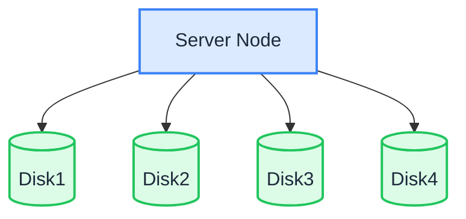

Im Modus mit einem einzelnen Knoten und mehreren Datenträgern (SNMD) verteilt ein Server die Daten auf mehrere Datenträger. Jedes Objekt wird in K Datenshards und M Paritätsshards aufgeteilt (Erasure Coding). Der Ausfall von bis zu M Datenträgern führt daher nicht zu Datenverlust.

:::warning

SNMD eignet sich für mittlere, nicht kritische Arbeitslasten. Die Bereitstellung kann bis zu M Datenträger verlieren, ohne dass Daten verloren gehen. Fällt jedoch der gesamte Server aus oder sind mehr als M Datenträger beschädigt, gehen die Daten verloren. Sichern Sie wichtige Daten. Für Fehlertoleranz auf Knotenebene verwenden Sie [MNMD](./multiple-node-multiple-disk.md).

:::

## Topologie und Planung



- 1 Server mit mehreren Datenträgern (dieses Beispiel verwendet 4 Datenträger, eingehängt unter `/data/rustfs0` bis `/data/rustfs3`).
- Erasure Coding verteilt Daten- und Paritätsshards auf die Datenträger. Die Fehlertoleranz beschränkt sich auf Datenträgerausfälle innerhalb des einzelnen Knotens.
- Formatieren Sie jeden Datenträger mit XFS und hängen Sie ihn getrennt ein (zum Beispiel mit den Labels `RUSTFS0` – `RUSTFS3`), wie auf der Seite zu den Voraussetzungen beschrieben.
- Prüfen Sie für Produktionsbereitstellungen zusätzlich die [Checklisten vor der Installation](../requirement/checklists/index.md).

## Voraussetzungen und Diensteinrichtung

Schließen Sie die [gemeinsamen Voraussetzungen und die Diensteinrichtung](./prerequisites-and-service.md) ab — Betriebssystem, Firewall, Zeitsynchronisation, Formatierung der Datenträger, Dienstbenutzer, Herunterladen der Binärdatei und systemd-Unit — und fahren Sie anschließend unten fort.

## Umgebungsvariablen konfigurieren

1. Legen Sie die Konfigurationsdatei an. `RUSTFS_VOLUMES` zählt die vier Einhängepunkte der Datenträger mit einer Brace-Expansion (geschweifte Klammern) auf:

```ini title="/etc/default/rustfs"
# Use a unique access key and a strong, random secret (e.g. openssl rand -base64 24)
RUSTFS_ACCESS_KEY=<your-access-key>
RUSTFS_SECRET_KEY=<your-secret-key>
RUSTFS_VOLUMES="/data/rustfs{0...3}"
RUSTFS_ADDRESS=":9000"
RUSTFS_CONSOLE_ENABLE=true
RUSTFS_CONSOLE_ADDRESS=":9001"
RUSTFS_OBS_LOGGER_LEVEL=error
RUSTFS_OBS_LOG_DIRECTORY="/var/log/rustfs/"
```

2. Legen Sie die Verzeichnisse für Speicher und Logs an:

```bash
sudo mkdir -p /data/rustfs{0..3} /var/log/rustfs /opt/tls
sudo chmod -R 750 /data/rustfs* /var/log/rustfs
```

## Dienst starten und prüfen

1. Starten Sie den Dienst und aktivieren Sie den Start beim Systemstart:

```bash
sudo systemctl enable --now rustfs
```

2. Prüfen Sie den Status des Dienstes:

```bash
systemctl status rustfs
```

3. Prüfen Sie den Port des Dienstes:

```bash
netstat -ntpl
```

4. Sehen Sie sich die Logdateien an:

```bash
tail -f /var/log/rustfs/rustfs*.log
```

5. Öffnen Sie die Console (Weboberfläche): Geben Sie im Browser die IP-Adresse des Servers und den Console-Port (Standard 9001) ein. Sie sollten Folgendes sehen:


## Nächste Schritte

- Benötigen Sie Fehlertoleranz auf Knotenebene und horizontale Skalierbarkeit? Siehe [Modus mit mehreren Knoten und mehreren Datenträgern (MNMD)](./multiple-node-multiple-disk.md).
- Sie probieren RustFS nur aus? [Der Modus mit einem einzelnen Knoten und einem Datenträger (SNSD)](./single-node-single-disk.md) lässt sich einfacher einrichten.
