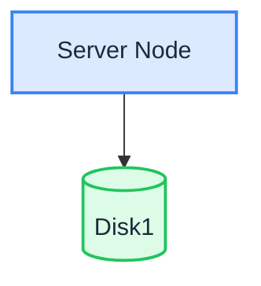

Im Modus mit einem einzelnen Knoten und einem Datenträger (SNSD) speichert ein Server alle Daten auf einem Datenträger. Das ist der einfachste Bereitstellungsmodus und dieselbe Topologie, die das Skript im [Linux-Schnellstart](./quick-start.md) einrichtet.

:::warning

Ein einzelner Datenträger bietet keine Redundanz: Fällt er aus, gehen die Daten verloren. SNSD eignet sich für Entwicklung, Tests und kleine, nicht kritische Arbeitslasten. Sichern Sie für den Produktionseinsatz die Daten regelmäßig oder wählen Sie [SNMD](./single-node-multiple-disk.md) / [MNMD](./multiple-node-multiple-disk.md).

:::

## Topologie und Planung



- 1 Server, 1 Datenträger (zum Beispiel ein mit XFS formatierter Datenträger, eingehängt unter `/data/rustfs0`).
- Kein Erasure Coding über mehrere Datenträger — die Fehlertoleranz hängt vollständig von Sicherungen ab.
- Prüfen Sie für Produktionsbereitstellungen zusätzlich die [Checklisten vor der Installation](../requirement/checklists/index.md).

## Voraussetzungen und Diensteinrichtung

Schließen Sie die [gemeinsamen Voraussetzungen und die Diensteinrichtung](./prerequisites-and-service.md) ab — Betriebssystem, Firewall, Zeitsynchronisation, Formatierung der Datenträger, Dienstbenutzer, Herunterladen der Binärdatei und systemd-Unit — und fahren Sie anschließend unten fort.

## Umgebungsvariablen konfigurieren

1. Legen Sie die Konfigurationsdatei an und tragen Sie den Pfad des einzelnen Datenträgers ein:

```ini title="/etc/default/rustfs"
# Use a unique access key and a strong, random secret (e.g. openssl rand -base64 24)
RUSTFS_ACCESS_KEY=<your-access-key>
RUSTFS_SECRET_KEY=<your-secret-key>
RUSTFS_VOLUMES="/data/rustfs0"
RUSTFS_ADDRESS=":9000"
RUSTFS_CONSOLE_ENABLE=true
RUSTFS_CONSOLE_ADDRESS=":9001"
RUSTFS_OBS_LOGGER_LEVEL=error
RUSTFS_OBS_LOG_DIRECTORY="/var/log/rustfs/"
```

2. Legen Sie die Verzeichnisse für Speicher und Logs an:

```bash
sudo mkdir -p /data/rustfs0 /var/log/rustfs /opt/tls
sudo chmod -R 750 /data/rustfs* /var/log/rustfs
```

## Dienst starten und prüfen

1. Starten Sie den Dienst und aktivieren Sie den Start beim Systemstart:

```bash
sudo systemctl enable --now rustfs
```

2. Prüfen Sie den Status des Dienstes:

```bash
systemctl status rustfs
```

3. Prüfen Sie den Port des Dienstes:

```bash
netstat -ntpl
```

4. Sehen Sie sich die Logdateien an:

```bash
tail -f /var/log/rustfs/rustfs*.log
```

5. Öffnen Sie die Console (Weboberfläche): Rufen Sie im Browser `http://<server-ip>:9001` auf. Sie sollten Folgendes sehen:


## Nächste Schritte

- Benötigen Sie Redundanz auf Datenträgerebene auf einem Server? Siehe [Modus mit einem einzelnen Knoten und mehreren Datenträgern (SNMD)](./single-node-multiple-disk.md).
- Benötigen Sie einen Produktionscluster? Siehe [Modus mit mehreren Knoten und mehreren Datenträgern (MNMD)](./multiple-node-multiple-disk.md).
