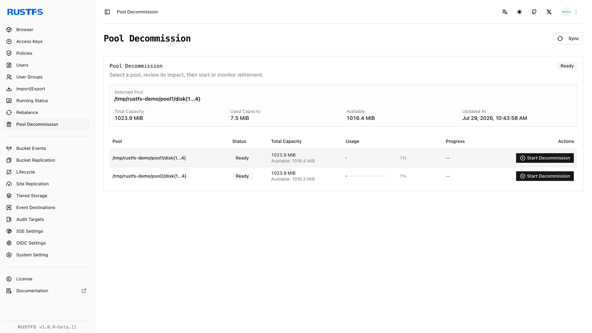
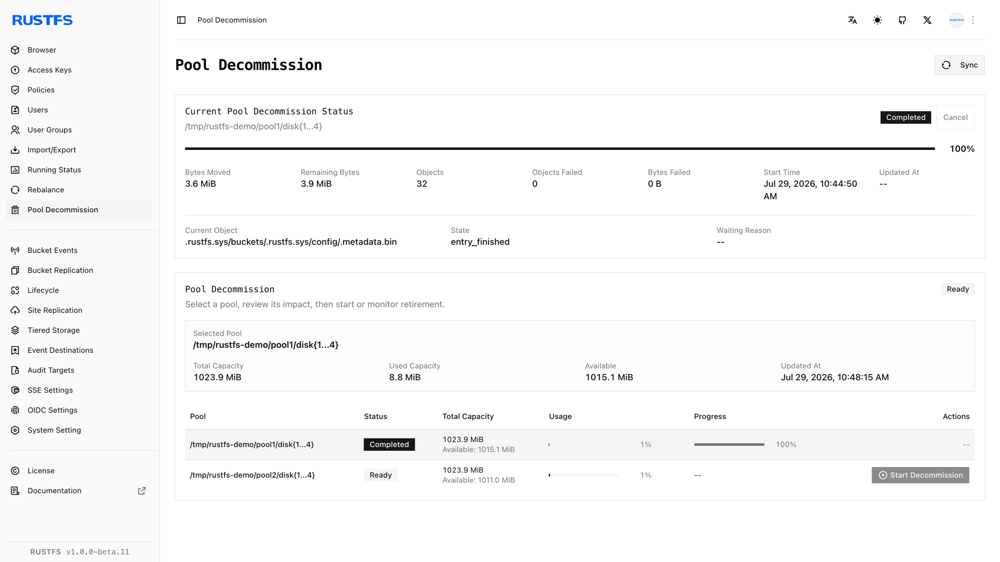
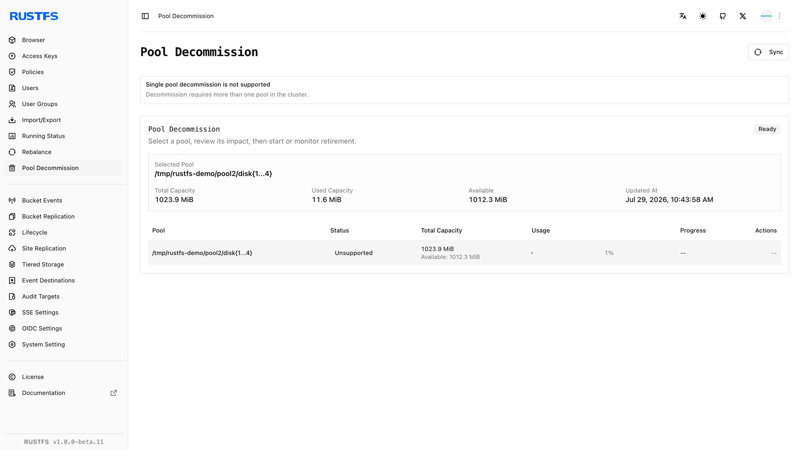

## Überblick

### Voraussetzungen

- Installieren Sie [`rc`](/de/operations/rc) auf dem Administrationshost, bevor Sie den `rc`-Ablauf in dieser Anleitung verwenden.
- Konfigurieren Sie Zugangsdaten mit der Berechtigung zur Verwaltung der Außerbetriebnahme.

Die **Speicherpool-Außerbetriebnahme** verschiebt Objekte aus einem ausgewählten Speicherpool in die verbleibenden aktiven Speicherpools, damit der Zielpool aus der Bereitstellung entfernt werden kann. Nutzen Sie sie, wenn Sie Hardware außer Betrieb nehmen, einen Speicherpool ersetzen oder Kapazität zusammenführen.

Die Außerbetriebnahme unterscheidet sich vom [Rebalancing](./data-rebalancing.md): Beim Rebalancing bleibt jeder Speicherpool aktiv, bei der Außerbetriebnahme wird der ausgewählte Speicherpool geleert und stillgelegt. Die beiden Vorgänge können nicht gleichzeitig laufen.

Vor dem Start:

- Es muss nach dem Vorgang mindestens ein aktiver Speicherpool bleiben.
- Prüfen Sie, dass die verbleibenden Speicherpools genug freie Kapazität haben. RustFS verlangt, dass ihr freier Speicher die abfließenden genutzten Bytes plus 30 % Aufschlag deckt.
- Bestätigen Sie, dass jeder Knoten und jedes Laufwerk betriebsbereit ist und kein Rebalancing läuft.
- Sichern Sie kritische Daten und planen Sie den Vorgang in eine Zeit mit geringerer Last.
- Notieren Sie die genaue Pool-ID und den Volume-Ausdruck, bevor Sie das Ziel auswählen.

Wenn Sie eine Außerbetriebnahme abbrechen, werden abgeschlossene Verschiebungen nicht zurückgerollt. Bereits verlagerte Objekte bleiben in den Zielpools.

## Ablauf

### Außerbetriebnahme in der Console starten

1. Melden Sie sich an der RustFS Console (Weboberfläche) mit einem Konto an, das die Berechtigung zur Verwaltung der Außerbetriebnahme hat.
2. Öffnen Sie **Pool Decommission** (Speicherpool-Außerbetriebnahme).
3. Suchen Sie den stillzulegenden Speicherpool und prüfen Sie ID, Volume-Ausdruck, genutzte Kapazität und Status.

   

4. Wählen Sie **Start Decommission** (Außerbetriebnahme starten) für diesen Speicherpool.
5. Prüfen Sie den Bestätigungsdialog sorgfältig und wählen Sie dann erneut **Start Decommission**.

   

6. Nutzen Sie **Sync** (Synchronisieren), um den Poolzustand und die Verschiebezähler zu aktualisieren, bis der Vorgang abgeschlossen ist.

   

Entfernen Sie nach dem Abschluss den Ausdruck des geleerten Speicherpools auf jedem verbleibenden Knoten aus `RUSTFS_VOLUMES` und starten Sie RustFS mit derselben geordneten Topologie neu. Nehmen Sie den Speicherpool bei Helm außer Betrieb, bevor Sie seinen Eintrag aus `pools.list` entfernen. Entfernen Sie einen aktiven Pool-Eintrag niemals und ändern Sie seine Reihenfolge nicht.



### Außerbetriebnahme mit rc starten

Konfigurieren Sie bei Bedarf den Cluster-Alias und listen Sie dann die Speicherpools auf:

```bash
rc alias set rustfs http://<server-ip>:9000 <your-access-key> <your-secret-key>
rc admin pool list rustfs
```

Starten Sie die Außerbetriebnahme von Pool `0` über seine nullbasierte ID:

```bash
rc admin decommission start rustfs 0 --by-id
```

Sie können stattdessen den genauen Volume-Ausdruck des Speicherpools ohne `--by-id` übergeben:

```bash
rc admin decommission start rustfs 'http://rustfs-node1:9000/data/rustfs{1...4}/mnmd'
```

Beobachten Sie alle Speicherpools oder nur den Zielpool:

```bash
rc admin decommission status rustfs
rc admin decommission status rustfs 0 --by-id
```

So brechen Sie einen laufenden Vorgang ab:

```bash
rc admin decommission cancel rustfs 0 --by-id
```

Wenn eine Außerbetriebnahme fehlgeschlagen ist oder abgebrochen wurde, löschen Sie ihre Metadaten, bevor Sie es erneut versuchen:

```bash
rc admin decommission clear rustfs 0 --by-id
```

Nachdem das Ziel `complete` meldet, entfernen Sie seinen Ausdruck auf jedem verbleibenden Knoten aus `RUSTFS_VOLUMES` und starten Sie RustFS mit der reduzierten Topologie neu.

## Überprüfung

### Außerbetriebnahme in der Console prüfen

Bestätigen Sie, dass der Zielpool `Completed` meldet, mit null fehlgeschlagenen Objekten und null fehlgeschlagenen Bytes. Prüfen Sie nach dem Entfernen des Speicherpools aus der Starttopologie und dem Neustart von RustFS Folgendes:



- Der stillgelegte Speicherpool erscheint nicht mehr als aktiver Speicherpool.
- Jeder verbleibende Knoten und jedes verbleibende Laufwerk ist online.
- Die verbleibenden Speicherpools zeigen die verlagerten Daten und haben ausreichend freie Kapazität.
- Vorhandene Objekte lassen sich weiterhin auflisten, lesen und herunterladen.

### Außerbetriebnahme mit rc prüfen

Führen Sie Folgendes aus, bevor Sie den Speicherpool aus der Topologie entfernen:

```bash
rc admin decommission status rustfs 0 --by-id
```

Bestätigen Sie, dass der Status `complete` ist und die Zähler für fehlgeschlagene Objekte und Bytes null sind. Führen Sie nach dem Aktualisieren von `RUSTFS_VOLUMES` und dem Neustart von RustFS Folgendes aus:

```bash
rc admin pool list rustfs
```

Prüfen Sie, dass nur die vorgesehenen aktiven Speicherpools übrig sind. Lesen Sie Objekte, die zuvor auf dem stillgelegten Speicherpool lagen, und schreiben Sie ein neues Testobjekt über den S3-Endpunkt.
