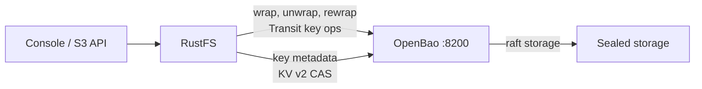
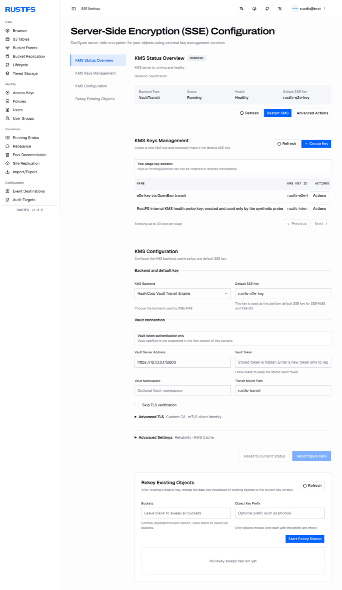

[OpenBao](https://github.com/openbao/openbao) ist der Open-Source-Fork von HashiCorp Vault. RustFS verwaltet SSE-KMS-Schlüssel über einen externen KMS mit seinem Vault-Transit-Backend, und OpenBao bietet dieselbe API-Oberfläche — daher ist keine RustFS-Codeänderung nötig; die Integration erfolgt rein über Konfiguration. Diese Anleitung deployt OpenBao, bereitet Secrets-Engines und ein minimal berechtigtes Token vor, konfiguriert RustFS und verifiziert SSE-KMS Ende-zu-Ende. Der Ablauf wurde mit RustFS `1.0.5` und OpenBao `2.7.2` verifiziert.

Sie benötigen Docker auf dem OpenBao-Host und einen RustFS-Server ab 1.0.5. Diese Anleitung ist eine Single-Node-Bereitstellung für Integrationstests; Produktionsumgebungen benötigen zusätzlich einen geclusterten OpenBao mit verwaltetem Unseal, siehe Hinweise am Ende.

## Architektur



RustFS erzeugt pro Objekt Datenchlüssel lokal und wrappt sie über die OpenBao-Transit-Engine; die Schlüssel-Lebenszyklus-Metadaten liegen in einem KV-v2-Mount mit CAS-Schreibvorgängen. OpenBao hält die Hauptschlüssel-Versionen — ist OpenBao nicht erreichbar, pausieren neue SSE-KMS-Schreibvorgänge und Lesezugriffe auf verschlüsselte Objekte, bis es wieder erreichbar und entiegelt ist.

## 1. OpenBao mit TLS und Raft-Speicher deployen

RustFS lehnt Klartext-HTTP zum KMS ab: Der Start schlägt mit `Vault Transit requires HTTPS outside explicit development mode` fehl. Richten Sie OpenBao von Anfang an mit TLS ein. Erstellen Sie die Verzeichnisstruktur und eine Konfiguration mit integriertem Raft-Speicher:

```bash
mkdir -p /data/openbao/{data,config,tls}
openssl req -x509 -newkey rsa:4096 -sha256 -days 825 -nodes \
  -keyout /data/openbao/tls/ca-key.pem -out /data/openbao/tls/ca.pem \
  -subj "/CN=openbao-demo-ca"
openssl req -newkey rsa:2048 -nodes -keyout /data/openbao/tls/server-key.pem \
  -out /data/openbao/tls/server.csr -subj "/CN=openbao-host"
openssl x509 -req -in /data/openbao/tls/server.csr \
  -CA /data/openbao/tls/ca.pem -CAkey /data/openbao/tls/ca-key.pem \
  -CAcreateserial -out /data/openbao/tls/server-cert.pem -days 825 -sha256 \
  -extfile <(printf "subjectAltName=IP:127.0.0.1,DNS:localhost,DNS:openbao-host")
```

```hcl title="/data/openbao/config/config.hcl"
storage "raft" {
  path    = "/openbao/data"
  node_id = "openbao-1"
}
listener "tcp" {
  address         = "0.0.0.0:8200"
  cluster_address = "0.0.0.0:8201"
  tls_disable     = 0
  tls_cert_file   = "/openbao/tls/server-cert.pem"
  tls_key_file    = "/openbao/tls/server-key.pem"
}
api_addr      = "https://127.0.0.1:8200"
cluster_addr  = "https://127.0.0.1:8201"
disable_mlock = true
ui            = false
```

Starten Sie den Container mit eingebundenen Data-, Config- und TLS-Verzeichnissen. Die Bind-Mounts müssen für den Container-Prozess schreibbar sein:

```bash
chmod -R a+rX /data/openbao/tls
chmod 777 /data/openbao/data
docker run -d --name openbao --restart unless-stopped \
  -p 127.0.0.1:8200:8200 \
  -v /data/openbao/data:/openbao/data \
  -v /data/openbao/config:/openbao/config \
  -v /data/openbao/tls:/openbao/tls \
  openbao/openbao:2.7.2 server
```

Initialisieren Sie mit einem einzelnen Schlüsselanteil und entiegeln Sie. Bewahren Sie Unseal-Schlüssel und Root-Token sicher auf — sie werden nur einmal angezeigt:

```bash
docker exec -e BAO_ADDR=https://127.0.0.1:8200 -e BAO_CACERT=/openbao/tls/ca.pem \
  openbao bao operator init -key-shares=1 -key-threshold=1 -format=json
```

Nach jedem Container-Neustart erneut entiegeln:

```bash
docker exec -e BAO_ADDR=https://127.0.0.1:8200 -e BAO_CACERT=/openbao/tls/ca.pem \
  openbao bao operator unseal <unseal-key>
```

## 2. Secrets-Engines aktivieren und ein minimal berechtigtes Token erstellen

RustFS benötigt zwei Engines: Transit für Schlüsseloperationen und KV v2 für die von ihm gepflegten Schlüssel-Metadaten. Legen Sie dedizierte Mounts an:

```bash
docker exec -e BAO_ADDR=https://127.0.0.1:8200 -e BAO_CACERT=/openbao/tls/ca.pem \
  -e BAO_TOKEN=<root-token> openbao \
  bao secrets enable -path=rustfs-transit transit
docker exec -e BAO_ADDR=https://127.0.0.1:8200 -e BAO_CACERT=/openbao/tls/ca.pem \
  -e BAO_TOKEN=<root-token> openbao \
  bao secrets enable -path=rustfs-meta -version=2 kv
```

Schreiben Sie eine Policy mit exakt den Rechten des RustFS-KMS-Clients — Transit-Schlüsselverwaltung inklusive LIST (der Startprobe), die Krypto-Operationen sowie die KV-v2-Daten- und Metadatenpfade für das konfigurierte Präfix:

```hcl title="rustfs-kms.hcl"
path "rustfs-transit/keys" {
  capabilities = ["list"]
}
path "rustfs-transit/keys/*" {
  capabilities = ["create", "read", "update", "delete", "list"]
}
path "rustfs-transit/encrypt/*" {
  capabilities = ["create", "update"]
}
path "rustfs-transit/decrypt/*" {
  capabilities = ["create", "update"]
}
path "rustfs-transit/rewrap/*" {
  capabilities = ["create", "update"]
}
path "rustfs-transit/keys/*/rotate" {
  capabilities = ["update"]
}
path "rustfs-transit/keys/*/config" {
  capabilities = ["read", "update"]
}
path "rustfs-meta/data/rustfs/kms/keys/*" {
  capabilities = ["create", "update", "read"]
}
path "rustfs-meta/metadata/rustfs/kms/keys/*" {
  capabilities = ["read", "list", "delete"]
}
```

Laden Sie die Policy und stellen Sie ein Orphan-Token aus:

```bash
docker cp rustfs-kms.hcl openbao:/tmp/rustfs-kms.hcl
docker exec -e BAO_ADDR=https://127.0.0.1:8200 -e BAO_CACERT=/openbao/tls/ca.pem \
  -e BAO_TOKEN=<root-token> openbao \
  bao policy write rustfs-kms /tmp/rustfs-kms.hcl
docker exec -e BAO_ADDR=https://127.0.0.1:8200 -e BAO_CACERT=/openbao/tls/ca.pem \
  -e BAO_TOKEN=<root-token> openbao \
  bao token create -policy=rustfs-kms -orphan -format=json
```

Legen Sie das Token auf dem RustFS-Host ab. Die Datei muss nur für den Eigentümer lesbar sein und dem `rustfs`-Dienstkonto gehören — RustFS lehnt Gruppen- und andere-Bits ab:

```bash
install -d -m 0755 -o rustfs -g rustfs /data/rustfs/kms
install -m 0600 -o rustfs -g rustfs /dev/null /data/rustfs/kms/openbao-token
# write the token into /data/rustfs/kms/openbao-token
cp /data/openbao/tls/ca.pem /data/rustfs/kms/openbao-ca.pem
```

## 3. RustFS konfigurieren

Ergänzen Sie die KMS-Einstellungen in der RustFS-Umgebungsdatei und starten Sie neu:

```ini title="/etc/default/rustfs"
RUSTFS_KMS_ENABLE=true
RUSTFS_KMS_BACKEND=vault-transit
RUSTFS_KMS_VAULT_ADDRESS=https://127.0.0.1:8200
RUSTFS_KMS_VAULT_MOUNT_PATH=rustfs-transit
RUSTFS_KMS_VAULT_TOKEN_FILE=/data/rustfs/kms/openbao-token
RUSTFS_KMS_VAULT_TRANSIT_METADATA_KV_MOUNT=rustfs-meta
RUSTFS_KMS_VAULT_TRANSIT_METADATA_PREFIX=rustfs/kms/keys
RUSTFS_KMS_VAULT_CA_CERT=/data/rustfs/kms/openbao-ca.pem
```

```bash
sudo systemctl restart rustfs
```

Schlägt die Backend-Validierung fehl, verweigert RustFS den Start und benennt das genaue Problem im Log — siehe [Fehlerbehebung](#fehlerbehebung). Läuft es, prüfen Sie den KMS-Status in der Konsole unter **SSE-Einstellungen** oder über die Admin-API:

```bash
curl -s http://localhost:9000/rustfs/admin/v3/kms/service-status
```

Die Antwort meldet `"backend_type":"VaultTransit"` mit `"healthy":true`, die konfigurierte Adresse, den Mount-Pfad und ob ein eigenes CA-Zertifikat verwendet wird.

## 4. Schlüssel erstellen und als Standard wählen

Die Konsole stellt den vollen KMS-Lebenszyklus unter **SSE-Einstellungen** bereit: Statusübersicht, Schlüsselverwaltung (Erstellen, zweistufiges Löschen), Backend-Konfiguration und Re-Encrypt-Sweeps für bestehende Objekte.

Erstellen Sie einen Schlüssel unter **KMS-Schlüsselverwaltung** — RustFS erzeugt den passenden Transit-Schlüssel in OpenBao und seinen Metadatensatz im KV-v2-Mount gemeinsam. Setzen Sie dann den **Standard-SSE-Schlüssel** in der Konsole oder über die Umgebung:

```ini title="/etc/default/rustfs"
RUSTFS_KMS_DEFAULT_KEY_ID=rustfs-e2e-key
```

Starten Sie RustFS nach der Änderung neu. Ein direkt in OpenBao angelegter Schlüssel ohne Umweg über RustFS lässt den KV-v2-Metadatensatz fehlen — erstellen Sie Schlüssel von der RustFS-Seite.



## 5. SSE-KMS Ende-zu-Ende verifizieren

Setzen Sie den Bucket-Standard oder übergeben Sie den Schlüssel pro Schreibvorgang. Die Upload-Antwort spiegelt Algorithmus und Schlüssel-ID, und der Download liefert die ursprünglichen Bytes:

```bash
aws s3api put-object \
  --endpoint-url http://localhost:9000 \
  --bucket my-bucket --key docs/e2e-check.txt \
  --body ./e2e-check.txt \
  --server-side-encryption aws:kms \
  --ssekms-key-id rustfs-e2e-key
```

```json
{
    "ETag": "\"57a02aed...\"",
    "ServerSideEncryption": "aws:kms",
    "SSEKMSKeyId": "rustfs-e2e-key"
}
```

```bash
aws s3api get-object \
  --endpoint-url http://localhost:9000 \
  --bucket my-bucket --key docs/e2e-check.txt ./e2e-check-back.txt
```

## Verifizierungsergebnisse

Die folgenden Prüfungen wurden gegen eine Live-OpenBao-2.7.2-Bereitstellung ausgeführt und sind auf jedem gesunden Setup zu erwarten:

| Prüfung | Erwartetes Ergebnis |
| --- | --- |
| SSE-KMS PUT/GET mit der Schlüssel-ID | Antwort spiegelt `aws:kms` und die Schlüssel-ID; heruntergeladene Bytes stimmen |
| Range-GET auf einem verschlüsselten Objekt | Byte-Bereich wird korrekt geliefert |
| RustFS-Neustart | Schlüssel-Metadaten werden aus KV v2 wiederhergestellt; verschlüsselte Objekte bleiben lesbar |
| OpenBao-Neustart (sealed) | Verschlüsselte Lesezugriffe schlagen mit `ServiceUnavailable` fehl — kein Klartext-Fallback; nach dem Entiegeln erholt sich das Lesen automatisch im Probeintervall |
| Transit-Schlüsselrotation | `latest_version` steigt, ältere Versionen bleiben erhalten; vor der Rotation gewrappte Objekte bleiben lesbar |
| Ciphertext-Manipulation im Storage | Lesezugriffe schlagen fehl, Löschung wird verweigert; kein Klartext-Fallback |
| Falscher Verschlüsselungskontext | Transit-Entschlüsselung schlägt mit Nachrichtenauthentifizierungsfehler fehl |

Hinweis zum Speicherlayout: Kleine Objekte legen ihre verschlüsselten Bytes inline in der je Datenträger vorhandenen `xl.meta`-Datei ab — ein Grep nach Klartext im Objektverzeichnis bleibt daher leer, obwohl die Daten dort liegen.

## Fehlerbehebung

### Start schlägt fehl mit `Vault Transit requires HTTPS outside explicit development mode`

Die KMS-Adresse ist kein HTTPS. Konfigurieren Sie TLS auf OpenBao und vertrauen Sie seinem CA über `RUSTFS_KMS_VAULT_CA_CERT`. Der Ausweg `RUSTFS_KMS_ALLOW_INSECURE_DEV_DEFAULTS=true` ist nur für die Entwicklung gedacht.

### Start schlägt fehl mit `Vault token file ... has insecure permissions 0o644`

Die Token-Datei benötigt `0600` ohne Gruppen- und andere-Bits und gehört dem RustFS-Dienstkonto:

```bash
chown rustfs:rustfs /data/rustfs/kms/openbao-token
chmod 600 /data/rustfs/kms/openbao-token
```

### Lesezugriffe schlagen mit `ServiceUnavailable` fehl, während OpenBao verriegelt ist

Erwartetes Verhalten: verschlüsselte Lesezugriffe benötigen das externe KMS. Entiegeln Sie OpenBao; RustFS erholt sich automatisch bei seiner nächsten KMS-Probe — ohne RustFS-Neustart.

### OpenBao-Transit entschlüsselt mit falschem `context`-Parameter

Für nicht abgeleitete Schlüssel ignoriert Transit `context` und bindet den S3-Verschlüsselungskontext als `associated_data`. Ein falscher `associated_data` schlägt mit `cipher: message authentication failed` fehl. Beim manuellen Test über `bao` übergeben Sie `associated_data`, nicht `context`.

### Ein manipuliertes verschlüsseltes Objekt kann weder gelesen noch gelöscht werden

Beide Pfade schlagen by design fehl — auch die Löschung prüft die gespeicherten Metadaten. Entfernen Sie die Objektverzeichnisse auf jedem Datenträger bei gestopptem RustFS und starten Sie neu.

## Produktion

Die obige Single-Node-OpenBao-Bereitstellung entiegelt manuell und speichert lokal. Für die Produktion: OpenBao als Cluster mit integrierter Storage-Replikation oder einem Auto-Unseal-Mechanismus betreiben, Unseal-Zugangsdaten und Raft-Datenbackup unabhängig von RustFS-Backups schützen und die OpenBao-Version pinnen — den vaultrs-Client vor jedem OpenBao-Upgrade gegen die neue Version prüfen.

## Nächste Schritte

- Backend-Übersicht und Bucket-Standardverschlüsselung finden Sie unter [SSE-KMS](./kms.md).
- Lesen Sie vor weiteren SSE-Funktionen die [S3-Kompatibilitätshinweise](/administration/protocols/s3).
- Erstellen Sie dedizierte Produktionszugangsdaten mit [Zugangsdatenverwaltung](/security-compliance/iam/access-token).
