On-demand migration pulls objects from an external bucket into a RustFS bucket when a client reads a missing key, or when you start a backfill. **This document uses Cloudflare R2 as the example** end to end. The steps below follow a Console v1.0.3 walkthrough that attached an R2 bucket to an empty local bucket, tested the connection, and then ran three pulls: one object with `rc cp`, a prefix backfill, and a full-namespace backfill with a dry run.

RustFS reads the source. The enable form states that RustFS never writes or deletes objects there. The migration page states that RustFS pulls objects only when they are read or backfilled, that new `PUT` and `DELETE` operations in RustFS are not synchronized to the source, and that later source changes do not update local copies.

Screenshots in this walkthrough use placeholders for the R2 account id and access key. The terminal prompt host is `localhost`.

## Source providers

**Source connection** → **Provider** lists these sources. The names below are the Console labels. Google Cloud Storage is two entries, HMAC and Native.

1. Amazon S3
2. S3-compatible storage
3. MinIO
4. RustFS
5. Cloudflare R2
6. Google Cloud Storage (HMAC)
7. Azure Blob Storage (Native)
8. Google Cloud Storage (Native)

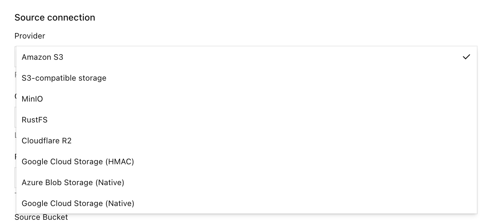

A migration from any other provider in that list uses the same flow: create an empty local bucket, enable on-demand migration, choose **Provider**, select **Test connection**, select **Enable migration**, then pull on a GET miss or with a backfill. Only the endpoint, credential, and bucket fields differ by provider. The R2 walkthrough below fills those fields for Cloudflare R2.

## On-demand migration and bucket replication

| Goal | Use |
| --- | --- |
| Pull objects into RustFS from a provider in the list above, on a read miss or by backfill | On-demand migration |
| Push object versions from a RustFS bucket to another bucket | [Bucket replication](./replication.md) |
| Synchronize site configuration and identity data across deployments | [Site replication](/operations/high-availability/site-replication) |

On-demand migration is an inbound pull. [Bucket replication](./replication.md) is an outbound copy of object versions and requires versioning on both buckets. After a key is stored locally, on-demand migration does not keep following the source.

:::warning[Do not close a replication loop]
Do not select a bucket that is already a replication target of this local bucket as the on-demand migration source.
:::

## Before you begin

The credential and endpoint here are for the Cloudflare R2 example. For another provider, enter that system's endpoint, read credential, and bucket name in the same Console fields.

- A RustFS Console that includes **On-demand migration**. This walkthrough used Console v1.0.3, on port `9001`.
- A Console account that can open the local bucket's **Settings**.
- The RustFS CLI, [`rc`](/operations/rc), on the host that will read the local bucket.
- A Cloudflare R2 API token that can read objects in the source bucket. Prefer a token scoped to that bucket. Public access on the R2 bucket is not part of this flow.
- The R2 S3 endpoint for the source bucket, `https://<account-id>.r2.cloudflarestorage.com`. If the bucket uses a jurisdiction, copy the endpoint from the R2 dashboard.

Point `rc` at the local RustFS S3 API, not at R2:

```bash
rc alias set rustfs http://localhost:9000 <your-access-key> <your-secret-key> --region us-east-1 --bucket-lookup path
```

The local bucket in this walkthrough is `migration`. The R2 bucket is `dl-rustfs`. Versioning was enabled on `migration`, and Object Lock was disabled. The walkthrough did not need Object Lock to enable on-demand migration, and it did not treat versioning as a requirement for enabling it. With versioning enabled, a local delete marker can hide the source key.

:::warning[Use a read-only source token]
Create an R2 token that can read the source bucket and cannot write or delete there. The form states that RustFS stores the secret and does not return it to the Console.
:::

:::note[Enabling the source does not copy data]
**Migration active** means the bucket is attached to the source. Runtime counters stay at zero until a client reads a missing key or you start a backfill.
:::

## 1. Create an empty local bucket

In the Console, open **Browser** → **Buckets**, create a bucket named `migration`, and confirm that it has no objects. Open **Settings** from that bucket when you are ready to attach the source.

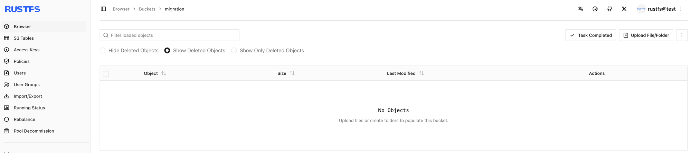

## 2. Open on-demand migration

1. Open bucket `migration` and select **Settings**.
2. Select **Automation**.
3. Find **On-demand migration**.
4. When it is not configured, select **Open migration settings** or **+ Enable on-demand migration**. When it is already active, select **Manage migration**.

The unconfigured page in this walkthrough says that no migration source is configured and offers **+ Enable on-demand migration**.

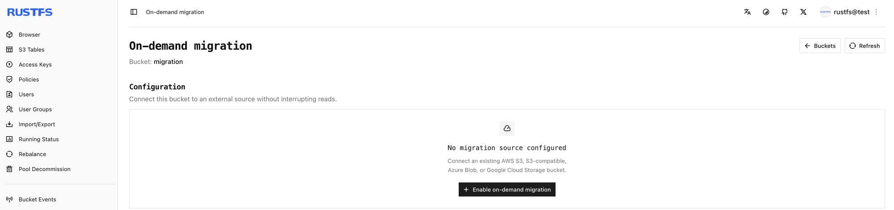

After the source is enabled, **Automation** shows **Migration active** and **Manage migration**.

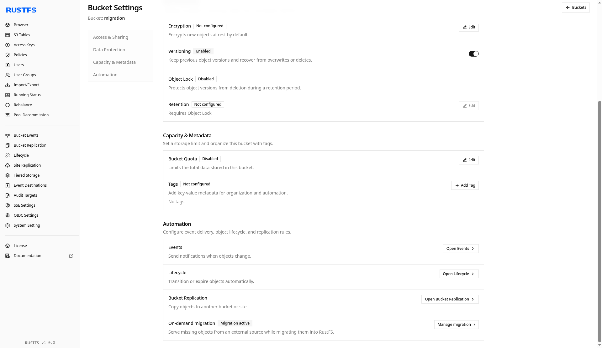

## 3. Point the bucket at Cloudflare R2

In **Enable on-demand migration**, set the source as follows. Replace the account id and keys with your own R2 token. Leave the session token empty unless the token requires one. Leave **Local prefix** empty to expose the whole source namespace. This walkthrough saved no extra prefix (**All keys**, **No added prefix**).

| Field | Value in this walkthrough |
| --- | --- |
| Source | Cloudflare R2 |
| Endpoint | `https://<account-id>.r2.cloudflarestorage.com` |
| Region | `us-east-1` (the form also accepts `auto`) |
| Source Bucket | `dl-rustfs` |
| Addressing style | Automatic |
| Access Key | R2 access key id |
| Secret Key | R2 secret |
| Session token | Empty |
| Local prefix | Empty |

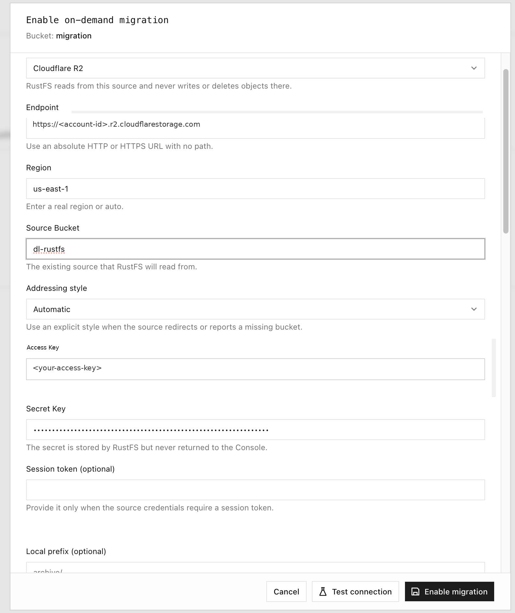

## 4. Test the connection and enable migration

Select **Test connection**. A successful check reports **Connection test passed** and shows a sample object key from the source bucket. Then select **Enable migration**.

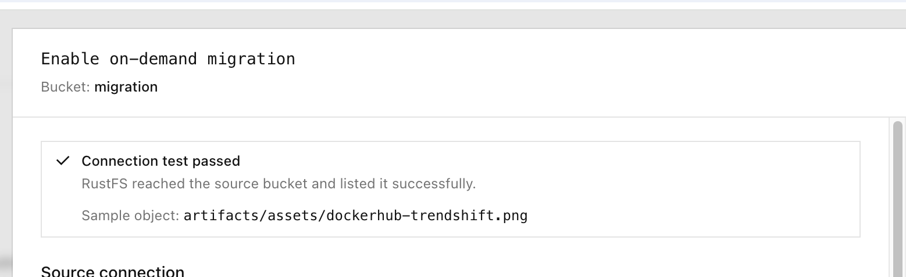

The same result also appears as a toast:

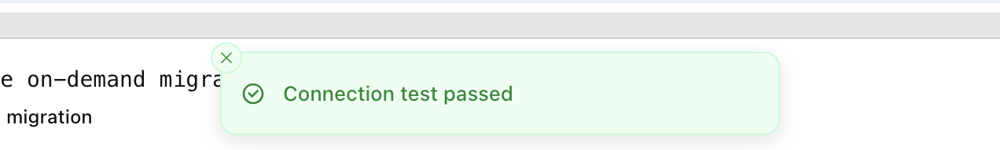

The configuration status becomes **Migration active**. Until something is read or backfilled, **Runtime status** stays at zero migrated objects and zero migrated data. **Latest job** stays **No backfill yet**.

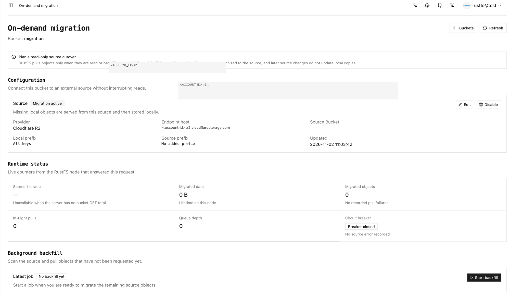

## 5. Pull one object with rc cp

Read the local bucket with `rc`. Do not send this request to the R2 endpoint. In this walkthrough the local bucket was still empty, and one missing object was pulled. The first miss returns the object to the client and stores it locally. A later read of the same key is served from RustFS.

```bash
rc cp rustfs/migration/artifacts/rustfs/packages/nightly/rustfs-nightly-2026-11-02.deb /tmp/
```

```text
rustfs/migration/artifacts/rustfs/packages/nightly/rustfs-nightly-2026-11-02.deb -> /tmp/rustfs-nightly-2026-11-02.deb (71.34 MiB)
```

Use another key if the source bucket does not contain this object. The terminal session shows that `rc cp` and later `rc ls` checks of the local nightly prefix. The listing is the local prefix after objects were present. The single `rc cp` above is the 71.34 MiB pull.

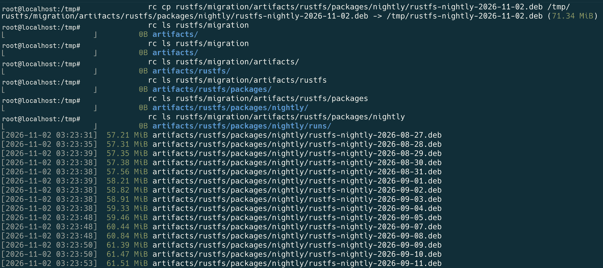

The same nightly prefix on the R2 bucket, as it appeared in the Cloudflare dashboard:

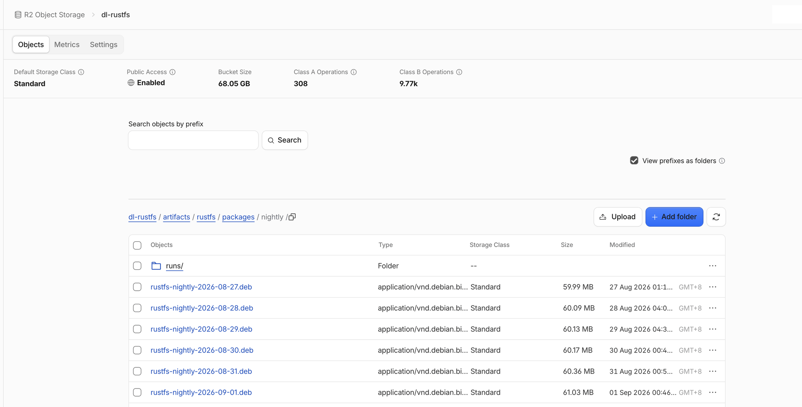

The bucket-size figure on that dashboard is Cloudflare's total for the bucket. The RustFS counters later on this page are what the migration job reported.

After the single-object pull, the Console **Browser** shows that object in the local bucket:

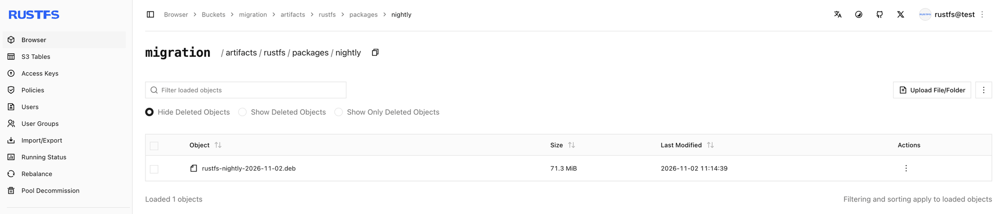

## 6. Backfill a prefix

**Start backfill** scans the source and pulls keys that are not already local. The dialog in this walkthrough used these settings:

| Option | Meaning | Walkthrough value |
| --- | --- | --- |
| Source listing prefix | List only this prefix | `artifacts/rustfs/packages/nightly/` |
| Existing local objects | What to do when the key is already local | **Always skip** |
| Dry run | List matches without queueing or writing objects | On for the rehearsal, then off for the pull |

**Dry run** lists matching objects without queueing or writing any object. Confirm the prefix, then turn **Dry run** off before you pull.

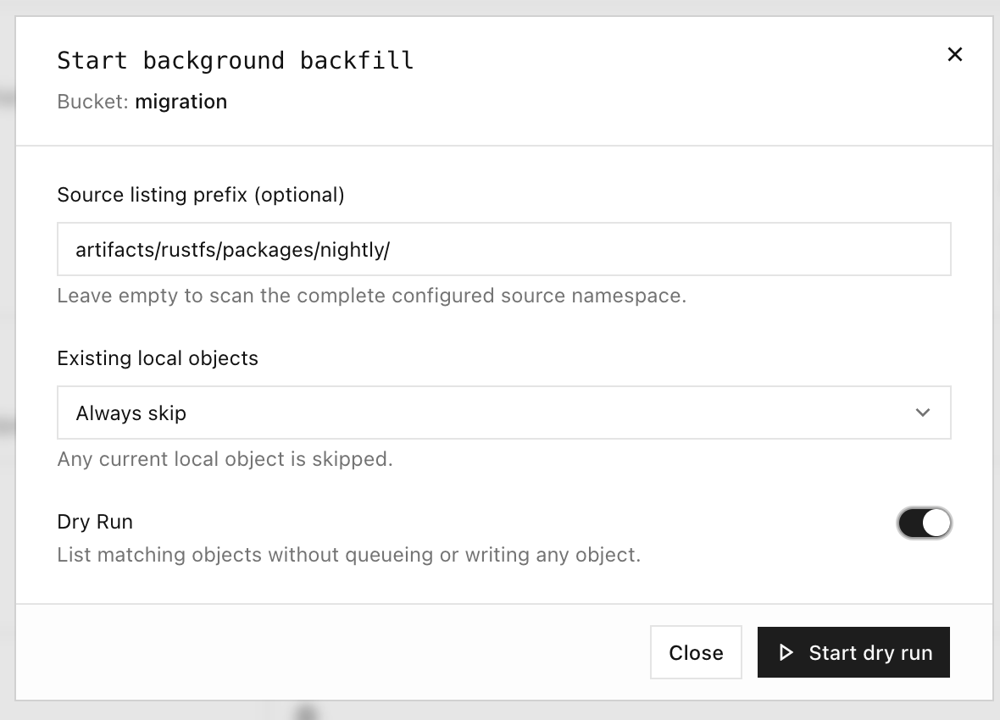

A prefix listing recorded during the walkthrough follows. The first key was truncated in the lab record. The full key has the form `artifacts/rustfs/packages/nightly/rustfs-nightly-2026-10-29.deb`. Timestamps are the lab record, about UTC. The full list is longer than this excerpt.

```text
…ghtly-2026-10-29.deb
[2026-11-02 03:25:08]  70.36 MiB artifacts/rustfs/packages/nightly/rustfs-nightly-2026-10-30.deb
[2026-11-02 03:25:08]  70.65 MiB artifacts/rustfs/packages/nightly/rustfs-nightly-2026-10-31.deb
[2026-11-02 03:25:08]  71.15 MiB artifacts/rustfs/packages/nightly/rustfs-nightly-2026-11-01.deb
[2026-11-02 03:14:39]  71.34 MiB artifacts/rustfs/packages/nightly/rustfs-nightly-2026-11-02.deb
[2026-11-02 03:25:08]  71.34 MiB artifacts/rustfs/packages/nightly/rustfs-nightly-latest.deb
```

While a backfill is writing objects, the Console shows listed and pulled counts. It does not show a completion percentage while the source scan is still running.

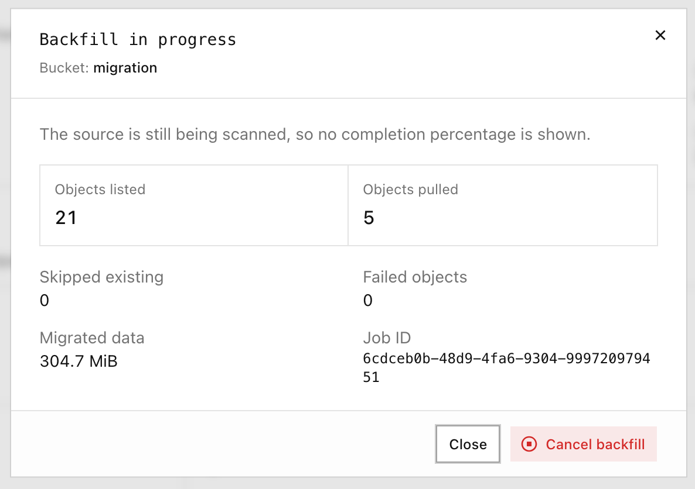

## 7. Run a dry run, then backfill the source namespace

Leave **Source listing prefix** empty to scan the configured source namespace. Run **Dry run** first and confirm the listed set. Then turn **Dry run** off and start the backfill.

A dry run in this walkthrough finished with objects listed and nothing pulled:

| Listed | Pulled | Skipped | Failed objects | Data |
| --- | --- | --- | --- | --- |
| 128 | 0 | 0 | 0 | 0 B |

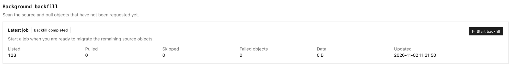

The full backfill that followed, with an empty prefix, finished as follows:

| Listed | Pulled | Skipped | Failed objects | Data |
| --- | --- | --- | --- | --- |
| 128 | 127 | 1 | 0 | 8.0 GiB |

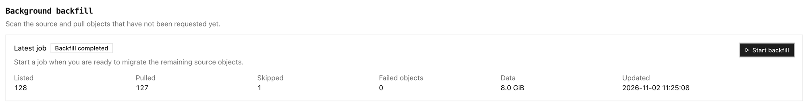

## 8. Verify the bucket

On the on-demand migration page, check:

1. **Runtime status** — migrated objects and migrated data are no longer zero, and no pull failures are recorded.
2. **Background backfill** — the latest job shows the listed, pulled, skipped, and failed counts.
3. **Browser** and `rc` — list the prefix with `rc ls`, as in the terminal session above, and read a local key again with `rc cp`.

In this walkthrough the runtime panel showed **Migrated data** 8.1 GiB and **Migrated objects** 128. The latest backfill showed Listed 128, Pulled 127, Skipped 1, Failed objects 0, and Data 8.0 GiB.

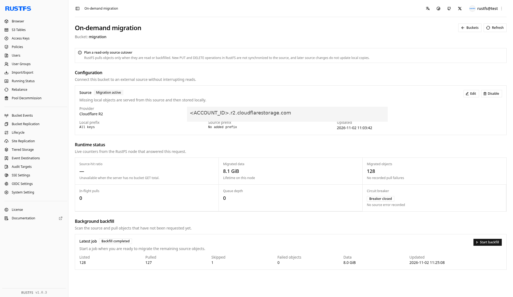

The bucket list after the walkthrough shows `migration` with 128 objects and 8.1 GiB:

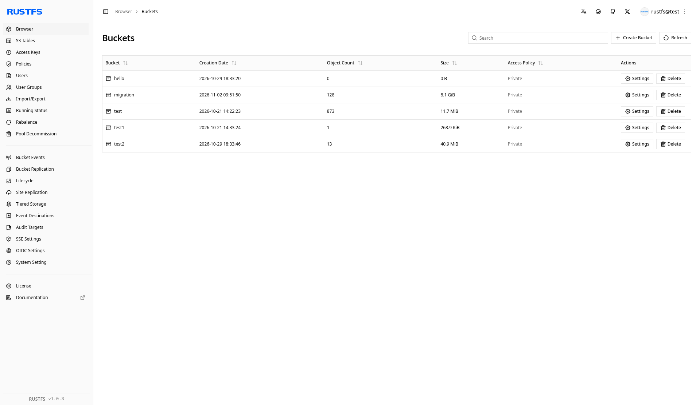

:::warning[The local copy does not track the source]
A later change to the same key on R2 is not pulled over the local object. A local `PUT` of that key is not written back to the source, and it stays in front of the source key. On-demand migration is not continuous replication from the source.
:::

## Next steps

- [Configure bucket replication](./replication.md) when you need an outbound copy
- [Install and use rc](/operations/rc)
- [Configure site replication](/operations/high-availability/site-replication) for site configuration and identity data
