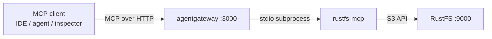
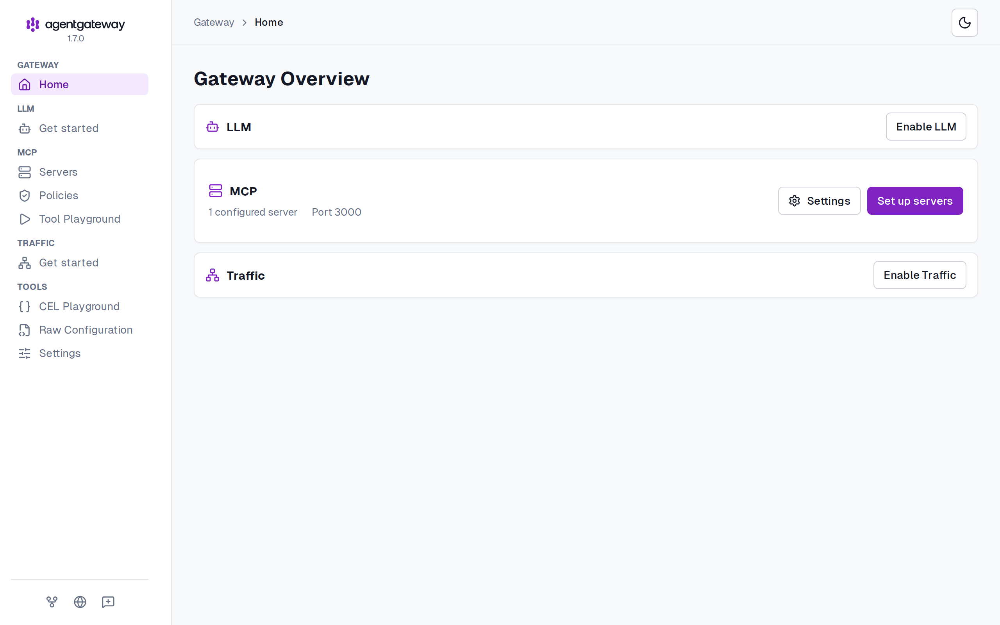
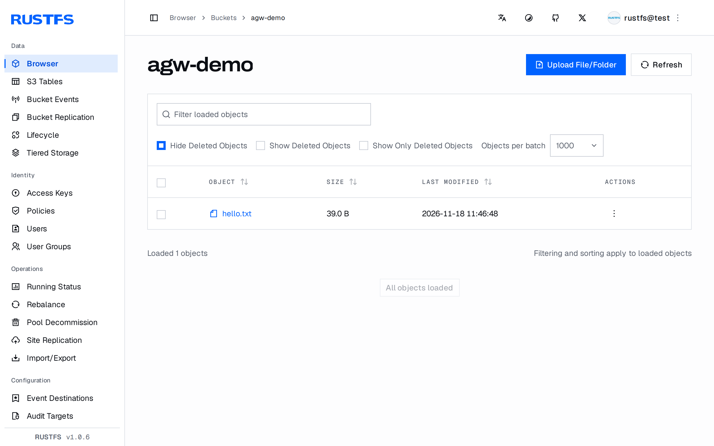

[agentgateway](https://github.com/agentgateway/agentgateway) is an AI-native proxy for MCP, A2A, and LLM traffic. Its MCP gateway federates MCP servers and exposes them over the network with authentication, policies, and OpenTelemetry observability. [RustFS ships its own MCP server](https://github.com/rustfs/mcp) exposing storage operations as tools, but over stdio only — usable as a local subprocess, not remotely. This guide connects the two: agentgateway launches the RustFS MCP server as a stdio target and serves it as a remote MCP endpoint, so any MCP client can operate RustFS storage through the gateway. The workflow was verified with agentgateway `1.7.0`, the `rustfs/mcp` server, and RustFS `1.0.6`.

You need Docker on the gateway host and a reachable RustFS server.

## Architecture



The gateway spawns `rustfs-mcp` as a child process and translates between its stdio transport and the MCP Streamable HTTP listener on port 3000. Storage operations flow through the gateway, so its policies, rate limiting, and telemetry apply to object-storage tool calls as well.

:::note[Why a gateway for a stdio server]

A stdio MCP server is only reachable from the machine that launches it. agentgateway adds the missing transport — remote clients connect over HTTP while the S3 credentials stay on the gateway host.

:::

## 1. Build the RustFS MCP server image

The MCP server lives in its own repository. Build the image from source:

```bash
git clone https://github.com/rustfs/mcp.git rustfs-mcp
docker build -t rustfs/rustfs-mcp:latest rustfs-mcp
```

The build produces an image that runs the MCP server over stdio and talks to any S3-compatible endpoint configured through the standard `AWS_*` environment variables.

## 2. Configure agentgateway

Create the gateway configuration. The target launches the MCP image as a subprocess; the volume mount exposes a host directory for the upload tool, and the endpoint points at RustFS through the Docker bridge gateway address:

```yaml title="config.yaml"
mcp:
  port: 3000
  targets:
  - name: rustfs
    stdio:
      cmd: docker
      args:
      - run
      - --rm
      - -i
      - -v
      - /data/agentgateway/demo:/demo
      - -e
      - AWS_ACCESS_KEY_ID=<your-access-key>
      - -e
      - AWS_SECRET_ACCESS_KEY=<your-secret-key>
      - -e
      - AWS_REGION=us-east-1
      - -e
      - AWS_ENDPOINT_URL=http://172.17.0.1:9000
      - rustfs/rustfs-mcp:latest
```

:::note[Endpoint addressing from the MCP container]

The MCP server runs in a container, so `127.0.0.1:9000` on the RustFS host is not reachable from it. Use the Docker bridge gateway address `172.17.0.1:9000` (or a shared network alias). If RustFS itself runs in Docker on a custom bridge network, Docker isolates bridges from each other — attach both containers to the same network and use the container name instead.

:::

Start the gateway with the configuration content:

```bash
agentgateway -c "$(cat config.yaml)"
```

The log confirms the listeners: the MCP bind on port 3000, the admin UI at `http://localhost:15000/ui`, and a stats endpoint on 15020.



## 3. Call RustFS tools through the gateway

The MCP inspector drives the gateway for manual verification:

```bash
npx @modelcontextprotocol/inspector --cli http://localhost:3000/mcp --method tools/list
```

```json
"tools": ["create_bucket", "delete_bucket", "get_object", "list_buckets", "list_objects", "upload_file"]
```

Create a bucket and upload a file through the gateway:

```bash
npx @modelcontextprotocol/inspector --cli http://localhost:3000/mcp \
  --method tools/call --tool-name create_bucket \
  --tool-arg bucket_name=agw-demo

npx @modelcontextprotocol/inspector --cli http://localhost:3000/mcp \
  --method tools/call --tool-name upload_file \
  --tool-arg local_file_path=/demo/hello.txt \
  --tool-arg bucket_name=agw-demo --tool-arg object_key=hello.txt
```

```text
✅ **File uploaded successfully!**
```

:::note[The upload path is on the MCP server side]

`upload_file` reads `local_file_path` from the filesystem of the process running the MCP server — inside the container. The volume mount `-v /data/agentgateway/demo:/demo` in step 2 exposes a host directory at `/demo` in the container, which is why the tool can read the file.

:::

## 4. Confirm the objects in RustFS

The object written through the gateway lands in the bucket like any S3 write. Confirm with the S3 API, replacing all connection placeholders:

```bash
aws s3api list-objects --bucket agw-demo \
  --endpoint-url http://localhost:9000
```

```json
{
    "Contents": [
        {
            "Key": "hello.txt",
            "Size": 39,
            "StorageClass": "STANDARD"
        }
    ]
}
```

Read it back through the gateway to close the loop:

```bash
npx @modelcontextprotocol/inspector --cli http://localhost:3000/mcp \
  --method tools/call --tool-name get_object \
  --tool-arg bucket_name=agw-demo --tool-arg object_key=hello.txt --tool-arg mode=read
```

    Content: hello from rustfs-mcp via agentgateway



## Validation results

| Check | Expected result |
| --- | --- |
| MCP handshake through the gateway | `serverInfo.name` reports `rustfs-mcp-server` with protocol `2025-03-26` |
| `tools/list` | All six storage tools federated: `create_bucket`, `delete_bucket`, `get_object`, `list_buckets`, `list_objects`, `upload_file` |
| `create_bucket` through the gateway | Bucket appears in RustFS |
| `upload_file` through the gateway | Object lands in the bucket; visible in the console and via the S3 API |
| `get_object` through the gateway | Content matches the uploaded file byte for byte |
| Gateway admin UI | Reports the configured MCP server and port |

## Troubleshooting

### `Error: invalid config: invalid type: string "config.yaml"`

The config flag consumes the configuration content, not a path. Pass the file contents: `agentgateway -c "$(cat config.yaml)"`.

### MCP tools time out or report connection errors

The MCP container cannot reach the RustFS address. `127.0.0.1:9000` inside the container is the container itself — use `172.17.0.1:9000` (Docker bridge gateway) or a shared network alias, as in step 2.

### `upload_file` fails with a missing local file

The path is resolved inside the MCP server container. Mount the host directory into the container with `-v` and reference the mounted path, as in step 2.

### `GET /mcp` returns `406 Not Acceptable`

Expected: the Streamable HTTP endpoint only accepts `POST` requests with `Accept: application/json, text/event-stream` headers — use an MCP client such as the inspector instead of a browser.

## Next steps

- Review the [RustFS MCP server](/developer/mcp) reference for the full tool set.
- Create dedicated credentials with [Access Key Management](/security-compliance/iam/access-token) for the gateway identity.
- Follow the [agentgateway documentation](https://agentgateway.dev/docs/) for authentication policies, rate limiting, and OpenTelemetry on the same gateway.
