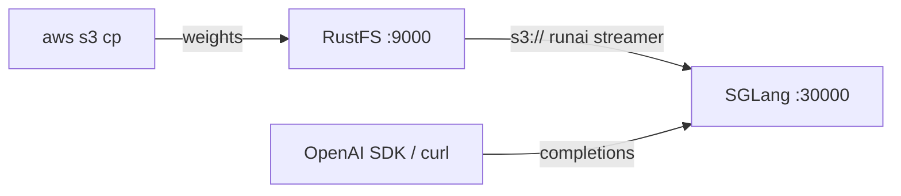

This guide connects [SGLang](https://github.com/sgl-project/sglang) — the serving framework for large language models and multimodal models — to **RustFS** as its model-weight store. You will upload a model into a RustFS bucket, point SGLang at the `s3://` URI, and serve OpenAI-compatible requests with the weights streamed straight from the bucket. The workflow was verified with `lmsysorg/sglang:v0.5.22-xeon` (SGLang 0.5.22, CPU engine) serving `Qwen/Qwen2.5-0.5B-Instruct` from a RustFS bucket on a CPU-only host.

You need Docker and a small Hugging Face model. This deployment is intended for local integration testing, not production.

## Architecture



When `--model-path` is an object-storage URI, SGLang switches to its `runai_streamer` load format automatically: the metadata files (`config.json`, tokenizer) download once into the local cache, then weight tensors stream lazily while the engine loads. The bucket stays the single copy of the model, so serving hosts need no local model store.

:::note[The CPU image ships without the S3 streamer]

The `xeon` CPU image does not include `runai-model-streamer-s3`, and starting the server with an `s3://` model path fails with `ImportError: S3 files module not found`. Install the package inside the container before launching the server — the image's virtual environment is managed with `uv`, which has no `pip` module.

:::

## 1. Upload the model to RustFS

Fetch the model files from Hugging Face and copy them into the bucket, replacing all connection placeholders:

```bash
docker run --rm -v "$PWD/models:/models" --entrypoint python3 \
  lmsysorg/sglang:v0.5.22-xeon -c \
  'from huggingface_hub import snapshot_download; snapshot_download("Qwen/Qwen2.5-0.5B-Instruct", local_dir="/models/qwen2.5-0.5b-instruct")'

aws s3 cp models/qwen2.5-0.5b-instruct \
  s3://my-bucket/sglang-models/qwen2.5-0.5b-instruct --recursive \
  --endpoint-url http://<your-rustfs-endpoint>:9000 \
  --acl private
```

Export the credentials for the following commands:

```bash
export AWS_ACCESS_KEY_ID=<your-access-key>
export AWS_SECRET_ACCESS_KEY=<your-secret-key>
export AWS_DEFAULT_REGION=us-east-1
```

Keep one model per prefix so several models can share the bucket. The streamer reads weight files in `.safetensors` format only.

## 2. Start SGLang against the bucket

Run the CPU image, install the S3 streamer package, and launch the server against the bucket URI:

```bash
docker run -d --name sglang -p 30000:30000 \
  -e AWS_ACCESS_KEY_ID \
  -e AWS_SECRET_ACCESS_KEY \
  -e AWS_DEFAULT_REGION \
  -e AWS_ENDPOINT_URL=http://<your-rustfs-endpoint>:9000 \
  --entrypoint bash lmsysorg/sglang:v0.5.22-xeon -c \
  'uv pip install -q runai-model-streamer-s3 && \
   python3 -m sglang.launch_server \
     --model-path s3://my-bucket/sglang-models/qwen2.5-0.5b-instruct \
     --served-model-name qwen2.5-0.5b-instruct \
     --host 0.0.0.0 --port 30000 \
     --device cpu --trust-remote-code \
     --disable-overlap-schedule \
     --mem-fraction-static 0.45'
```

`AWS_ENDPOINT_URL` points the streamer at RustFS; requests use path-style addressing against the custom endpoint. `--mem-fraction-static` sizes the KV cache share of host memory on the CPU backend — raise it on hosts with more free RAM. Wait for the startup line:

```bash
docker logs -f sglang
```

```text
The server is fired up and ready to roll!
```

## 3. Run inference

Confirm the model is served, then send an OpenAI-compatible completion request:

```bash
curl -s http://localhost:30000/v1/models
```

```json
{"object":"list","data":[{"id":"qwen2.5-0.5b-instruct","object":"model","owned_by":"sglang","root":"qwen2.5-0.5b-instruct","max_model_len":32768}]}
```

```bash
curl -s http://localhost:30000/v1/completions \
  -H "Content-Type: application/json" \
  -d '{"model":"qwen2.5-0.5b-instruct","prompt":"RustFS is","max_tokens":16,"temperature":0}'
```

```json
{"object":"text_completion","model":"qwen2.5-0.5b-instruct","choices":[{"index":0,"text":" a file system for the Linux kernel that is designed to be used in embedded systems","finish_reason":"length"}],"usage":{"prompt_tokens":4,"total_tokens":20,"completion_tokens":16}}
```


## 4. Stop or reset

To tear down the demo while keeping the bucket objects:

```bash
docker rm -f sglang
```

To delete the stored model:

```bash
aws s3 rm s3://my-bucket/sglang-models --recursive \
  --endpoint-url http://<your-rustfs-endpoint>:9000
```

## Troubleshooting

### `ImportError: S3 files module not found`

The S3 backend of the runai streamer is missing. Run `uv pip install runai-model-streamer-s3` inside the container before starting the server, as shown in step 2.

### `pip: command not found` or `No module named pip`

The image's `/opt/.venv` is created by `uv` without `pip`. Use `uv pip install` instead of `pip install`.

### `Loaded weights leave no GPU memory for the KV cache`

`--mem-fraction-static` is too small for the loaded weights on this host. The error message reports the minimum viable value — restart the server with a larger fraction (for example `0.45` on a 16 GB host for a 0.5 B model).

### Requests fail with signature or access errors

Confirm all four variables are set for the server container: `AWS_ACCESS_KEY_ID`, `AWS_SECRET_ACCESS_KEY`, `AWS_DEFAULT_REGION`, and `AWS_ENDPOINT_URL` including the scheme.

## Next steps

- Review [S3 compatibility notes](/administration/protocols/s3) before adopting additional serving operations.
- Create dedicated production credentials with [Access Key Management](/security-compliance/iam/access-token).
- Follow the [SGLang documentation](https://docs.sglang.io/) for tensor parallelism, quantization, and larger models on the same bucket-backed model store.
