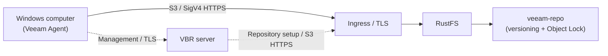

Veeam Backup & Replication (VBR) is an enterprise backup platform that stores backup data in S3-compatible object storage. This guide shows how to register RustFS as a VBR object storage repository, back up an entire Windows computer with the Veeam Agent, and restore a file from the stored backup.

You need a running RustFS instance reachable over HTTPS, a bucket dedicated to backups, a Windows machine with VBR 13 installed, and a Veeam license that includes object storage backup. Download VBR from the [official Veeam download page](https://www.veeam.com/products/downloads.html) and size the backup server according to [Veeam's system requirements](https://helpcenter.veeam.com/docs/vbr/userguide/system_requirements_backup_server.html?ver=13), not a small lab VM configuration.

:::note[License requirement]

Backing up to S3-compatible object storage is an enterprise feature of Veeam. Purchase a Veeam Enterprise edition license, or another paid license that includes this feature, for production use. For a proof of concept (POC), [request a free 30-day Veeam Data Platform trial license](https://www.veeam.com/products/data-platform-trial.html) and install it before running the job. Downloading or installing VBR alone does not enable this feature. In the validated configuration, Community Edition could add the repository but refused to run the object storage backup job without the required license.

:::

## Validated configuration

The reported test used VBR **13.1.2.57**, RustFS **1.0.1**, a Windows Agent backup, and a repository configured for **Direct** connection. A backup job and one file-level restore completed successfully. This is an integration test, not a Veeam certification or a validation of bare-metal recovery, retention enforcement, or every Veeam workload. The roughly 1 MiB objects observed in this test are not a fixed block-size guarantee.

## Architecture



In Direct mode, the Agent sends backup data to RustFS; VBR manages the job and repository. A gateway configuration instead sends data through the selected gateway or mount server. The Agent or gateway that actually transfers data must be able to reach and trust the RustFS HTTPS endpoint. See [Veeam Agent connection modes](https://helpcenter.veeam.com/docs/vbr/userguide/agents_object_storage.html?ver=13). The object-key prefix in this guide is `veeam`, and the bucket is `veeam-repo`.

## 1. Prepare the bucket and credentials

Create a dedicated bucket with versioning and Object Lock enabled. Versioning is a prerequisite for the Object Lock that Veeam immutability relies on:

```bash
rc bucket create <your-alias>/veeam-repo --with-lock
rc bucket version info <your-alias>/veeam-repo
```

Use the following bucket-scoped starting policy and validate it with your selected Veeam mode. Bucket operations and object operations use separate resource scopes. The policy omits `s3:CreateBucket` because the bucket already exists. This is not a proven minimum-permission policy: the lab policy includes legal-hold management and governance-retention bypass. Review whether those permissions are required and remove unnecessary privileges before production use. In particular, `s3:BypassGovernanceRetention` permits bypassing governance-mode protection; do not assume this credential cannot delete protected versions.

```json
{
  "Version": "2012-10-17",
  "Statement": [
    {
      "Effect": "Allow",
      "Action": ["s3:GetObject","s3:PutObject","s3:DeleteObject",
                 "s3:GetObjectVersion","s3:DeleteObjectVersion",
                 "s3:AbortMultipartUpload","s3:ListMultipartUploadParts",
                 "s3:PutObjectRetention","s3:GetObjectRetention",
                 "s3:PutObjectLegalHold","s3:GetObjectLegalHold",
                 "s3:BypassGovernanceRetention"],
      "Resource": ["arn:aws:s3:::veeam-repo/*"]
    },
    {
      "Effect": "Allow",
      "Action": ["s3:ListBucket","s3:ListBucketVersions","s3:GetBucketLocation",
                 "s3:GetBucketVersioning","s3:GetBucketObjectLockConfiguration",
                 "s3:ListBucketMultipartUploads"],
      "Resource": ["arn:aws:s3:::veeam-repo"]
    }
  ]
}
```

```bash
rc admin policy create <your-alias> veeam-repo-rw <path-to-policy-file>
rc admin user add <your-alias> veeam <your-secret-key>
rc admin policy attach <your-alias> veeam-repo-rw --user veeam
```

Veeam requires HTTPS for S3-compatible object storage. You can terminate TLS in front of RustFS with Traefik or Nginx. Use a certificate whose SAN covers the endpoint hostname and whose chain is trusted by the VBR server and the Agent or gateway that transfers data. For a private CA, install its root CA certificate in the appropriate trusted-root stores; do not import an arbitrary endpoint certificate as a trusted CA or disable verification.

Keep lifecycle expiration and transition rules off this dedicated backup bucket; let Veeam manage backup retention. See [Veeam Agent object storage limitations](https://helpcenter.veeam.com/docs/agentforwindows/userguide/backup_to_object_storage.html).

## 2. Add the RustFS repository in VBR

In the VBR console, go to **Backup Infrastructure → Backup Repositories → Add Repository → Object storage → S3 Compatible**:

1. Service point: your RustFS HTTPS endpoint, Region: `us-east-1`.
2. Credentials: the `veeam` access key and secret key. Select **Direct** for the illustrated data path; choose a gateway when direct access is unsuitable.
3. Bucket: `veeam-repo`, Folder: `veeam`.
4. Before selecting Folder, create an object under `veeam/` with an S3 client if the fresh bucket has no prefixes, then use **Browse**.
5. If testing immutable backups, enable **Make backups immutable** and validate object retention separately. Enabling Object Lock on a bucket alone does not make every backup immutable.


When Veeam reports that automatic bucket provisioning fails with Access Denied, choose **Yes** to disable it and proceed — the bucket exists and the IAM user intentionally cannot create buckets.

For Agent backups, explicitly configure **Set Access Permissions → Security** as described in [Veeam's S3-compatible repository access instructions](https://helpcenter.veeam.com/docs/vbr/userguide/access_permissions.html?ver=13). **Provided by the backup server** uses a gateway or mount server, even when the repository says Direct. True Direct access requires a compatible IAM/STS configuration or **Agents share credentials to object storage repository**. The latter exposes the repository credentials to protected machines and is less secure; use it only in an isolated POC if needed. Generic IAM/STS support is not proof that Veeam's credential workflow is compatible; validate the selected mode before production use.

The lab report does not record the Security selection, so it does not independently confirm that data bypassed a gateway.

On success, the repository is listed as **S3-compatible**. Used Space is Veeam's reported usage, not an independent measurement of RustFS capacity:


## 3. Enroll the protected computer

The backup job alone does not install the Veeam agent. Use a protection group:

1. **Inventory → Physical and Cloud Infrastructure → Add protection group…**
2. Type **Individual computers**, add the machine with its real hostname and local administrator credentials in `HOSTNAME\user` form.
3. Keep **Install Veeam Backup & Replication Agent** enabled, then Apply.

:::warning[Windows UAC remote restrictions]

First check the hostname, credentials, connectivity, and firewall. Only if the failure is confirmed to be local-account UAC remote filtering should an administrator consider setting `LocalAccountTokenFilterPolicy` to `1` under `HKLM\SOFTWARE\Microsoft\Windows\CurrentVersion\Policies\System`. This allows elevated remote tokens for local administrators; it is not a general access-denied fix. Restrict access to a trusted management network, record the previous setting, and restore it when no longer required, checking that agent management still works. See [Microsoft's UAC remote restrictions](https://learn.microsoft.com/en-us/troubleshoot/windows-server/windows-security/user-account-control-and-remote-restriction). After installation, reboot if the Backup agent column shows **Reboot required**.

:::

## 4. Run the backup job

1. **Home → Backup Job → Windows computer…**
2. Computers: **From protection group**, Backup Mode: **Entire computer**.
3. Storage: Backup repository = **RustFS**, retention as needed.
4. Finish, then right-click the job and select **Start**.

After the job completes, the job list shows **Last Result: Success** and the restore point appears under **Home → Backups → Object Storage → RustFS Veeam Backup**:


Verify the objects in RustFS:

```bash
rc object find <your-alias>/veeam-repo/ | tail -1
```

The test observed data objects under `Veeam/Backup/veeam/Clients/{agent-id}/…`. Listing an object alone does not verify backup completeness, a restore point, or immutable retention.

## 5. Restore files

1. **Home → Backups → Object Storage → RustFS Veeam Backup → <computer>**.
2. Right-click the restore point → **Restore guest files…** → Browse.
3. Pick a file in the Backup Browser, restore it to a target folder, and verify its content.


A successful restore with matching file content validates the backup-to-file-recovery workflow for that file. It does not prove every restore point is recoverable. For an immutable-backup POC, also inspect retention mode and expiry and verify that protected versions cannot be deleted during retention using controlled test data; do not run destructive checks against production backups.

## Troubleshooting

| Symptom | Fix |
|---|---|
| "Backup to object storage requires a valid Enterprise edition license" | Install a license that includes object storage (trial or paid); Community Edition cannot run object storage jobs |
| "backup agent is missing" during the job | Enroll the machine through a protection group (step 3); the job wizard does not push-install agents |
| Agent push fails with access denied | Check credentials, hostname, and firewall first; use the UAC warning above only for a confirmed remote-filtering issue |
| Backup agent column shows "Reboot required" | Reboot the machine to complete the agent installation |
| Console shows HTTP 502 right after boot | Veeam services are still starting; retry after `VeeamBackupSvc` and the PostgreSQL service are Running |
| Folder list is empty in the wizard | The folder picker lists existing prefixes; create a placeholder object under the prefix first, then Browse |
| Repository capacity shows N/A | SOSAPI reporting is not required for backup; support is tracked in [rustfs/rustfs#1511](https://github.com/rustfs/rustfs/issues/1511) |

## Next steps

- [Veeam downloads](https://www.veeam.com/products/downloads.html) and [POC trial license](https://www.veeam.com/products/data-platform-trial.html).
- [Veeam Agent object storage requirements](https://helpcenter.veeam.com/docs/agentforwindows/userguide/backup_to_object_storage.html).
- [RustFS Object Lock](../../../administration/data/object/object-lock.md) and [bucket versioning](../../../administration/data/object/versioning.md).
