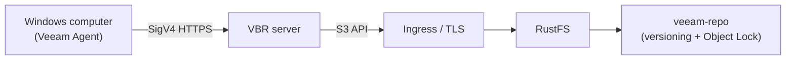
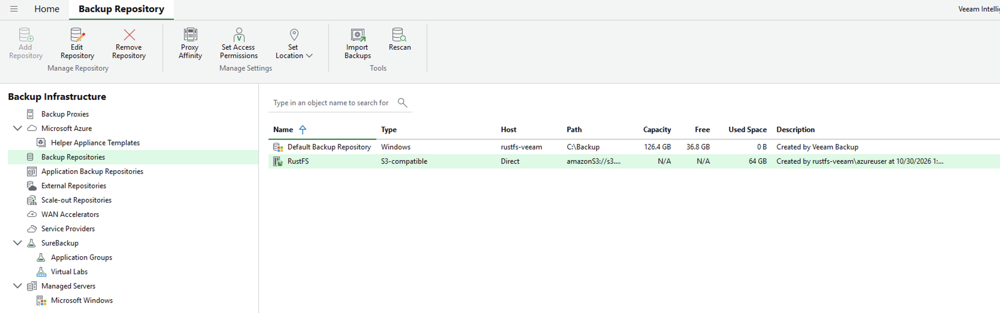

Veeam Backup & Replication (VBR) is an enterprise backup platform that stores backup data in S3-compatible object storage. This guide shows how to register RustFS as a VBR object storage repository, back up an entire Windows computer with the Veeam Agent, and restore a file from the stored backup.

You need a running RustFS instance reachable over HTTPS, a bucket dedicated to backups, a Windows machine with VBR 13 installed (4 vCPU and 8 GB RAM are a practical minimum), and a Veeam license that includes object storage backup.

:::note[License requirement]

Backup to object storage is an Enterprise-tier Veeam feature. VBR Community Edition can add and validate an S3 repository, but running a backup job to it requires an Enterprise license or the free 30-day evaluation key (Veeam Data Platform Trial Key).

:::

## Architecture



Veeam writes roughly 1 MiB backup blocks into the bucket through the S3 API during backup and reads back only the blocks that contain the requested data during a restore. The bucket prefix in this guide is `veeam`, and the bucket is `veeam-repo`.

## 1. Prepare the bucket and credentials

Create a dedicated bucket with versioning and Object Lock enabled. Versioning is a prerequisite for the Object Lock that Veeam immutability relies on:

```bash
rc bucket create <your-alias>/veeam-repo --with-lock
rc bucket version info <your-alias>/veeam-repo
```

Create a least-privilege policy scoped to the bucket. The policy intentionally omits `s3:CreateBucket`: Veeam offers automatic bucket provisioning, and declining it is the recommended posture when the bucket already exists.

```json
{
  "Version": "2012-10-17",
  "Statement": [
    {
      "Effect": "Allow",
      "Action": ["s3:GetObject","s3:PutObject","s3:DeleteObject",
                 "s3:GetObjectVersion","s3:DeleteObjectVersion",
                 "s3:AbortMultipartUpload","s3:ListMultipartUploadParts",
                 "s3:ListBucketMultipartUploads",
                 "s3:PutObjectRetention","s3:GetObjectRetention",
                 "s3:PutObjectLegalHold","s3:GetObjectLegalHold",
                 "s3:BypassGovernanceRetention"],
      "Resource": ["arn:aws:s3:::veeam-repo/*"]
    },
    {
      "Effect": "Allow",
      "Action": ["s3:ListBucket","s3:ListBucketVersions","s3:GetBucketLocation",
                 "s3:GetBucketVersioning"],
      "Resource": ["arn:aws:s3:::veeam-repo"]
    }
  ]
}
```

```bash
rc admin policy create <your-alias> veeam-repo-rw <path-to-policy-file>
rc admin user add <your-alias> veeam <your-secret-key>
rc admin policy attach <your-alias> veeam-repo-rw --user veeam
```

Veeam requires HTTPS for object storage. Terminate TLS in front of RustFS (for example with Traefik or Nginx) using a certificate whose SAN covers the endpoint hostname, and import that certificate into the Veeam server's **Trusted Root Certification Authorities** store.

## 2. Add the RustFS repository in VBR

In the VBR console, go to **Backup Infrastructure → Backup Repositories → Add Repository → Object storage → S3 Compatible**:

1. Service point: your RustFS HTTPS endpoint, Region: `us-east-1`.
2. Credentials: the `veeam` access key and secret key.
3. Bucket: `veeam-repo`, Folder: `veeam`.
4. Optionally enable **Make backups immutable** (the bucket's Object Lock is already enabled).


When Veeam reports that automatic bucket provisioning fails with Access Denied, choose **Yes** to disable it and proceed — the bucket exists and the IAM user intentionally cannot create buckets.

On success, the repository is listed as **S3-compatible** with the used space matching the bucket contents:



## 3. Enroll the protected computer

The backup job alone does not install the Veeam agent. Use a protection group:

1. **Inventory → Physical and Cloud Infrastructure → Add protection group…**
2. Type **Individual computers**, add the machine with its real hostname and local administrator credentials in `HOSTNAME\user` form.
3. Keep **Install Veeam Backup & Replication Agent** enabled, then Apply.

:::note[Windows UAC]

If the agent push fails with an access error, set `LocalAccountTokenFilterPolicy` to `1` under `HKLM\SOFTWARE\Microsoft\Windows\CurrentVersion\Policies\System` on the target machine and rescan. After the agent installs, reboot the machine when the Backup agent column shows **Reboot required**.

:::

## 4. Run the backup job

1. **Home → Backup Job → Windows computer…**
2. Computers: **From protection group**, Backup Mode: **Entire computer**.
3. Storage: Backup repository = **RustFS**, retention as needed.
4. Finish, then right-click the job and select **Start**.

After the job completes, the job list shows **Last Result: Success** and the restore point appears under **Home → Backups → Object Storage → RustFS Veeam Backup**:


Verify the objects in RustFS:

```bash
rc object find <your-alias>/veeam-repo/ | tail -1
```

Veeam stores roughly 1 MiB data blocks under `Veeam/Backup/veeam/Clients/{agent-id}/…` with an ETag and a version on every object.

## 5. Restore files

1. **Home → Backups → Object Storage → RustFS Veeam Backup → <computer>**.
2. Right-click the restore point → **Restore guest files…** → Browse.
3. Pick a file in the Backup Browser, restore it to a target folder, and verify its content.


Restoring reads back only the blocks containing the selected file, which validates the full read path against RustFS.

## Troubleshooting

| Symptom | Fix |
|---|---|
| "Backup to object storage requires a valid Enterprise edition license" | Install a license that includes object storage (trial or paid); Community Edition cannot run object storage jobs |
| "backup agent is missing" during the job | Enroll the machine through a protection group (step 3); the job wizard does not push-install agents |
| Agent push fails with access denied | Set `LocalAccountTokenFilterPolicy=1` on the target; use the real hostname, not `localhost` |
| Backup agent column shows "Reboot required" | Reboot the machine to complete the agent installation |
| Console shows HTTP 502 right after boot | Veeam services are still starting; retry after `VeeamBackupSvc` and the PostgreSQL service are Running |
| Folder list is empty in the wizard | The folder picker lists existing prefixes; create a placeholder object under the prefix first, then Browse |
| Repository capacity shows N/A | SOSAPI reporting is not required for backup; support is tracked in [rustfs#1511](https://github.com/rustfs/rustfs/issues/1511) |
