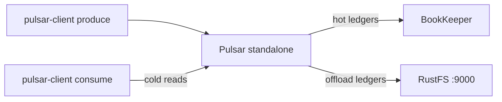

This guide connects [Apache Pulsar](https://github.com/apache/pulsar) to **RustFS** through its tiered-storage S3 offloader. You will run a standalone broker with offloading pointed at a RustFS bucket, produce messages, trigger a ledger offload, and read the offloaded messages back from the bucket. The workflow was verified with `apachepulsar/pulsar-all:4.0.4` offloading a topic to RustFS and serving cold reads from it.

You need Docker. This deployment is intended for local integration testing, not production.

## Architecture



Old ledgers are uploaded to the bucket as `<offloader-id>-ledger-<n>` data blocks plus a small `-index` object, and the broker reads them back transparently when a consumer asks for messages that are no longer in BookKeeper.

## 1. Start the standalone broker with offloading

The plain `apachepulsar/pulsar` image ships without offloader packages and fails with `No offloader found for driver 'S3'` — use the `pulsar-all` image, which includes them. The broker is capped to a small heap:

```bash
docker run -d --name pulsar -p 6650:6650 -p 8080:8080 \
  -e ACCESS_KEY_ID=<your-access-key> \
  -e ACCESS_KEY_SECRET=<your-secret-key> \
  -e PULSAR_MEM="-Xms512m -Xmx512m" \
  --entrypoint bash apachepulsar/pulsar-all:4.0.4 -c '
    sed -i -e "s|^managedLedgerMaxEntriesPerLedger=.*|managedLedgerMaxEntriesPerLedger=100|" \
           -e "s|^managedLedgerMinLedgerRolloverTimeMinutes=.*|managedLedgerMinLedgerRolloverTimeMinutes=1|" \
           /pulsar/conf/standalone.conf
    printf "\nmanagedLedgerOffloadDriver=S3\nmanagedLedgerOffloadBucket=my-bucket\nmanagedLedgerOffloadServiceEndpoint=http://<your-rustfs-endpoint>:9000\nmanagedLedgerOffloadRegion=us-east-1\n" >> /pulsar/conf/standalone.conf
    exec bin/pulsar standalone -nss
  '
```

The two `managedLedger*` edits shrink ledgers so a rollover happens within the demo; the appended block enables offloading.

:::note[Driver S3 reads managedLedgerOffload* keys, not s3ManagedLedgerOffload*]

For driver `S3` the offloader resolves the generic `managedLedgerOffloadBucket`, `managedLedgerOffloadServiceEndpoint`, and `managedLedgerOffloadRegion` keys. The `s3ManagedLedgerOffload*` names belong to the `aws-s3` driver and are ignored here — with them, the offloader crashes with `NullPointerException: endpoint`. The same applies to credentials: driver `S3` reads `ACCESS_KEY_ID` and `ACCESS_KEY_SECRET` environment variables, not the `AWS_*` pair.

:::

Wait for the broker:

```bash
docker logs -f pulsar 2>&1 | grep -m1 "The ledger offloader was created"
```

## 2. Produce messages and keep the topic alive

Topics with no subscription are deleted by the inactive-topic cleanup within minutes, which cancels the demo mid-flight. Produce a first batch, then create a durable subscription that keeps the topic registered:

```bash
docker exec pulsar bin/pulsar-client produce -m "hello rustfs offload" -n 300 \
  persistent://public/default/rustfs-test
```

```text
300 messages successfully produced
```

```bash
timeout 30 docker exec pulsar bin/pulsar-client consume -s keepalive -n 1 -p Earliest \
  persistent://public/default/rustfs-test
```

## 3. Roll a ledger and trigger the offload

A ledger only rolls when a write happens after `managedLedgerMinLedgerRolloverTimeMinutes` has passed — the check runs on write, not in the background. Wait at least one minute, produce another batch to force the roll, then offload everything older than the last kilobyte:

```bash
sleep 65
docker exec pulsar bin/pulsar-client produce -m "rollover" -n 120 \
  persistent://public/default/rustfs-test
docker exec pulsar bin/pulsar-admin topics offload -s 1K \
  persistent://public/default/rustfs-test
```

```text
Offload triggered for persistent://public/default/rustfs-test for messages before 11:0:-1
```

The offload takes a moment — wait for completion:

```bash
sleep 30
docker exec pulsar bin/pulsar-admin topics offload-status \
  persistent://public/default/rustfs-test
```

```text
Offload was a success
```

Confirm the ledger objects landed in RustFS — data block plus index, at the bucket root:

```bash
aws s3 ls s3://my-bucket/ --recursive \
  --endpoint-url http://<your-rustfs-endpoint>:9000 | grep ledger
```

```text
2026-10-25 02:34:49      21057 7f9379cc-c21d-4829-a857-4c39ec02e391-ledger-9
2026-10-25 02:34:49        214 7f9379cc-c21d-4829-a857-4c39ec02e391-ledger-9-index
```

## 4. Read the offloaded messages back

Consume from the earliest position with a fresh subscription. The first ledger now lives only in RustFS, so every message the broker returns is a cold read from the bucket:

```bash
timeout 90 docker exec pulsar bin/pulsar-client consume -s coldread -n 420 -p Earliest \
  persistent://public/default/rustfs-test 2>&1 | grep -c "^-----"
```

```text
420
```

All 420 messages — the 300 from the offloaded ledger plus the 120 from the active one — come back through the bucket.


## 5. Stop or reset

To tear down the broker while keeping the bucket objects:

```bash
docker rm -f pulsar
```

To delete the offloaded ledgers:

```bash
aws s3 rm s3://my-bucket/ --recursive --exclude "*" --include "*ledger*" \
  --endpoint-url http://<your-rustfs-endpoint>:9000
```

## Troubleshooting

### `No offloader found for driver 'S3'. Please make sure you dropped the offloader nar packages`

The image does not include the offloader NARs. Use `apachepulsar/pulsar-all` as shown in step 1.

### `NullPointerException: endpoint` when offloading

The offloader read no service endpoint — the `managedLedgerOffload*` keys are missing or were written with the `s3ManagedLedgerOffload*` names of the `aws-s3` driver. Append the exact block from step 1 and restart.

### `Couldn't get the access key id.` in the broker log

Driver `S3` does not read `AWS_ACCESS_KEY_ID`. Export `ACCESS_KEY_ID` and `ACCESS_KEY_SECRET` on the broker container.

### `Topic ... not found` during the demo

The inactive-topic cleanup deleted the topic because it had no subscription. Re-run step 2 and keep the `keepalive` subscription in place.

### `Offload was a success` but no objects appear

Only closed ledgers older than the size threshold are uploaded, and a ledger rolls on the next write after the minimum rollover age. Produce another batch, then trigger the offload again.

## Next steps

- Review [S3 compatibility notes](/administration/protocols/s3) before enabling automatic offload thresholds on namespaces.
- Create dedicated production credentials with [Access Key Management](/security-compliance/iam/access-token).
- Follow the [Pulsar tiered storage documentation](https://pulsar.apache.org/docs/next/cookbooks-tiered-storage/) for namespace thresholds, retention policies, and multi-node brokers against the same bucket.
