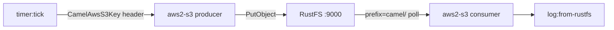
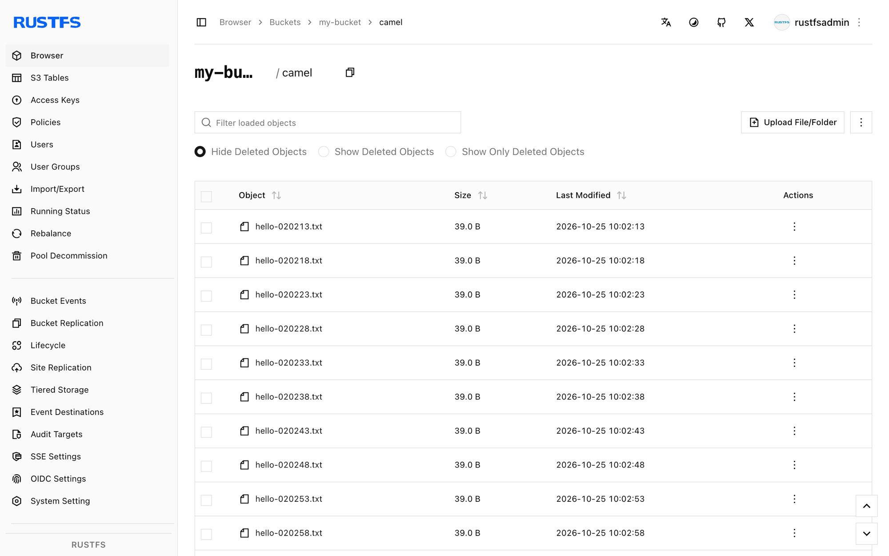

This guide connects [Apache Camel](https://github.com/apache/camel) — the versatile integration framework — to **RustFS** through its S3 component. You will write a two-route integration in YAML: a producer route that writes a message to a bucket on a timer, and a consumer route that reads those objects back and logs them. The workflow was verified with Camel JBang on `eclipse-temurin:21-jdk`, using the `aws2-s3` component with an overridden endpoint and path-style addressing.

You need Docker. This deployment is intended for local integration testing, not production.

## Architecture



Camel JBang runs the route file directly and resolves the S3 component dependencies automatically — no project scaffolding, build, or deploy step.

## 1. Write the integration route

Create the route file. Credentials come from the default AWS provider chain (environment variables), so the URIs carry only addressing:

```yaml title="route.yaml"
- from:
    uri: "timer:tick"
    parameters:
      period: "5000"
    steps:
      - setBody:
          simple: "Hello from Camel at ${date:now:yyyy-MM-dd HH:mm:ss}"
      - setHeader:
          name: "CamelAwsS3Key"
          simple: "camel/hello-${date:now:HHmmss}.txt"
      - to:
          uri: "aws2-s3://my-bucket?overrideEndpoint=true&uriEndpointOverride=http://<your-rustfs-endpoint>:9000&forcePathStyle=true&useDefaultCredentialsProvider=true"
- from:
    uri: "aws2-s3://my-bucket?prefix=camel/&deleteAfterRead=false&maxMessagesPerPoll=5&overrideEndpoint=true&uriEndpointOverride=http://<your-rustfs-endpoint>:9000&forcePathStyle=true&useDefaultCredentialsProvider=true"
    steps:
      - to:
          uri: "log:from-rustfs"
```

The producer sets the object key through the `CamelAwsS3Key` header — here a per-message timestamp, so every tick writes a new object. The consumer polls the `camel/` prefix with `deleteAfterRead=false`, so objects stay in the bucket after they are consumed.

:::note[Component name and endpoint options]

The component resolved by Camel JBang in this workflow is `aws2-s3`. `overrideEndpoint=true` activates the custom endpoint, `uriEndpointOverride` carries its URL, and `forcePathStyle=true` selects the path-style addressing RustFS expects. `useDefaultCredentialsProvider=true` makes the component read credentials from the standard environment variables.

:::

## 2. Run the route with Camel JBang

Run the integration in a container with the credentials exported. JBang asks to trust the sources on first use, so add the trust rules before starting:

```bash
docker run --rm --network bridge \
  -e AWS_ACCESS_KEY_ID=<your-access-key> \
  -e AWS_SECRET_ACCESS_KEY=<your-secret-key> \
  -e AWS_REGION=us-east-1 \
  -v "$PWD:/routes" \
  --entrypoint bash eclipse-temurin:21-jdk -c '
    export JBANG_DIR=/root/.jbang PATH=/root/.jbang/bin:$PATH
    curl -Ls https://sh.jbang.dev | bash >/dev/null 2>&1
    jbang trust add https://github.com/apache/ 2>/dev/null || true
    jbang trust add /routes 2>/dev/null || true
    cd /routes && jbang camel@apache/camel run route.yaml
  '
```

The first run downloads the Camel runtime and dependencies, then starts the routes. Consumers log each object they read:

```text
2026-10-25 02:02:41.069  INFO 120 --- [-s3://my-bucket] from-rustfs : Exchange[ExchangePattern: InOnly, BodyType: byte[], Body: Hello from Camel at 2026-10-25 02:02:38]
```

## 3. Verify the objects

Confirm the producer's objects sit in RustFS, replacing all connection placeholders:

```bash
aws s3 ls s3://my-bucket/camel/ \
  --endpoint-url http://<your-rustfs-endpoint>:9000
```

```text
2026-10-25 02:02:13         39 hello-020213.txt
2026-10-25 02:02:18         39 hello-020218.txt
2026-10-25 02:02:23         39 hello-020223.txt
```



## 4. Stop or reset

Stop the container to end the routes. To delete the demo objects:

```bash
aws s3 rm s3://my-bucket/camel --recursive \
  --endpoint-url http://<your-rustfs-endpoint>:9000
```

## Troubleshooting

### `Cannot find component with name: aws-s3`

Your Camel version resolves the component under a different name — this workflow runs against `aws2-s3`. Use the name your runtime reports in the suggestion list (`Did you mean: ... aws2-s3 ...`).

### `is not from a trusted source`

JBang refuses to run untrusted code. Run `jbang trust add https://github.com/apache/` and `jbang trust add /routes` before `jbang camel@apache/camel run`, as shown in step 2.

### `useDefaultCredentialsProvider is set to false`

The component found no credential configuration in the URI. Either add `useDefaultCredentialsProvider=true` and export `AWS_ACCESS_KEY_ID` and `AWS_SECRET_ACCESS_KEY`, or configure the `accessKey` and `secretKey` endpoint options directly.

### Consumer reads nothing

The consumer only polls the prefix given by `prefix=camel/`. Confirm the producer ran (`timer` log lines appear) and that its `CamelAwsS3Key` header starts with `camel/`.

## Next steps

- Review [S3 compatibility notes](/administration/protocols/s3) before adopting multipart or streaming operations on this component.
- Create dedicated production credentials with [Access Key Management](/security-compliance/iam/access-token).
- Follow the [Camel S3 component documentation](https://camel.apache.org/components/latest/aws2-s3-component.html) for download ranges, bucket operations, and consumer tuning on the same routes.
