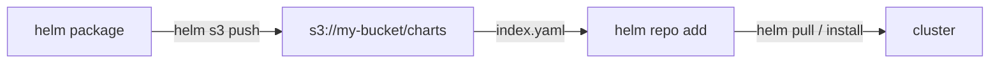
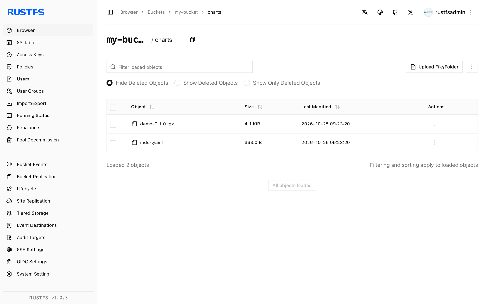

This guide connects [Helm](https://github.com/helm/helm) — the CNCF package manager for Kubernetes — to **RustFS** through the [helm-s3](https://github.com/hypnoglow/helm-s3) plugin, so a RustFS bucket becomes a private chart repository. You will initialize the repository in the bucket, push a packaged chart, then add the repository to Helm and pull the chart back. The workflow was verified with `alpine/helm:3.16.4` and helm-s3 `v0.17.2` against a RustFS bucket.

You need Docker. This deployment is intended for local integration testing, not production.

## Architecture



The bucket prefix holds `index.yaml` and one `.tgz` per chart version. Helm reads and writes it through the plugin, so the repository is reachable from anywhere that can reach RustFS.

## 1. Install the plugin and initialize the repository

The `alpine/helm` image ships without `git`, so install the plugin from its release archive instead of the repository URL:

```bash
cd /tmp
wget -q https://github.com/hypnoglow/helm-s3/releases/download/v0.17.2/helm-s3_0.17.2_linux_amd64.tar.gz
mkdir -p helm-s3 && tar -xzf helm-s3_0.17.2_linux_amd64.tar.gz -C helm-s3
helm plugin install helm-s3
```

Point the plugin at RustFS through its own environment variables and initialize the repository prefix:

```bash
export AWS_ENDPOINT=<your-rustfs-endpoint>:9000
export AWS_DISABLE_SSL=true
export AWS_ACCESS_KEY_ID=<your-access-key>
export AWS_SECRET_ACCESS_KEY=<your-secret-key>
export AWS_DEFAULT_REGION=us-east-1

helm s3 init s3://my-bucket/charts
```

```text
Initialized empty repository at s3://my-bucket/charts
```

:::note[helm-s3 uses AWS_ENDPOINT, not AWS_ENDPOINT_URL]

The plugin builds its request URLs from `AWS_ENDPOINT` (host and port, no scheme) plus `AWS_DISABLE_SSL=true` for plain HTTP. The standard `AWS_ENDPOINT_URL` variable is not honored, and the SDK-default virtual-hosted addressing it triggers fails against RustFS with `403 Forbidden`.

:::

## 2. Push a chart

Register the repository before the first push — the plugin reads the Helm repositories file and errors if it is missing:

```bash
helm repo add rustfs-charts s3://my-bucket/charts
```

Create and package a demo chart, then push it. `helm s3 push` takes the **repository name**, not the `s3://` URI:

```bash
helm create demo
helm package demo
helm s3 push ./demo-0.1.0.tgz rustfs-charts
```

```text
Successfully uploaded the chart to the repository.
```

## 3. Install or pull from the bucket

Refresh the repository index and confirm the chart is discoverable:

```bash
helm repo update
helm search repo rustfs-charts/demo
```

```text
NAME              	CHART VERSION	APP VERSION	DESCRIPTION
rustfs-charts/demo	0.1.0        	1.16.0     	A Helm chart for Kubernetes
```

Pull the chart back out of RustFS:

```bash
helm pull rustfs-charts/demo --destination ./pullback
tar -tzf ./pullback/demo-0.1.0.tgz | head -2
```

```text
demo/Chart.yaml
demo/values.yaml
```



## 4. Stop or reset

Charts are plain bucket objects, so cleanup is a prefix delete:

```bash
aws s3 rm s3://my-bucket/charts --recursive \
  --endpoint-url http://<your-rustfs-endpoint>:9000
```

## Troubleshooting

### `head s3 object: Forbidden` on `helm s3 init`

The plugin is using virtual-hosted addressing — `AWS_ENDPOINT` and `AWS_DISABLE_SSL` are not set. Export them exactly as shown in step 1.

### `check if index exists in the storage` fails with a git error

The image has no `git`, so `helm plugin install <git-url>` cannot clone. Install from the release archive as shown in step 1.

### `The index file already exists under the provided URI`

The repository prefix was initialized before. Re-run with `helm s3 init --ignore-if-exists s3://my-bucket/charts`, or pass `--force` to replace the index.

### `repo with name s3://... not found` on push

`helm s3 push` expects the repository name registered with `helm repo add` — use `helm s3 push ./demo-0.1.0.tgz rustfs-charts`.

### `couldn't load repositories file` during push

Helm's `repositories.yaml` does not exist yet in this environment. Run `helm repo add rustfs-charts s3://my-bucket/charts` before pushing.

## Next steps

- Review [S3 compatibility notes](/administration/protocols/s3) before hosting larger repositories with many chart versions.
- Create dedicated production credentials with [Access Key Management](/security-compliance/iam/access-token).
- Follow the [helm-s3 documentation](https://github.com/hypnoglow/helm-s3) for repository reindexing, chart deletion, and CI usage on the same bucket.
