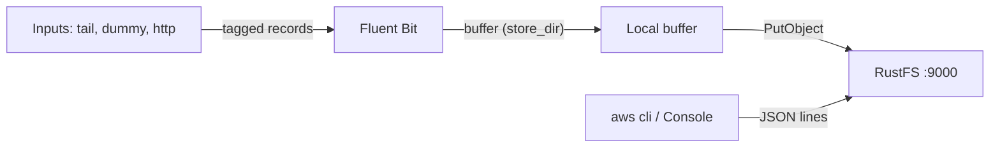

This guide connects [Fluent Bit](https://github.com/fluent/fluent-bit) — the CNCF log processor and forwarder — to **RustFS** as a log destination. You will run Fluent Bit with its `s3` output, buffer records on disk, upload them into a RustFS bucket, and read a delivered log file back. The workflow was verified with `fluent/fluent-bit:3.2.10` writing to a RustFS bucket over path-style addressing.

You need Docker. This deployment is intended for local integration testing, not production.

## Architecture



The S3 output buffers tagged records in `store_dir` and uploads a file once it reaches `total_file_size`, or when `upload_timeout` expires — whichever happens first. Each uploaded object is a file of JSON lines.

## 1. Create the bucket

The S3 output never creates buckets, and uploads fail with `NoSuchBucket` when the bucket is missing. Create it first, replacing all connection placeholders:

```bash
aws s3 mb s3://my-bucket \
  --endpoint-url http://<your-rustfs-endpoint>:9000
```

## 2. Configure the S3 output

Create the Fluent Bit configuration:

```text title="fluent-bit.conf"
[SERVICE]
    Flush 2
    Log_Level info

[INPUT]
    Name dummy
    Tag rustfs.test
    Rate 200

[OUTPUT]
    Name s3
    Match *
    endpoint http://<your-rustfs-endpoint>:9000
    region us-east-1
    bucket my-bucket
    total_file_size 1M
    use_put_object On
    upload_timeout 30s
    store_dir /tmp/flb-store
    json_date_key date
    json_date_format iso8601
```

`use_put_object On` uploads each buffered file with a single `PutObject` call. `upload_timeout` forces an upload after 30 seconds even when the buffer has not reached `total_file_size` — low-volume inputs need it or their records stay on local disk.

:::note[Custom endpoints use path-style by default]

Fluent Bit 3.2 has no `s3_force_path_style` option — the plugin rejects it as an unknown property. When `endpoint` points at a custom S3 service, requests address the bucket path-style, which matches RustFS defaults. No extra flag is required.

:::

## 3. Run Fluent Bit

Start the container with credentials passed through the standard AWS environment variables:

```bash
docker run -d --name fluent-bit \
  -e AWS_ACCESS_KEY_ID=<your-access-key> \
  -e AWS_SECRET_ACCESS_KEY=<your-secret-key> \
  -v "$PWD/fluent-bit.conf:/fluent-bit/etc/fluent-bit.conf:ro" \
  fluent/fluent-bit:3.2.10
```

Wait for the first upload, then confirm the worker started cleanly:

```bash
docker logs fluent-bit 2>&1 | grep "worker #0 started"
```

```text
[output:s3:s3.0] worker #0 started
```

## 4. Verify the uploaded objects

List the bucket — the default key layout is `fluent-bit-logs/<tag>/YYYY/MM/DD/HH/MM/`:

```bash
aws s3 ls s3://my-bucket/ --recursive \
  --endpoint-url http://<your-rustfs-endpoint>:9000
```

```text
2026-10-25 01:13:28  1021326 fluent-bit-logs/rustfs.test/2026/10/25/01/13/59-objectbmjH9744
2026-10-25 01:16:05   333735 fluent-bit-logs/rustfs.test/2026/10/25/01/15/34-objectKfCq13io
```

Read one object back — every line is a JSON record:

```bash
aws s3 cp s3://my-bucket/fluent-bit-logs/rustfs.test/2026/10/25/01/13/59-objectbmjH9744 - \
  --endpoint-url http://<your-rustfs-endpoint>:9000 | head -2
```

```json
{"date":"2026-10-25T01:13:59.204844Z","message":"dummy"}
{"date":"2026-10-25T01:13:59.206396Z","message":"dummy"}
```


## 5. Stop or reset

To tear down the demo while keeping the bucket objects:

```bash
docker rm -f fluent-bit
```

To delete the uploaded logs:

```bash
aws s3 rm s3://my-bucket/fluent-bit-logs --recursive \
  --endpoint-url http://<your-rustfs-endpoint>:9000
```

## Troubleshooting

### `PutObject request failed` with `NoSuchBucket`

The output bucket does not exist. Create it as shown in step 1 — the plugin never creates buckets.

### `[config] s3: unknown configuration property 's3_force_path_style'`

Fluent Bit 3.2 does not have this option. Remove it; custom endpoints already use path-style addressing.

### Objects never appear and the log stays quiet

The buffer has not reached `total_file_size` and no `upload_timeout` is set. Add `upload_timeout 30s` so low-volume inputs flush periodically.

### `InvalidAccessKeyId` in the Fluent Bit log

The credential environment variables are missing from the container, or the values are wrong. The S3 output reads `AWS_ACCESS_KEY_ID` and `AWS_SECRET_ACCESS_KEY`.

## Next steps

- Review [S3 compatibility notes](/administration/protocols/s3) before enabling multipart uploads or compression on this output.
- Create dedicated production credentials with [Access Key Management](/security-compliance/iam/access-token).
- Follow the [Fluent Bit S3 output documentation](https://docs.fluentbit.io/manual/pipeline/outputs/s3) for `s3_key_format`, compression, and `tail` input tuning on the same bucket.
