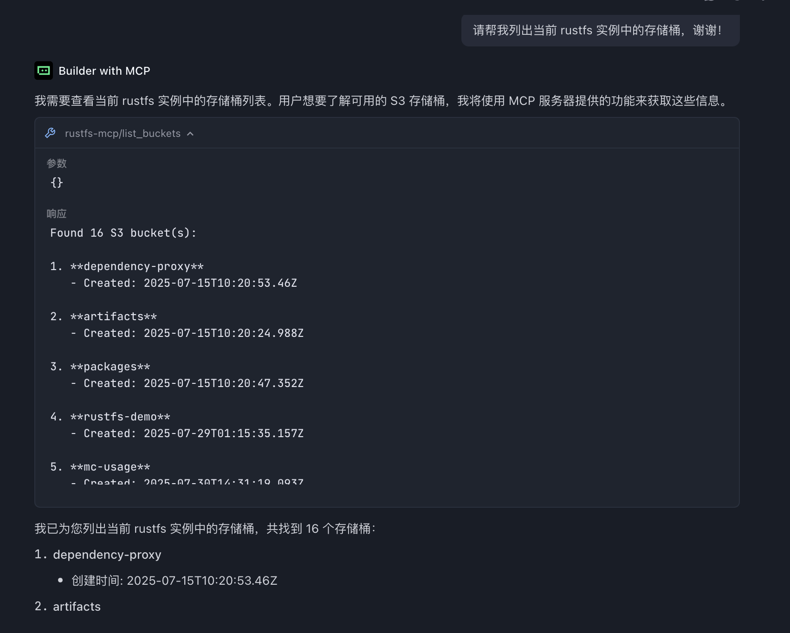

**RustFS MCP Server** is a [Model Context Protocol (MCP)](https://www.anthropic.com/news/model-context-protocol) server that gives AI assistants, such as Claude Desktop, access to S3-compatible object storage.

### What is MCP?

The Model Context Protocol is an open standard that enables AI applications to establish secure, controlled connections with external systems. This server acts as a bridge between AI tools and S3-compatible storage services, providing structured access to file operations while maintaining security and observability.

## Features

### Supported S3 operations

- **List Buckets**: Lists all accessible S3 buckets.
- **List Objects**: Browses bucket contents with optional prefix filtering.
- **Upload Files**: Uploads local files with automatic MIME type detection and cache control.
- **Get Objects**: Retrieves objects from S3 storage, supporting read or download modes.

## Installation

:::warning[Build instructions may be outdated]

The `rustfs-mcp` crate is no longer part of the current `rustfs/rustfs` main branch, so the build commands below may fail against a fresh clone. Check the [RustFS GitHub organization](https://github.com/rustfs) for the MCP server's current location before building from source.

:::

### Prerequisites

- Rust 1.75+ (for building from source)
- Configured AWS credentials (via environment variables, AWS CLI, or IAM roles)
- Access to S3-compatible storage services

### Build from source

```bash
# Clone the repository
git clone https://github.com/rustfs/rustfs.git
cd rustfs

# Build the MCP server
cargo build --release -p rustfs-mcp

# Binary will be available at
./target/release/rustfs-mcp
```

## Configuration

### Environment variables

```bash
# AWS credentials (required)
export AWS_ACCESS_KEY_ID=your_access_key
export AWS_SECRET_ACCESS_KEY=your_secret_key
export AWS_REGION=us-east-1  # optional, defaults to us-east-1

# Optional: Custom S3 endpoint (for MinIO, etc.)
export AWS_ENDPOINT_URL=http://localhost:9000

# Log level (optional)
export RUST_LOG=info
```

### Command-line options

```bash
rustfs-mcp --help
```

The server supports various command line options to customize behavior:

- `--access-key-id`: AWS access key ID for S3 authentication
- `--secret-access-key`: AWS secret key for S3 authentication
- `--region`: AWS region for S3 operations (default: us-east-1)
- `--endpoint-url`: Custom S3 endpoint URL (for MinIO, LocalStack, etc.)
- `--log-level`: Log level configuration (default: rustfs_mcp_server=info)

## Usage

### Start the server

```bash
# Start the MCP server
rustfs-mcp

# Or with custom options
rustfs-mcp --log-level debug --region us-east-1
```

### Connect a chat client

#### Pass command-line arguments

```json
{
  "mcpServers": {
    "rustfs-mcp": {
      "command": "/path/to/rustfs-mcp",
      "args": [
        "--access-key-id", "your_access_key",
        "--secret-access-key", "your_secret_key",
        "--region", "us-east-1",
        "--log-level", "info"
      ]
    }
  }
}
```

#### Pass environment variables

```json
{
  "mcpServers": {
    "rustfs-mcp": {
      "command": "/path/to/rustfs-mcp",
      "env": {
        "AWS_ACCESS_KEY_ID": "your_access_key",
        "AWS_SECRET_ACCESS_KEY": "your_secret_key",
        "AWS_REGION": "us-east-1"
      }
    }
  }
}
```

### Run with Docker

RustFS MCP provides an [official Dockerfile](https://github.com/rustfs/rustfs/tree/main/crates/mcp) that you can use to build a container image.

```bash
# Clone RustFS repository code
git clone https://github.com/rustfs/rustfs.git

# Build Docker image
docker build -f crates/mcp/Dockerfile -t rustfs/rustfs-mcp .
```

After the build succeeds, add the server to your IDE's MCP configuration.

#### Configure MCP in an AI IDE

Many AI IDEs, such as Cursor, Windsurf, and Trae, support MCP. For example, in Trae, add the following content to the MCP configuration (**MCP --> Add**):

```json
{
  "mcpServers": {
    "rustfs-mcp": {
      "command": "docker",
      "args": [
        "run",
        "--rm",
        "-i",
        "-e",
        "AWS_ACCESS_KEY_ID",
        "-e",
        "AWS_SECRET_ACCESS_KEY",
        "-e",
        "AWS_REGION",
        "-e",
        "AWS_ENDPOINT_URL",
        "rustfs/rustfs-mcp"
      ],
      "env": {
        "AWS_ACCESS_KEY_ID": "rustfs_access_key",
        "AWS_SECRET_ACCESS_KEY": "rustfs_secret_key",
        "AWS_REGION": "us-east-1",
        "AWS_ENDPOINT_URL": "rustfs_instance_url"
      }
    }
  }
}
```

:::note[Access keys]

`AWS_ACCESS_KEY_ID` and `AWS_SECRET_ACCESS_KEY` are RustFS access keys. To create them, see [Access keys](../security-compliance/iam/access-token.md).

:::

If the server is added successfully, the MCP configuration page lists its [available tools](#available-tools).


To invoke an MCP tool in Trae, enter a prompt in the chat. For example:

```text
List the buckets in this RustFS instance.
```

Trae returns the following response:



Trae uses **Builder with MCP** mode, calling the `list_buckets` tool to list all buckets in the configured RustFS instance. Other tools work the same way.

## Available tools

The MCP server exposes the following tools that AI assistants can use:

### `list_buckets`

Lists all S3 buckets accessible with the configured credentials.

**Parameters**: None

### `list_objects`

Lists objects in an S3 bucket with optional prefix filtering.

**Parameters**:

- `bucket_name` (string): Name of the S3 bucket
- `prefix` (string, optional): Prefix for filtering objects

### `upload_file`

Uploads a local file to S3 with automatic MIME type detection.

**Parameters**:

- `local_file_path` (string): Local file path
- `bucket_name` (string): Target S3 bucket
- `object_key` (string): S3 object key (target path)
- `content_type` (string, optional): Content type (auto-detected if not provided)
- `storage_class` (string, optional): S3 storage class
- `cache_control` (string, optional): Cache control header

### `get_object`

Retrieves objects from S3 with two operation modes: direct content reading or download to file.

**Parameters**:

- `bucket_name` (string): Source S3 bucket
- `object_key` (string): S3 object key
- `version_id` (string, optional): Version ID for versioned objects
- `mode` (string, optional): Operation mode - "read" (default) returns content directly, "download" saves to local file
- `local_path` (string, optional): Local file path (required when mode is "download")
- `max_content_size` (number, optional): Maximum content size for read mode in bytes (default: 1MB)

### `create_bucket`

Creates a new RustFS bucket.

**Parameters**:

- `bucket_name` (string): Name of the bucket to create.

### `delete_bucket`

Deletes the specified RustFS bucket.

**Parameters**:

- `bucket_name` (string): Name of the bucket to delete.

## Architecture

The MCP server is built with a modular architecture:

```text
rustfs-mcp/
├── src/
│   ├── main.rs          # Entry point, CLI parsing and server initialization
│   ├── server.rs        # MCP server implementation and tool handlers
│   ├── s3_client.rs     # S3 client wrapper with async operations
│   ├── config.rs        # Configuration management and CLI options
│   └── lib.rs           # Library exports and public API
└── Cargo.toml           # Dependencies, metadata and binary configuration
```
