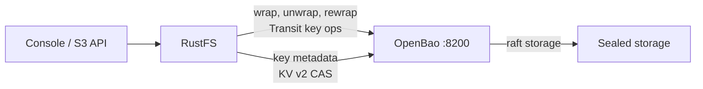
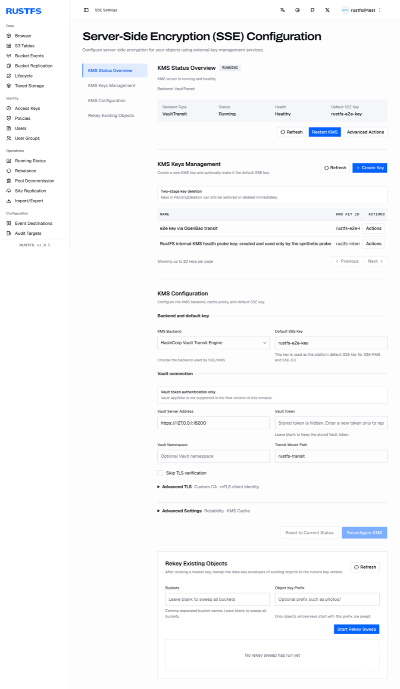

[OpenBao](https://github.com/openbao/openbao) is the open-source fork of HashiCorp Vault. RustFS manages SSE-KMS keys through an external KMS using its Vault Transit backend, and OpenBao keeps the same API surface, so no RustFS code change is needed — the integration is configuration only. This guide deploys OpenBao, prepares the secrets engines and a least-privilege token, configures RustFS, and verifies SSE-KMS end to end. The workflow was verified with RustFS `1.0.5` and OpenBao `2.7.2`.

You need Docker on the OpenBao host and a RustFS 1.0.5+ server. This guide is a single-node deployment for integration testing; production deployments additionally require clustered OpenBao with managed unseal, as described at the end.

## Architecture



RustFS generates per-object data keys locally and wraps them through the OpenBao Transit engine; key lifecycle metadata is kept in a KV v2 mount with compare-and-set writes. OpenBao holds the master key versions, so an OpenBao outage means new SSE-KMS writes and reads of encrypted objects pause until it is reachable and unsealed again.

## 1. Deploy OpenBao with TLS and raft storage

RustFS refuses plain HTTP to the KMS: startup fails with `Vault Transit requires HTTPS outside explicit development mode`. Set up OpenBao with TLS from the start. Create the directory layout and a config with integrated raft storage:

```bash
mkdir -p /data/openbao/{data,config,tls}
openssl req -x509 -newkey rsa:4096 -sha256 -days 825 -nodes \
  -keyout /data/openbao/tls/ca-key.pem -out /data/openbao/tls/ca.pem \
  -subj "/CN=openbao-demo-ca"
openssl req -newkey rsa:2048 -nodes -keyout /data/openbao/tls/server-key.pem \
  -out /data/openbao/tls/server.csr -subj "/CN=openbao-host"
openssl x509 -req -in /data/openbao/tls/server.csr \
  -CA /data/openbao/tls/ca.pem -CAkey /data/openbao/tls/ca-key.pem \
  -CAcreateserial -out /data/openbao/tls/server-cert.pem -days 825 -sha256 \
  -extfile <(printf "subjectAltName=IP:127.0.0.1,DNS:localhost,DNS:openbao-host")
```

```hcl title="/data/openbao/config/config.hcl"
storage "raft" {
  path    = "/openbao/data"
  node_id = "openbao-1"
}
listener "tcp" {
  address         = "0.0.0.0:8200"
  cluster_address = "0.0.0.0:8201"
  tls_disable     = 0
  tls_cert_file   = "/openbao/tls/server-cert.pem"
  tls_key_file    = "/openbao/tls/server-key.pem"
}
api_addr      = "https://127.0.0.1:8200"
cluster_addr  = "https://127.0.0.1:8201"
disable_mlock = true
ui            = false
```

Start the container with the data, config, and TLS directories mounted. The bind mounts must be writable by the container process:

```bash
chmod -R a+rX /data/openbao/tls
chmod 777 /data/openbao/data
docker run -d --name openbao --restart unless-stopped \
  -p 127.0.0.1:8200:8200 \
  -v /data/openbao/data:/openbao/data \
  -v /data/openbao/config:/openbao/config \
  -v /data/openbao/tls:/openbao/tls \
  openbao/openbao:2.7.2 server
```

Initialize with a single key share and unseal. Keep the unseal key and root token safe — they are shown once:

```bash
docker exec -e BAO_ADDR=https://127.0.0.1:8200 -e BAO_CACERT=/openbao/tls/ca.pem \
  openbao bao operator init -key-shares=1 -key-threshold=1 -format=json
```

After every container restart, unseal again:

```bash
docker exec -e BAO_ADDR=https://127.0.0.1:8200 -e BAO_CACERT=/openbao/tls/ca.pem \
  openbao bao operator unseal <unseal-key>
```

## 2. Enable the secrets engines and create a scoped token

RustFS needs two engines: Transit for key operations, and KV v2 for the key metadata it maintains. Create dedicated mounts:

```bash
docker exec -e BAO_ADDR=https://127.0.0.1:8200 -e BAO_CACERT=/openbao/tls/ca.pem \
  -e BAO_TOKEN=<root-token> openbao \
  bao secrets enable -path=rustfs-transit transit
docker exec -e BAO_ADDR=https://127.0.0.1:8200 -e BAO_CACERT=/openbao/tls/ca.pem \
  -e BAO_TOKEN=<root-token> openbao \
  bao secrets enable -path=rustfs-meta -version=2 kv
```

Write a policy granting exactly what the RustFS KMS client needs — Transit key management including LIST (the startup probe depends on it), the crypto operations, and the KV v2 data and metadata paths for the configured prefix:

```hcl title="rustfs-kms.hcl"
path "rustfs-transit/keys" {
  capabilities = ["list"]
}
path "rustfs-transit/keys/*" {
  capabilities = ["create", "read", "update", "delete", "list"]
}
path "rustfs-transit/encrypt/*" {
  capabilities = ["create", "update"]
}
path "rustfs-transit/decrypt/*" {
  capabilities = ["create", "update"]
}
path "rustfs-transit/rewrap/*" {
  capabilities = ["create", "update"]
}
path "rustfs-transit/keys/*/rotate" {
  capabilities = ["update"]
}
path "rustfs-transit/keys/*/config" {
  capabilities = ["read", "update"]
}
path "rustfs-meta/data/rustfs/kms/keys/*" {
  capabilities = ["create", "update", "read"]
}
path "rustfs-meta/metadata/rustfs/kms/keys/*" {
  capabilities = ["read", "list", "delete"]
}
```

Load the policy and issue an orphan token:

```bash
docker cp rustfs-kms.hcl openbao:/tmp/rustfs-kms.hcl
docker exec -e BAO_ADDR=https://127.0.0.1:8200 -e BAO_CACERT=/openbao/tls/ca.pem \
  -e BAO_TOKEN=<root-token> openbao \
  bao policy write rustfs-kms /tmp/rustfs-kms.hcl
docker exec -e BAO_ADDR=https://127.0.0.1:8200 -e BAO_CACERT=/openbao/tls/ca.pem \
  -e BAO_TOKEN=<root-token> openbao \
  bao token create -policy=rustfs-kms -orphan -format=json
```

Store the token on the RustFS host. The file must have owner-only permissions and be owned by the `rustfs` service account — RustFS rejects group or other read bits:

```bash
install -d -m 0755 -o rustfs -g rustfs /data/rustfs/kms
install -m 0600 -o rustfs -g rustfs /dev/null /data/rustfs/kms/openbao-token
# write the token into /data/rustfs/kms/openbao-token
cp /data/openbao/tls/ca.pem /data/rustfs/kms/openbao-ca.pem
```

## 3. Configure RustFS

Add the KMS settings to the RustFS environment file and restart:

```ini title="/etc/default/rustfs"
RUSTFS_KMS_ENABLE=true
RUSTFS_KMS_BACKEND=vault-transit
RUSTFS_KMS_VAULT_ADDRESS=https://127.0.0.1:8200
RUSTFS_KMS_VAULT_MOUNT_PATH=rustfs-transit
RUSTFS_KMS_VAULT_TOKEN_FILE=/data/rustfs/kms/openbao-token
RUSTFS_KMS_VAULT_TRANSIT_METADATA_KV_MOUNT=rustfs-meta
RUSTFS_KMS_VAULT_TRANSIT_METADATA_PREFIX=rustfs/kms/keys
RUSTFS_KMS_VAULT_CA_CERT=/data/rustfs/kms/openbao-ca.pem
```

```bash
sudo systemctl restart rustfs
```

If the backend fails validation, RustFS refuses to start and names the exact problem in the log — see [Troubleshooting](#troubleshooting). When it starts, check the KMS status in the console under **SSE Settings**, or through the admin API:

```bash
curl -s http://localhost:9000/rustfs/admin/v3/kms/service-status
```

The response reports `"backend_type":"VaultTransit"` with `"healthy":true`, the configured address, mount path, and whether a custom CA is in use.

## 4. Create a key and select the default

The console exposes the full KMS lifecycle under **SSE Settings**: status overview, key management (create, two-stage deletion), backend configuration, and re-encrypt sweeps for existing objects.

Create a key in **KMS Keys Management** — RustFS creates the matching Transit key in OpenBao and its metadata record in the KV v2 mount together. Then set **Default SSE Key** either in the console or through the environment:

```ini title="/etc/default/rustfs"
RUSTFS_KMS_DEFAULT_KEY_ID=rustfs-e2e-key
```

Restart RustFS after changing the default. Creating a key directly in OpenBao without going through RustFS leaves the KV v2 metadata record missing — create keys from the RustFS side.



## 5. Verify SSE-KMS end to end

Set the bucket default or pass the key per write. The upload response echoes both the encryption algorithm and the key ID, and the download returns the original bytes:

```bash
aws s3api put-object \
  --endpoint-url http://localhost:9000 \
  --bucket my-bucket --key docs/e2e-check.txt \
  --body ./e2e-check.txt \
  --server-side-encryption aws:kms \
  --ssekms-key-id rustfs-e2e-key
```

```json
{
    "ETag": "\"57a02aed...\"",
    "ServerSideEncryption": "aws:kms",
    "SSEKMSKeyId": "rustfs-e2e-key"
}
```

```bash
aws s3api get-object \
  --endpoint-url http://localhost:9000 \
  --bucket my-bucket --key docs/e2e-check.txt ./e2e-check-back.txt
```

## Validation results

The following checks were executed against a live OpenBao 2.7.2 deployment and are expected to pass on any healthy setup:

| Check | Expected result |
| --- | --- |
| SSE-KMS PUT/GET with the key ID | Response echoes `aws:kms` and the key ID; downloaded bytes match |
| Range GET on an encrypted object | Byte range returned correctly |
| RustFS restart | Key metadata recovers from KV v2; encrypted objects remain readable |
| OpenBao restart (sealed) | Encrypted reads fail with `ServiceUnavailable` — no plaintext fallback; after unsealing, reads recover automatically within the probe interval |
| Transit key rotation | `latest_version` increments with older versions retained; objects wrapped before rotation stay readable |
| Ciphertext tampering on storage | Reads fail and deletion is refused; no plaintext fallback |
| Wrong encryption context | Transit decryption fails with a message authentication error |

On storage layout note: small objects store their encrypted bytes inline in the per-disk `xl.meta` file, so ciphertext greps against the object directory come back empty even though the data is there.

## Troubleshooting

### Startup fails with `Vault Transit requires HTTPS outside explicit development mode`

The KMS address is not HTTPS. Configure TLS on OpenBao and trust its CA through `RUSTFS_KMS_VAULT_CA_CERT`. The escape hatch `RUSTFS_KMS_ALLOW_INSECURE_DEV_DEFAULTS=true` exists for development only.

### Startup fails with `Vault token file ... has insecure permissions 0o644`

The token file must have `0600` permissions with group and other bits unset, owned by the RustFS service account:

```bash
chown rustfs:rustfs /data/rustfs/kms/openbao-token
chmod 600 /data/rustfs/kms/openbao-token
```

### Reads fail with `ServiceUnavailable` while OpenBao is sealed

Expected behavior: encrypted reads require the external KMS. Unseal OpenBao; RustFS recovers automatically on its next KMS probe — writes and reads resume without a RustFS restart.

### OpenBao transit decrypts with the wrong `context` parameter

For non-derived keys, transit ignores `context` and binds the S3 encryption context as `associated_data`. A wrong `associated_data` fails with `cipher: message authentication failed`. When testing the binding manually through `bao`, pass `associated_data`, not `context`.

### A tampered encrypted object cannot be read or deleted

Both paths fail by design — deletion also verifies the stored metadata. Remove the object directories from every disk while RustFS is stopped, then restart.

## Production notes

The single-node OpenBao deployment above keeps unseal manual and storage local. For production: run OpenBao as a cluster with integrated storage replication or an auto-unseal mechanism, protect the unseal credentials and the raft data backup independently of RustFS backups, and pin the OpenBao version — validate the vaultrs client against each OpenBao upgrade before rolling it out.

## Next steps

- Review the backend overview and bucket-default encryption in [SSE-KMS](./kms.md).
- Read the [S3 compatibility notes](/administration/protocols/s3) before adopting further SSE features.
- Create dedicated production credentials with [Access Key Management](/security-compliance/iam/access-token).
