La migration à la demande importe des objets d’un compartiment externe vers un compartiment RustFS lorsqu’un client lit une clé absente, ou lorsque vous lancez un backfill. **Ce document utilise Cloudflare R2 comme exemple** de bout en bout. Les étapes suivent un parcours sur la Console v1.0.3 : un compartiment R2 a été attaché à un compartiment local vide, la connexion a été testée, puis trois imports ont été exécutés — un objet avec `rc cp`, un backfill de préfixe, et un backfill de tout le namespace source avec un dry run.

RustFS lit la source. Le formulaire d’activation indique que RustFS n’y écrit ni n’y supprime jamais d’objets. La page de migration indique que RustFS n’importe des objets que lorsqu’ils sont lus ou remplis par un backfill, que les nouvelles opérations `PUT` et `DELETE` dans RustFS ne sont pas synchronisées vers la source, et que les modifications ultérieures de la source ne mettent pas à jour les copies locales.

Les captures de ce parcours utilisent des marqueurs pour l’identifiant de compte R2 et la clé d’accès. L’hôte de l’invite du terminal est `localhost`.

## Fournisseurs source

**Source connection** → **Provider** liste ces sources. Les noms sont les libellés exacts de la Console. Google Cloud Storage apparaît deux fois : HMAC et Native.

1. Amazon S3
2. S3-compatible storage
3. MinIO
4. RustFS
5. Cloudflare R2
6. Google Cloud Storage (HMAC)
7. Azure Blob Storage (Native)
8. Google Cloud Storage (Native)

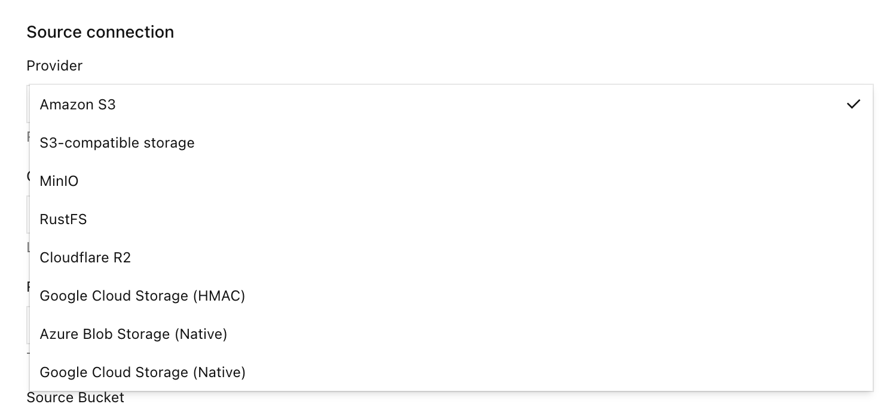

Une migration depuis un autre fournisseur de cette liste suit le même flux : créer un compartiment local vide, activer la migration à la demande, choisir **Provider**, sélectionner **Test connection**, sélectionner **Enable migration**, puis importer lors d’un GET manquant ou par un backfill. Seuls les champs de point de terminaison, d’identifiants et de compartiment changent selon le fournisseur. Le parcours R2 ci-dessous remplit ces champs pour Cloudflare R2.

## Migration à la demande et réplication de compartiment

| Objectif | Utiliser |
| --- | --- |
| Importer des objets dans RustFS depuis un fournisseur de la liste ci-dessus, lors d’une lecture manquante ou par backfill | Migration à la demande |
| Pousser des versions d’objets d’un compartiment RustFS vers un autre compartiment | [Réplication de compartiment](./replication.md) |
| Synchroniser la configuration de site et les données d’identité entre des déploiements | [Réplication de site](/operations/high-availability/site-replication) |

La migration à la demande est un import entrant. La [réplication de compartiment](./replication.md) est une copie sortante des versions d’objets et exige la gestion des versions sur les deux compartiments. Une fois une clé stockée localement, la migration à la demande ne suit plus la source.

:::warning[Ne fermez pas une boucle de réplication]
Ne choisissez pas comme source de la migration à la demande un compartiment qui est déjà la cible de réplication de ce compartiment local.
:::

## Avant de commencer

Les identifiants et le point de terminaison de cette section concernent l’exemple Cloudflare R2. Pour un autre fournisseur, saisissez le point de terminaison, l’identifiant de lecture et le nom de compartiment de ce système dans les mêmes champs de la Console.

- Une Console RustFS qui contient **On-demand migration**. Ce parcours utilisait la Console v1.0.3, sur le port `9001`.
- Un compte de Console autorisé à ouvrir **Settings** du compartiment local.
- La CLI RustFS [`rc`](/operations/rc) sur l’hôte qui lit le compartiment local.
- Un jeton d’API Cloudflare R2 capable de lire les objets du compartiment source. Limitez de préférence le jeton à ce compartiment. L’accès public du compartiment R2 ne fait pas partie de ce parcours.
- Le point de terminaison S3 R2 du compartiment source, `https://<account-id>.r2.cloudflarestorage.com`. Si le compartiment utilise une juridiction, copiez le point de terminaison depuis le tableau de bord R2.

Pointez `rc` vers l’API S3 RustFS locale, pas vers R2 :

```bash
rc alias set rustfs http://localhost:9000 <your-access-key> <your-secret-key> --region us-east-1 --bucket-lookup path
```

Le compartiment local de ce parcours est `migration`. Le compartiment R2 est `dl-rustfs`. La gestion des versions était activée sur `migration`, et le verrouillage d’objet était désactivé. Le verrouillage d’objet n’était pas nécessaire pour activer la migration à la demande, et la gestion des versions n’en était pas un prérequis. Lorsque la gestion des versions est activée, un marqueur de suppression local peut masquer la clé source.

:::warning[Utilisez un jeton source en lecture seule]
Créez un jeton R2 qui peut lire le compartiment source et ne peut ni y écrire ni y supprimer. Le formulaire indique que RustFS conserve le secret et ne le renvoie pas à la Console.
:::

:::note[Activer la source ne copie pas les données]
**Migration active** signifie que le compartiment est attaché à la source. Les compteurs d’exécution restent à zéro tant qu’un client ne lit pas une clé absente ou que vous ne lancez pas un backfill.
:::

## 1. Créer un compartiment local vide

Dans la Console, ouvrez **Browser** → **Buckets**, créez un compartiment nommé `migration` et vérifiez qu’il ne contient aucun objet. Ouvrez **Settings** de ce compartiment lorsque vous êtes prêt à attacher la source.

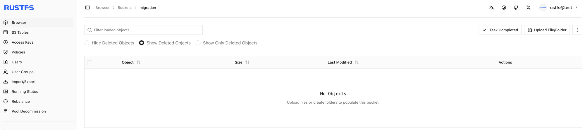

## 2. Ouvrir la migration à la demande

1. Ouvrez le compartiment `migration` et sélectionnez **Settings**.
2. Sélectionnez **Automation**.
3. Repérez **On-demand migration**.
4. S’il n’est pas configuré, sélectionnez **Open migration settings** ou **+ Enable on-demand migration**. S’il est déjà actif, sélectionnez **Manage migration**.

Dans ce parcours, la page non configurée indique qu’aucune source de migration n’est configurée et propose **+ Enable on-demand migration**.

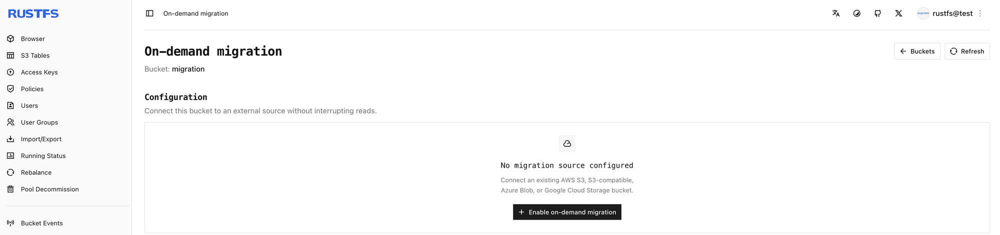

Une fois la source activée, **Automation** affiche **Migration active** et **Manage migration**.

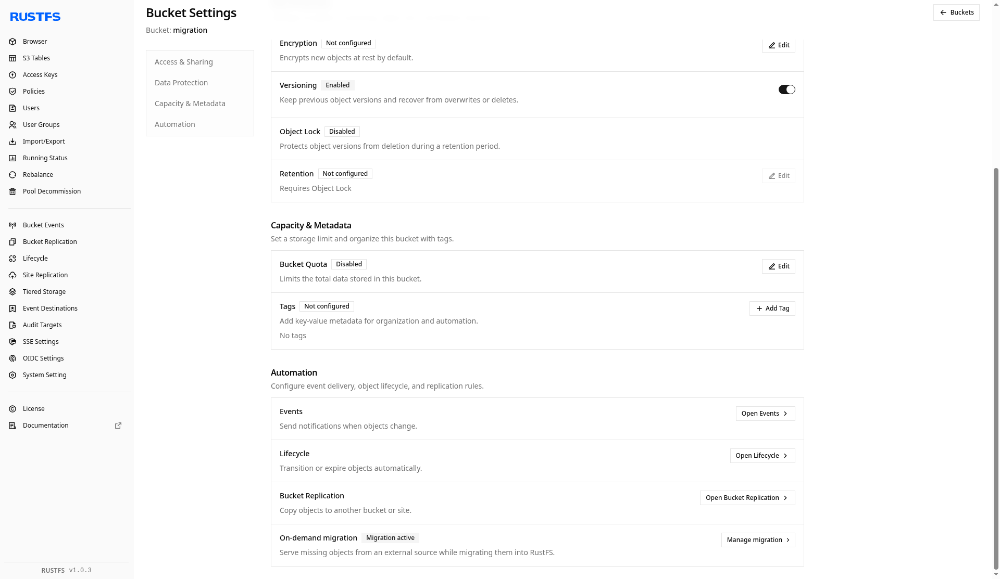

## 3. Pointer le compartiment vers Cloudflare R2

Dans **Enable on-demand migration**, renseignez la source comme suit. Remplacez l’identifiant de compte et les clés par votre propre jeton R2. Laissez le jeton de session vide, sauf si le jeton l’exige. Laissez **Local prefix** vide pour exposer tout le namespace source. Ce parcours n’a enregistré aucun préfixe supplémentaire (**All keys**, **No added prefix**).

| Champ | Valeur dans ce parcours |
| --- | --- |
| Source | Cloudflare R2 |
| Endpoint | `https://<account-id>.r2.cloudflarestorage.com` |
| Region | `us-east-1` (le formulaire accepte aussi `auto`) |
| Source Bucket | `dl-rustfs` |
| Addressing style | Automatic |
| Access Key | ID de clé d’accès R2 |
| Secret Key | Secret R2 |
| Session token | Vide |
| Local prefix | Vide |

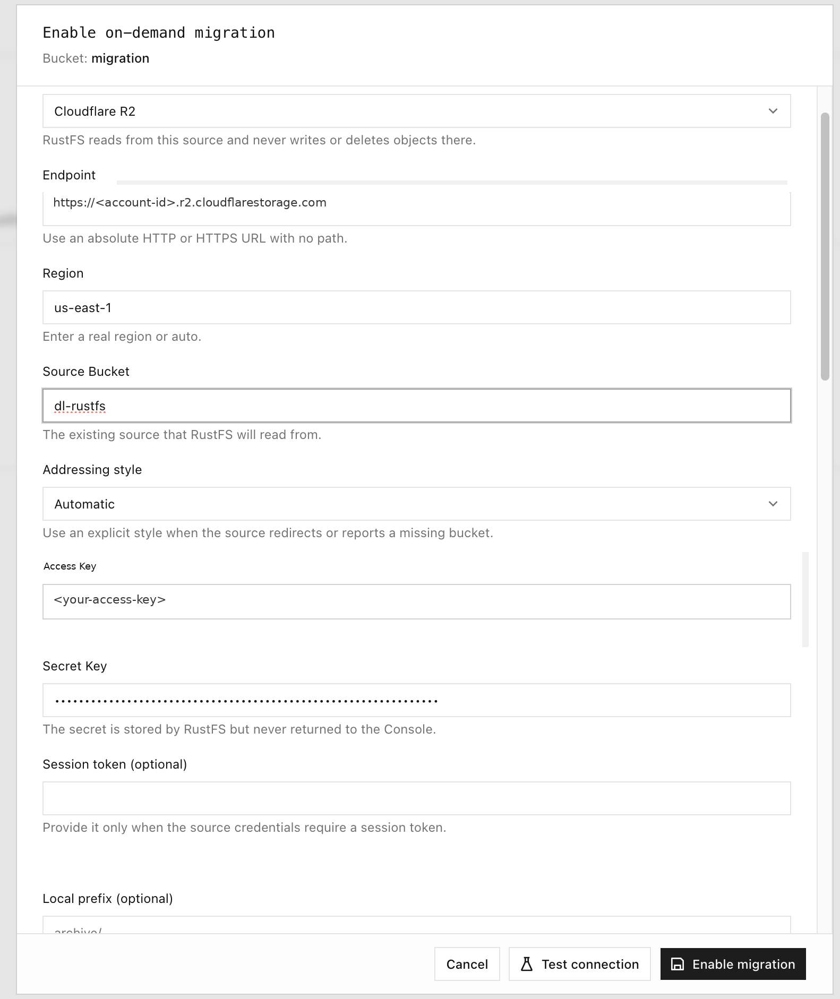

## 4. Tester la connexion et activer la migration

Sélectionnez **Test connection**. Un contrôle réussi affiche **Connection test passed** et une clé d’objet d’exemple issue du compartiment source. Sélectionnez ensuite **Enable migration**.

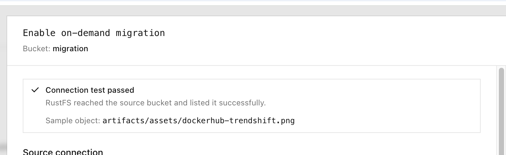

Le même résultat apparaît aussi sous forme de toast :

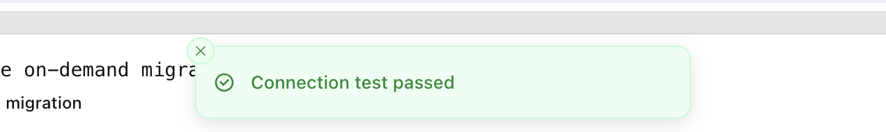

L’état de configuration devient **Migration active**. Tant qu’aucune lecture ni aucun backfill n’a lieu, **Runtime status** reste à zéro objet migré et zéro donnée migrée. **Latest job** reste **No backfill yet**.

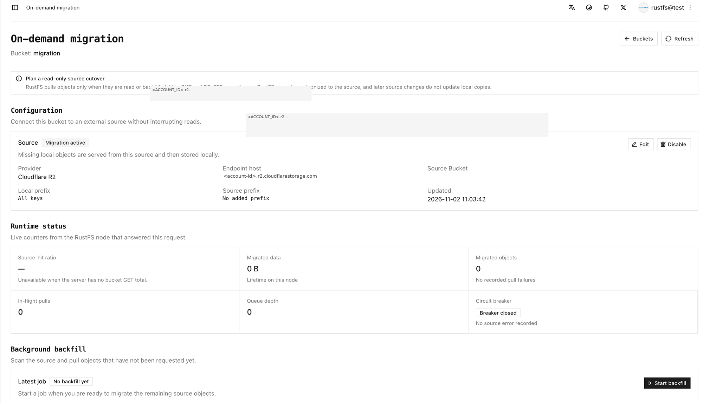

## 5. Récupérer un objet avec rc cp

Lisez le compartiment local avec `rc`. N’envoyez pas cette requête au point de terminaison R2. Dans ce parcours, le compartiment local était encore vide et un objet absent a été importé. Le premier échec de lecture renvoie l’objet au client et le stocke localement. Une lecture ultérieure de la même clé est servie par RustFS.

```bash
rc cp rustfs/migration/artifacts/rustfs/packages/nightly/rustfs-nightly-2026-11-02.deb /tmp/
```

```text
rustfs/migration/artifacts/rustfs/packages/nightly/rustfs-nightly-2026-11-02.deb -> /tmp/rustfs-nightly-2026-11-02.deb (71.34 MiB)
```

Utilisez une autre clé si le compartiment source ne contient pas cet objet. La session de terminal montre ce `rc cp` et les contrôles `rc ls` ultérieurs du préfixe nightly local. La liste correspond au préfixe local une fois les objets présents. Le `rc cp` ci-dessus est l’import de 71.34 MiB.

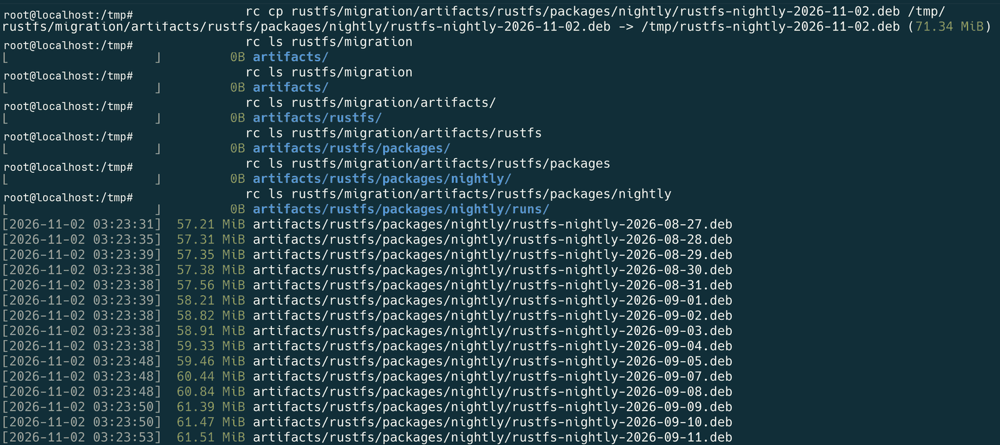

Le même préfixe nightly sur le compartiment R2, tel qu’il apparaissait dans le tableau de bord Cloudflare :

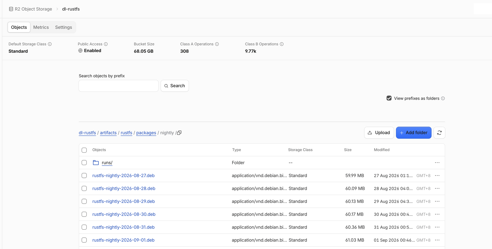

Le chiffre de taille de compartiment sur ce tableau de bord est le total Cloudflare du compartiment. Les compteurs RustFS plus loin sur cette page sont ce que le travail de migration a indiqué.

Après l’import de l’objet unique, le **Browser** de la Console affiche cet objet dans le compartiment local :

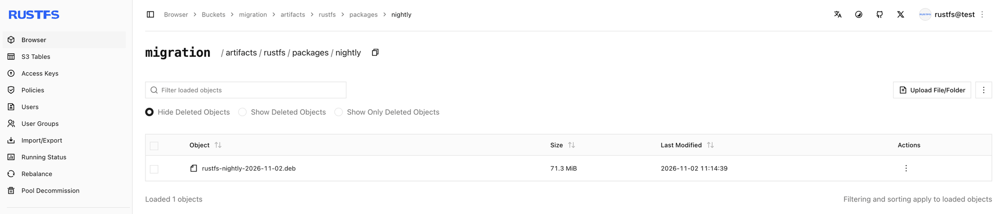

## 6. Lancer un backfill sur un préfixe

**Start backfill** parcourt la source et importe les clés qui ne sont pas déjà locales. La boîte de dialogue de ce parcours utilisait ces réglages :

| Option | Signification | Valeur du parcours |
| --- | --- | --- |
| Source listing prefix | Ne lister que ce préfixe | `artifacts/rustfs/packages/nightly/` |
| Existing local objects | Que faire si la clé est déjà locale | **Always skip** |
| Dry run | Lister les correspondances sans mettre en file ni écrire d’objets | Activé pour la répétition, puis désactivé pour l’import |

**Dry run** liste les objets correspondants sans mettre en file ni écrire aucun objet. Vérifiez le préfixe, puis désactivez **Dry run** avant d’importer.

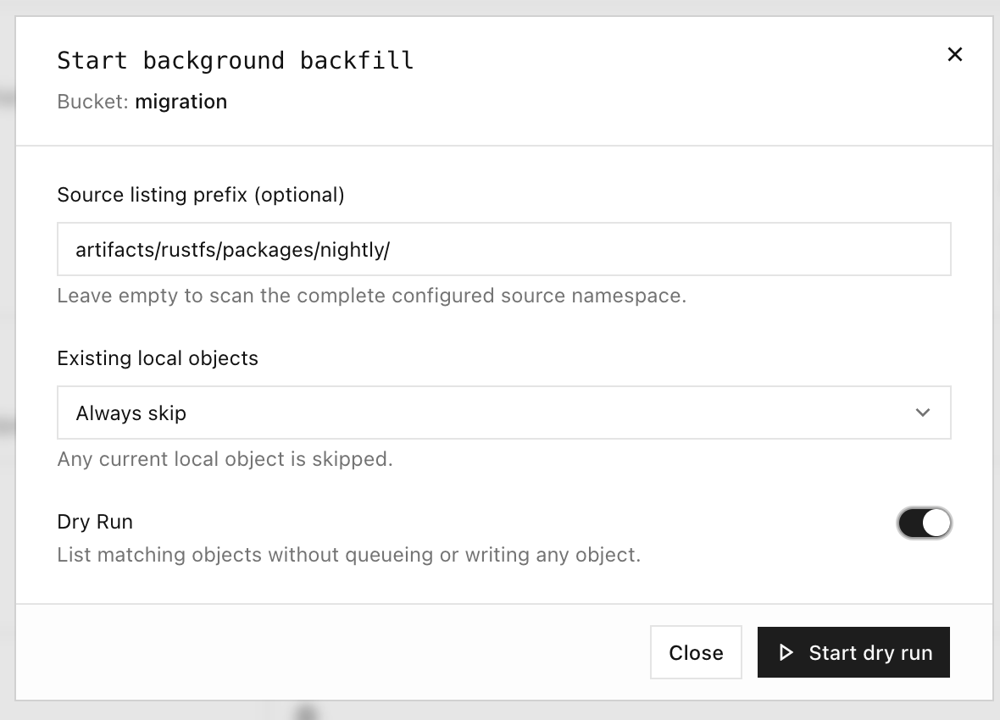

Voici un extrait de liste de préfixe enregistré pendant le parcours. La première clé était tronquée dans les notes de laboratoire. La clé complète a la forme `artifacts/rustfs/packages/nightly/rustfs-nightly-2026-10-29.deb`. Les horodatages sont ceux des notes, environ UTC. La liste complète est plus longue que cet extrait.

```text
…ghtly-2026-10-29.deb
[2026-11-02 03:25:08]  70.36 MiB artifacts/rustfs/packages/nightly/rustfs-nightly-2026-10-30.deb
[2026-11-02 03:25:08]  70.65 MiB artifacts/rustfs/packages/nightly/rustfs-nightly-2026-10-31.deb
[2026-11-02 03:25:08]  71.15 MiB artifacts/rustfs/packages/nightly/rustfs-nightly-2026-11-01.deb
[2026-11-02 03:14:39]  71.34 MiB artifacts/rustfs/packages/nightly/rustfs-nightly-2026-11-02.deb
[2026-11-02 03:25:08]  71.34 MiB artifacts/rustfs/packages/nightly/rustfs-nightly-latest.deb
```

Pendant qu’un backfill écrit des objets, la Console affiche les nombres listés et importés. Elle n’affiche pas de pourcentage d’avancement tant que le parcours de la source est en cours.

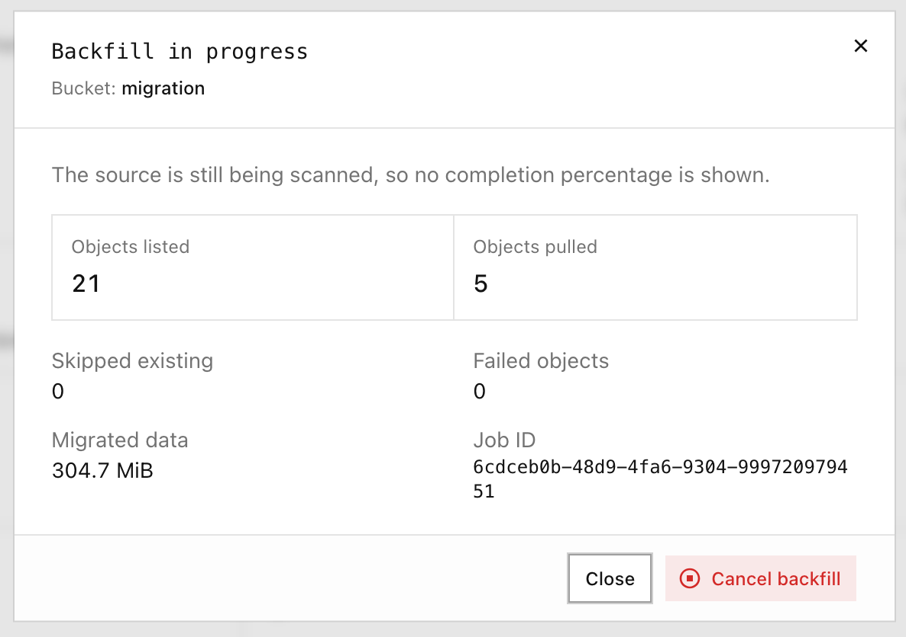

## 7. Lancer un dry run, puis le backfill du namespace source

Laissez **Source listing prefix** vide pour parcourir le namespace source configuré. Lancez d’abord **Dry run** et vérifiez l’ensemble listé. Désactivez ensuite **Dry run** et démarrez le backfill.

Un dry run de ce parcours s’est terminé avec des objets listés et aucun import :

| Listed | Pulled | Skipped | Failed objects | Data |
| --- | --- | --- | --- | --- |
| 128 | 0 | 0 | 0 | 0 B |

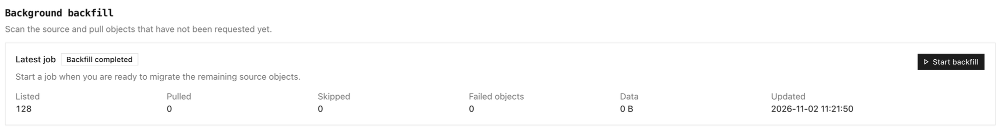

Le backfill complet qui a suivi, avec un préfixe vide, s’est terminé ainsi :

| Listed | Pulled | Skipped | Failed objects | Data |
| --- | --- | --- | --- | --- |
| 128 | 127 | 1 | 0 | 8.0 GiB |

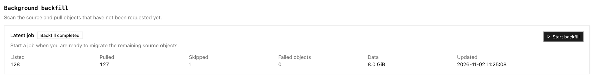

## 8. Vérifier le compartiment

Sur la page de migration à la demande, vérifiez :

1. **Runtime status** — les objets migrés et les données migrées ne sont plus à zéro, et aucun échec d’import n’est enregistré.
2. **Background backfill** — le dernier travail affiche les nombres listés, importés, ignorés et en échec.
3. **Browser** et `rc` — listez le préfixe avec `rc ls`, comme dans la session de terminal ci-dessus, puis relisez une clé locale avec `rc cp`.

Dans ce parcours, le panneau d’exécution affichait **Migrated data** 8.1 GiB et **Migrated objects** 128. Le dernier backfill affichait Listed 128, Pulled 127, Skipped 1, Failed objects 0 et Data 8.0 GiB.

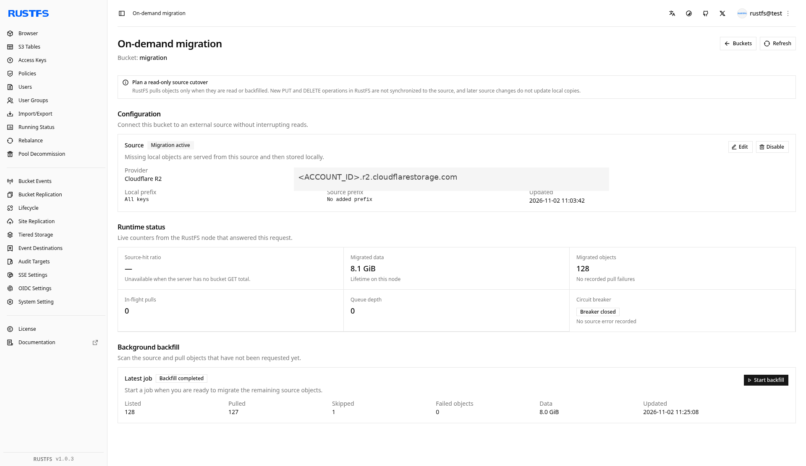

La liste des compartiments après le parcours montre `migration` avec 128 objets et 8.1 GiB :

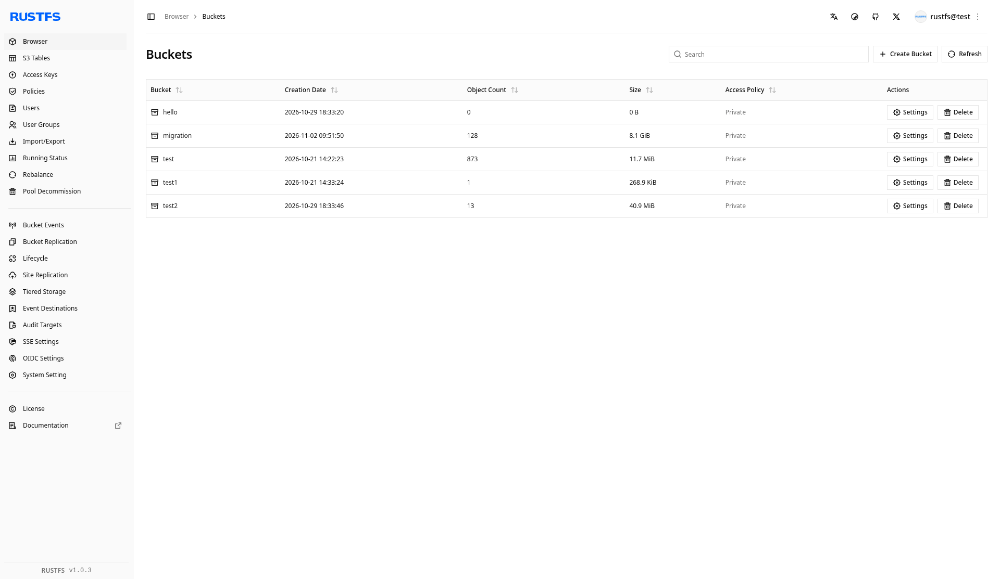

:::warning[La copie locale ne suit pas la source]
Une modification ultérieure de la même clé sur R2 n’est pas importée par-dessus l’objet local. Un `PUT` local de cette clé n’est pas réécrit vers la source et reste devant la clé source. La migration à la demande n’est pas une réplication continue depuis la source.
:::

## Étapes suivantes

- [Configurer la réplication de compartiment](./replication.md) lorsque vous avez besoin d’une copie sortante
- [Installer et utiliser rc](/operations/rc)
- [Configurer la réplication de site](/operations/high-availability/site-replication) pour la configuration de site et les données d’identité
