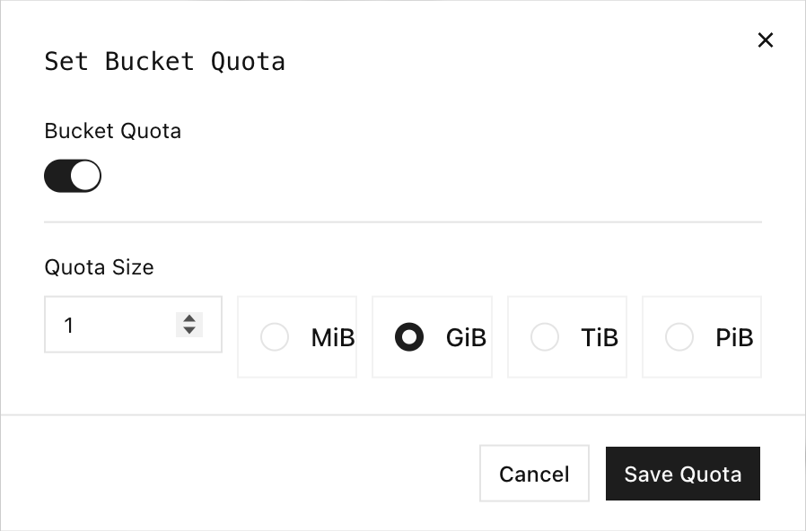

Les quotas de compartiment (bucket) RustFS limitent le volume total de données d’objets stocké dans un compartiment individuel. Utilisez un quota pour empêcher une charge de travail de consommer davantage que la capacité qui lui est attribuée, tout en permettant aux autres compartiments d’utiliser le stockage restant.

## Vue d’ensemble

RustFS prend actuellement en charge les quotas stricts (hard), exprimés en octets. Avant d’accepter une écriture, RustFS compare la somme de l’utilisation actuelle du compartiment et de la taille de l’objet demandé à la limite configurée. Une écriture qui dépasserait la limite est rejetée avec `InvalidRequest` et le message `Bucket quota exceeded`.

Les contrôles de quota couvrent ces opérations :

| Opération | Comportement du quota |
| --- | --- |
| Charger un objet (upload) | Rejette le chargement lorsque l’utilisation actuelle plus la taille de l’objet dépasse la limite. |
| Terminer un chargement partitionné | Contrôle la taille de l’objet assemblé avant de valider le chargement. |
| Copier un objet dans le compartiment | Compare la taille de l’objet source au quota du compartiment de destination. |
| Supprimer un objet | Toujours autorisé, afin que vous puissiez récupérer de la capacité. |

Le quota s’applique aux données d’objets, et non au nombre d’objets ni au débit des requêtes. Un compartiment sans limite configurée est illimité.

:::note[Chargements de remplacement]

Le contrôle de quota réserve la taille complète de l’objet entrant, qu’il ajoute à l’utilisation actuelle du compartiment. Le remplacement d’une clé d’objet existante peut donc exiger une marge suffisante pour l’objet de remplacement dans son intégralité.

:::

## Configurer dans la Console

1. Connectez-vous à la Console RustFS et ouvrez **Browser** (navigateur).
2. Recherchez le compartiment et sélectionnez **Settings** (paramètres).
3. Sous **Capacity & Metadata** (capacité et métadonnées), recherchez **Bucket Quota** (quota de compartiment) et sélectionnez **Edit** (modifier).
4. Activez **Bucket Quota**.
5. Saisissez la taille du quota et sélectionnez **MiB**, **GiB**, **TiB** ou **PiB**.
6. Sélectionnez **Save Quota** (enregistrer le quota).



Pour supprimer la limite, rouvrez la boîte de dialogue, désactivez **Bucket Quota** et enregistrez la modification.

## Utiliser rc

Configurez un alias pour votre déploiement RustFS :

```bash
rc alias set rustfs http://localhost:9000 \
	<your-access-key> <your-secret-key> \
	--region us-east-1 --bucket-lookup path
```

Remplacez `localhost` par l’adresse du serveur RustFS lorsque `rc` s’exécute sur un autre hôte.

### Autorisations

Les opérations de quota exigent ces actions de politique :

| Opération | Action requise |
| --- | --- |
| Définir ou effacer un quota | `admin:SetBucketQuota` |
| Lire la configuration ou les statistiques de quota | `s3:GetBucketQuota` |
| Vérifier si une opération envisagée tient dans le quota | `s3:GetBucketQuota` |

L’identifiant racine dispose de ces autorisations. Pour une administration déléguée, n’attachez que les actions nécessaires au flux.

### Définir un quota

Définissez un quota strict de 1 GiB. `rc` accepte des valeurs en octets ou des unités telles que `1G`, `500M` et `10KB` :

```bash
rc bucket quota set rustfs/my-bucket 1G
```

La réponse indique la limite configurée et l’utilisation actuelle :

```text
Bucket: my-bucket
Quota: 1 GiB
Usage: 0 B
Type:  HARD
```

### Lire le quota

```bash
rc bucket quota info rustfs/my-bucket
```

Utilisez `--json` lorsqu’un autre outil doit traiter le résultat :

```bash
rc bucket quota info rustfs/my-bucket --json
```

Lorsqu’aucune limite n’est configurée, la sortie lisible indique `Quota: unlimited`.

:::note[Propagation de la configuration]

Une requête émise juste après la définition ou l’effacement d’un quota peut renvoyer brièvement l’état précédent. Interrogez de nouveau le quota et confirmez la valeur attendue avant de lancer le flux de vérification.

:::

### Effacer un quota

Supprimez la limite sans supprimer les objets :

```bash
rc bucket quota clear rustfs/my-bucket
rc bucket quota info rustfs/my-bucket
```

Le compartiment devient illimité une fois la modification de configuration appliquée.

## Contrôles de quota avancés

`rc 0.1.29` n’expose aucune commande pour les statistiques d’utilisation détaillées ni pour les contrôles indicatifs d’écritures envisagées. Utilisez l’API d’administration RustFS pour ces opérations. Les requêtes doivent utiliser AWS Signature Version 4 avec un identifiant RustFS actif.

Les exemples utilisent ces variables de shell :

```bash
export RUSTFS_ENDPOINT=http://localhost:9000
export RUSTFS_ACCESS_KEY=<your-access-key>
export RUSTFS_SECRET_KEY=<your-secret-key>
export BUCKET_NAME=my-bucket
```

:::warning[Protégez les identifiants]

Les variables d’environnement sont pratiques pour les tests locaux, mais elles peuvent être visibles par les processus qui s’exécutent sous le même utilisateur du système d’exploitation. En production, utilisez le gestionnaire de secrets de votre plateforme ou un fichier d’identifiants à accès restreint.

:::

### Lire les statistiques d’utilisation détaillées

Utilisez le point de terminaison de statistiques pour obtenir la limite, l’utilisation actuelle, les octets restants et le pourcentage utilisé :

```bash
curl --fail-with-body \
	--aws-sigv4 "aws:amz:us-east-1:s3" \
	--user "${RUSTFS_ACCESS_KEY}:${RUSTFS_SECRET_KEY}" \
	"${RUSTFS_ENDPOINT}/rustfs/admin/v3/quota-stats/${BUCKET_NAME}"
```

```json
{
	"bucket": "my-bucket",
	"quota_limit": 1073741824,
	"current_usage": 1048576,
	"remaining_quota": 1072693248,
	"usage_percentage": 0.09765625
}
```

Les valeurs d’utilisation proviennent de la comptabilité d’usage des données de RustFS. Laissez à cette vue le temps de refléter les changements très récents avant d’utiliser la réponse de statistiques pour une facturation ou une orchestration externe.

### Vérifier un chargement envisagé

Vérifiez si un chargement de 64 MiB tiendrait, sans écrire d’objet :

```bash
curl --fail-with-body \
	--aws-sigv4 "aws:amz:us-east-1:s3" \
	--user "${RUSTFS_ACCESS_KEY}:${RUSTFS_SECRET_KEY}" \
	--request POST \
	--header "Content-Type: application/json" \
	--data '{"operation_type":"PUT","operation_size":67108864}' \
	"${RUSTFS_ENDPOINT}/rustfs/admin/v3/quota-check/${BUCKET_NAME}"
```

Le champ `allowed` indique la décision. Ce contrôle est indicatif : une autre écriture peut consommer de la capacité avant le début du chargement prévu, et le chargement effectif reste donc la référence.

## Vérification

Définissez un petit quota de test, chargez un objet qui tient dans le quota, puis tentez de charger un objet qui dépasse la capacité restante :

```bash
rc bucket quota set rustfs/my-bucket 1M

dd if=/dev/zero of=/tmp/quota-small.bin bs=1024 count=256
dd if=/dev/zero of=/tmp/quota-large.bin bs=1048576 count=2

rc object copy /tmp/quota-small.bin rustfs/my-bucket/hello.bin
rc object copy /tmp/quota-large.bin rustfs/my-bucket/too-large.bin
```

L’objet de 256 KiB réussit. L’objet de 2 MiB dépasse le quota de 1 MiB du compartiment, donc `rc` se termine avec une erreur et RustFS ne crée pas `too-large.bin`.

Supprimez le premier objet et effacez le quota de test :

```bash
rc object remove rustfs/my-bucket/hello.bin --force
rc bucket quota clear rustfs/my-bucket
rc bucket quota info rustfs/my-bucket
```

Confirmez que la dernière requête indique `Quota: unlimited`.

Si l’application du quota ne parvient pas à lire ou à analyser sa configuration interne, RustFS journalise `Bucket quota check degraded to allow` et autorise l’écriture. Surveillez cet avertissement, car il signifie que l’application du quota est temporairement indisponible.

## Étapes suivantes

- [Créer un compartiment](./creation.md)
- [Gérer les règles de cycle de vie](../lifecycle-management.md)
- [Configurer l’observabilité](/fr/operations/observability)
