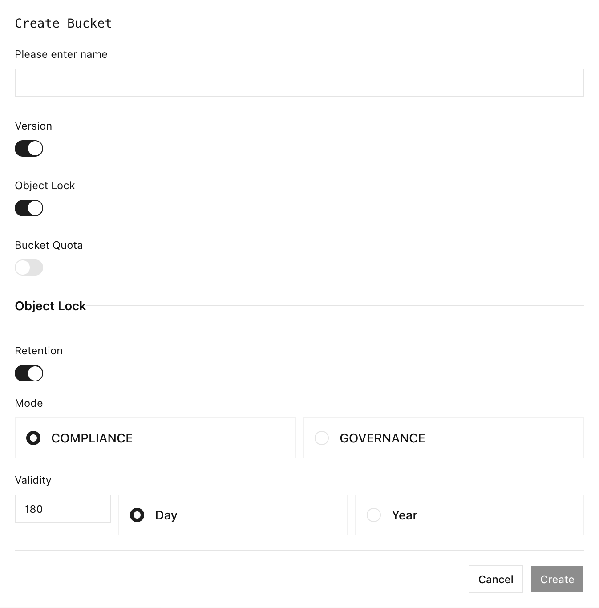

Le verrouillage d’objet de RustFS applique une protection en écriture unique et lecture multiple à chaque version d’objet. Utilisez les périodes de rétention pour une protection limitée dans le temps, et la conservation légale (Legal Hold) pour une protection sans date d’expiration prédéfinie.

## Vue d’ensemble

Le verrouillage d’objet exige la gestion des versions du compartiment (bucket). Vous pouvez l’activer à la création d’un compartiment, ou utiliser l’API S3 `PutObjectLockConfiguration` sur un compartiment existant dont la gestion des versions est activée. Chaque écrasement crée une nouvelle version ; la rétention et la conservation légale protègent une version précise, et non la clé d’objet dans son ensemble.

| Protection | Comportement |
| --- | --- |
| Rétention `GOVERNANCE` | Bloque la suppression et le raccourcissement de la rétention, sauf si l’appelant possède l’autorisation de contournement et demande explicitement un contournement. La rétention peut être prolongée sans contournement. |
| Rétention `COMPLIANCE` | Bloque la suppression, même avec le contournement de gouvernance. La date peut être prolongée, mais pas raccourcie. |
| Conservation légale | Bloque la suppression jusqu’à ce que la conservation soit définie sur `OFF`. Elle n’a pas de date d’expiration, et le contournement de gouvernance ne la lève pas. |

La suppression d’une clé sans ID de version crée un marqueur de suppression. La version protégée reste stockée et peut toujours être récupérée par son ID de version.

:::danger[Planifiez la rétention avant de l’activer]

La rétention COMPLIANCE ne peut être ni contournée ni raccourcie avant sa date de fin de conservation (retain-until). Testez les politiques dans un compartiment hors production et vérifiez la synchronisation horaire, les autorisations, les règles de cycle de vie, la réplication et les procédures de sauvegarde avant de protéger des données de production.

:::

## Configurer dans la Console

1. Connectez-vous à la Console RustFS et ouvrez **Buckets**.
2. Sélectionnez **Create Bucket** et saisissez le nom du compartiment.
3. Activez **Object Lock**. La Console active aussi **Version**, car le verrouillage d’objet exige la gestion des versions.
4. Pour appliquer automatiquement la rétention aux nouvelles versions d’objet, activez **Retention**.
5. Sélectionnez **COMPLIANCE** ou **GOVERNANCE**, saisissez la période de rétention, puis sélectionnez **Day** ou **Year**.
6. Sélectionnez **Create**.



La Console affiche d’abord `180` jours lorsque la rétention par défaut est activée. Remplacez cette valeur par la période exigée par votre politique de rétention ; il s’agit d’une valeur initiale de l’interface, et non d’une recommandation générale.

Pour inspecter un objet protégé, ouvrez le compartiment, sélectionnez le nom de l’objet et utilisez les onglets **Versions** et **Info**. L’onglet Info expose les champs **Legal Hold** et **RetentionPolicy**.

## Utiliser rc

Configurez un alias avant d’exécuter ces exemples :

```bash
rc alias set rustfs http://localhost:9000 \
	<your-access-key> <your-secret-key> \
	--region us-east-1 --bucket-lookup path
```

:::note[Limite de création de compartiment dans rc 0.1.29]

`rc bucket create --with-lock` et `--with-versioning` apparaissent dans l’aide de `rc 0.1.29`, mais renvoient `not implemented` à l’exécution. Créez le compartiment avec verrouillage d’objet dans la Console. Les en-têtes de chargement ci-dessous sont pris en charge et ont été validés avec RustFS.

:::

Chargez une version d’objet avec une rétention GOVERNANCE. Fournissez les deux en-têtes de rétention ensemble et utilisez un horodatage UTC au format RFC 3339 situé dans le futur :

```bash
rc object copy /path/to/hello.txt rustfs/my-bucket/hello.txt \
	-H "x-amz-object-lock-mode:GOVERNANCE" \
	-H "x-amz-object-lock-retain-until-date:2027-01-01T00:00:00Z"
```

Chargez une version d’objet avec la conservation légale activée :

```bash
rc object copy /path/to/hello.txt rustfs/my-bucket/legal-hold.txt \
	-H "x-amz-object-lock-legal-hold:ON"
```

Répertoriez les versions protégées et inspectez une version précise :

```bash
rc bucket version list rustfs/my-bucket --json
rc object stat rustfs/my-bucket/hello.txt \
	--version-id <version-id> --json
```

`rc 0.1.29` ne fournit pas de commandes pour modifier la rétention ni pour faire passer une conservation légale existante entre `ON` et `OFF`. Utilisez la Console ou un SDK S3 pour ces opérations.

## Vérifier la protection

1. Chargez un objet de test avec une rétention GOVERNANCE ou une conservation légale.
2. Notez son ID de version avec `rc bucket version list`.
3. Tentez de supprimer cette version exacte via un client S3, sans contournement. RustFS doit renvoyer `AccessDenied` tant que la protection est active.
4. Confirmez que la version reste visible dans la Console et via `rc object stat --version-id`.

Pour la rétention GOVERNANCE, ne testez le contournement qu’avec une identité d’administration dédiée disposant de `s3:BypassGovernanceRetention`. La rétention COMPLIANCE et la conservation légale restent protégées contre le contournement de gouvernance.

## Considérations d’exploitation

- La rétention par défaut du compartiment est calculée lorsqu’une nouvelle version d’objet ou un chargement partitionné est initié.
- La copie d’un objet crée une nouvelle version de destination ; la politique de rétention de la destination s’applique de façon indépendante.
- Suspendre la gestion des versions n’est pas approprié pour un compartiment avec verrouillage d’objet.
- L’expiration du cycle de vie ne peut pas retirer une version tant que la rétention ou la conservation légale bloque la suppression.
- Les cibles de réplication des objets verrouillés doivent prendre en charge un comportement compatible de verrouillage d’objet.

## Étapes suivantes

- [Gérer les versions d’objet](./versioning.md)
- [Configurer la réplication de compartiment](../bucket/replication.md)
- [Consulter la liste de contrôle de sécurité](/fr/installation/requirement/checklists/security-checklists)
