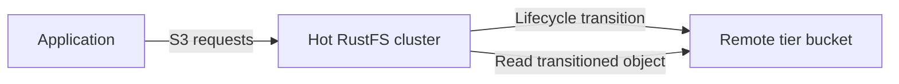

Le stockage hiérarchisé de RustFS déplace les objets du stockage local vers un backend distant configuré. Cette page explique les cibles prises en charge et montre comment ajouter et maintenir un niveau RustFS dans la Console.

La hiérarchisation est asynchrone. RustFS conserve localement les métadonnées de l’objet, transfère les données de l’objet vers le niveau distant et continue de servir les lectures S3 via le compartiment (bucket) d’origine et la clé d’objet.



:::note[Les noms de niveau ne sont pas des classes de stockage AWS]

Les règles de cycle de vie désignent un niveau enregistré par son nom en majuscules, par exemple `COLDTIER`. Ne substituez pas les libellés de classe AWS tels que `INTELLIGENT_TIERING`, `GLACIER` ou `DEEP_ARCHIVE`, sauf si vous avez enregistré un niveau RustFS portant exactement ce nom valide et vérifié le comportement de la cible.

:::

## Backends pris en charge

Le code source de RustFS définit des implémentations de backend warm pour ces types de cibles :

| Type | Clé de configuration | Cible typique |
| --- | --- | --- |
| RustFS | `rustfs` | Un autre déploiement RustFS |
| S3 | `s3` | Amazon S3 ou un point de terminaison S3 pris en charge par ce backend |
| Wasabi | `wasabi` | Stockage objet Wasabi |
| MinIO | `minio` | Un déploiement MinIO |
| Aliyun | `aliyun` | Alibaba Cloud Object Storage Service (OSS) |
| Tencent | `tencent` | Tencent Cloud Object Storage (COS) |
| Huaweicloud | `huaweicloud` | Huawei Cloud Object Storage Service (OBS) |
| Azure | `azure` | Azure Blob Storage |
| GCS | `gcs` | Google Cloud Storage |
| R2 | `r2` | Cloudflare R2 |

Les charges utiles et les exigences d’identifiants varient selon le fournisseur. Le flux complet ci-dessous utilise le backend RustFS, car le code source de RustFS contient un test de bout en bout, du cluster chaud vers le cluster froid, pour ce chemin.

## Avant de commencer

Préparez les éléments suivants :

- Un déploiement RustFS source qui conserve les données chaudes.
- Un déploiement RustFS cible distinct et un compartiment cible existant. Cet exemple utilise `my-bucket` sur la cible.
- Des identifiants cibles autorisés à charger, lire, lister et supprimer des objets dans ce compartiment.
- L’accès à la Console RustFS du déploiement source.

Utilisez TLS pour les deux déploiements en production. Limitez les identifiants cibles au compartiment de niveau dédié et à son préfixe.

## 1. Ouvrir le stockage hiérarchisé

Connectez-vous à la Console RustFS du déploiement source. Dans la navigation de gauche, sélectionnez **Tiered Storage** (stockage hiérarchisé), puis sélectionnez **Add Tier** (ajouter un niveau) dans le coin supérieur droit.

## 2. Sélectionner la cible

Sélectionnez le fournisseur cible. Cet exemple utilise **RustFS** pour relier le déploiement source à un autre déploiement RustFS.

## 3. Saisir les détails de la cible

Remplissez le formulaire :

| Champ | Valeur |
| --- | --- |
| **Name (A-Z,0-9,_)** (nom) | Saisissez un nom de niveau unique en majuscules, par exemple `COLDTIER`. |
| **Endpoint** (point de terminaison) | Saisissez le point de terminaison S3 RustFS de la cible. |
| **Access Key** (clé d’accès) | Saisissez la clé d’accès du déploiement cible. |
| **Secret Key** (clé secrète) | Saisissez la clé secrète du déploiement cible. |
| **Bucket** (compartiment) | Saisissez le nom du compartiment cible existant, par exemple `my-bucket`. |
| **Prefix (Optional)** (préfixe, facultatif) | Saisissez éventuellement un préfixe dédié aux objets hiérarchisés. |
| **Region** (région) | Saisissez éventuellement la région cible, par exemple `us-east-1`. |

Laissez **Storage Class** (classe de stockage) à sa valeur par défaut, sauf si le backend cible exige une autre classe de stockage prise en charge.

:::warning[Protégez les identifiants du niveau]

Le formulaire contient une clé secrète. Utilisez des identifiants limités au compartiment cible et au préfixe. N’exposez pas la clé dans des captures d’écran, des tickets ou des journaux.

:::

## 4. Enregistrer le niveau

Sélectionnez **Save** (enregistrer). RustFS valide le backend et le sonde en écrivant, en lisant puis en supprimant un petit objet. L’enregistrement échoue lorsque le point de terminaison, les identifiants, les autorisations du compartiment ou la configuration du backend ne peuvent pas achever cette sonde.

Lorsque le niveau apparaît dans la liste **Tiers** (niveaux), configurez une règle de transition dans [Gestion du cycle de vie](/fr/administration/data/lifecycle-management). Un niveau enregistré ne déplace aucun objet tant qu’une règle de cycle de vie ne référence pas son nom.

## Gérer les niveaux avec `rc`

Installez et configurez [`rc`](/fr/operations/rc), puis listez les niveaux enregistrés sur le déploiement source :

```bash
rc bucket lifecycle tier list local
```

Ajoutez un niveau RustFS avec les mêmes réglages que dans le flux de la Console :

```bash
rc bucket lifecycle tier add rustfs COLDTIER local \
  --endpoint <target-rustfs-endpoint> \
  --access-key <your-access-key> \
  --secret-key <your-secret-key> \
  --bucket my-bucket \
  --region us-east-1
```

Inspectez la configuration du niveau et les statistiques disponibles :

```bash
rc bucket lifecycle tier info COLDTIER local
```

Les commandes de niveau restantes mettent à jour les identifiants ou suppriment un niveau :

```bash
rc bucket lifecycle tier edit COLDTIER local \
  --access-key <your-access-key> \
  --secret-key <your-secret-key>
rc bucket lifecycle tier remove COLDTIER local
```

Consultez [Gestion du cycle de vie](/fr/administration/data/lifecycle-management) pour créer des règles de transition, confirmer les transitions et restaurer des copies locales. Exécutez `rc bucket lifecycle tier <command> --help` pour examiner les options propres au fournisseur avant de modifier un niveau.

## Surveiller l’activité des niveaux

Utilisez le point de terminaison de statistiques de niveau avec une requête signée en SigV4 et l’autorisation `admin:ListTier` :

```http
GET /rustfs/admin/v3/tier-stats?tier=COLDTIER HTTP/1.1
Host: <hot-rustfs-endpoint>
```

Surveillez les échecs de transition en même temps que la capacité du cluster source et la disponibilité côté cible. Un niveau configuré ajoute le service cible et le chemin réseau au chemin de lecture des objets qui ne disposent pas d’une copie locale restaurée.

## Modifier ou supprimer un niveau

L’API d’administration expose ces routes de mutation, qui exigent toutes `admin:SetTier` :

| Opération | Route |
| --- | --- |
| Modifier un niveau | `POST /rustfs/admin/v3/tier/{tiername}` |
| Supprimer un niveau | `DELETE /rustfs/admin/v3/tier/{tiername}` |
| Effacer tous les niveaux | `POST /rustfs/admin/v3/tier/clear` |

Avant de modifier ou de supprimer un niveau :

1. Désactivez les règles de cycle de vie qui référencent le niveau.
2. Confirmez qu’aucune tâche de transition ne l’utilise encore.
3. Confirmez qu’aucun objet source ne dépend des données stockées dans son compartiment ou son préfixe cible.
4. Sauvegardez la configuration du niveau et notez l’emplacement cible.

Les mutations de niveau ordinaires vérifient l’utilisation du backend et protègent les cibles non vides. N’utilisez pas d’option `force` pour contourner ces contrôles, sauf si vous avez démontré de façon indépendante que chaque objet transféré reste récupérable. La suppression de la configuration d’un niveau actif peut rendre les objets transférés illisibles depuis le cluster source.

:::warning[Ne modifiez pas directement les objets du niveau]

Ne renommez pas, n’écrasez pas et ne supprimez pas les objets générés dans le compartiment cible. Gérez les objets source par l’intermédiaire du cluster RustFS chaud, afin que RustFS puisse maintenir la cohérence entre les métadonnées de transition locales et les données distantes.

:::

## Référence de l’API d’administration

Le code source actuel de RustFS enregistre ces routes de niveau :

| Méthode | Route | Autorisation |
| --- | --- | --- |
| `PUT` | `/rustfs/admin/v3/tier` | `admin:SetTier` |
| `POST` | `/rustfs/admin/v3/tier/{tiername}` | `admin:SetTier` |
| `DELETE` | `/rustfs/admin/v3/tier/{tiername}` | `admin:SetTier` |
| `POST` | `/rustfs/admin/v3/tier/clear` | `admin:SetTier` |
| `GET` | `/rustfs/admin/v3/tier` (lister les configurations) | `admin:ListTier` |
| `GET` | `/rustfs/admin/v3/tier/{tier}` (vérifier la connectivité) | `admin:ListTier` |
| `GET` | `/rustfs/admin/v3/tier-stats` (lire les statistiques) | `admin:ListTier` |

Toutes les requêtes de l’API d’administration exigent une authentification SigV4. Ces routes forment une interface d’administration, et non des opérations S3 ordinaires sur les compartiments.

## Étapes suivantes

Consultez la [gestion du cycle de vie](/fr/administration/data/lifecycle-management) et configurez les [politiques d’accès](/fr/security-compliance/iam/policies) pour les administrateurs et les identifiants de service utilisés par le stockage hiérarchisé.
