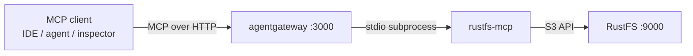
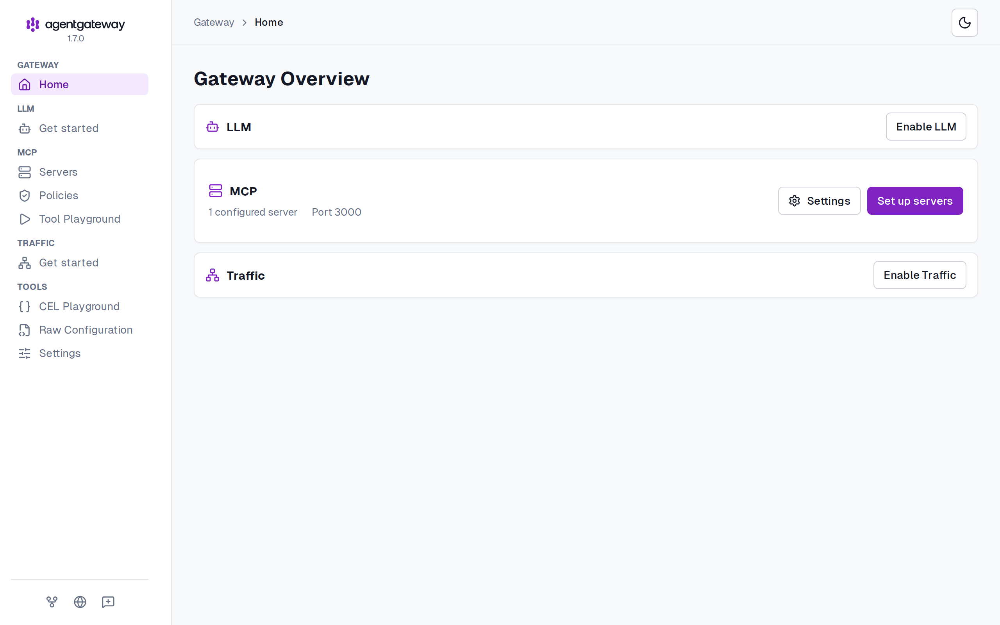
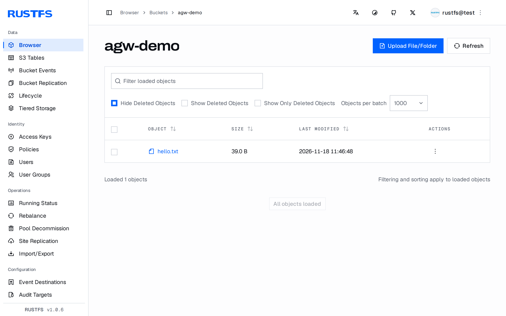

[agentgateway](https://github.com/agentgateway/agentgateway) est un proxy IA-natif pour le trafic MCP, A2A et LLM. Sa passerelle MCP fédère les serveurs MCP et les expose sur le réseau avec authentification, politiques et observabilité OpenTelemetry. [RustFS embarque son propre serveur MCP](https://github.com/rustfs/mcp) exposant les opérations de stockage comme outils, mais en stdio uniquement — utilisable comme sous-processus local, pas à distance. Ce guide connecte les deux : agentgateway lance le serveur MCP RustFS comme cible stdio et le sert comme point de terminaison MCP distant, afin que tout client MCP puisse opérer le stockage RustFS via la passerelle. Le workflow a été vérifié avec agentgateway `1.7.0`, le serveur `rustfs/mcp` et RustFS `1.0.6`.

Vous avez besoin de Docker sur l'hôte de la passerelle et d'un serveur RustFS joignable.

## Architecture



La passerelle lance `rustfs-mcp` comme processus enfant et fait la translation entre son transport stdio et l'écoute MCP Streamable HTTP sur le port 3000. Les opérations de stockage passent par la passerelle — ses politiques, sa limitation de débit et sa télémétrie s'appliquent donc aussi aux appels d'outils de stockage objet.

:::note[Pourquoi une passerelle pour un serveur stdio]

Un serveur MCP stdio n'est joignable que depuis la machine qui le lance. agentgateway ajoute le transport manquant — les clients distants se connectent en HTTP pendant que les identifiants S3 restent sur l'hôte de la passerelle.

:::

## 1. Construire l'image du serveur MCP RustFS

Le serveur MCP vit dans son propre dépôt. Construisez l'image depuis les sources :

```bash
git clone https://github.com/rustfs/mcp.git rustfs-mcp
docker build -t rustfs/rustfs-mcp:latest rustfs-mcp
```

Le build produit une image qui exécute le serveur MCP en stdio et dialogue avec tout point de terminaison compatible S3 configuré via les variables d'environnement `AWS_*` standard.

## 2. Configurer agentgateway

Créez la configuration de la passerelle. La cible lance l'image MCP comme sous-processus ; le montage de volume expose un répertoire hôte pour l'outil de téléversement, et le point de terminaison pointe vers RustFS via l'adresse de passerelle du bridge Docker :

```yaml title="config.yaml"
mcp:
  port: 3000
  targets:
  - name: rustfs
    stdio:
      cmd: docker
      args:
      - run
      - --rm
      - -i
      - -v
      - /data/agentgateway/demo:/demo
      - -e
      - AWS_ACCESS_KEY_ID=<your-access-key>
      - -e
      - AWS_SECRET_ACCESS_KEY=<your-secret-key>
      - -e
      - AWS_REGION=us-east-1
      - -e
      - AWS_ENDPOINT_URL=http://172.17.0.1:9000
      - rustfs/rustfs-mcp:latest
```

:::note[Adressage du point de terminaison depuis le conteneur MCP]

Le serveur MCP tourne dans un conteneur — `127.0.0.1:9000` sur l'hôte RustFS ne lui est pas joignable. Utilisez l'adresse de passerelle du bridge Docker `172.17.0.1:9000` (ou un alias de réseau partagé). Si RustFS tourne lui-même dans Docker sur un réseau bridge personnalisé, Docker isole les bridges entre eux — rattachez les deux conteneurs au même réseau et utilisez le nom du conteneur.

:::

Démarrez la passerelle avec le contenu de la configuration :

```bash
agentgateway -c "$(cat config.yaml)"
```

Le journal confirme les écouteurs : le bind MCP sur le port 3000, l'UI d'administration à `http://localhost:15000/ui` et un endpoint de statistiques sur 15020.



## 3. Appeler les outils RustFS via la passerelle

L'inspecteur MCP pilote la passerelle pour une vérification manuelle :

```bash
npx @modelcontextprotocol/inspector --cli http://localhost:3000/mcp --method tools/list
```

```json
"tools": ["create_bucket", "delete_bucket", "get_object", "list_buckets", "list_objects", "upload_file"]
```

Créez un bucket et téléversez un fichier via la passerelle :

```bash
npx @modelcontextprotocol/inspector --cli http://localhost:3000/mcp \
  --method tools/call --tool-name create_bucket \
  --tool-arg bucket_name=agw-demo

npx @modelcontextprotocol/inspector --cli http://localhost:3000/mcp \
  --method tools/call --tool-name upload_file \
  --tool-arg local_file_path=/demo/hello.txt \
  --tool-arg bucket_name=agw-demo --tool-arg object_key=hello.txt
```

```text
✅ **File uploaded successfully!**
```

:::note[Le chemin de téléversement est côté serveur MCP]

`upload_file` lit `local_file_path` depuis le système de fichiers du processus exécutant le serveur MCP — donc depuis l'intérieur du conteneur. Le montage `-v /data/agentgateway/demo:/demo` de l'étape 2 expose un répertoire hôte en `/demo` dans le conteneur, ce qui permet à l'outil de lire le fichier.

:::

## 4. Confirmer les objets dans RustFS

L'objet écrit via la passerelle atterrit dans le bucket comme toute écriture S3. Confirmez avec l'API S3, en remplaçant tous les paramètres fictifs :

```bash
aws s3api list-objects --bucket agw-demo \
  --endpoint-url http://localhost:9000
```

```json
{
    "Contents": [
        {
            "Key": "hello.txt",
            "Size": 39,
            "StorageClass": "STANDARD"
        }
    ]
}
```

Relisez-le via la passerelle pour boucler la boucle :

```bash
npx @modelcontextprotocol/inspector --cli http://localhost:3000/mcp \
  --method tools/call --tool-name get_object \
  --tool-arg bucket_name=agw-demo --tool-arg object_key=hello.txt --tool-arg mode=read
```

    Content: hello from rustfs-mcp via agentgateway



## Résultats de validation

| Vérification | Résultat attendu |
| --- | --- |
| Poignée de main MCP via la passerelle | `serverInfo.name` rapporte `rustfs-mcp-server` avec le protocole `2025-03-26` |
| `tools/list` | Les six outils de stockage fédérés : `create_bucket`, `delete_bucket`, `get_object`, `list_buckets`, `list_objects`, `upload_file` |
| `create_bucket` via la passerelle | Le bucket apparaît dans RustFS |
| `upload_file` via la passerelle | L'objet atterrit dans le bucket ; visible dans la console et via l'API S3 |
| `get_object` via la passerelle | Le contenu correspond octet par octet au fichier téléversé |
| UI d'administration de la passerelle | Rapporte le serveur MCP configuré et le port |

## Dépannage

### `Error: invalid config: invalid type: string "config.yaml"`

Le paramètre de configuration attend le contenu de la configuration, pas un chemin. Passez le contenu du fichier : `agentgateway -c "$(cat config.yaml)"`.

### Les outils MCP expirent ou signalent des erreurs de connexion

Le conteneur MCP ne peut pas joindre l'adresse RustFS. `127.0.0.1:9000` dans le conteneur désigne le conteneur lui-même — utilisez `172.17.0.1:9000` (passerelle du bridge Docker) ou un alias de réseau partagé, voir l'étape 2.

### `upload_file` échoue avec un fichier local manquant

Le chemin est résolu dans le conteneur du serveur MCP. Montez le répertoire hôte dans le conteneur avec `-v` et référencez le chemin monté, voir l'étape 2.

### `GET /mcp` renvoie `406 Not Acceptable`

Attendu : le point de terminaison Streamable HTTP n'accepte que des requêtes `POST` avec les en-têtes `Accept: application/json, text/event-stream` — utilisez un client MCP comme l'inspecteur plutôt qu'un navigateur.

## Prochaines étapes

- La référence du [serveur MCP RustFS](/developer/mcp) décrit l'ensemble complet des outils.
- Créez des identifiants dédiés avec la [gestion des clés d'accès](/security-compliance/iam/access-token) pour l'identité de la passerelle.
- Suivez la [documentation agentgateway](https://agentgateway.dev/docs/) pour les politiques d'authentification, la limitation de débit et OpenTelemetry sur la même passerelle.
