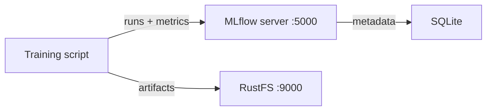

Ce guide connecte [MLflow](https://github.com/mlflow/mlflow) — la plateforme de suivi d’expériences et de registre de modèles — à **RustFS** comme magasin d’artefacts S3. Vous allez démarrer le serveur de suivi MLflow avec Docker Compose, journaliser des paramètres, des métriques et des artefacts depuis une exécution d’entraînement, et vérifier que les artefacts sont stockés dans RustFS. Le flux a été validé avec `ghcr.io/mlflow/mlflow:v2.22.1` et `rustfs/rustfs-x86-musl:v2.3.1`.

Vous avez besoin de Docker avec le plugin Compose. Ce déploiement est destiné aux tests d’intégration locaux, pas à la production.

## Schéma d’architecture



Le serveur de suivi conserve les métadonnées des expériences et des exécutions dans SQLite et stocke les artefacts — fichiers de modèle, graphiques, rapports — directement dans RustFS via la racine d’artefacts `s3://`. Le client a besoin des mêmes identifiants RustFS, car c’est lui qui charge (upload) les artefacts, via boto3 et le réglage `MLFLOW_S3_ENDPOINT_URL`.

## 1. Créer les fichiers du projet

Créez un répertoire de travail :

```bash
mkdir rustfs-mlflow
cd rustfs-mlflow
```

Créez un fichier d’environnement et remplacez les deux espaces réservés d’identifiants :

```ini title=".env"
RUSTFS_ACCESS_KEY=<your-access-key>
RUSTFS_SECRET_KEY=<your-secret-key>
MLFLOW_BUCKET=my-bucket
```

Utilisez des identifiants dédiés pour le compartiment (bucket) d’artefacts. N’ajoutez pas le fichier `.env` au dépôt.

Créez le fichier Compose :

```yaml title="compose.yaml"
services:
  rustfs:
    image: rustfs/rustfs-x86-musl:v2.3.1
    environment:
      RUSTFS_ACCESS_KEY: ${RUSTFS_ACCESS_KEY}
      RUSTFS_SECRET_KEY: ${RUSTFS_SECRET_KEY}
      RUSTFS_VOLUMES: /data
      RUSTFS_ADDRESS: ":9000"
      RUSTFS_CONSOLE_ADDRESS: ":9001"
      RUSTFS_CONSOLE_ENABLE: "true"
    volumes:
      - rustfs-data:/data
    ports:
      - "9000:9000"
      - "9001:9001"
    healthcheck:
      test: ["CMD", "curl", "-sf", "http://127.0.0.1:9000/health"]
      interval: 10s
      timeout: 5s
      retries: 6
      start_period: 10s
    networks:
      - mlflow

  create-bucket:
    image: rustfs/rc:latest
    depends_on:
      rustfs:
        condition: service_healthy
    environment:
      RUSTFS_ACCESS_KEY: ${RUSTFS_ACCESS_KEY}
      RUSTFS_SECRET_KEY: ${RUSTFS_SECRET_KEY}
      MLFLOW_BUCKET: ${MLFLOW_BUCKET}
    entrypoint:
      - /bin/sh
      - -c
      - |
        /usr/bin/rc alias set rustfs http://rustfs:9000 "$${RUSTFS_ACCESS_KEY}" "$${RUSTFS_SECRET_KEY}"
        /usr/bin/rc mb --ignore-existing rustfs/$${MLFLOW_BUCKET}
    networks:
      - mlflow

  mlflow:
    image: ghcr.io/mlflow/mlflow:v2.22.1
    command:
      - server
      - --backend-store-uri
      - sqlite:////mlflow/mlflow.db
      - --default-artifact-root
      - s3://${MLFLOW_BUCKET}/mlflow-artifacts
      - --host
      - 0.0.0.0
      - --port
      - "5000"
    environment:
      AWS_ACCESS_KEY_ID: ${RUSTFS_ACCESS_KEY}
      AWS_SECRET_ACCESS_KEY: ${RUSTFS_SECRET_KEY}
      MLFLOW_S3_ENDPOINT_URL: http://rustfs:9000
      AWS_DEFAULT_REGION: us-east-1
    depends_on:
      create-bucket:
        condition: service_completed_successfully
    ports:
      - "5000:5000"
    volumes:
      - mlflow-db:/mlflow
    networks:
      - mlflow

networks:
  mlflow:

volumes:
  rustfs-data:
  mlflow-db:
```

Le service `create-bucket` doit s’exécuter avant le démarrage du serveur, car MLflow ne crée pas le compartiment. `MLFLOW_S3_ENDPOINT_URL` oriente le client boto3 du serveur vers RustFS avec un adressage de type chemin (path-style). La base SQLite réside sur un volume afin que les métadonnées des expériences survivent aux redémarrages ; les déploiements de production devraient utiliser un backend de base de données géré.

## 2. Valider et démarrer le déploiement

Résolvez le fichier Compose avant de démarrer les conteneurs :

```bash
docker compose config
```

Démarrez les services et attendez le serveur de suivi :

```bash
docker compose up -d
docker compose ps
```

Le service `create-bucket` devrait se terminer avec le code `0`, et l’interface MLflow devrait répondre sur `http://localhost:5000` :

```bash
curl -sf http://localhost:5000/ >/dev/null && echo ready
```

Ouvrez la Console RustFS à l’adresse `http://localhost:9001` pour voir les artefacts arriver dans `my-bucket` à l’étape suivante.

## 3. Journaliser une exécution d’entraînement

Créez le script client — il s’exécute dans l’image MLflow, qui livre toutes les dépendances :

```bash title="train_demo.py" {12}
import mlflow

mlflow.set_tracking_uri("http://localhost:5000")
mlflow.set_experiment("rustfs-demo")

with mlflow.start_run(run_name="rustfs-verify") as run:
    mlflow.log_params({"model": "demo-regressor", "alpha": 0.5})
    for step in range(3):
        mlflow.log_metric("rmse", 0.9 - step * 0.2, step=step)
    with open("model-summary.txt", "w") as f:
        f.write("demo model trained against RustFS artifact store\n")
    mlflow.log_artifact("model-summary.txt", artifact_path="reports")
    print("run_id:", run.info.run_id)
    print("artifact_uri:", run.info.artifact_uri)
```

Copiez le script dans le conteneur en cours d’exécution et exécutez-le avec l’environnement du service :

```bash
docker compose cp train_demo.py mlflow:/tmp/train_demo.py
docker compose exec -w /tmp mlflow python train_demo.py
```

`artifact_uri` s’affiche sous la forme `s3://my-bucket/mlflow-artifacts/<experiment-id>/<run-id>/artifacts` — le client charge l’artefact directement vers RustFS.

## 4. Vérifier les artefacts dans RustFS

Relisez l’artefact via le serveur de suivi, puis listez le même objet dans RustFS. Enregistrez ce qui suit sous le nom `verify.py`, remplacez `<your-run-id>` par l’identifiant affiché à l’étape 3, et exécutez-le de la même façon :

```bash title="verify.py" {5}
import mlflow

mlflow.set_tracking_uri("http://localhost:5000")
client = mlflow.MlflowClient()
print([a.path for a in client.list_artifacts("<your-run-id>", "reports")])
path = client.download_artifacts("<your-run-id>", "reports/model-summary.txt")
print(open(path).read())
```

Le téléchargement lit l’objet depuis RustFS via le serveur de suivi. Confirmez ensuite les objets dans le compartiment :

```bash
docker compose exec rustfs /usr/bin/rc ls local/my-bucket/mlflow-artifacts/ -r
```

La sortie devrait inclure l’objet d’artefact :

```text
mlflow-artifacts/1/a1aece9243504f2680a52fba0c32765f/artifacts/reports/model-summary.txt
```


Les exécutions, les paramètres et les métriques survivent à un redémarrage du serveur parce qu’ils sont stockés dans SQLite, tandis que les artefacts restent dans RustFS :

```bash
docker compose restart mlflow
docker compose exec -w /tmp mlflow python verify.py
```

L’appel `list_artifacts` réussit de nouveau face au serveur redémarré, en lisant les mêmes objets dans RustFS.

## 5. Arrêter ou réinitialiser le déploiement

Arrêtez les conteneurs tout en conservant toutes les données :

```bash
docker compose down
```

Le volume RustFS conserve les objets d’artefacts et le volume MLflow conserve la base de métadonnées. Pour tout supprimer, y compris les artefacts dans RustFS, ajoutez `--volumes`.

## Dépannage

### `ModuleNotFoundError: No module named 'boto3'` lors de la journalisation des artefacts

Le client qui exécute `log_artifact` a besoin de boto3, car il charge directement vers S3. Installez-le dans l’environnement qui exécute le script d’entraînement, ou exécutez le script dans l’image MLflow comme indiqué à l’étape 3.

### `AccessDenied` ou erreurs de connexion pendant le chargement d’un artefact

Vérifiez que `MLFLOW_S3_ENDPOINT_URL` est défini dans l’environnement du client — sans cela, boto3 envoie les requêtes au véritable Amazon S3. Le point de terminaison doit être joignable depuis la machine qui exécute le script d’entraînement ; utilisez `http://localhost:9000` hors du réseau Compose et `http://rustfs:9000` à l’intérieur.

### Le serveur ne démarre pas et signale une erreur de compartiment

Le compartiment d’artefacts doit exister avant le démarrage du serveur. Consultez les journaux du service `create-bucket` :

```bash
docker compose logs create-bucket
```

## Étapes suivantes

- Consultez les [notes de compatibilité S3](/fr/administration/protocols/s3) avant d’adopter d’autres opérations MLflow.
- Créez des identifiants de production dédiés avec la [gestion des clés d’accès](/fr/security-compliance/iam/access-token).
- Suivez la [documentation MLflow](https://mlflow.org/docs/latest/) pour ajouter un registre de modèles ou déplacer le magasin de métadonnées vers une base de données gérée.
