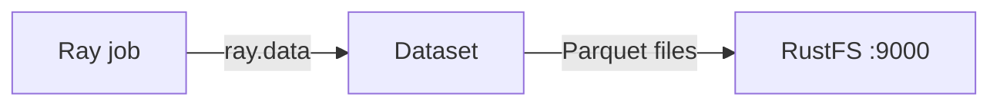

Ce guide connecte [Ray](https://github.com/ray-project/ray) — le framework distribué de calcul Python et d’IA — à **RustFS** via la prise en charge du système de fichiers S3 de Ray Data. Vous allez exécuter une tâche Ray dans l’image officielle, écrire un jeu de données au format Parquet dans un compartiment (bucket) RustFS, le relire et vérifier les objets. Le flux a été validé avec `rayproject/ray:2.44.0-py311` (Ray 2.44, système de fichiers pyarrow) et `rustfs/rustfs-x86-musl:v2.3.1`.

Vous avez besoin de Docker. Ce déploiement est destiné aux tests d’intégration locaux, pas à la production.

## Schéma d’architecture



Ray Data lit et écrit les jeux de données via le `S3FileSystem` de pyarrow. Passer un `S3FileSystem` configuré pour RustFS redirige chaque opération de jeu de données — Parquet, CSV, JSON — vers le compartiment.

## 1. Créer le fichier de tâche

Créez le script, en remplaçant tous les espaces réservés de connexion :

```python title="ray_s3.py"
import ray
ray.init(ignore_reinit_error=True)

import pandas as pd
from pyarrow.fs import S3FileSystem

fs = S3FileSystem(
    endpoint_override="http://<your-rustfs-endpoint>:9000",
    access_key="<your-access-key>",
    secret_key="<your-secret-key>",
    region="us-east-1",
)

df = pd.DataFrame({"id": range(5), "value": [x * 1.5 for x in range(5)]})
ds = ray.data.from_pandas(df)
ds.write_parquet("my-bucket/ray-demo/events/", filesystem=fs)

back = ray.data.read_parquet("my-bucket/ray-demo/events/", filesystem=fs).take_all()
print("rows:", len(back))
print("sample:", back[0])
ray.shutdown()
```

`endpoint_override` prend l’URL complète du point de terminaison, schéma compris. Le `S3FileSystem` de pyarrow utilise des requêtes en adressage de type chemin (path-style) pour les points de terminaison personnalisés, si bien qu’aucun indicateur supplémentaire n’est nécessaire. Le même objet de système de fichiers fonctionne pour `write_csv`, `read_json` et les autres méthodes de Ray Data.

## 2. Exécuter la tâche

Exécutez le script dans l’image Ray, sur le même réseau Docker que RustFS :

```bash
docker run --rm --network oo-rustfs_default \
  -v "$PWD/ray_s3.py":/tmp/ray_s3.py \
  rayproject/ray:2.44.0-py311 python /tmp/ray_s3.py
```

```text
rows: 5
sample: {'id': 0, 'value': 0.0}
```

## 3. Vérifier les objets dans RustFS

Listez le préfixe du jeu de données :

```bash
rc ls rustfs/my-bucket/ray-demo/ -r
```

Ray Data a écrit le jeu de données sous la forme d’un bloc Parquet :

```text
ray-demo/events/0_000000_000000.parquet
```


## 4. Arrêter ou réinitialiser

Ray Data ne conserve aucun état propre. Pour supprimer le jeu de données de démonstration :

```bash
rc rm rustfs/my-bucket/ray-demo/ --recursive --force
```

## Dépannage

### `Unable to connect to endpoint` ou délais dépassés

Vérifiez que `endpoint_override` inclut le schéma et qu’il est joignable depuis le conteneur Ray. À l’intérieur d’un réseau Compose, le nom d’hôte est `rustfs` ; depuis l’hôte, utilisez `http://localhost:9000`.

### `Access Denied` à l’écriture

Vérifiez que la clé d’accès et la clé secrète sont passées à `S3FileSystem` lui-même — Ray ne lit pas les variables d’environnement AWS du conteneur par ce chemin de code.

## Étapes suivantes

- Consultez les [notes de compatibilité S3](/fr/administration/protocols/s3) avant d’adopter d’autres opérations Ray.
- Créez des identifiants de production dédiés avec la [gestion des clés d’accès](/fr/security-compliance/iam/access-token).
- Suivez la [documentation Ray Data](https://docs.ray.io/en/latest/data/data.html) pour enchaîner des transformations, l’ingestion d’entraînement et les points de contrôle sur le même compartiment.
