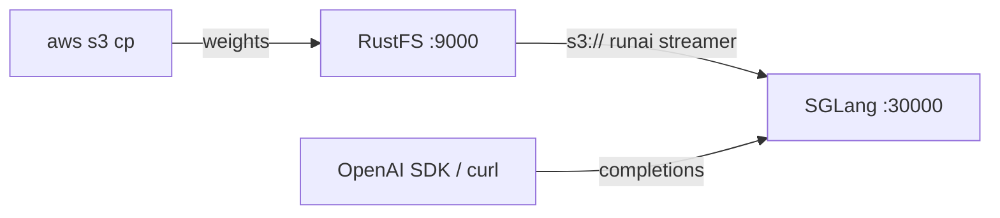
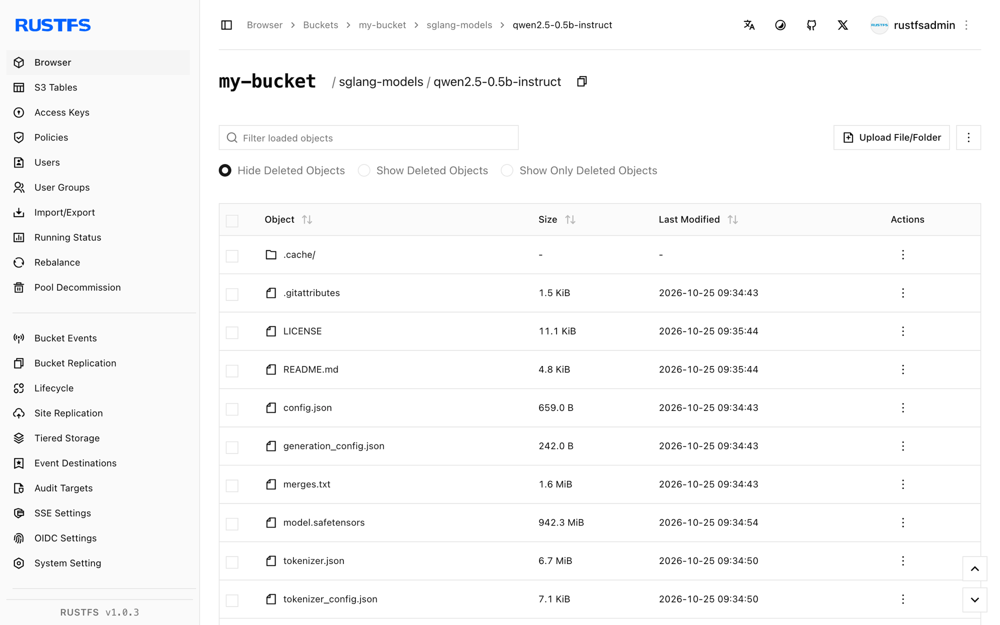

Ce guide connecte [SGLang](https://github.com/sgl-project/sglang) — le framework de service pour grands modèles de langage et modèles multimodaux — à **RustFS** comme stockage des poids de modèle. Vous allez charger un modèle dans un bucket RustFS, pointer SGLang vers l'URI `s3://` et servir des requêtes compatibles OpenAI avec les poids streamés directement depuis le bucket. Le workflow a été vérifié avec `lmsysorg/sglang:v0.5.22-xeon` (SGLang 0.5.22, moteur CPU) servant `Qwen/Qwen2.5-0.5B-Instruct` depuis un bucket RustFS sur un hôte CPU uniquement.

Vous avez besoin de Docker et d'un petit modèle Hugging Face. Ce déploiement est destiné aux tests d'intégration locaux, pas à la production.

## Architecture



Quand `--model-path` est une URI de stockage objet, SGLang bascule automatiquement vers son format de chargement `runai_streamer` : les fichiers de métadonnées (`config.json`, tokenizer) sont téléchargés une fois dans le cache local, puis les tenseurs de poids sont streamés à la demande pendant que le moteur charge. Le bucket reste l'unique copie du modèle, donc les hôtes de service n'ont pas besoin de magasin de modèles local.

:::note[L'image CPU n'embarque pas le streamer S3]

L'image CPU `xeon` n'inclut pas `runai-model-streamer-s3` ; démarrer le serveur avec un chemin de modèle `s3://` échoue avec `ImportError: S3 files module not found`. Installez le paquet dans le conteneur avant de lancer le serveur — l'environnement virtuel de l'image est géré avec `uv`, qui n'a pas de module `pip`.

:::

## 1. Charger le modèle dans RustFS

Récupérez les fichiers du modèle depuis Hugging Face et copiez-les dans le bucket, en remplaçant tous les paramètres fictifs de connexion :

```bash
docker run --rm -v "$PWD/models:/models" --entrypoint python3 \
  lmsysorg/sglang:v0.5.22-xeon -c \
  'from huggingface_hub import snapshot_download; snapshot_download("Qwen/Qwen2.5-0.5B-Instruct", local_dir="/models/qwen2.5-0.5b-instruct")'

aws s3 cp models/qwen2.5-0.5b-instruct \
  s3://my-bucket/sglang-models/qwen2.5-0.5b-instruct --recursive \
  --endpoint-url http://<your-rustfs-endpoint>:9000 \
  --acl private
```

Exportez les identifiants pour les commandes suivantes :

```bash
export AWS_ACCESS_KEY_ID=<your-access-key>
export AWS_SECRET_ACCESS_KEY=<your-secret-key>
export AWS_DEFAULT_REGION=us-east-1
```

Utilisez un préfixe par modèle afin que plusieurs modèles partagent le même bucket. Le streamer ne lit que les fichiers de poids au format `.safetensors`.

## 2. Démarrer SGLang sur le bucket

Lancez l'image CPU, installez le paquet du streamer S3 et démarrez le serveur sur l'URI du bucket :

```bash
docker run -d --name sglang -p 30000:30000 \
  -e AWS_ACCESS_KEY_ID \
  -e AWS_SECRET_ACCESS_KEY \
  -e AWS_DEFAULT_REGION \
  -e AWS_ENDPOINT_URL=http://<your-rustfs-endpoint>:9000 \
  --entrypoint bash lmsysorg/sglang:v0.5.22-xeon -c \
  'uv pip install -q runai-model-streamer-s3 && \
   python3 -m sglang.launch_server \
     --model-path s3://my-bucket/sglang-models/qwen2.5-0.5b-instruct \
     --served-model-name qwen2.5-0.5b-instruct \
     --host 0.0.0.0 --port 30000 \
     --device cpu --trust-remote-code \
     --disable-overlap-schedule \
     --mem-fraction-static 0.45'
```

`AWS_ENDPOINT_URL` dirige le streamer vers RustFS ; les requêtes vers le point de terminaison personnalisé utilisent l'adressage path-style. `--mem-fraction-static` fixe la part de mémoire hôte réservée au cache KV sur le backend CPU — augmentez-la sur les hôtes disposant de plus de RAM libre. Attendez la ligne de démarrage :

```bash
docker logs -f sglang
```

```text
The server is fired up and ready to roll!
```

## 3. Exécuter l'inférence

Vérifiez que le modèle est servi, puis envoyez une requête de complétion compatible OpenAI :

```bash
curl -s http://localhost:30000/v1/models
```

```json
{"object":"list","data":[{"id":"qwen2.5-0.5b-instruct","object":"model","owned_by":"sglang","root":"qwen2.5-0.5b-instruct","max_model_len":32768}]}
```

```bash
curl -s http://localhost:30000/v1/completions \
  -H "Content-Type: application/json" \
  -d '{"model":"qwen2.5-0.5b-instruct","prompt":"RustFS is","max_tokens":16,"temperature":0}'
```

```json
{"object":"text_completion","model":"qwen2.5-0.5b-instruct","choices":[{"index":0,"text":" a file system for the Linux kernel that is designed to be used in embedded systems","finish_reason":"length"}],"usage":{"prompt_tokens":4,"total_tokens":20,"completion_tokens":16}}
```



## 4. Arrêter ou réinitialiser

Pour démonter la démo tout en conservant les objets du bucket :

```bash
docker rm -f sglang
```

Pour supprimer le modèle stocké :

```bash
aws s3 rm s3://my-bucket/sglang-models --recursive \
  --endpoint-url http://<your-rustfs-endpoint>:9000
```

## Dépannage

### `ImportError: S3 files module not found`

Le backend S3 du streamer RunAI est absent. Exécutez `uv pip install runai-model-streamer-s3` dans le conteneur avant de démarrer le serveur, comme indiqué à l'étape 2.

### `pip: command not found` ou `No module named pip`

Le `/opt/.venv` de l'image a été créé par `uv` sans `pip`. Utilisez `uv pip install` au lieu de `pip install`.

### `Loaded weights leave no GPU memory for the KV cache`

`--mem-fraction-static` est trop faible pour les poids chargés sur cet hôte. Le message d'erreur indique la valeur minimale viable — relancez le serveur avec une fraction plus grande (par exemple `0.45` sur un hôte de 16 Go pour un modèle de 0,5 B).

### Les requêtes échouent avec des erreurs de signature ou d'accès

Vérifiez que les quatre variables sont définies pour le conteneur du serveur : `AWS_ACCESS_KEY_ID`, `AWS_SECRET_ACCESS_KEY`, `AWS_DEFAULT_REGION` et `AWS_ENDPOINT_URL` avec le schéma inclus.

## Prochaines étapes

- Consultez les [notes de compatibilité S3](/administration/protocols/s3) avant d'adopter d'autres opérations de service.
- Créez des identifiants de production dédiés avec la [gestion des clés d'accès](/security-compliance/iam/access-token).
- Suivez la [documentation SGLang](https://docs.sglang.io/) pour le parallélisme de tenseurs, la quantification et des modèles plus grands sur le même magasin de modèles adossé au bucket.
