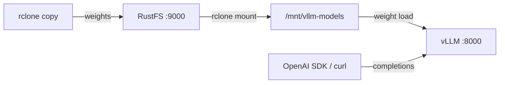

Ce guide connecte [vLLM](https://github.com/vllm-project/vllm) — le moteur d’inférence de grands modèles de langage (LLM) à haut débit — à **RustFS** comme magasin de poids de modèles. Vous allez charger (upload) un modèle dans un compartiment (bucket) RustFS, exposer le compartiment à l’hôte vLLM via un montage rclone et servir le modèle avec l’API compatible avec OpenAI. Le flux a été validé avec `vllm/vllm-openai-cpu` (vLLM 0.30.0) servant `facebook/opt-125m` depuis un compartiment RustFS adossé à `rustfs/rustfs-x86-musl:v2.3.1`, sur un hôte uniquement CPU.

Vous avez besoin de Docker et d’un binaire rclone sur l’hôte qui exécute vLLM. Ce déploiement est destiné aux tests d’intégration locaux, pas à la production.

## Schéma d’architecture



Le compartiment est la seule copie du modèle. Les hôtes qui servent le modèle montent le compartiment en lecture seule, si bien que chaque nœud récupère les poids depuis RustFS et qu’il n’existe aucun magasin de modèles local susceptible de diverger.

:::note[Pourquoi un montage rclone]

vLLM 0.30 charge les chemins de modèle `s3://` via le streamer de modèles RunAI, dont les lectures par plage échouent actuellement face aux points de terminaison S3 personnalisés tels que RustFS (le chargeur signale `File access error` pour tout décalage non nul). Monter le compartiment comme système de fichiers est la méthode validée pour conserver les poids dans RustFS pendant que vLLM les lit comme des fichiers locaux.

:::

## 1. Charger le modèle vers RustFS

Créez le compartiment et copiez-y les poids du modèle, en remplaçant tous les espaces réservés de connexion :

```ini title="rclone.conf"
[rustfs]
type = s3
provider = Other
access_key_id = <your-access-key>
secret_access_key = <your-secret-key>
endpoint = http://<your-rustfs-endpoint>:9000
region = us-east-1
```

```bash
rc mb rustfs/vllm-models
rclone copy ./opt-125m rustfs:vllm-models/opt-125m --transfers 4
```

Toute disposition Hugging Face convient — `config.json`, les fichiers du tokenizer et les fichiers de poids (`model.safetensors` ou `pytorch_model.bin`). Conservez un modèle par préfixe afin que plusieurs modèles puissent partager le compartiment.

## 2. Monter le compartiment sur l’hôte vLLM

Sur la machine qui exécute vLLM, montez le compartiment en lecture seule pour les clients, avec `--allow-other` :

```bash
mkdir -p /mnt/vllm-models
rclone mount rustfs:vllm-models /mnt/vllm-models \
  --allow-other --daemon
ls /mnt/vllm-models/opt-125m/
```

```text
config.json  merges.txt  model.safetensors  tokenizer.json  vocab.json
```

## 3. Exécuter vLLM

Démarrez l’image CPU face aux poids montés :

```bash
docker run -d --name vllm -p 8000:8000 --shm-size=2g \
  -v /mnt/vllm-models:/models:ro \
  vllm/vllm-openai-cpu:latest \
  --model /models/opt-125m --served-model-name opt-125m \
  --dtype float32 --max-model-len 256 --gpu-memory-utilization 0.15
```

vLLM lit les poids à travers le montage — le conteneur reste sans état et le modèle réside dans RustFS. Attendez que le serveur soit prêt :

```bash
curl -s http://localhost:8000/v1/models | head -c 200
```

```text
{"object":"list","data":[{"id":"opt-125m","object":"model","created":...,"root":"/models/opt-125m",...}]}
```

`--gpu-memory-utilization` contrôle la fraction de RAM réservée au cache KV sur le backend CPU ; réduisez-la sur les petits hôtes. `--dtype float32` correspond à ce que les noyaux d’attention CPU prennent en charge pour ce modèle.

## 4. Exécuter l’inférence

Envoyez une requête de complétion compatible avec OpenAI :

```bash
curl -s http://localhost:8000/v1/completions \
  -H "Content-Type: application/json" \
  -d '{"model": "opt-125m", "prompt": "RustFS is", "max_tokens": 12, "temperature": 0}'
```

```json
{"id":"cmpl-...","object":"text_completion","model":"opt-125m",
 "choices":[{"index":0,"text":" a great tool for building your own server. It's a",
 "finish_reason":"length",...}]}
```

La requête suit le schéma OpenAI standard, si bien que le client Python fonctionne sans modification :

```python
from openai import OpenAI

client = OpenAI(base_url="http://localhost:8000/v1", api_key="EMPTY")
print(client.completions.create(
    model="opt-125m", prompt="RustFS is", max_tokens=12, temperature=0,
).choices[0].text)
```


## 5. Arrêter ou réinitialiser

Pour démonter la démonstration tout en conservant les objets du compartiment :

```bash
docker rm -f vllm
fusermount -u /mnt/vllm-models
```

Pour supprimer le modèle stocké :

```bash
rclone purge rustfs:vllm-models
```

## Dépannage

### `Cannot find any model weights with /models/...`

Le montage avait un cache de répertoires périmé, ou les fichiers de poids ne sont jamais arrivés dans le compartiment. Relancez `rclone copy` et confirmez les fichiers à travers le montage avec `ls` avant de démarrer vLLM. Un `--dir-cache-time` court (par exemple `10s`) aide pendant que vous itérez.

### `Unsupported CPU attention configuration: head_dim=...`

Les noyaux CPU de vLLM prennent en charge un ensemble fixe de dimensions de tête. Les tout petits modèles de test tels que `hf-internal-testing/tiny-random-*` utilisent des formes exotiques qui échouent au moment de la requête — utilisez un petit modèle réel tel que `facebook/opt-125m`.

### `Insufficient space in /dev/shm`

Le moteur CPU de vLLM échange des tenseurs via la mémoire partagée. Exécutez le conteneur avec `--shm-size=2g` (ou `--ipc=host`).

### Le serveur s’arrête avec `Available memory on node 0 ... is less than desired CPU memory utilization`

La réservation par défaut du cache KV représente 90 % de la RAM système. Réduisez-la avec `--gpu-memory-utilization 0.15` (l’indicateur s’applique au backend CPU comme fraction de mémoire, malgré son nom).

## Étapes suivantes

- Consultez les [notes de compatibilité S3](/fr/administration/protocols/s3) avant d’adopter d’autres configurations de service.
- Créez des identifiants de production dédiés avec la [gestion des clés d’accès](/fr/security-compliance/iam/access-token).
- Suivez la [documentation vLLM](https://docs.vllm.ai/en/latest/serving/openai_compatible_server.html) pour les modèles de conversation, le parallélisme de tenseurs et les poids quantifiés, au-dessus du même magasin de modèles adossé au compartiment.
