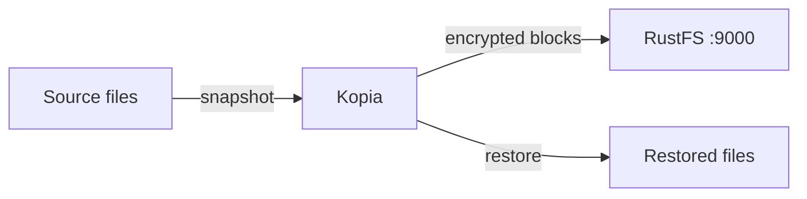
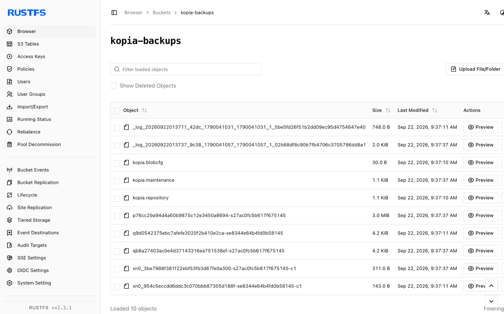

Ce guide connecte [Kopia](https://github.com/kopia/kopia) — l’outil open source de sauvegarde et de restauration — à **RustFS** comme dépôt S3. Vous allez créer un dépôt dans un compartiment (bucket) RustFS, prendre un instantané d’un répertoire, le restaurer dans un répertoire vide et comparer les sommes de contrôle. Le flux a été validé avec `kopia/kopia:0.18.1` et `rustfs/rustfs-x86-musl:v2.3.1`.

Vous avez besoin de Docker. Ce déploiement est destiné aux tests d’intégration locaux, pas à la production.

## Schéma d’architecture



Kopia stocke les fichiers de format du dépôt ainsi que les blocs de contenu dédupliqués et chiffrés dans le compartiment. Les restaurations relisent les blocs et reconstituent les fichiers d’origine, si bien que la somme de contrôle de chaque fichier restauré doit correspondre à la source.

## 1. Créer le dépôt

Créez d’abord le compartiment, puis initialisez le dépôt Kopia à l’intérieur. Le point de terminaison est un `host:port` nu (sans schéma) ; `--disable-tls` fait passer le client en HTTP simple :

```bash
rc alias set rustfs http://<your-rustfs-endpoint>:9000 <your-access-key> <your-secret-key>
rc mb rustfs/kopia-backups

docker run --rm --network oo-rustfs_default kopia/kopia:0.18.1 repository create s3 \
  --bucket kopia-backups \
  --access-key <your-access-key> \
  --secret-access-key <your-secret-key> \
  --endpoint <your-rustfs-endpoint>:9000 \
  --region us-east-1 \
  --disable-tls \
  --password <your-kopia-password> \
  --override-username demo --override-hostname workstation
```

Kopia valide le fournisseur en lisant et en écrivant via l’API S3 avant de signaler le succès.

## 2. Se connecter, prendre un instantané et restaurer

Exécutez les commandes suivantes depuis le répertoire qui contient votre `repository.config` (créé à l’étape précédente). Kopia lit les réglages de connexion dans ce fichier, si bien que les indicateurs S3 ne sont nécessaires qu’une fois :

```bash
export KOPIA_PASSWORD=<your-kopia-password>
export KOPIA_CONFIG_PATH=/config/repository.config

alias kopia='docker run --rm --network oo-rustfs_default \
  -e KOPIA_PASSWORD -e KOPIA_CONFIG_PATH \
  -v "$PWD/config:/config" \
  -v "$PWD/source:/source:ro" \
  -v "$PWD/restore:/restore" kopia/kopia:0.18.1'

kopia repository connect s3 \
  --bucket kopia-backups \
  --access-key <your-access-key> \
  --secret-access-key <your-secret-key> \
  --endpoint <your-rustfs-endpoint>:9000 \
  --region us-east-1 --disable-tls \
  --override-username demo --override-hostname workstation

kopia snapshot create /source
kopia snapshot list
```

Restaurez l’instantané dans un répertoire vide et comparez les sommes de contrôle avec la source. L’ID d’instantané est l’identifiant `ka...` affiché par `snapshot list` :

```bash
kopia restore <snapshot-id> /restore

sha256sum source/blob.bin restore/blob.bin
```

```text
bec4530e2798465b...  source/blob.bin
bec4530e2798465b...  restore/blob.bin
```

## 3. Vérifier les objets dans RustFS

Listez le compartiment :

```bash
rc ls rustfs/kopia-backups/ -r
```

La sortie montre les fichiers de format du dépôt ainsi que les blocs de contenu empaquetés écrits par l’instantané :

```text
kopia.blobcfg
kopia.repository
p0000.../...
```



## 4. Arrêter ou réinitialiser

Kopia est un outil côté client et ne conserve aucun état en cours d’exécution. Pour supprimer le dépôt et tous les instantanés, supprimez le compartiment :

```bash
rc rb rustfs/kopia-backups --force
```

## Dépannage

### `Endpoint url cannot have fully qualified paths`

Le point de terminaison doit être une valeur `host:port` nue, sans schéma ni chemin — Kopia construit lui-même les URL des objets.

### `server gave HTTP response to HTTPS client`

Sans `--disable-tls`, Kopia parle HTTPS. RustFS sans TLS a besoin de l’indicateur `--disable-tls` à la fois sur `repository create s3` et sur `repository connect s3`.

### `can't connect to storage` avec une erreur DNS

Le client S3 utilise l’adressage de type hôte virtuel. Conservez le point de terminaison sous la forme d’une valeur `host:port` nue ; Kopia utilise des requêtes en adressage de type chemin (path-style) pour les points de terminaison donnés sous cette forme.

## Étapes suivantes

- Consultez les [notes de compatibilité S3](/fr/administration/protocols/s3) avant d’adopter d’autres opérations Kopia.
- Créez des identifiants de production dédiés avec la [gestion des clés d’accès](/fr/security-compliance/iam/access-token).
- Suivez la [documentation des dépôts Kopia](https://kopia.io/docs/repositories/) pour ajouter des politiques, une rétention et des instantanés planifiés.
