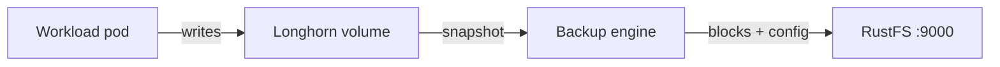

Ce guide connecte [Longhorn](https://github.com/longhorn/longhorn) — le système de stockage bloc distribué pour Kubernetes — à **RustFS** comme cible de sauvegarde S3. Vous allez configurer la cible de sauvegarde, sauvegarder un volume qui contient des données, supprimer le volume, le restaurer depuis RustFS et vérifier les données. Le flux a été validé avec Longhorn 1.9.0 sur k3s (Kubernetes 1.30) et `rustfs/rustfs-x86-musl:v2.3.1`.

Vous avez besoin d’un cluster Kubernetes avec Longhorn installé et d’un accès `kubectl`. Ce guide est destiné aux tests d’intégration, pas à la production.

## Schéma d’architecture



Longhorn stocke les sauvegardes dans le préfixe `backupstore/volumes/` du compartiment cible, sous forme de blocs adressés par le contenu plus un petit fichier de configuration de volume. Les restaurations relisent ces objets dans un nouveau volume, sur tout nœud qui peut joindre RustFS.

## 1. Créer le compartiment de sauvegarde

Créez un compartiment (bucket) dédié avec le client [`rc`](https://github.com/rustfs/cli), en utilisant votre propre point de terminaison et vos identifiants :

```bash
rc alias set rustfs http://<your-rustfs-endpoint>:9000 <your-access-key> <your-secret-key>
rc mb rustfs/longhorn-backups
```

Longhorn ne crée pas le compartiment, si bien que cette étape doit être terminée avant la première sauvegarde.

## 2. Configurer la cible de sauvegarde

Stockez les identifiants RustFS dans un secret de l’espace de noms `longhorn-system`. `AWS_ENDPOINTS` doit être un point de terminaison que chaque nœud peut joindre — utilisez l’adresse IP du nœud ou l’adresse d’un répartiteur de charge interne, pas une redirection de port depuis votre poste de travail :

```bash
kubectl -n longhorn-system create secret generic rustfs-s3-secret \
  --from-literal=AWS_ACCESS_KEY_ID=<your-access-key> \
  --from-literal=AWS_SECRET_ACCESS_KEY=<your-secret-key> \
  --from-literal=AWS_ENDPOINTS=http://<your-rustfs-endpoint>:9000
```

Longhorn 1.9 gère les cibles de sauvegarde via la ressource `BackupTarget`. Corrigez la cible `default` avec le compartiment RustFS :

```bash
kubectl -n longhorn-system patch backupTarget default --type merge -p '
spec:
  backupTargetURL: s3://longhorn-backups@us-east-1/
  credentialSecret: rustfs-s3-secret
  pollInterval: 5m'
```

Le segment `@us-east-1` est l’annotation de région dans le format d’URL S3 ; il n’a pas besoin de correspondre à une région de déploiement réelle.

Attendez que la cible devienne disponible — cela confirme que Longhorn a atteint le compartiment via le secret :

```bash
kubectl -n longhorn-system get backupTarget default
```

```text
NAME      URL                                CREDENTIAL         AVAILABLE   LASTSYNCEDAT
default   s3://longhorn-backups@us-east-1/   rustfs-s3-secret   true        2026-09-21T08:36:55Z
```

## 3. Écrire des données et créer une sauvegarde

Créez un volume de test qui contient des données. Le manifeste suivant crée un PVC de 1 GiB et un pod qui écrit un fichier marqueur :

```yaml title="demo.yaml"
apiVersion: v1
kind: PersistentVolumeClaim
metadata:
  name: demo-vol
spec:
  accessModes: [ReadWriteOnce]
  storageClassName: longhorn
  resources:
    requests:
      storage: 1Gi
---
apiVersion: v1
kind: Pod
metadata:
  name: demo-app
spec:
  volumes:
  - name: data
    persistentVolumeClaim:
      claimName: demo-vol
  containers:
  - name: app
    image: busybox:1.36
    command: ["sh", "-c", "echo 'longhorn rustfs demo' > /data/hello.txt && sleep 3600"]
    volumeMounts:
    - name: data
      mountPath: /data
```

Appliquez-le et attendez que le pod s’exécute :

```bash
kubectl apply -f demo.yaml
kubectl get pod demo-app
```

Créez un instantané et sauvegardez-le. Vous pouvez le faire dans l’interface Longhorn (**Volume** → **Snapshot** → **Backup**, soit volume, instantané et sauvegarde) ou de façon déclarative :

```bash
VOLUME=$(kubectl get pvc demo-vol -o jsonpath='{.spec.volumeName}')
kubectl -n longhorn-system apply -f - <<EOF
apiVersion: longhorn.io/v1beta2
kind: Snapshot
metadata:
  name: demo-snap
  namespace: longhorn-system
spec:
  volume: $VOLUME
EOF
```

Créez ensuite la ressource `Backup` pour cet instantané :

```bash
kubectl -n longhorn-system apply -f - <<EOF
apiVersion: longhorn.io/v1beta2
kind: Backup
metadata:
  name: demo-backup
  namespace: longhorn-system
spec:
  snapshotName: demo-snap
EOF
```

Attendez la fin de la sauvegarde :

```bash
kubectl -n longhorn-system wait --for=jsonpath='{.status.state}'=Completed backup/demo-backup --timeout=300s
kubectl -n longhorn-system get backup demo-backup -o jsonpath='{.status.backupURL}'
```

## 4. Vérifier la sauvegarde dans RustFS

Listez le compartiment :

```bash
rc ls rustfs/longhorn-backups/ -r
```

La sortie devrait inclure la configuration du volume et les blocs adressés par le contenu :

```text
backupstore/volumes/08/62/pvc-b73aeb3a-1482-4146-a8c9-749954c5dd7d/backups/backup_backup-f52accbdf3984e3d.cfg
backupstore/volumes/08/62/pvc-b73aeb3a-1482-4146-a8c9-749954c5dd7d/blocks/15/22/15220b19...blk
```


## 5. Restaurer et vérifier les données

Créez un nouveau volume qui restaure à partir de la sauvegarde, en utilisant le `backupURL` de l’étape 3 :

```bash
kubectl -n longhorn-system apply -f - <<EOF
apiVersion: longhorn.io/v1beta2
kind: Volume
metadata:
  name: demo-restored
  namespace: longhorn-system
spec:
  size: "1073741824"
  numberOfReplicas: 1
  fromBackup: "<backupURL-from-step-3>"
EOF
```

La restauration s’exécute lors du premier attachement du volume. Créez un PVC lié au volume restauré via un PV statique, puis montez-le :

```bash
kubectl apply -f - <<EOF
apiVersion: v1
kind: PersistentVolume
metadata:
  name: demo-restored-pv
spec:
  capacity:
    storage: 1Gi
  accessModes: [ReadWriteOnce]
  claimRef:
    name: demo-restored
    namespace: default
  csi:
    driver: driver.longhorn.io
    volumeHandle: demo-restored
    fsType: ext4
  storageClassName: longhorn-static
---
apiVersion: v1
kind: PersistentVolumeClaim
metadata:
  name: demo-restored
spec:
  accessModes: [ReadWriteOnce]
  storageClassName: longhorn-static
  volumeName: demo-restored-pv
  resources:
    requests:
      storage: 1Gi
EOF
```

Montez le volume restauré dans un pod de vérification :

```bash
kubectl apply -f - <<EOF
apiVersion: v1
kind: Pod
metadata:
  name: restore-verify
spec:
  volumes:
  - name: data
    persistentVolumeClaim:
      claimName: demo-restored
  containers:
  - name: verify
    image: busybox:1.36
    command: ["sh", "-c", "cat /data/hello.txt && sleep 300"]
    volumeMounts:
    - name: data
      mountPath: /data
EOF
sleep 40
kubectl logs restore-verify
```

La sortie affiche le fichier marqueur de l’étape 3, ce qui prouve que les données ont fait l’aller-retour via RustFS :

```text
longhorn rustfs demo
```

## 6. Nettoyer

Supprimez les charges de travail de test et le volume restauré :

```bash
kubectl delete pod restore-verify demo-app
kubectl delete pvc demo-restored demo-vol
kubectl -n longhorn-system delete volume/demo-restored
```

La sauvegarde dans RustFS reste en place jusqu’à ce que vous la supprimiez depuis l’interface Longhorn ou le compartiment.

## Dépannage

### `No available disk candidates to create a new replica`

Longhorn n’a aucun disque planifiable sur le nœud. Vérifiez que le nœud a enregistré son disque par défaut :

```bash
kubectl -n longhorn-system get nodes.longhorn.io -o jsonpath='{.items[0].status.diskStatus}'
```

Si la structure est vide, créez `/var/lib/longhorn` sur le nœud et enregistrez le disque :

```bash
kubectl -n longhorn-system patch nodes.longhorn.io <node-name> --type merge -p '
spec:
  disks:
    default:
      path: /var/lib/longhorn
      allowScheduling: true'
```

### `failed to create backup ... missing input parameter`

La sauvegarde s’est exécutée avant la configuration de la cible de sauvegarde par défaut. Terminez l’étape 2, confirmez que `AVAILABLE` vaut `true`, puis créez de nouveau la sauvegarde.

### La cible de sauvegarde ne devient jamais disponible

Le secret doit exister avant la synchronisation de la cible, et `AWS_ENDPOINTS` doit être joignable depuis les nœuds eux-mêmes. Consultez les journaux de `longhorn-manager` pour les erreurs S3 :

```bash
kubectl -n longhorn-system logs -l app=longhorn-manager | grep -i s3 | tail
```

## Étapes suivantes

- Consultez les [notes de compatibilité S3](/fr/administration/protocols/s3) avant d’adopter d’autres cibles de sauvegarde.
- Créez des identifiants de production dédiés avec la [gestion des clés d’accès](/fr/security-compliance/iam/access-token).
- Suivez la [documentation de sauvegarde Longhorn](https://longhorn.io/docs/1.9.0/backups-and-restore/) pour configurer des tâches de sauvegarde récurrentes et des instantanés planifiés.
