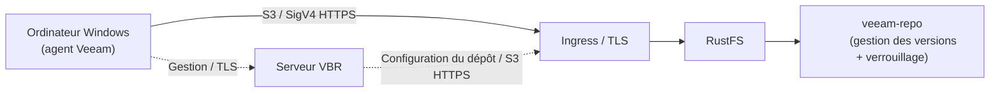

Veeam Backup & Replication (VBR) est une plateforme de sauvegarde d’entreprise qui stocke les données de sauvegarde dans un stockage objet compatible S3. Ce guide montre comment enregistrer RustFS comme dépôt de stockage objet VBR, sauvegarder un ordinateur Windows entier avec l’agent Veeam et restaurer un fichier depuis la sauvegarde.

Vous avez besoin d’une instance RustFS accessible via HTTPS, d’un compartiment dédié aux sauvegardes, d’un ordinateur Windows avec VBR 13 et d’une licence Veeam incluant la sauvegarde vers le stockage objet. Téléchargez VBR depuis la [page officielle de téléchargement Veeam](https://www.veeam.com/products/downloads.html). Dimensionnez le serveur selon la [configuration requise par Veeam](https://helpcenter.veeam.com/docs/vbr/userguide/system_requirements_backup_server.html?ver=13), et non selon une petite machine virtuelle de laboratoire.

:::note[Exigence de licence]

La sauvegarde vers le stockage objet compatible S3 est une fonctionnalité d’entreprise de Veeam. Pour la production, achetez une licence Veeam Enterprise ou une autre licence payante incluant cette fonctionnalité. Pour une preuve de concept (POC), [demandez une licence d’essai gratuite de Veeam Data Platform de 30 jours](https://www.veeam.com/products/data-platform-trial.html) et installez-la avant de lancer la tâche. Le téléchargement ou l’installation de VBR seul n’active pas cette fonctionnalité. Dans la configuration validée, Community Edition pouvait ajouter le dépôt, mais refusait la tâche de sauvegarde vers le stockage objet sans la licence requise.

:::

## Configuration validée

Le test rapporté utilisait VBR **13.1.2.57**, RustFS **1.0.1**, une sauvegarde avec l’agent Windows et un dépôt en mode de connexion **Direct**. Une tâche de sauvegarde et une restauration de fichier ont réussi. Il s’agit d’un test d’intégration, pas d’une certification Veeam ni d’une validation de la restauration bare metal, de l’application de la rétention ou de toutes les charges de travail Veeam. Les objets d’environ 1 Mio observés ne garantissent pas une taille de bloc fixe.

## Architecture



En mode Direct, l’agent envoie les données de sauvegarde à RustFS ; VBR gère la tâche et le dépôt. En mode passerelle, les données transitent par la passerelle ou le serveur de montage choisi. L’agent ou la passerelle qui transfère les données doit pouvoir joindre le point de terminaison HTTPS RustFS et faire confiance à son certificat. Consultez les [modes de connexion de Veeam Agent](https://helpcenter.veeam.com/docs/vbr/userguide/agents_object_storage.html?ver=13). Le préfixe de clé d’objet est `veeam` et le compartiment est `veeam-repo`.

## 1. Préparer le compartiment et les identifiants

Créez un compartiment dédié avec la gestion des versions et le verrouillage d’objet (Object Lock). La gestion des versions est un prérequis du verrouillage d’objet nécessaire aux sauvegardes immuables Veeam :

```bash
rc bucket create <your-alias>/veeam-repo --with-lock
rc bucket version info <your-alias>/veeam-repo
```

Utilisez cette politique initiale limitée au compartiment et validez-la pour le mode Veeam choisi. Les opérations sur compartiments et sur objets utilisent des portées de ressources distinctes. `s3:CreateBucket` est omis puisque le compartiment existe déjà. Ce n’est pas une politique minimale démontrée : la politique du laboratoire inclut la gestion des conservations légales et le contournement de la rétention en mode gouvernance. Avant la production, examinez ces autorisations et supprimez celles qui sont inutiles. En particulier, `s3:BypassGovernanceRetention` permet de contourner la protection en mode gouvernance ; ces identifiants ne garantissent donc pas l’impossibilité de supprimer des versions protégées.

```json
{
  "Version": "2012-10-17",
  "Statement": [
    {
      "Effect": "Allow",
      "Action": ["s3:GetObject","s3:PutObject","s3:DeleteObject",
                 "s3:GetObjectVersion","s3:DeleteObjectVersion",
                 "s3:AbortMultipartUpload","s3:ListMultipartUploadParts",
                 "s3:PutObjectRetention","s3:GetObjectRetention",
                 "s3:PutObjectLegalHold","s3:GetObjectLegalHold",
                 "s3:BypassGovernanceRetention"],
      "Resource": ["arn:aws:s3:::veeam-repo/*"]
    },
    {
      "Effect": "Allow",
      "Action": ["s3:ListBucket","s3:ListBucketVersions","s3:GetBucketLocation",
                 "s3:GetBucketVersioning","s3:GetBucketObjectLockConfiguration",
                 "s3:ListBucketMultipartUploads"],
      "Resource": ["arn:aws:s3:::veeam-repo"]
    }
  ]
}
```

```bash
rc admin policy create <your-alias> veeam-repo-rw <path-to-policy-file>
rc admin user add <your-alias> veeam <your-secret-key>
rc admin policy attach <your-alias> veeam-repo-rw --user veeam
```

Veeam exige HTTPS pour le stockage objet compatible S3. Vous pouvez terminer TLS devant RustFS avec Traefik ou Nginx. Le SAN doit couvrir le nom d’hôte du point de terminaison ; le serveur VBR et l’agent ou la passerelle doivent faire confiance à la chaîne du certificat. Pour une autorité de certification privée, installez son certificat racine dans les magasins de confiance appropriés. N’importez pas un certificat de serveur quelconque comme autorité de confiance et ne désactivez pas la vérification.

Ne configurez pas de règles de cycle de vie d’expiration ou de transition dans ce compartiment de sauvegarde ; laissez Veeam gérer la rétention. Consultez les [limitations du stockage objet pour Veeam Agent](https://helpcenter.veeam.com/docs/agentforwindows/userguide/backup_to_object_storage.html).

## 2. Ajouter le dépôt RustFS dans VBR

Dans la console VBR, allez dans **Backup Infrastructure → Backup Repositories → Add Repository → Object storage → S3 Compatible** :

1. Service point : votre point de terminaison HTTPS RustFS, Region : `us-east-1`.
2. Credentials : la clé d’accès et la clé secrète de `veeam`. Choisissez **Direct** pour le chemin de données illustré, ou une passerelle si l’accès direct ne convient pas.
3. Bucket : `veeam-repo`, Folder : `veeam`.
4. Si le compartiment neuf n’a aucun préfixe, créez un objet sous `veeam/` avec un client S3, puis sélectionnez Folder avec **Browse**.
5. Pour tester les sauvegardes immuables, activez **Make backups immutable** et vérifiez séparément la rétention des objets. Activer le verrouillage du compartiment ne rend pas toutes les sauvegardes immuables.


Lorsque Veeam signale que le provisionnement automatique du compartiment échoue avec Access Denied, choisissez **Yes** pour le désactiver et continuer — le compartiment existe déjà et l’utilisateur IAM ne peut volontairement pas en créer.

Pour les sauvegardes avec agent, configurez explicitement **Set Access Permissions → Security** selon les [instructions Veeam d’accès aux dépôts compatibles S3](https://helpcenter.veeam.com/docs/vbr/userguide/access_permissions.html?ver=13). **Provided by the backup server** utilise une passerelle ou un serveur de montage, même si le dépôt affiche Direct. Un véritable accès Direct exige une configuration IAM/STS compatible ou **Agents share credentials to object storage repository**. Cette dernière option transmet les identifiants du dépôt aux ordinateurs protégés et offre moins de sécurité ; utilisez-la seulement si nécessaire dans un POC isolé. Une prise en charge générique d’IAM/STS ne prouve pas la compatibilité avec le mécanisme d’identifiants Veeam ; validez le mode avant la production.

Le rapport de laboratoire ne précise pas l’option Security et ne confirme donc pas indépendamment que les données ne transitaient pas par une passerelle.

En cas de succès, le dépôt apparaît comme **S3-compatible**. Used Space est l’utilisation rapportée par Veeam, pas une mesure indépendante de la capacité RustFS :


## 3. Enregistrer l’ordinateur protégé

La tâche de sauvegarde seule n’installe pas l’agent Veeam. Utilisez un groupe de protection :

1. **Inventory → Physical and Cloud Infrastructure → Add protection group…**
2. Type **Individual computers**, ajoutez la machine avec son vrai nom d’hôte et des identifiants d’administrateur local sous la forme `HOSTNAME\user`.
3. Laissez **Install Veeam Backup & Replication Agent** coché, puis Apply.

:::warning[Restrictions UAC Windows à distance]

Vérifiez d’abord le nom d’hôte, les identifiants, la connectivité et le pare-feu. Un administrateur ne doit envisager de définir `LocalAccountTokenFilterPolicy` à `1` sous `HKLM\SOFTWARE\Microsoft\Windows\CurrentVersion\Policies\System` que si le filtrage UAC à distance d’un compte local est confirmé. Ce réglage autorise des jetons élevés à distance pour les administrateurs locaux ; ce n’est pas une solution générale aux refus d’accès. Limitez l’accès à un réseau d’administration de confiance, notez la valeur précédente et rétablissez-la lorsqu’elle n’est plus nécessaire, en vérifiant la gestion de l’agent. Consultez les [restrictions UAC à distance de Microsoft](https://learn.microsoft.com/en-us/troubleshoot/windows-server/windows-security/user-account-control-and-remote-restriction). Après l’installation, redémarrez si Backup agent affiche **Reboot required**.

:::

## 4. Exécuter la tâche de sauvegarde

1. **Home → Backup Job → Windows computer…**
2. Computers : **From protection group**, Backup Mode : **Entire computer**.
3. Storage : Backup repository = **RustFS**, rétention selon les besoins.
4. Finish, puis faites un clic droit sur la tâche et sélectionnez **Start**.

Une fois la tâche terminée, la liste des tâches affiche **Last Result: Success** et le point de restauration apparaît sous **Home → Backups → Object Storage → RustFS Veeam Backup** :


Vérifiez les objets dans RustFS :

```bash
rc object find <your-alias>/veeam-repo/ | tail -1
```

Le test a observé des objets de données sous `Veeam/Backup/veeam/Clients/{agent-id}/…`. Lister un objet ne prouve ni l’intégrité complète de la sauvegarde, ni la présence d’un point de restauration, ni une rétention immuable.

## 5. Restaurer des fichiers

1. **Home → Backups → Object Storage → RustFS Veeam Backup → <computer>**.
2. Clic droit sur le point de restauration → **Restore guest files…** → Browse.
3. Choisissez un fichier dans le Backup Browser, restaurez-le vers un dossier cible et vérifiez son contenu.


Une restauration réussie avec un contenu identique valide le parcours de sauvegarde et de récupération pour ce fichier, pas tous les points de restauration. Pour un POC de sauvegarde immuable, vérifiez aussi le mode et l’expiration de rétention, puis confirmez avec des données de test contrôlées que les versions protégées ne peuvent pas être supprimées pendant la rétention. N’effectuez pas de tests destructifs sur les sauvegardes de production.

## Dépannage

| Symptôme | Solution |
|---|---|
| "Backup to object storage requires a valid Enterprise edition license" | Installez une licence incluant la sauvegarde vers le stockage objet (essai ou payante) ; Community Edition ne peut pas exécuter ces tâches |
| "backup agent is missing" pendant la tâche | Enregistrez la machine via un groupe de protection (étape 3) ; l’assistant de tâche n’installe pas les agents |
| L’installation de l’agent échoue avec une erreur d’accès | Vérifiez d’abord les identifiants, le nom d’hôte et le pare-feu ; consultez l’avertissement UAC uniquement si le filtrage à distance est confirmé |
| La colonne Backup agent affiche "Reboot required" | Redémarrez la machine pour terminer l’installation de l’agent |
| La console affiche HTTP 502 juste après le démarrage | Les services Veeam démarrent encore ; réessayez lorsque `VeeamBackupSvc` et le service PostgreSQL sont Running |
| La liste des dossiers est vide dans l’assistant | Le sélecteur liste les préfixes existants ; créez d’abord un objet sous le préfixe, puis utilisez Browse |
| La capacité du dépôt affiche N/A | Les rapports SOSAPI ne sont pas requis pour la sauvegarde ; leur prise en charge est suivie dans [rustfs/rustfs#1511](https://github.com/rustfs/rustfs/issues/1511) |

## Étapes suivantes

- [Téléchargements Veeam](https://www.veeam.com/products/downloads.html) et [licence d’essai pour un POC](https://www.veeam.com/products/data-platform-trial.html).
- [Exigences du stockage objet pour Veeam Agent](https://helpcenter.veeam.com/docs/agentforwindows/userguide/backup_to_object_storage.html).
- [Verrouillage d’objet RustFS](../../../administration/data/object/object-lock.md) et [gestion des versions](../../../administration/data/object/versioning.md).
