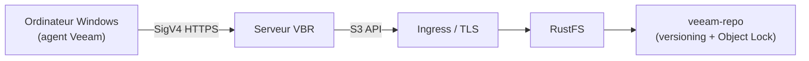

Veeam Backup & Replication (VBR) est une plateforme de sauvegarde entreprise qui stocke les données de sauvegarde dans un stockage objet compatible S3. Ce guide montre comment enregistrer RustFS comme dépôt de stockage objet VBR, sauvegarder un ordinateur Windows entier avec l’agent Veeam et restaurer un fichier depuis la sauvegarde.

Vous avez besoin d’une instance RustFS en cours d’exécution accessible via HTTPS, d’un compartiment dédié aux sauvegardes, d’une machine Windows avec VBR 13 installé (4 vCPU et 8 Go de RAM constituent un minimum pratique) et d’une licence Veeam incluant la sauvegarde vers stockage objet.

:::note[Exigence de licence]

La sauvegarde vers stockage objet est une fonctionnalité Veeam de niveau Enterprise. VBR Community Edition peut ajouter et valider un dépôt S3, mais l’exécution d’un job de sauvegarde vers celui-ci nécessite une licence Enterprise ou la clé d’évaluation gratuite de 30 jours (Veeam Data Platform Trial Key).

:::

## Architecture



Pendant la sauvegarde, Veeam écrit des blocs d’environ 1 Mio dans le compartiment via l’API S3 ; lors d’une restauration, seuls les blocs contenant les données demandées sont relus. Le préfixe dans ce guide est `veeam` et le compartiment est `veeam-repo`.

## 1. Préparer le compartiment et les identifiants

Créez un compartiment dédié avec le versioning et l’Object Lock activés. Le versioning est un prérequis de l’Object Lock dont dépend l’immuabilité Veeam :

```bash
rc bucket create <your-alias>/veeam-repo --with-lock
rc bucket version info <your-alias>/veeam-repo
```

Créez une politique à privilèges minimaux limitée au compartiment. Cette politique omet volontairement `s3:CreateBucket` : Veeam propose la création automatique de compartiments, et la refuser est l’attitude recommandée lorsque le compartiment existe déjà.

```json
{
  "Version": "2012-10-17",
  "Statement": [
    {
      "Effect": "Allow",
      "Action": ["s3:GetObject","s3:PutObject","s3:DeleteObject",
                 "s3:GetObjectVersion","s3:DeleteObjectVersion",
                 "s3:AbortMultipartUpload","s3:ListMultipartUploadParts",
                 "s3:ListBucketMultipartUploads",
                 "s3:PutObjectRetention","s3:GetObjectRetention",
                 "s3:PutObjectLegalHold","s3:GetObjectLegalHold",
                 "s3:BypassGovernanceRetention"],
      "Resource": ["arn:aws:s3:::veeam-repo/*"]
    },
    {
      "Effect": "Allow",
      "Action": ["s3:ListBucket","s3:ListBucketVersions","s3:GetBucketLocation",
                 "s3:GetBucketVersioning"],
      "Resource": ["arn:aws:s3:::veeam-repo"]
    }
  ]
}
```

```bash
rc admin policy create <your-alias> veeam-repo-rw <path-to-policy-file>
rc admin user add <your-alias> veeam <your-secret-key>
rc admin policy attach <your-alias> veeam-repo-rw --user veeam
```

Veeam exige HTTPS pour le stockage objet. Terminez TLS devant RustFS (par exemple avec Traefik ou Nginx) avec un certificat dont le SAN couvre le nom d’hôte du point de terminaison, puis importez ce certificat dans le magasin **Trusted Root Certification Authorities** du serveur Veeam.

## 2. Ajouter le dépôt RustFS dans VBR

Dans la console VBR, allez dans **Backup Infrastructure → Backup Repositories → Add Repository → Object storage → S3 Compatible** :

1. Service point : votre point de terminaison HTTPS RustFS, Region : `us-east-1`.
2. Credentials : la clé d’accès et la clé secrète de `veeam`.
3. Bucket : `veeam-repo`, Folder : `veeam`.
4. Optionnel : activez **Make backups immutable** (l’Object Lock du compartiment est déjà activé).


Lorsque Veeam signale que le provisionnement automatique du compartiment échoue avec Access Denied, choisissez **Yes** pour le désactiver et continuer — le compartiment existe déjà et l’utilisateur IAM ne peut volontairement pas en créer.

En cas de succès, le dépôt est listé comme **S3-compatible** avec l’espace utilisé correspondant au contenu du compartiment :


## 3. Enregistrer l’ordinateur protégé

Le job de sauvegarde seul n’installe pas l’agent Veeam. Utilisez un groupe de protection :

1. **Inventory → Physical and Cloud Infrastructure → Add protection group…**
2. Type **Individual computers**, ajoutez la machine avec son vrai nom d’hôte et des identifiants d’administrateur local sous la forme `HOSTNAME\user`.
3. Laissez **Install Veeam Backup & Replication Agent** coché, puis Apply.

:::note[UAC Windows]

Si l’installation de l’agent échoue avec une erreur d’accès, définissez `LocalAccountTokenFilterPolicy` à `1` sous `HKLM\SOFTWARE\Microsoft\Windows\CurrentVersion\Policies\System` sur la machine cible et relancez un rescan. Après l’installation de l’agent, redémarrez la machine lorsque la colonne Backup agent affiche **Reboot required**.

:::

## 4. Exécuter le job de sauvegarde

1. **Home → Backup Job → Windows computer…**
2. Computers : **From protection group**, Backup Mode : **Entire computer**.
3. Storage : Backup repository = **RustFS**, rétention selon les besoins.
4. Finish, puis faites un clic droit sur le job et sélectionnez **Start**.

Une fois le job terminé, la liste des jobs affiche **Last Result: Success** et le point de restauration apparaît sous **Home → Backups → Object Storage → RustFS Veeam Backup** :


Vérifiez les objets dans RustFS :

```bash
rc object find <your-alias>/veeam-repo/ | tail -1
```

Veeam stocke des blocs d’environ 1 Mio sous `Veeam/Backup/veeam/Clients/{agent-id}/…`, chaque objet portant un ETag et une version.

## 5. Restaurer des fichiers

1. **Home → Backups → Object Storage → RustFS Veeam Backup → <computer>**.
2. Clic droit sur le point de restauration → **Restore guest files…** → Browse.
3. Choisissez un fichier dans le Backup Browser, restaurez-le vers un dossier cible et vérifiez son contenu.


La restauration ne relit que les blocs contenant le fichier sélectionné, ce qui valide le chemin de lecture complet contre RustFS.

## Dépannage

| Symptôme | Solution |
|---|---|
| "Backup to object storage requires a valid Enterprise edition license" | Installez une licence incluant la sauvegarde vers stockage objet (essai ou payante) ; Community Edition ne peut pas exécuter de jobs vers le stockage objet |
| "backup agent is missing" pendant le job | Enregistrez la machine via un groupe de protection (étape 3) ; l’assistant de job n’installe pas les agents |
| L’installation de l’agent échoue avec une erreur d’accès | Définissez `LocalAccountTokenFilterPolicy=1` sur la cible ; utilisez le vrai nom d’hôte, pas `localhost` |
| La colonne Backup agent affiche "Reboot required" | Redémarrez la machine pour terminer l’installation de l’agent |
| La console affiche HTTP 502 juste après le démarrage | Les services Veeam démarrent encore ; réessayez lorsque `VeeamBackupSvc` et le service PostgreSQL sont Running |
| La liste des dossiers est vide dans l’assistant | Le sélecteur liste les préfixes existants ; créez d’abord un objet placeholder sous le préfixe, puis Browse |
| La capacité du dépôt affiche N/A | Le reporting SOSAPI n’est pas requis pour la sauvegarde ; le support est suivi dans [rustfs#1511](https://github.com/rustfs/rustfs/issues/1511) |
