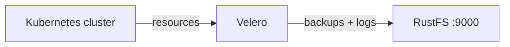

Ce guide connecte [Velero](https://github.com/vmware-tanzu/velero) — l’outil de sauvegarde et de restauration Kubernetes — à **RustFS** comme backend de stockage objet. Vous allez installer Velero dans un cluster Kubernetes avec un emplacement de sauvegarde RustFS, sauvegarder les ressources du cluster, les supprimer, restaurer depuis le compartiment (bucket) et vérifier les objets restaurés. Le flux a été validé avec la CLI Velero 1.16.2, `velero-plugin-for-aws:v1.12.2` sur k3s (Kubernetes 1.30) et `rustfs/rustfs-x86-musl:v2.3.1`.

Vous avez besoin d’un cluster Kubernetes avec un accès `kubectl` et la CLI Velero. Ce guide est destiné aux tests d’intégration, pas à la production.

## Schéma d’architecture



Velero sérialise les ressources Kubernetes et, de façon facultative, les données de volumes de pods dans des archives gzip sous `backups/<name>/` dans le compartiment. Les restaurations téléchargent ces archives et recréent les ressources dans le cluster.

## 1. Créer le compartiment de sauvegarde

Créez un compartiment dédié — Velero ne crée pas les compartiments :

```bash
rc alias set rustfs http://<your-rustfs-endpoint>:9000 <your-access-key> <your-secret-key>
rc mb rustfs/velero-backups
```

## 2. Installer Velero

Écrivez les identifiants dans un fichier et installez le serveur Velero. Le `s3Url` doit être un point de terminaison joignable depuis les pods du cluster eux-mêmes — utilisez l’adresse IP du nœud ou une adresse interne, pas une redirection de port depuis votre poste de travail :

```bash
cat > velero-creds <<EOF
[default]
aws_access_key_id=<your-access-key>
aws_secret_access_key=<your-secret-key>
EOF

kubectl create namespace velero
kubectl create secret generic cloud-credentials \
  --namespace velero --from-file=cloud=velero-creds

velero install \
  --provider aws \
  --plugins velero/velero-plugin-for-aws:v1.12.2 \
  --bucket velero-backups \
  --backup-location-config region=us-east-1,s3ForcePathStyle="true",s3Url=http://<your-rustfs-endpoint>:9000 \
  --secret-file velero-creds \
  --use-volume-snapshots=false
```

Attendez que le déploiement soit prêt et que l’emplacement de sauvegarde passe à `Available` :

```bash
kubectl -n velero get pods
velero backup-location get
```

```text
NAME      PROVIDER   BUCKET/PREFIX    PHASE      LAST VALIDATED   ACCESS MODE   DEFAULT
default   aws        velero-backups   Available  2026-09-22 ...   ReadWrite     true
```

## 3. Sauvegarder les ressources du cluster

Créez deux ressources de démonstration et sauvegardez toute la portée de l’espace de noms default :

```bash
kubectl create configmap demo-cm --from-literal=key=rustfs-velero-demo
kubectl create deployment nginx --image=nginx:1.27

velero backup create demo-backup --wait
velero backup get
```

La sauvegarde charge (upload) les archives de ressources et les journaux vers RustFS.

## 4. Vérifier la sauvegarde dans RustFS

Listez le compartiment :

```bash
rc ls rustfs/velero-backups/ -r
```

L’ensemble d’archives de la sauvegarde est stocké sous le préfixe `backups/` :

```text
backups/demo-backup/demo-backup-resources.json.gz
backups/demo-backup/demo-backup-logs.gz
backups/demo-backup/demo-backup-itemoperations.json.gz
```


## 5. Restaurer et vérifier

Supprimez les ressources de démonstration et restaurez-les à partir de la sauvegarde. La restauration lit les archives depuis RustFS et recrée les ressources :

```bash
kubectl delete configmap demo-cm
kubectl delete deployment nginx

velero restore create --from-backup demo-backup --wait
```

Confirmez que les ressources sont de retour avec leur contenu d’origine :

```bash
kubectl get configmap demo-cm -o jsonpath="{.data.key}"
kubectl get deployment nginx
```

```text
rustfs-velero-demo
NAME    READY   UP-TO-DATE   AVAILABLE   AGE
nginx   1/1     1            1           10s
```

## 6. Arrêter ou réinitialiser

Les sauvegardes restent dans le compartiment `velero-backups` et servent à restaurer dans tout cluster qui exécute Velero face au même compartiment. Pour supprimer la sauvegarde de démonstration de RustFS :

```bash
velero backup delete demo-backup --confirm
rc rm rustfs/velero-backups/backups/ --recursive --force
```

## Dépannage

### L’emplacement de sauvegarde reste `Unavailable`

Le pod Velero ne peut pas joindre le `s3Url`. Les points de terminaison d’un réseau pont Docker personnalisé ne sont pas routables depuis les pods Kubernetes — utilisez l’adresse IP du pont de l’hôte Docker (par exemple `http://172.17.0.1:9000` sur un cluster à hôte unique) ou une adresse de nœud. Corrigez l’emplacement et laissez Velero revalider :

```bash
kubectl -n velero patch backupstoragelocation default --type merge -p \
  '{"spec":{"config":{"s3Url":"http://172.17.0.1:9000"}}}'
```

### La sauvegarde se termine en `PartiallyFailed` avec une erreur de daemonset

L’erreur `daemonset pod not found in running state` signifie que le pod node-agent (utilisé pour les sauvegardes de volumes de pods) n’était pas en cours d’exécution. Elle n’affecte pas les archives des ressources du cluster. Attendez l’agent, ou ne conservez `--default-volumes-to-fs-backup` que lorsque l’agent est en cours d’exécution.

### `FailedValidation` juste après l’installation

La première tentative de sauvegarde s’exécute face à un emplacement qui n’a pas encore été validé. Attendez que `velero backup-location get` indique `Available` avant de créer des sauvegardes.

## Étapes suivantes

- Consultez les [notes de compatibilité S3](/fr/administration/protocols/s3) avant d’adopter d’autres opérations Velero.
- Créez des identifiants de production dédiés avec la [gestion des clés d’accès](/fr/security-compliance/iam/access-token).
- Suivez la [documentation Velero](https://velero.io/docs/main/) pour ajouter des planifications, des instantanés de volumes et des flux de migration de cluster.
