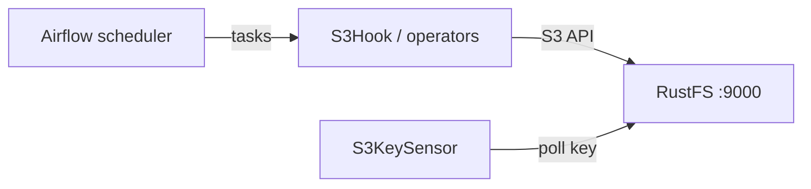

Ce guide connecte [Apache Airflow](https://github.com/apache/airflow) — la plateforme d’orchestration de workflows — à **RustFS** via les hooks, les opérateurs et les sensors du fournisseur Amazon S3. Vous allez enregistrer une connexion avec un point de terminaison personnalisé, exécuter un DAG qui écrit un objet dans un compartiment (bucket) RustFS, attendre une clé avec `S3KeySensor`, puis relire l’objet avec `S3Hook`. Le flux a été validé avec `apache/airflow:3.3.2` (autonome, SequentialExecutor) et le fournisseur `apache-airflow-providers-amazon` face à `rustfs/rustfs-x86-musl:v2.3.1`.

Vous avez besoin de Docker, ou d’une installation Airflow existante. Ce déploiement est destiné aux tests d’intégration locaux, pas à la production.

## Schéma d’architecture



Chaque interaction S3 à l’intérieur d’un DAG passe par le client S3 du fournisseur, orienté vers RustFS par le `endpoint_url` de la connexion. Les opérateurs, les sensors et les hooks partagent le même objet de connexion.

## 1. Exécuter Airflow

Démarrez une instance autonome avec les exemples désactivés, puis créez le compartiment de démonstration :

```bash
docker run -d --name airflow --network oo-rustfs_default -p 8080:8080 \
  -e AIRFLOW__CORE__LOAD_EXAMPLES=False \
  -v "$PWD/dags":/opt/airflow/dags \
  apache/airflow:3.3.2 standalone

rc mb rustfs/airflow-demo
```

L’image est livrée avec tous les fournisseurs préinstallés, y compris `apache-airflow-providers-amazon`.

## 2. Enregistrer la connexion RustFS

Le fournisseur S3 lit son point de terminaison dans le champ extra de la connexion. Remplacez tous les espaces réservés de la connexion :

```bash
docker exec airflow airflow connections add rustfs \
  --conn-type aws \
  --conn-extra '{"endpoint_url": "http://<your-rustfs-endpoint>:9000", "region_name": "us-east-1", "aws_access_key_id": "<your-access-key>", "aws_secret_access_key": "<your-secret-key>"}'
```

Les clés `aws_access_key_id` et `aws_secret_access_key` dans `--conn-extra` fournissent les identifiants ; `endpoint_url` redirige le client boto3 d’AWS vers RustFS.

## 3. Écrire le DAG

Le DAG écrit un objet avec un opérateur, attend la clé avec un sensor, puis la relit avec le hook :

```python title="rustfs_demo.py"
import datetime

from airflow.providers.amazon.aws.hooks.s3 import S3Hook
from airflow.providers.amazon.aws.operators.s3 import S3CreateObjectOperator
from airflow.providers.amazon.aws.sensors.s3 import S3KeySensor
from airflow.sdk import dag, task

@dag(
    schedule=None,
    start_date=datetime.datetime(2026, 1, 1),
    catchup=False,
    tags=["rustfs"],
)
def rustfs_demo():
    create = S3CreateObjectOperator(
        task_id="write_object",
        s3_bucket="airflow-demo",
        s3_key="dags/airflow-put.txt",
        data="written by airflow to rustfs",
        aws_conn_id="rustfs",
        replace=True,
    )

    wait = S3KeySensor(
        task_id="wait_for_object",
        bucket_key="dags/airflow-put.txt",
        bucket_name="airflow-demo",
        aws_conn_id="rustfs",
        timeout=120,
        poke_interval=10,
        mode="reschedule",
    )

    @task
    def read_object():
        hook = S3Hook(aws_conn_id="rustfs")
        body = hook.read_key(key="dags/airflow-put.txt", bucket_name="airflow-demo")
        print("read back:", body)
        assert body == "written by airflow to rustfs"

    create >> [wait, read_object()]

rustfs_demo()
```

Notez les chemins d’import : `S3CreateObjectOperator` se trouve dans le module `operators`, tandis que `S3KeySensor` se trouve dans le module `sensors` — importer les deux depuis le même endroit échoue.

## 4. Réactiver et déclencher

Les nouveaux DAG démarrent en pause, et un déclenchement effectué pendant la pause reste en file d’attente indéfiniment. Réactivez d’abord, puis déclenchez :

```bash
docker exec airflow airflow dags unpause rustfs_demo
docker exec airflow airflow dags trigger rustfs_demo
```

Surveillez la fin de l’exécution :

```bash
docker exec airflow airflow dags list-runs rustfs_demo | head -3
```

```text
dag_id       run_id                                    state
rustfs_demo  manual__2026-09-29T13:15:57.332688+00:00  success
```

Les trois tâches réussissent : `write_object`, `wait_for_object` et `read_object`.

## 5. Vérifier les objets dans RustFS

Listez le préfixe du compartiment :

```bash
rc ls rustfs/airflow-demo/ -r
rc cat rustfs/airflow-demo/dags/airflow-put.txt
```

```text
[2026-09-29 13:16:01]       28 B dags/airflow-put.txt
written by airflow to rustfs
```


## 6. Arrêter ou réinitialiser

Pour démonter la démonstration tout en conservant les objets du compartiment :

```bash
docker rm -f airflow
```

Pour supprimer les données stockées :

```bash
rc rm rustfs/airflow-demo/ --recursive --force
```

## Dépannage

### Les exécutions de DAG restent `queued` après le déclenchement

Le DAG est en pause. Dans Airflow 3, les nouveaux DAG sont en pause par défaut, et les exécutions déclenchées dans cet état ne s’exécutent jamais. Exécutez `airflow dags unpause rustfs_demo` ; les exécutions en file d’attente démarrent alors d’elles-mêmes.

### `cannot import name 'S3KeySensor' from 'airflow.providers.amazon.aws.operators.s3'`

Le sensor se trouve dans un module distinct : `from airflow.providers.amazon.aws.sensors.s3 import S3KeySensor`.

### Les tâches échouent avec des erreurs de connexion

Le `endpoint_url` doit être joignable depuis le conteneur Airflow — utilisez le nom d’hôte du réseau Docker pour RustFS, pas `localhost`. Airflow 3 expose son point de terminaison de contrôle d’intégrité sous `/api/v2/monitor/health` si vous avez besoin de vérifier l’état des composants.

## Étapes suivantes

- Consultez les [notes de compatibilité S3](/fr/administration/protocols/s3) avant d’adopter d’autres hooks du fournisseur.
- Créez des identifiants de production dédiés avec la [gestion des clés d’accès](/fr/security-compliance/iam/access-token).
- Suivez la [documentation du fournisseur Amazon](https://airflow.apache.org/docs/apache-airflow-providers-amazon/stable/index.html) pour les opérateurs de transfert tels que `S3ToLocalFilesystemOperator` et `LocalFilesystemToS3Operator`.
