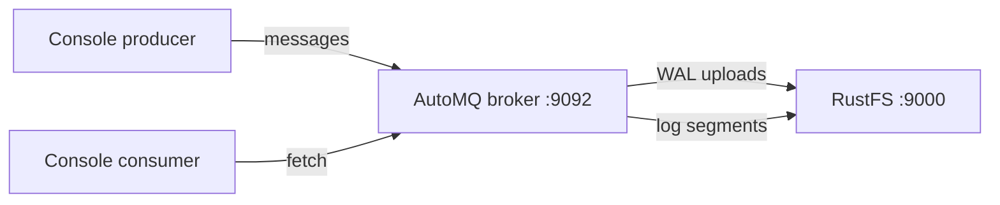

Ce guide connecte [AutoMQ](https://github.com/AutoMQ/automq) — la distribution Kafka cloud native qui conserve son stockage de journaux dans le stockage objet — à **RustFS**. Vous allez démarrer un broker AutoMQ à nœud unique en mode KRaft, avec ses compartiments (buckets) de journaux S3 orientés vers RustFS, puis produire et consommer des messages. Le flux a été validé avec AutoMQ 1.3.0 (API Kafka 3.9.0) face à `rustfs/rustfs-x86-musl:v2.3.1`.

Vous avez besoin de Docker. Ce déploiement est destiné aux tests d’intégration locaux, pas à la production.

## Schéma d’architecture



AutoMQ découple le stockage des brokers : le journal d’écriture anticipée (write-ahead log) est mis en tampon localement, puis chargé (upload) sous forme d’objets de flux immuables dans le compartiment. Le broker ne conserve aucun répertoire de données local au-delà du WAL.

## 1. Exécuter le broker

Démarrez AutoMQ avec les compartiments S3 orientés vers RustFS. Quatre détails sont obligatoires : des arguments de script séparés par des espaces (`--key=value` fait boucler le script de démarrage indéfiniment), `JAVA_TOOL_OPTIONS` avec `-XX:-UseContainerSupport` (sinon le JDK 17 fourni plante lors de la détection de cgroup v2), le rôle combiné `server`, et les identifiants via les variables d’environnement `KAFKA_S3_ACCESS_KEY`/`KAFKA_S3_SECRET_KEY` (les arguments de script `--s3.access.key` sont ignorés) :

```bash
docker run -d --name automq --hostname automq --network oo-rustfs_default -p 9092:9092 \
  -e JAVA_TOOL_OPTIONS="-XX:-UseContainerSupport" \
  -e KAFKA_HEAP_OPTS="-Xms512m -Xmx512m -XX:MetaspaceSize=96m -XX:MaxDirectMemorySize=512M" \
  -e KAFKA_S3_ACCESS_KEY=<your-access-key> \
  -e KAFKA_S3_SECRET_KEY=<your-secret-key> \
  -v /opt/automq-data:/data/kafka \
  automqinc/automq:1.3.0 /opt/automq/scripts/start.sh up \
  --process.roles server \
  --node.id 0 \
  --controller.quorum.voters 0@automq:9093 \
  --s3.region us-east-1 \
  --s3.bucket automq-demo \
  --s3.endpoint http://rustfs:9000
```

Le broker associe son listener à l’adresse IP du conteneur. Pour les outils de console, adressez-le par cette adresse IP (le nom d’hôte `automq` fonctionne aussi depuis l’intérieur du conteneur).

## 2. Créer un topic et produire

```bash
AIP=<automq-container-ip>
docker exec automq sh -c "cd /opt/automq/kafka && \
  ./bin/kafka-topics.sh --bootstrap-server $AIP:9092 --create --topic rustfs-automq --partitions 1 --replication-factor 1"

docker exec automq sh -c "cd /opt/automq/kafka && \
  printf 'mq-msg-one\nmq-msg-two\nmq-msg-three\n' | \
  ./bin/kafka-console-producer.sh --bootstrap-server $AIP:9092 --topic rustfs-automq"
```

## 3. Consommer les messages

```bash
docker exec automq sh -c "cd /opt/automq/kafka && \
  ./bin/kafka-console-consumer.sh --bootstrap-server $AIP:9092 \
  --topic rustfs-automq --from-beginning --max-messages 3 --timeout-ms 30000"
```

```text
mq-msg-one
mq-msg-two
mq-msg-three
Processed a total of 3 messages
```

## 4. Vérifier les objets dans RustFS

Listez le compartiment — AutoMQ écrit ses flux de journaux et ses métriques sous forme d’objets :

```bash
rc ls rustfs/automq-demo/ -r
```

```text
automq/logs/rZdE0DjZSrqy96PXrMUZVw/0/2026100700/fcd3fc76-... 
automq/logs/rZdE0DjZSrqy96PXrMUZVw/0/2026100701/52877dc7-...
automq/metrics/rZdE0DjZSrqy96PXrMUZVw/0/2026100701/4733e680-...
```

Les objets de flux de journaux contiennent les données du topic — le broker ne conserve localement que le WAL, si bien qu’augmenter ou réduire le nombre de brokers ne déplace pas les données.


## 5. Arrêter ou réinitialiser

```bash
docker rm -f automq
rc rm rustfs/automq-demo/ --recursive --force
```

## Dépannage

### Le script de démarrage affiche des lignes `setup_value:` indéfiniment, à 100 % de CPU

L’analyseur d’arguments n’accepte que la forme séparée par des espaces (`--s3.bucket x`, et non `--s3.bucket=x`). La forme avec `=` fait boucler l’analyseur indéfiniment.

### `java.lang.NullPointerException ... CgroupInfo.getMountPoint()`

Le JDK 17 fourni échoue à la détection de cgroup v2 dans cette image. Définissez `JAVA_TOOL_OPTIONS="-XX:-UseContainerSupport"`.

### `unknown process role broker,controller`

Le script d’AutoMQ 1.3.0 attend que le rôle combiné s’écrive `server`.

### Le broker démarre, mais les clients obtiennent `Connection to node -1 could not be established`

Le listener s’associe à l’adresse IP du conteneur (`hostname -I`). Adressez le broker par cette adresse IP ou par le nom d’hôte `automq` depuis le même réseau Docker — `localhost` ne fonctionne que pour les outils exécutés à l’intérieur du conteneur du broker lui-même.

### `List objects failed, cost: 120000+ ms`

AutoMQ utilise par défaut l’adressage de type hôte virtuel et entre dans une boucle de nouvelles tentatives face aux points de terminaison par adresse IP. Forcez l’adressage de type chemin (path-style) des compartiments en remplaçant les URL de compartiment par `KAFKA_CFG_S3_DATA_BUCKETS`/`KAFKA_CFG_S3_OPS_BUCKETS` définies sur `0@s3://<bucket>?region=us-east-1&endpoint=http://rustfs:9000&pathStyle=true&authType=static`, et passez les identifiants via `KAFKA_S3_ACCESS_KEY`/`KAFKA_S3_SECRET_KEY`.

## Étapes suivantes

- Comparez avec le guide [Kafka](/fr/developer/integration/big-data/kafka) lorsque vous préférez une intégration S3 fondée sur Connect avec un Kafka standard.
- Créez des identifiants de production dédiés avec la [gestion des clés d’accès](/fr/security-compliance/iam/access-token).
- Suivez la [documentation AutoMQ](https://docs.automq.com/) pour les clusters à plusieurs nœuds et le réglage des paramètres du WAL sur le même compartiment.
