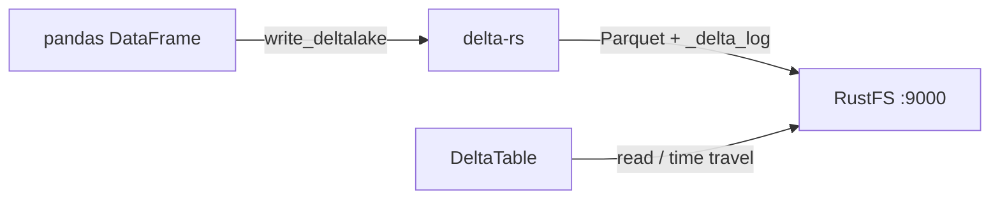

Ce guide connecte [Delta Lake](https://github.com/delta-io/delta) — le format de table lakehouse open source — à **RustFS** via delta-rs, l’implémentation Delta native en Rust. Vous allez écrire une table Delta dans un compartiment (bucket) RustFS depuis Python, la relire avec l’historique des transactions ACID, et confirmer les fichiers `_delta_log` et Parquet dans le compartiment. Le flux a été validé avec le paquet Python `deltalake` (delta-rs) et pandas face à `rustfs/rustfs-x86-musl:v2.3.1`.

Vous avez besoin de Python 3.9 ou plus récent. Ce déploiement est destiné aux tests d’intégration locaux, pas à la production.

## Schéma d’architecture



delta-rs stocke chaque table sous forme de fichiers Parquet plus un journal de transactions (`_delta_log/`). Toutes les E/S passent par la crate `object_store`, configurée avec les mêmes variables d’environnement AWS que les autres clients S3.

## 1. Installer le client

```bash
pip install deltalake pandas pyarrow
```

`pyarrow` est requis pour convertir les cadres pandas en lots d’enregistrements compatibles avec Delta.

## 2. Écrire une table Delta

Créez le compartiment et écrivez une table, en remplaçant tous les espaces réservés de connexion. `AWS_S3_ALLOW_UNSAFE_RENAME` est nécessaire parce que RustFS ne fournit pas copy-if-not-exists, que delta-rs utilise sinon pour les conflits de commit :

```python title="delta_s3.py"
import pandas as pd
from deltalake import DeltaTable, write_deltalake

storage_options = {
    "AWS_ENDPOINT_URL": "http://<your-rustfs-endpoint>:9000",
    "AWS_ACCESS_KEY_ID": "<your-access-key>",
    "AWS_SECRET_ACCESS_KEY": "<your-secret-key>",
    "AWS_REGION": "us-east-1",
    "AWS_ALLOW_HTTP": "true",
    "AWS_S3_ALLOW_UNSAFE_RENAME": "true",
}

table = "s3://<your-bucket>/events"
df = pd.DataFrame({"id": [1, 2, 3], "name": ["alpha", "beta", "gamma"]})
write_deltalake(table, df, storage_options=storage_options)
print("written:", df.shape[0], "rows")
```

```text
written: 3 rows
```

L’URI `table` utilise la forme standard `s3://bucket/prefix` ; le point de terminaison et les identifiants viennent de `storage_options`.

## 3. Relire la table

```python title="delta_read.py"
from deltalake import DeltaTable

back = DeltaTable("s3://<your-bucket>/events", storage_options=storage_options).to_pandas()
print("read back:", back.shape[0], "rows")
print(back.sort_values("id").to_string(index=False))
print("version:", DeltaTable("s3://<your-bucket>/events", storage_options=storage_options).version())
```

```text
read back: 3 rows
 id   name
  1  alpha
  2   beta
  3  gamma
version: 0
```

Comme la version est suivie dans le journal des transactions, la même table prend en charge le voyage dans le temps avec `DeltaTable(..., version=N)` et les ajouts qui incrémentent la version.

## 4. Vérifier les objets dans RustFS

Listez le préfixe de la table :

```bash
rc ls rustfs/<your-bucket>/ -r
```

Le premier commit a créé le journal des transactions et un fichier Parquet :

```text
events/_delta_log/00000000000000000000.json
events/part-00000-3859855e-45e4-4ae5-94ff-2d8eab5e7ebb-c000.snappy.parquet
```

Chaque nouvelle écriture ajoute une entrée de journal `NNNNNNNNNNNNNNNNNNNN.json` et des parties Parquet ; les lecteurs rejouent le journal pour obtenir un instantané cohérent.


## 5. Arrêter ou réinitialiser

delta-rs ne conserve aucun état propre. Pour supprimer la table :

```bash
rc rm rustfs/<your-bucket>/events/ --recursive --force
```

## Dépannage

### `Import pyarrow failed` lors de l’écriture d’un DataFrame pandas

`write_deltalake` convertit les cadres via Arrow. Installez `pyarrow` en plus de `deltalake` et de `pandas`.

### `Generic DeltaTable error: commit conflict` ou erreurs de renommage au commit

delta-rs valide les commits en copiant et en renommant des objets temporaires, ce qui exige un renommage atomique sur le backend. Pour les magasins compatibles avec S3 sans copy-if-not-exists, définissez `AWS_S3_ALLOW_UNSAFE_RENAME: "true"` dans `storage_options` — acceptable pour un seul rédacteur, pas pour des rédacteurs concurrents.

### `Unknown lengthy error: AWS connectivity or endpoint errors`

Vérifiez que `AWS_ENDPOINT_URL` inclut le schéma et que `AWS_ALLOW_HTTP` vaut `"true"` pour les points de terminaison en HTTP simple ; sans cela, le client S3 ne parle que HTTPS.

## Étapes suivantes

- Consultez les [notes de compatibilité S3](/fr/administration/protocols/s3) avant d’adopter d’autres clients Delta.
- Créez des identifiants de production dédiés avec la [gestion des clés d’accès](/fr/security-compliance/iam/access-token).
- Suivez la [documentation d’utilisation de delta-rs](https://delta-io.github.io/delta-rs/usage/writing/writing-to-s3/) pour les configurations à rédacteurs concurrents avec une coordination de commit adossée à DynamoDB.
