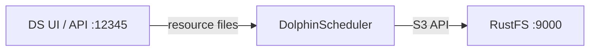

Ce guide connecte [Apache DolphinScheduler](https://github.com/apache/dolphinscheduler) — l’ordonnanceur de workflows — à **RustFS** comme stockage de son centre de ressources. Vous allez exécuter le serveur autonome, basculer le stockage des ressources vers S3, charger (upload) un fichier de ressource via l’API et vérifier l’objet dans le compartiment (bucket). Le flux a été validé avec DolphinScheduler 3.2.1 (serveur autonome) face à `rustfs/rustfs-x86-musl:v2.3.1`.

Vous avez besoin de Docker.

## Schéma d’architecture



Le centre de ressources stocke les scripts de workflow, les JAR de dépendances et d’autres fichiers. Avec le stockage S3, chaque fichier chargé devient un objet sous `dolphinscheduler/<tenant>/resources/` dans le compartiment.

## 1. Exécuter le serveur autonome

```bash
docker run -d --name dolphinscheduler --hostname dolphinscheduler \
  --network oo-rustfs_default -p 12345:12345 \
  apache/dolphinscheduler-standalone-server:3.2.1
```

Le conteneur unique regroupe le master, le worker, l’API, l’alerte et un ZooKeeper intégré. L’interface est à `http://localhost:12345/dolphinscheduler/ui` (connexion par défaut `admin` / `dolphinscheduler123`).

## 2. Basculer le centre de ressources vers RustFS

Le backend de stockage se trouve dans `/opt/dolphinscheduler/conf/common.properties`. Ajoutez les propriétés S3 au fichier existant — ne remplacez pas le fichier, il contient de nombreux autres réglages :

```bash
docker exec dolphinscheduler bash -c "cat >> /opt/dolphinscheduler/conf/common.properties << 'EOF'

resource.storage.type=S3
resource.storage.base.dir=/ds-resources
resource.aws.s3.bucket.name=ds-demo
resource.aws.s3.endpoint=http://<your-rustfs-endpoint>:9000
resource.aws.access.key.id=<your-access-key>
resource.aws.secret.access.key=<your-secret-key>
resource.aws.region=us-east-1
EOF"
docker restart dolphinscheduler
```

Attendez le retour de l’API (environ une minute), puis créez le compartiment :

```bash
rc mb rustfs/ds-demo
```

## 3. Charger un fichier de ressource

Connectez-vous via l’API pour obtenir un identifiant de session, puis chargez un fichier. Le point de terminaison exige les deux paramètres `name` et `fullName` :

```bash
printf "ds resource file stored in rustfs" > /tmp/ds-file.txt
TOKEN=$(curl -s -m 10 -X POST http://localhost:12345/dolphinscheduler/login \
  -d "userName=admin&userPassword=dolphinscheduler123" \
  | python3 -c "import json,sys; print(json.load(sys.stdin)['data']['sessionId'])")

curl -s -m 30 -X POST "http://localhost:12345/dolphinscheduler/resources" \
  -H "session-id: $TOKEN" -H "Cookie: sessionId=$TOKEN" \
  -F "file=@/tmp/ds-file.txt" -F "type=FILE" -F "currentDir=/" \
  -F "name=ds-file.txt" -F "fullName=/ds-file.txt" -F "description=demo"
```

```json
{"code":0,"msg":"success","data":null,"failed":false,"success":true}
```

## 4. Vérifier dans DolphinScheduler et RustFS

Relisez le fichier via l’API :

```bash
curl -s -m 30 "http://localhost:12345/dolphinscheduler/resources/view-ui?fullName=/ds-file.txt&skipLineNum=100&limit=100" \
  -H "session-id: $TOKEN" -H "Cookie: sessionId=$TOKEN" | grep "ds resource"
```

```text
ds resource file stored in rustfs
```

Listez le compartiment — le fichier se trouve sous le préfixe de ressources du tenant :

```bash
rc ls rustfs/ds-demo/ -r
```

```text
dolphinscheduler/default/resources/ds-file.txt
dolphinscheduler/default/udfs/
```


## 5. Arrêter ou réinitialiser

```bash
docker rm -f dolphinscheduler
rc rm rustfs/ds-demo/ --recursive --force
```

## Dépannage

### Le serveur ne démarre pas et signale une erreur Azure `clientId/tenantId/clientSecret`

La configuration de stockage a été écrite comme un fichier entièrement nouveau au lieu d’être ajoutée, si bien que `resource.storage.type=S3` a été perdu et que les valeurs par défaut pointaient vers Azure. Ajoutez toujours le contenu au fichier `common.properties` existant, comme à l’étape 2.

### `Required request parameter 'name'/'fullName' is not present`

Le point de terminaison de création de ressource exige les deux champs de formulaire `name` et `fullName`, en plus de `file`, `type` et `currentDir`.

### L’API renvoie 405 pour l’appel de jeton

Les points de terminaison de connexion et de jeton acceptent POST, mais les points de terminaison de style `/api/v2/token` diffèrent selon la version — utilisez le formulaire de connexion indiqué à l’étape 3 et transmettez l’en-tête `session-id` ainsi que `Cookie: sessionId=...` à chaque appel.

## Étapes suivantes

- Comparez avec le guide [Airflow](/fr/developer/integration/big-data/airflow) pour une orchestration sans centre de ressources intégré.
- Créez des identifiants de production dédiés avec la [gestion des clés d’accès](/fr/security-compliance/iam/access-token).
- Suivez la [documentation DolphinScheduler](https://dolphinscheduler.apache.org/en-us/docs/latest/user_doc/common/resource-management.html) pour raccorder le même centre de ressources S3 à l’exécution des tâches du worker.
