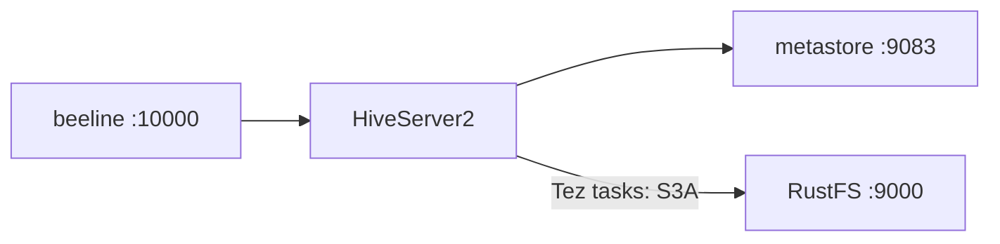

Ce guide connecte [Apache Hive](https://github.com/apache/hive) — l’entrepôt de données classique — à **RustFS** via le système de fichiers S3A. Vous allez exécuter l’image Docker Hive 4.0.1 avec un metastore et HiveServer2, configurer S3A dans trois couches de configuration, créer une table externe sur un emplacement RustFS, puis charger et interroger les données. Le flux a été validé avec Hive 4.0.1 face à `rustfs/rustfs-x86-musl:v2.3.1`.

Vous avez besoin de Docker (deux conteneurs : metastore et hiveserver2).

## Schéma d’architecture



Hive stocke les métadonnées des tables dans le metastore (Derby dans ce test) et les données des tables dans l’emplacement S3A de la table. L’exécution des requêtes s’effectue sur Tez à l’intérieur du conteneur hiveserver2.

## 1. Exécuter le metastore et HiveServer2

```bash
docker run -d --name hive-metastore --hostname hive-meta --network oo-rustfs_default \
  -e SERVICE_NAME=metastore -e DB_DRIVER=derby apache/hive:4.0.1

docker run -d --name hive-server --hostname hive-server --network oo-rustfs_default \
  -e SERVICE_NAME=hiveserver2 -e DB_DRIVER=derby apache/hive:4.0.1
```

Le metastore met 1 à 2 minutes à initialiser son schéma Derby ; HiveServer2 écoute sur le port 10000, le metastore sur le port 9083.

## 2. Configurer S3A à trois endroits

Les tâches Tez lisent le répertoire de configuration Hadoop, HiveServer2 lit la configuration Hive, et le metastore a aussi besoin du point de terminaison. Créez un seul fichier de propriétés et copiez-le vers les trois chemins :

```xml title="s3a-core-site.xml"
<?xml version="1.0"?>
<configuration>
  <property><name>fs.s3a.endpoint</name><value>http://<your-rustfs-endpoint>:9000</value></property>
  <property><name>fs.s3a.access.key</name><value><your-access-key></value></property>
  <property><name>fs.s3a.secret.key</name><value><your-secret-key></value></property>
  <property><name>fs.s3a.path.style.access</name><value>true</value></property>
  <property><name>fs.s3a.connection.ssl.enabled</name><value>false</value></property>
  <property><name>fs.s3a.aws.credentials.provider</name><value>org.apache.hadoop.fs.s3a.SimpleAWSCredentialsProvider</value></property>
  <property><name>fs.s3a.impl</name><value>org.apache.hadoop.fs.s3a.S3AFileSystem</value></property>
</configuration>
```

```bash
rc mb rustfs/hive-demo
docker cp s3a-core-site.xml hive-server:/opt/hive/conf/hive-site.xml
docker cp s3a-core-site.xml hive-server:/opt/hive/conf/core-site.xml
docker cp s3a-core-site.xml hive-server:/opt/hadoop/etc/hadoop/core-site.xml
docker exec -u root hive-server bash -c \
  "chown hive:hive /opt/hive/conf/hive-site.xml /opt/hive/conf/core-site.xml /opt/hadoop/etc/hadoop/core-site.xml; \
   mkdir -p /home/hive/.beeline; chmod 777 /home/hive/.beeline"
docker exec hive-server bash -c \
  "echo 'export HADOOP_CONF_DIR=/opt/hadoop/etc/hadoop' >> /opt/hive/conf/hive-env.sh; \
   echo 'export HADOOP_CLASSPATH=/opt/hadoop/share/hadoop/tools/lib/*:/opt/tez/*:/opt/tez/lib/*' >> /opt/hive/conf/hive-env.sh"
docker restart hive-server
```

Le JAR `hadoop-aws` est livré dans `/opt/hadoop/share/hadoop/tools/lib` — l’export `HADOOP_CLASSPATH` le place sur le classpath des requêtes. `mkdir /home/hive/.beeline` fait taire une erreur inoffensive de répertoire personnel de beeline.

## 3. Créer une table externe

```bash
docker exec hive-server bash -c "cd /opt/hive && beeline -u 'jdbc:hive2://localhost:10000' \
  -n hive -e \"CREATE EXTERNAL TABLE default.events (id INT, label STRING) \
  ROW FORMAT DELIMITED FIELDS TERMINATED BY ',' STORED AS TEXTFILE \
  LOCATION 's3a://hive-demo/warehouse/events';\""
```

Une table `EXTERNAL` avec un `LOCATION` S3A conserve toutes les données dans RustFS. (Un `CREATE TABLE ... LOCATION` géré, sur un chemin de base autre que celui par défaut, est refusé par les règles des tables gérées de Hive 4 — utilisez des tables externes pour les emplacements S3A.)

## 4. Charger les données et les interroger

`LOAD DATA INPATH` déplace un fichier local vers l’emplacement S3A de la table (le renommage est exécuté par HiveServer2, qui dispose des identifiants) :

```bash
docker exec hive-server bash -c "printf '1,alpha\n2,beta\n3,gamma\n' > /tmp/hive-load.txt"
docker exec hive-server bash -c "cd /opt/hive && beeline -u 'jdbc:hive2://localhost:10000' \
  -n hive -e \"LOAD DATA INPATH 'file:///tmp/hive-load.txt' INTO TABLE default.events;\""
```

```text
INFO  : Loading data to table default.events from file:/tmp/hive-load.txt
```

## 5. Interroger et vérifier dans RustFS

```bash
docker exec hive-server bash -c "cd /opt/hive && beeline -u 'jdbc:hive2://localhost:10000' \
  -n hive --outputformat=tsv2 -e 'SELECT * FROM default.events ORDER BY id;'"
```

```text
1	alpha
2	beta
3	gamma
```

Listez le répertoire de la table — le fichier chargé est un objet ordinaire :

```bash
rc ls rustfs/hive-demo/warehouse/events/
```

```text
warehouse/events/hive-load.txt
warehouse/events/hive-load_copy_1.txt
warehouse/events/hive-load_copy_2.txt
```


## 6. Arrêter ou réinitialiser

```bash
docker rm -f hive-server hive-metastore
rc rm rustfs/hive-demo/ --recursive --force
```

## Dépannage

### `NoClassDefFoundError: org.apache.tez.mapreduce.hadoop.InputSplitInfo` sur INSERT

Les JAR Tez sont absents du classpath des requêtes. Ajoutez l’export `HADOOP_CLASSPATH` de l’étape 2 (bibliothèque tools, plus tez et tez lib) à `/opt/hive/conf/hive-env.sh`.

### `NoAwsCredentialsException: SimpleAWSCredentialsProvider: No AWS credentials in the Hadoop configuration`

Les processus de tâches Tez lisent `/opt/hadoop/etc/hadoop/core-site.xml`, et pas seulement le répertoire de configuration Hive. Copiez les propriétés S3A vers les trois chemins de l’étape 2.

### `Permission denied` s’affiche après chaque commande beeline

beeline tente de créer `/home/hive/.beeline`. Exécutez `mkdir -p /home/hive/.beeline && chmod 777` une fois (en tant que root dans le conteneur).

### `Unable to create database managed path file:/user/hive/warehouse/...`

Hive 4 conserve les bases gérées à l’intérieur de la racine de l’entrepôt géré. Utilisez `CREATE EXTERNAL TABLE ... LOCATION 's3a://...'` pour les emplacements S3A.

## Étapes suivantes

- Comparez avec le guide [Trino](/fr/developer/integration/database/trino) lorsque vous voulez du SQL interactif sur les mêmes objets, sans metastore.
- Créez des identifiants de production dédiés avec la [gestion des clés d’accès](/fr/security-compliance/iam/access-token).
- Suivez la [documentation Hive](https://hive.apache.org/) pour rattacher un metastore adossé à MySQL et partager le même entrepôt entre Hive et Spark sur le même compartiment (bucket).
