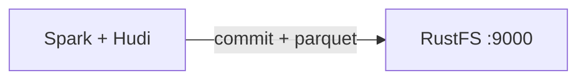

Ce guide connecte [Apache Hudi](https://github.com/apache/hudi) — la plateforme transactionnelle de lac de données — à **RustFS** comme magasin de tables en copie sur écriture (copy-on-write). Vous allez exécuter Spark avec le bundle Hudi, écrire une table vers l’emplacement `s3a://` à l’intérieur d’un compartiment (bucket) RustFS, la relire et vérifier les fichiers de la table. Le flux a été validé avec `apache/spark:3.5.6`, `hudi-spark3.5-bundle_2.12:0.15.0`, `hadoop-aws:3.3.4` et `rustfs/rustfs-x86-musl:v2.3.1`.

Vous avez besoin de Docker. Ce déploiement est destiné aux tests d’intégration locaux, pas à la production.

## Schéma d’architecture



Hudi stocke la chronologie `.hoodie/`, les fichiers de commit et les blocs de données Parquet sous le chemin de la table dans le compartiment. Les lectures déterminent le dernier instantané de la table à partir de la chronologie, si bien que chaque écriture et chaque requête passe par l’API S3.

## 1. Exécuter l’écriture Spark

Hudi exige le sérialiseur Kryo et les identifiants s3a sous forme de propriétés Hadoop. La session `spark-shell` suivante crée une table non partitionnée dans `my-bucket` — remplacez tous les espaces réservés de connexion :

```scala
import org.apache.spark.sql.SaveMode

val df = Seq((1, "a"), (2, "b"), (3, "c")).toDF("id", "name")
df.write.format("hudi")
  .option("hoodie.table.name", "events")
  .option("hoodie.datasource.write.recordkey.field", "id")
  .option("hoodie.datasource.write.precombine.field", "name")
  .option("hoodie.datasource.write.partitionpath.field", "")
  .mode(SaveMode.Overwrite)
  .save("s3a://my-bucket/hudi-demo/events")

val back = spark.read.format("hudi").load("s3a://my-bucket/hudi-demo/events")
back.select("id", "name").show()
```

```bash
docker run --rm --network oo-rustfs_default \
  -v "$PWD/hudi_test.scala":/tmp/hudi_test.scala \
  apache/spark:3.5.6 /opt/spark/bin/spark-shell \
  --packages org.apache.hudi:hudi-spark3.5-bundle_2.12:0.15.0,org.apache.hadoop:hadoop-aws:3.3.4 \
  --conf spark.serializer=org.apache.spark.serializer.KryoSerializer \
  --conf spark.hadoop.fs.s3a.endpoint=http://rustfs:9000 \
  --conf spark.hadoop.fs.s3a.path.style.access=true \
  --conf spark.hadoop.fs.s3a.access.key=<your-access-key> \
  --conf spark.hadoop.fs.s3a.secret.key=<your-secret-key> \
  --conf spark.hadoop.fs.s3a.region=us-east-1 \
  --conf spark.jars.ivy=/tmp/.ivy2 \
  --conf spark.sql.shuffle.partitions=2 \
  -i /tmp/hudi_test.scala
```

Les indicateurs `--packages` téléchargent le bundle Hudi et le connecteur s3a au premier lancement. Le réglage `spark.jars.ivy` évite les erreurs de droits sur le cache Ivy dans le conteneur. Le `show()` de relecture affiche les trois lignes :

```text
+---+----+
|  2|   b|
|  3|   c|
|  1|   a|
+---+----+
```

## 2. Vérifier les objets dans RustFS

Listez le préfixe de la table :

```bash
rc ls rustfs/my-bucket/hudi-demo/ -r
```

La disposition de la table Hudi apparaît sous le chemin de la table — la chronologie `.hoodie/` avec le fichier de commit, plus le bloc de données Parquet :

```text
hudi-demo/events/.hoodie/20260922015803291.commit
hudi-demo/events/.hoodie/20260922015803291.commit.requested
hudi-demo/events/<partition>/<filegroup>/<parquet-block>
```


## 3. Arrêter ou réinitialiser

Spark s’exécute comme un client ponctuel et ne conserve aucun état. Pour supprimer la table de démonstration :

```bash
rc rm rustfs/my-bucket/hudi-demo/ --recursive --force
```

## Dépannage

### `hoodie only support org.apache.spark.serializer.KryoSerializer as spark.serializer`

Hudi refuse le sérialiseur Spark par défaut. Passez `--conf spark.serializer=org.apache.spark.serializer.KryoSerializer` comme indiqué ci-dessus.

### `Partition-path field has to be non-empty` ou erreurs de classe keygenerator

Pour une table non partitionnée, conservez le générateur de clés par défaut (ne définissez pas `hoodie.datasource.write.keygenerator.class`) et définissez `hoodie.datasource.write.partitionpath.field` comme chaîne vide.

### `NoSuchMethodError` ou `ClassNotFoundException` dans l’écriture Hudi

Les versions de Spark et du bundle Hudi doivent correspondre : `hudi-spark3.5-bundle_2.12` va avec Spark 3.5.x, et le client Hadoop fourni doit être compatible avec `hadoop-aws:3.3.4`.

## Étapes suivantes

- Consultez les [notes de compatibilité S3](/fr/administration/protocols/s3) avant d’adopter d’autres opérations Hudi.
- Créez des identifiants de production dédiés avec la [gestion des clés d’accès](/fr/security-compliance/iam/access-token).
- Suivez le [guide Spark de Hudi](https://hudi.apache.org/docs/quick-start-guide/) pour ajouter des upserts, la compaction et des intégrations de requêtes sur la même table.
