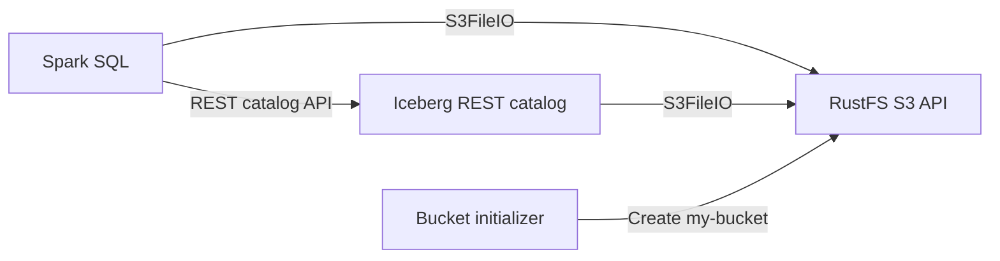

Ce guide exécute **Apache Iceberg** avec Spark, un catalogue REST Iceberg et **RustFS** comme entrepôt compatible avec S3. Vous allez créer une table Iceberg, écrire des lignes, les interroger et vérifier que les fichiers de la table sont stockés dans RustFS.

Pour utiliser le catalogue REST intégré à RustFS, suivez la [configuration de S3 Tables](/fr/administration/data/s3-tables) et le [guide PyIceberg](/fr/developer/integration/big-data/pyiceberg). Le déploiement ci-dessous exécute un service de catalogue distinct.

Vous avez besoin de Docker avec le plugin Compose et de ressources locales suffisantes pour quatre conteneurs. Ce déploiement est destiné à un test d’intégration local, pas à la production.

:::note[État en amont]

La [demande d’intégration n° 14928](https://github.com/apache/iceberg/pull/14928) d’Apache Iceberg a démontré le même flux Spark, catalogue REST, `S3FileIO` et RustFS, y compris la création de table et les écritures. Cette demande a été fermée sans être fusionnée, et le [guide de démarrage Spark](https://iceberg.apache.org/spark-quickstart/#docker-compose) actuel utilise encore un autre stockage compatible avec S3. La configuration ci-dessous documente donc une intégration RustFS, et non un réglage par défaut d’Apache Iceberg.

:::

## Schéma d’architecture



Spark utilise le service REST pour les opérations de catalogue. Spark et le catalogue REST reçoivent le point de terminaison RustFS, la région, les identifiants et le réglage d’adressage de type chemin, afin d’accéder aux fichiers de métadonnées et de données dans `s3://my-bucket/warehouse`.

## 1. Créer les fichiers du projet

Créez un répertoire de travail :

```bash
mkdir rustfs-iceberg
cd rustfs-iceberg
```

Créez un fichier d’environnement et remplacez les deux valeurs d’identifiants indicatives :

```ini title=".env"
RUSTFS_ACCESS_KEY=<your-access-key>
RUSTFS_SECRET_KEY=<your-secret-key>
```

Utilisez des identifiants dédiés pour le compartiment de l’entrepôt. N’ajoutez pas le fichier `.env` au dépôt (ne le versionnez pas).

Créez la configuration du catalogue Spark :

```ini title="spark-defaults.conf"
spark.sql.extensions org.apache.iceberg.spark.extensions.IcebergSparkSessionExtensions
spark.sql.catalog.demo org.apache.iceberg.spark.SparkCatalog
spark.sql.catalog.demo.type rest
spark.sql.catalog.demo.uri http://rest:8181
spark.sql.catalog.demo.io-impl org.apache.iceberg.aws.s3.S3FileIO
spark.sql.catalog.demo.warehouse s3://my-bucket/warehouse
spark.sql.catalog.demo.s3.endpoint http://rustfs:9000
spark.sql.catalog.demo.s3.path-style-access true
spark.sql.defaultCatalog demo
spark.sql.catalogImplementation in-memory
```

L’adressage de type chemin est requis pour ce point de terminaison du réseau de conteneurs. Le nom d’hôte `rustfs` n’est résolu qu’à l’intérieur du réseau Compose ; les clients exécutés sur l’hôte utilisent `http://localhost:9000`.

Créez le fichier Compose :

```yaml title="compose.yaml"
services:
  rustfs:
    image: rustfs/rustfs:1.0.0-alpha.83
    environment:
      RUSTFS_ACCESS_KEY: ${RUSTFS_ACCESS_KEY}
      RUSTFS_SECRET_KEY: ${RUSTFS_SECRET_KEY}
      RUSTFS_VOLUMES: /data
      RUSTFS_ADDRESS: ":9000"
      RUSTFS_CONSOLE_ADDRESS: ":9001"
      RUSTFS_CONSOLE_ENABLE: "true"
      RUSTFS_OBS_LOGGER_LEVEL: error
      RUSTFS_OBS_LOG_DIRECTORY: /var/log/rustfs/
    volumes:
      - rustfs-data:/data
    ports:
      - "9000:9000"
      - "9001:9001"
    networks:
      - iceberg

  create-bucket:
    image: rustfs/rc:latest
    depends_on:
      - rustfs
    environment:
      RUSTFS_ACCESS_KEY: ${RUSTFS_ACCESS_KEY}
      RUSTFS_SECRET_KEY: ${RUSTFS_SECRET_KEY}
    entrypoint:
      - /bin/sh
      - -c
      - |
        until /usr/bin/rc alias set rustfs http://rustfs:9000 "$${RUSTFS_ACCESS_KEY}" "$${RUSTFS_SECRET_KEY}"; do
          echo "Waiting for RustFS..."
          sleep 2
        done
        /usr/bin/rc ls rustfs/my-bucket >/dev/null 2>&1 || /usr/bin/rc mb rustfs/my-bucket
    networks:
      - iceberg

  rest:
    image: apache/iceberg-rest-fixture
    depends_on:
      create-bucket:
        condition: service_completed_successfully
    environment:
      AWS_ACCESS_KEY_ID: ${RUSTFS_ACCESS_KEY}
      AWS_SECRET_ACCESS_KEY: ${RUSTFS_SECRET_KEY}
      AWS_REGION: us-east-1
      CATALOG_WAREHOUSE: s3://my-bucket/warehouse
      CATALOG_IO__IMPL: org.apache.iceberg.aws.s3.S3FileIO
      CATALOG_S3_ENDPOINT: http://rustfs:9000
      CATALOG_S3_PATH__STYLE__ACCESS: "true"
    ports:
      - "8181:8181"
    networks:
      - iceberg

  spark-iceberg:
    image: tabulario/spark-iceberg
    depends_on:
      create-bucket:
        condition: service_completed_successfully
      rest:
        condition: service_started
    environment:
      AWS_ACCESS_KEY_ID: ${RUSTFS_ACCESS_KEY}
      AWS_SECRET_ACCESS_KEY: ${RUSTFS_SECRET_KEY}
      AWS_REGION: us-east-1
    volumes:
      - ./spark-defaults.conf:/opt/spark/conf/spark-defaults.conf:ro
    ports:
      - "8888:8888"
      - "8080:8080"
    networks:
      - iceberg

networks:
  iceberg:

volumes:
  rustfs-data:
```

L’[image `rc`](https://github.com/rustfs/cli) fournit le client en ligne de commande officiel de RustFS. L’initialiseur vérifie l’existence de `my-bucket` avant de le créer, afin que des redémarrages répétés ne suppriment pas les données d’entrepôt existantes. Le volume RustFS conserve les objets de l’entrepôt lorsque les conteneurs sont recréés.

:::warning[Versions d’images]

Les images du guide de démarrage Apache Iceberg sont publiées sans étiquettes de version stables dans l’exemple en amont. Avant d’utiliser ce modèle au-delà d’un test local, épinglez chaque image sur une étiquette ou une empreinte testée, et validez ensemble les versions de Spark, du moteur Iceberg et du catalogue REST.

:::

## 2. Valider et démarrer le déploiement

Résolvez le fichier Compose avant de démarrer les conteneurs :

```bash
docker compose config
```

Démarrez les services et attendez la fin de l’initialisation du compartiment :

```bash
docker compose up -d
docker compose ps -a
```

Le service `create-bucket` devrait afficher un code de sortie `0`. Consultez ses journaux s’il ne se termine pas :

```bash
docker compose logs create-bucket
```

Ouvrez la Console RustFS à l’adresse `http://localhost:9001`. Le catalogue REST est disponible à l’adresse `http://localhost:8181`, et le serveur de notebooks Spark à l’adresse `http://localhost:8888`.

## 3. Créer une table Iceberg et l’interroger

Démarrez Spark SQL :

```bash
docker compose exec spark-iceberg spark-sql
```

Créez un espace de noms et une table partitionnée :

```sql
CREATE NAMESPACE IF NOT EXISTS demo.nyc;

CREATE TABLE demo.nyc.taxis
(
	vendor_id bigint,
	trip_id bigint,
	trip_distance float,
	fare_amount double,
	store_and_fwd_flag string
)
PARTITIONED BY (vendor_id);
```

Insérez des lignes d’exemple, puis interrogez-les :

```sql
INSERT INTO demo.nyc.taxis
VALUES
	(1, 1000371, 1.8, 15.32, 'N'),
	(2, 1000372, 2.5, 22.15, 'N'),
	(2, 1000373, 0.9, 9.01, 'N'),
	(1, 1000374, 8.4, 42.13, 'Y');

SELECT * FROM demo.nyc.taxis ORDER BY trip_id;
```

La requête devrait renvoyer quatre lignes :

```text
1  1000371  1.8  15.32  N
2  1000372  2.5  22.15  N
2  1000373  0.9  9.01   N
1  1000374  8.4  42.13  Y
```

## 4. Vérifier les objets dans RustFS

Listez l’entrepôt depuis l’image d’initialisation du compartiment :

```bash
docker compose run --rm --entrypoint /bin/sh create-bucket -c \
  '/usr/bin/rc alias set rustfs http://rustfs:9000 "$RUSTFS_ACCESS_KEY" "$RUSTFS_SECRET_KEY" >/dev/null && /usr/bin/rc find rustfs/my-bucket/warehouse'
```

La sortie devrait inclure des objets de métadonnées et de données Iceberg sous le préfixe `warehouse/nyc/taxis`. Vous pouvez aussi inspecter le compartiment `my-bucket` dans la Console RustFS.

## 5. Arrêter ou réinitialiser la pile

Arrêtez les conteneurs tout en conservant le volume de données RustFS :

```bash
docker compose down
```

Pour supprimer l’entrepôt local et repartir d’un volume RustFS vide, ajoutez explicitement `--volumes` :

```bash
docker compose down --volumes
```

## Dépannage

### Spark n’atteint pas RustFS

Dans Compose, utilisez `http://rustfs:9000`. Dans `spark-defaults.conf`, `http://localhost:9000` désigne le conteneur Spark lui-même.

Vérifiez que `spark.sql.catalog.demo.s3.path-style-access` vaut `true`. Les requêtes en adressage de type hôte virtuel exigent une configuration de domaine et de DNS RustFS supplémentaire.

### Le catalogue renvoie une erreur S3

Vérifiez que les identifiants de `.env` correspondent aux identifiants RustFS et que le service `create-bucket` s’est terminé avec succès :

```bash
docker compose logs create-bucket rest
```

La propriété du catalogue REST utilise des doubles traits de soulignement dans `CATALOG_IO__IMPL` et `CATALOG_S3_PATH__STYLE__ACCESS` ; l’image de test les convertit en noms de propriétés Iceberg à points et à traits d’union.

## Étapes suivantes

- Consultez les [notes de compatibilité S3](/fr/administration/protocols/s3) avant d’adopter d’autres opérations Iceberg.
- Créez des identifiants de production dédiés avec la [gestion des clés d’accès](/fr/security-compliance/iam/access-token).
- Suivez la [documentation Spark d’Apache Iceberg](https://iceberg.apache.org/docs/latest/spark-getting-started/) pour configurer votre environnement Spark existant.