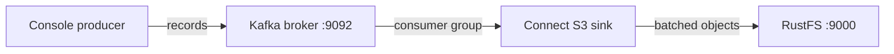
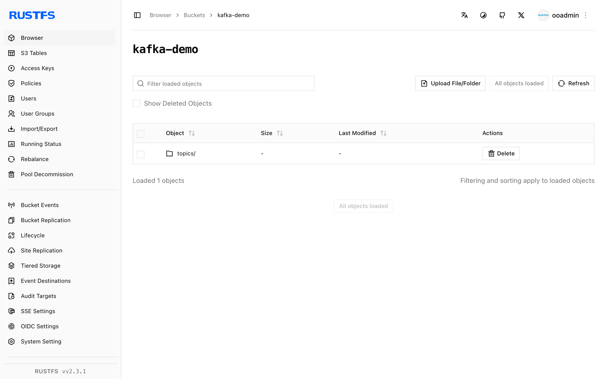

Ce guide connecte [Apache Kafka](https://github.com/apache/kafka) — la plateforme distribuée de streaming d’événements — à **RustFS** via le connecteur sink S3 de Kafka Connect. Vous allez exécuter un broker KRaft et un worker Connect, déployer le sink S3 pour un topic et produire des enregistrements qui arrivent sous forme d’objets dans un compartiment (bucket) RustFS. Le flux a été validé avec `apache/kafka:4.0.0` et `confluentinc/kafka-connect-s3` v10.5.25 face à `rustfs/rustfs-x86-musl:v2.3.1`.

Le stockage hiérarchisé KIP-405 de Kafka nécessite un plugin `RemoteLogStorageManager`, et les implémentations S3 de l’écosystème sont des solutions propriétaires d’éditeurs. Le sink S3 de Connect est le moyen ouvert et auto-hébergé de déplacer les données de topic vers un stockage compatible avec S3, et c’est l’approche documentée ici.

Vous avez besoin de Docker. Ce déploiement est destiné aux tests d’intégration locaux, pas à la production.

## Schéma d’architecture



La tâche du sink consomme un topic dans un groupe de consommateurs dédié et écrit les lots d’enregistrements dans le compartiment, un objet par `flush.size` enregistrements et par partition.

## 1. Exécuter le broker

Démarrez un broker KRaft dont le listener annoncé est joignable depuis les autres conteneurs :

```bash
docker run -d --name kafka --hostname kafka --network oo-rustfs_default \
  -e CLUSTER_ID=5L6g3nShT-eMCtK--X86sw \
  -e KAFKA_NODE_ID=1 \
  -e KAFKA_PROCESS_ROLES=broker,controller \
  -e KAFKA_LISTENERS=PLAINTEXT://:9092,CONTROLLER://:9093 \
  -e KAFKA_ADVERTISED_LISTENERS=PLAINTEXT://kafka:9092 \
  -e KAFKA_CONTROLLER_LISTENER_NAMES=CONTROLLER \
  -e KAFKA_LISTENER_SECURITY_PROTOCOL_MAP=CONTROLLER:PLAINTEXT,PLAINTEXT:PLAINTEXT \
  -e KAFKA_CONTROLLER_QUORUM_VOTERS=1@kafka:9093 \
  -e KAFKA_OFFSETS_TOPIC_REPLICATION_FACTOR=1 \
  -e KAFKA_TRANSACTION_STATE_LOG_REPLICATION_FACTOR=1 \
  -e KAFKA_TRANSACTION_STATE_LOG_MIN_ISR=1 \
  apache/kafka:4.0.0

docker exec kafka /opt/kafka/bin/kafka-topics.sh \
  --bootstrap-server localhost:9092 \
  --create --topic rustfs-topic --partitions 1 --replication-factor 1

rc mb rustfs/kafka-demo
```

Par défaut, l’image annonce `localhost:9092`, ce qui ne fonctionne que depuis l’intérieur du conteneur du broker. C’est le remplacement de `KAFKA_ADVERTISED_LISTENERS` qui permet à Connect (et à tout client distant) d’atteindre le broker.

## 2. Installer le connecteur

Téléchargez l’archive Confluent Hub, qui regroupe le connecteur et ses dépendances, puis décompressez-la là où le worker peut la voir :

```bash
curl -Lo kafka-connect-s3.zip "https://hub-downloads.confluent.io/api/plugins/confluentinc/kafka-connect-s3/versions/10.5.25/confluentinc-kafka-connect-s3-10.5.25.zip"
unzip kafka-connect-s3.zip -d /opt/kafka-conn/plugins
```

## 3. Configurer le worker et le sink

Créez les propriétés du worker. Le convertisseur de valeurs doit être `ByteArrayConverter` afin que les enregistrements soient écrits tels quels :

```ini title="worker.properties"
bootstrap.servers=kafka:9092
key.converter=org.apache.kafka.connect.storage.StringConverter
value.converter=org.apache.kafka.connect.converters.ByteArrayConverter
offset.storage.file.filename=/tmp/connect.offsets
offset.flush.interval.ms=5000
plugin.path=/opt/kafka-conn-plugins
```

Créez la configuration du connecteur sink, en remplaçant tous les espaces réservés de connexion :

```ini title="rustfs-sink.properties"
name=rustfs-sink
connector.class=io.confluent.connect.s3.S3SinkConnector
tasks.max=1
topics=rustfs-topic
s3.bucket.name=kafka-demo
s3.region=us-east-1
store.url=http://<your-rustfs-endpoint>:9000
s3.path.style.access.enabled=true
flush.size=3
storage.class=io.confluent.connect.s3.storage.S3Storage
format.class=io.confluent.connect.s3.format.bytearray.ByteArrayFormat
consumer.override.auto.offset.reset=earliest
```

Kafka 4.0 a déplacé la classe vers `org.apache.kafka.connect.converters.ByteArrayConverter` — l’ancien chemin du paquet `storage` ne se résout plus.

## 4. Exécuter le worker

Exécutez `connect-standalone` au premier plan pour que ses journaux aillent dans `docker logs`, avec les identifiants du compartiment dans l’environnement :

```bash
docker run -d --name kafka-connect --hostname kafka-connect \
  --network oo-rustfs_default \
  -v /opt/kafka-conn/plugins:/opt/kafka-conn-plugins:ro \
  -v "$PWD/worker.properties":/etc/kafka/worker.properties:ro \
  -v "$PWD/rustfs-sink.properties":/etc/kafka/sink.properties:ro \
  -e AWS_ACCESS_KEY_ID=<your-access-key> \
  -e AWS_SECRET_ACCESS_KEY=<your-secret-key> \
  apache/kafka:4.0.0 \
  /opt/kafka/bin/connect-standalone.sh /etc/kafka/worker.properties /etc/kafka/sink.properties
```

Le worker est prêt lorsque la tâche du sink revendique la partition :

```text
INFO [rustfs-sink|task-0] Assigned topic partitions: [rustfs-topic-0]
```

## 5. Produire des enregistrements

Envoyez au moins `flush.size` enregistrements pour que le connecteur termine un lot :

```bash
docker exec kafka sh -c "printf 'msg-one\nmsg-two\nmsg-three\n' | \
  /opt/kafka/bin/kafka-console-producer.sh --bootstrap-server localhost:9092 --topic rustfs-topic"
```

Après quelques secondes, le lot devient un objet dans le compartiment :

```bash
rc ls rustfs/kafka-demo/ -r
rc cat rustfs/kafka-demo/topics/rustfs-topic/partition=0/rustfs-topic+0+0000000000.bin
```

```text
topics/rustfs-topic/partition=0/rustfs-topic+0+0000000000.bin
topics/rustfs-topic/partition=0/rustfs-topic+0+0000000003.bin
msg-one
msg-two
msg-three
```

Le nom de l’objet encode le topic, la partition et l’offset de départ. Chaque lot suivant de trois enregistrements arrive dans l’objet suivant (`+0000000003.bin` et ainsi de suite).



## 6. Arrêter ou réinitialiser

Pour démonter la démonstration tout en conservant les objets du compartiment :

```bash
docker rm -f kafka-connect kafka
```

Pour supprimer les données stockées :

```bash
rc rm rustfs/kafka-demo/ --recursive --force
```

## Dépannage

### `AdminClient ... Rebootstrapping with Cluster (id: null)` boucle indéfiniment

Le broker annonce `localhost:9092`, si bien qu’un client distant reçoit des métadonnées qui pointent vers lui-même. Définissez `KAFKA_ADVERTISED_LISTENERS=PLAINTEXT://kafka:9092` (et les variables de listener correspondantes) comme à l’étape 1.

### `Invalid schema type for ByteArrayConverter: STRING`

Le rédacteur `ByteArrayFormat` n’accepte que des octets bruts. Basculez le `value.converter` du worker vers le convertisseur ByteArray, ou choisissez une classe de format qui correspond au convertisseur que vous utilisez.

### `Class org.apache.kafka.connect.storage.ByteArrayConverter could not be found`

Kafka 4.0 a déplacé la classe vers `org.apache.kafka.connect.converters.ByteArrayConverter`. Utilisez le nouveau chemin de paquet dans `worker.properties`.

### Le connecteur se télécharge, mais le plugin est introuvable

Le JAR nu du connecteur issu de Maven n’a pas ses dépendances. Utilisez l’archive Confluent Hub de l’étape 2, qui regroupe le répertoire `lib/` complet, et assurez-vous que `plugin.path` pointe vers le répertoire qui contient le dossier du connecteur.

## Étapes suivantes

- Consultez les [notes de compatibilité S3](/fr/administration/protocols/s3) avant d’adopter d’autres connecteurs.
- Créez des identifiants de production dédiés avec la [gestion des clés d’accès](/fr/security-compliance/iam/access-token).
- Suivez la [documentation du sink S3 de Kafka Connect](https://docs.confluent.io/kafka-connect-s3/current/index.html) pour les formats Parquet et Avro, le partitionnement par le temps et les chaînes d’identifiants fondées sur IAM.
