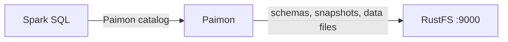
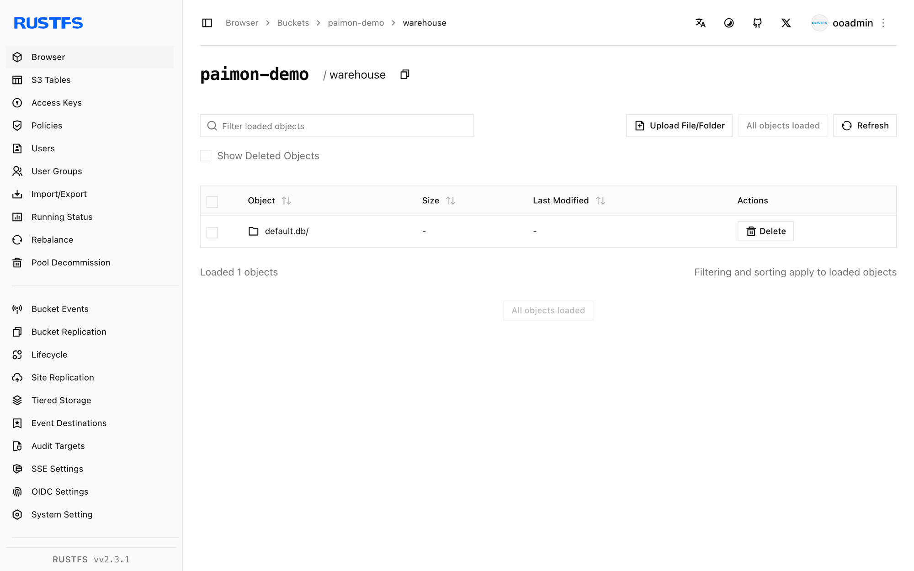

Ce guide connecte [Apache Paimon](https://github.com/apache/paimon) — le format de table lakehouse en flux continu — à **RustFS** comme stockage d’entrepôt. Vous allez créer un catalogue Paimon sur un compartiment (bucket) RustFS avec Spark, écrire une table à clé primaire et la relire. Le flux a été validé avec Paimon 1.2.0 sur Spark 3.5.6 face à `rustfs/rustfs-x86-musl:v2.3.1`.

Vous avez besoin de Docker et du client `rc`.

## Schéma d’architecture



Paimon stocke chaque table sous l’entrepôt du catalogue sous la forme d’un répertoire `*.db` qui contient `schema/`, `snapshot/` et les fichiers de données. Toutes les E/S passent par le FileIO S3 propre à Paimon (`paimon-s3`), et non par Hadoop S3A.

## 1. Exécuter Spark

```bash
docker run -d --name spark-paimon --hostname spark --network oo-rustfs_default \
  spark:3.5.6-scala2.12-java17-python3-ubuntu sleep infinity
docker cp paimon_test.sql spark-paimon:/tmp/paimon_test.sql
```

Créez le fichier SQL (remarque : les options du catalogue sont passées sur la CLI ci-dessous, pas dans le fichier) :

```sql title="paimon_test.sql"
CREATE TABLE paimon.default.events (id INT, label STRING) TBLPROPERTIES ("primary-key"="id");
INSERT INTO paimon.default.events VALUES (1,'alpha'),(2,'beta'),(3,'gamma');
SELECT * FROM paimon.default.events ORDER BY id;
```

## 2. Exécuter le script SQL

Trois éléments sont requis : les extensions Spark, le FileIO S3 propre à Paimon (`paimon-s3` — les JAR Hadoop S3A ne sont pas utilisés par le lecteur de Paimon) et les options `s3.*` au niveau du catalogue :

```bash
docker exec -u root spark-paimon bash -c "cd /opt/spark && \
  ./bin/spark-sql \
  --packages org.apache.paimon:paimon-spark-3.5:1.2.0,org.apache.paimon:paimon-s3:1.2.0,org.apache.hadoop:hadoop-aws:3.3.4 \
  --conf spark.sql.extensions=org.apache.paimon.spark.extensions.PaimonSparkSessionExtensions \
  --conf spark.sql.catalog.paimon=org.apache.paimon.spark.SparkCatalog \
  --conf spark.sql.catalog.paimon.warehouse=s3://paimon-demo/warehouse \
  --conf spark.sql.catalog.paimon.s3.endpoint=http://rustfs:9000 \
  --conf spark.sql.catalog.paimon.s3.access-key=<your-access-key> \
  --conf spark.sql.catalog.paimon.s3.secret-key=<your-secret-key> \
  --conf spark.sql.catalog.paimon.s3.path-style-access=true \
  -f /tmp/paimon_test.sql"
```

```text
Time taken: 9.447 seconds
1	alpha
2	beta
3	gamma
Time taken: 1.257 seconds, Fetched 3 row(s)
```

Sans la ligne des extensions, Paimon échoue immédiatement avec une erreur `requiredSparkConfsCheck` ; sans `paimon-s3`, le catalogue échoue avec `UnsupportedSchemeException: Could not find a file io implementation for scheme 's3'`.

## 3. Vérifier les objets dans RustFS

```bash
rc ls rustfs/paimon-demo/warehouse/ -r | head -6
```

```text
warehouse/default.db/events/schema/schema-0
warehouse/default.db/events/snapshot/snapshot-1
warehouse/default.db/events/bucket-0/data-...
warehouse/default.db/events/manifest/...
```

Le compartiment contient toute la disposition du lakehouse : schémas, instantanés, manifestes et fichiers de données pour chaque groupe de hachage.



## 4. Arrêter ou réinitialiser

```bash
docker rm -f spark-paimon
rc rm rustfs/paimon-demo/ --recursive --force
```

## Dépannage

### `UnsupportedSchemeException: Could not find a file io implementation for scheme 's3'`

Le FileIO propre à Paimon a besoin de son plugin S3 sur le classpath. Ajoutez `org.apache.paimon:paimon-s3:1.2.0` à `--packages`, à côté du connecteur Spark.

### `When using Paimon, it is necessary to configure spark.sql.extensions...`

Ajoutez `--conf spark.sql.extensions=org.apache.paimon.spark.extensions.PaimonSparkSessionExtensions` — Paimon échoue immédiatement sans cela.

### `SCHEMA_NOT_FOUND: The schema paimon cannot be found`

Le catalogue n’était pas enregistré. Enregistrez-le sous `spark.sql.catalog.paimon` et qualifiez les noms de tables avec `paimon.`.

### Les écritures échouent avec des erreurs S3 côté exécuteurs

Ce sont les options `s3.*` au niveau du catalogue (`s3.endpoint`, `s3.access-key`, `s3.secret-key`, `s3.path-style-access`) que lit le FileIO de Paimon — les seuls réglages Hadoop `fs.s3a.*` ne sont pas utilisés par les opérations de fichiers côté exécuteurs.

## Étapes suivantes

- Comparez avec les guides [Iceberg](/fr/developer/integration/big-data/iceberg), [Hudi](/fr/developer/integration/big-data/hudi) et [Delta Lake](/fr/developer/integration/big-data/delta-lake) pour les autres formats lakehouse sur le même compartiment.
- Créez des identifiants de production dédiés avec la [gestion des clés d’accès](/fr/security-compliance/iam/access-token).
- Suivez la [documentation Paimon](https://paimon.apache.org/docs/master/) pour la compaction, les producteurs de changelog et les écritures en flux Flink sur le même compartiment.
