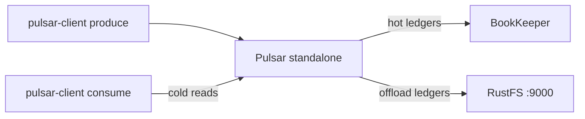

Ce guide connecte [Apache Pulsar](https://github.com/apache/pulsar) à **RustFS** via son offloader S3 de stockage hiérarchisé (tiered storage). Vous allez exécuter un broker standalone dont le déchargement pointe vers un bucket RustFS, produire des messages, déclencher un déchargement de ledger, puis relire les messages déchargés depuis le bucket. Le workflow a été vérifié avec `apachepulsar/pulsar-all:4.0.4`, qui décharge un topic vers RustFS et sert des lectures à froid depuis celui-ci.

Vous avez besoin de Docker. Ce déploiement est destiné aux tests d'intégration locaux, pas à la production.

## Architecture



Les anciens ledgers sont téléversés dans le bucket sous forme de blocs de données `<offloader-id>-ledger-<n>` plus un petit objet `-index`. Quand un consommateur demande des messages qui ne sont plus dans BookKeeper, le broker les relit de façon transparente depuis le bucket.

## 1. Démarrer le broker standalone avec déchargement

L'image simple `apachepulsar/pulsar` n'embarque pas les paquets d'offloader et échoue avec `No offloader found for driver 'S3'` — utilisez l'image `pulsar-all`, qui les inclut. Le broker est plafonné à un petit tas :

```bash
docker run -d --name pulsar -p 6650:6650 -p 8080:8080 \
  -e ACCESS_KEY_ID=<your-access-key> \
  -e ACCESS_KEY_SECRET=<your-secret-key> \
  -e PULSAR_MEM="-Xms512m -Xmx512m" \
  --entrypoint bash apachepulsar/pulsar-all:4.0.4 -c '
    sed -i -e "s|^managedLedgerMaxEntriesPerLedger=.*|managedLedgerMaxEntriesPerLedger=100|" \
           -e "s|^managedLedgerMinLedgerRolloverTimeMinutes=.*|managedLedgerMinLedgerRolloverTimeMinutes=1|" \
           /pulsar/conf/standalone.conf
    printf "\nmanagedLedgerOffloadDriver=S3\nmanagedLedgerOffloadBucket=my-bucket\nmanagedLedgerOffloadServiceEndpoint=http://<your-rustfs-endpoint>:9000\nmanagedLedgerOffloadRegion=us-east-1\n" >> /pulsar/conf/standalone.conf
    exec bin/pulsar standalone -nss
  '
```

Les deux modifications `managedLedger*` rapetissent les ledgers pour qu'un basculement survienne pendant la démo ; le bloc ajouté active le déchargement.

:::note[Le pilote S3 lit les clés managedLedgerOffload*, pas s3ManagedLedgerOffload*]

Pour le pilote `S3`, l'offloader résout les clés génériques `managedLedgerOffloadBucket`, `managedLedgerOffloadServiceEndpoint` et `managedLedgerOffloadRegion`. Les noms `s3ManagedLedgerOffload*` appartiennent au pilote `aws-s3` et sont ignorés ici — avec eux, l'offloader plante avec `NullPointerException: endpoint`. Il en va de même pour les identifiants : le pilote `S3` lit les variables d'environnement `ACCESS_KEY_ID` et `ACCESS_KEY_SECRET`, pas la paire `AWS_*`.

:::

Attendez le broker :

```bash
docker logs -f pulsar 2>&1 | grep -m1 "The ledger offloader was created"
```

## 2. Produire des messages et garder le topic en vie

Les topics sans subscription sont supprimés par le nettoyage des topics inactifs en quelques minutes, ce qui annule la démo en cours de route. Produisez un premier lot, puis créez une subscription durable qui maintient le topic enregistré :

```bash
docker exec pulsar bin/pulsar-client produce -m "hello rustfs offload" -n 300 \
  persistent://public/default/rustfs-test
```

```text
300 messages successfully produced
```

```bash
timeout 30 docker exec pulsar bin/pulsar-client consume -s keepalive -n 1 -p Earliest \
  persistent://public/default/rustfs-test
```

## 3. Faire basculer un ledger et déclencher le déchargement

Un ledger ne bascule que si une écriture survient après `managedLedgerMinLedgerRolloverTimeMinutes` — la vérification se fait à l'écriture, pas en tâche de fond. Attendez au moins une minute, produisez un autre lot pour forcer le basculement, puis déchargez tout ce qui précède le dernier kilooctet :

```bash
sleep 65
docker exec pulsar bin/pulsar-client produce -m "rollover" -n 120 \
  persistent://public/default/rustfs-test
docker exec pulsar bin/pulsar-admin topics offload -s 1K \
  persistent://public/default/rustfs-test
```

```text
Offload triggered for persistent://public/default/rustfs-test for messages before 11:0:-1
```

Le déchargement prend un moment — attendez la fin :

```bash
sleep 30
docker exec pulsar bin/pulsar-admin topics offload-status \
  persistent://public/default/rustfs-test
```

```text
Offload was a success
```

Confirmez que les objets de ledger ont atterri dans RustFS — bloc de données plus index, à la racine du bucket :

```bash
aws s3 ls s3://my-bucket/ --recursive \
  --endpoint-url http://<your-rustfs-endpoint>:9000 | grep ledger
```

```text
2026-10-25 02:34:49      21057 7f9379cc-c21d-4829-a857-4c39ec02e391-ledger-9
2026-10-25 02:34:49        214 7f9379cc-c21d-4829-a857-4c39ec02e391-ledger-9-index
```

## 4. Relire les messages déchargés

Consommez depuis la position la plus ancienne avec une subscription neuve. Le premier ledger ne vit plus que dans RustFS, donc chaque message renvoyé par le broker est une lecture à froid depuis le bucket :

```bash
timeout 90 docker exec pulsar bin/pulsar-client consume -s coldread -n 420 -p Earliest \
  persistent://public/default/rustfs-test 2>&1 | grep -c "^-----"
```

```text
420
```

Les 420 messages — les 300 du ledger déchargé plus les 120 du ledger actif — reviennent via le bucket.


## 5. Arrêter ou réinitialiser

Pour démonter le broker tout en conservant les objets du bucket :

```bash
docker rm -f pulsar
```

Pour supprimer les ledgers déchargés :

```bash
aws s3 rm s3://my-bucket/ --recursive --exclude "*" --include "*ledger*" \
  --endpoint-url http://<your-rustfs-endpoint>:9000
```

## Dépannage

### `No offloader found for driver 'S3'. Please make sure you dropped the offloader nar packages`

L'image n'inclut pas les NAR d'offloader. Utilisez `apachepulsar/pulsar-all` comme à l'étape 1.

### `NullPointerException: endpoint` lors du déchargement

L'offloader n'a lu aucun endpoint de service — les clés `managedLedgerOffload*` manquent ou ont été écrites avec les noms `s3ManagedLedgerOffload*` du pilote `aws-s3`. Ajoutez le bloc exact de l'étape 1 et redémarrez.

### `Couldn't get the access key id.` dans le journal du broker

Le pilote `S3` ne lit pas `AWS_ACCESS_KEY_ID`. Exportez `ACCESS_KEY_ID` et `ACCESS_KEY_SECRET` sur le conteneur du broker.

### `Topic ... not found` pendant la démo

Le nettoyage des topics inactifs a supprimé le topic faute de subscription. Relancez l'étape 2 et conservez la subscription `keepalive`.

### `Offload was a success` mais aucun objet n'apparaît

Seuls les ledgers fermés antérieurs au seuil de taille sont téléversés, et un ledger bascule à la prochaine écriture après l'âge minimal. Produisez un autre lot, puis déclenchez à nouveau le déchargement.

## Prochaines étapes

- Consultez les [notes de compatibilité S3](/administration/protocols/s3) avant d'activer des seuils de déchargement automatiques sur les namespaces.
- Créez des identifiants de production dédiés avec la [gestion des clés d'accès](/security-compliance/iam/access-token).
- Suivez la [documentation du stockage hiérarchisé de Pulsar](https://pulsar.apache.org/docs/next/cookbooks-tiered-storage/) pour les seuils de namespace, les politiques de rétention et les brokers multi-nœuds contre le même bucket.
