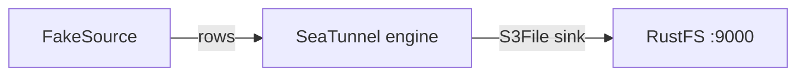

Ce guide connecte [Apache SeaTunnel](https://github.com/apache/seatunnel) — le moteur d’intégration de données — à **RustFS** via le connecteur S3File. Vous allez exécuter une tâche par lots qui génère des lignes avec FakeSource et les écrit sous forme de fichiers JSON dans un compartiment (bucket) RustFS. Le flux a été validé avec SeaTunnel 2.3.12 face à `rustfs/rustfs-x86-musl:v2.3.1`.

Vous avez besoin de Docker et du client `rc`.

## Schéma d’architecture



Le sink S3File écrit via le système de fichiers Hadoop S3A, si bien que le connecteur accepte à la fois ses propres options d’identifiants et les clés Hadoop `fs.s3a.*` standard.

## 1. Exécuter le moteur

Le connecteur et les JAR Hadoop AWS sont livrés dans l’image :

```bash
docker run --rm apache/seatunnel:2.3.12 \
  sh -c "ls /opt/seatunnel/connectors/ | grep s3; ls /opt/seatunnel/lib/ | grep hadoop-aws"
```

```text
connector-file-s3-2.3.12.jar
seatunnel-hadoop-aws.jar
```

## 2. Écrire la configuration de la tâche

Le point délicat : le sink valide `access_key`/`secret_key` à la compilation, tandis que le client S3A réel lit les clés `fs.s3a.*`. Fournissez les deux, et conservez le point de terminaison sans schéma — la version Hadoop fournie refuse les points de terminaison `http://` :

```text title="seatunnel-rustfs.conf"
env {
  parallelism = 1
  job.mode = "BATCH"
}

source {
  FakeSource {
    plugin_output = "fake"
    row.num = 5
    schema = {
      fields {
        id = "int"
        name = "string"
        value = "double"
      }
    }
  }
}

sink {
  S3File {
    bucket = "s3a://seatunnel-demo"
    access_key = "<your-access-key>"
    secret_key = "<your-secret-key>"
    fs.s3a.endpoint = "<your-rustfs-endpoint>:9000"
    fs.s3a.access.key = "<your-access-key>"
    fs.s3a.secret.key = "<your-secret-key>"
    fs.s3a.aws.credentials.provider = "org.apache.hadoop.fs.s3a.SimpleAWSCredentialsProvider"
    fs.s3a.connection.ssl.enabled = "false"
    file_format_type = "json"
    path = "/out"
  }
}
```

## 3. Exécuter la tâche

```bash
docker run --rm --network oo-rustfs_default \
  -v "$PWD/seatunnel-rustfs.conf":/task.conf:ro \
  apache/seatunnel:2.3.12 \
  sh -c "cd /opt/seatunnel && ./bin/seatunnel.sh --config /task.conf -e local"
```

```text
2026-10-07 ... INFO  ... Submit job finished, job id: 1159846059493556225
```

## 4. Vérifier les objets dans RustFS

```bash
rc ls rustfs/seatunnel-demo/out/
rc cat rustfs/seatunnel-demo/out/T_1159846059493556225_2de3d99235_0_1_0.json | head -1
```

```text
out/T_1159846059493556225_2de3d99235_0_1_0.json
{"id":168282592,"name":"ELyqD","value":1.594479327987022E308}
```

Cinq lignes FakeSource sont arrivées sous la forme d’un seul fichier JSON dans le compartiment.


## 5. Arrêter ou réinitialiser

SeaTunnel en mode `-e local` ne conserve aucun état. Pour supprimer la sortie :

```bash
rc rm rustfs/seatunnel-demo/ --recursive --force
```

## Dépannage

### `Plugin PluginIdentifier{... pluginName='S3'} not found`

La classe du sink est enregistrée sous le nom `S3File`, et non `S3`.

### `There are unconfigured options, the options('access_key', 'secret_key') are required`

Le sink S3File exige ses propres options `access_key`/`secret_key` même lorsque les clés `fs.s3a.*` sont présentes. Fournissez les deux jeux, comme à l’étape 2.

### `No AWS Credentials provided by InstanceProfileCredentialsProvider`

Le client S3A côté coordinateur est retombé sur le fournisseur de profil d’instance, parce que `fs.s3a.aws.credentials.provider` et la paire `fs.s3a.access.key`/`fs.s3a.secret.key` étaient absents. Ajoutez les trois, comme à l’étape 2.

### La tâche reste bloquée sur `doesBucketExist`

La version Hadoop fournie refuse les points de terminaison avec le schéma `http://`. Utilisez la forme `host:port` nue pour `fs.s3a.endpoint` et ajoutez `fs.s3a.connection.ssl.enabled = "false"`.

## Étapes suivantes

- Consultez les [notes de compatibilité S3](/fr/administration/protocols/s3) avant d’adopter d’autres connecteurs SeaTunnel.
- Créez des identifiants de production dédiés avec la [gestion des clés d’accès](/fr/security-compliance/iam/access-token).
- Suivez la [documentation S3File de SeaTunnel](https://seatunnel.apache.org/docs/connector-v2/sink/S3File) pour les formats parquet/orc, les écritures partitionnées et la source S3File correspondante.
