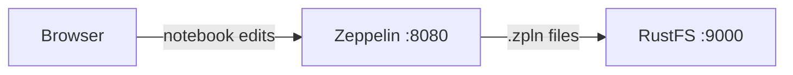

Ce guide connecte [Apache Zeppelin](https://github.com/apache/zeppelin) — le notebook web pour l’analyse de données — à **RustFS** via le stockage de notebooks S3 de Zeppelin. Vous allez démarrer Zeppelin orienté vers un compartiment (bucket) RustFS, créer une note et vérifier que le notebook est stocké dans RustFS et survit à un redémarrage. Le flux a été validé avec `apache/zeppelin:0.12.0` et `rustfs/rustfs-x86-musl:v2.3.1`.

Vous avez besoin de Docker. Ce déploiement est destiné aux tests d’intégration locaux, pas à la production.

## Schéma d’architecture



Avec la classe de stockage `S3NotebookRepo`, chaque note est persistée sous la forme d’un fichier JSON `.zpln` sous le préfixe `user/notebook/` du compartiment. Zeppelin lit et écrit directement dans le compartiment, si bien que les notes survivent aux redémarrages de conteneur et peuvent être partagées entre les instances.

## 1. Démarrer Zeppelin

Créez un fichier d’environnement et remplacez les deux espaces réservés d’identifiants :

```ini title=".env"
AWS_ACCESS_KEY_ID=<your-access-key>
AWS_SECRET_ACCESS_KEY=<your-secret-key>
```

Démarrez Zeppelin sur le même réseau Docker que RustFS, avec les réglages de stockage S3 :

```bash
docker run -d --name zeppelin --network oo-rustfs_default \
  -p 8080:8080 \
  -e AWS_ACCESS_KEY_ID \
  -e AWS_SECRET_ACCESS_KEY \
  -e ZEPPELIN_NOTEBOOK_STORAGE=org.apache.zeppelin.notebook.repo.S3NotebookRepo \
  -e ZEPPELIN_NOTEBOOK_S3_BUCKET=my-bucket \
  -e ZEPPELIN_NOTEBOOK_S3_ENDPOINT=http://rustfs:9000 \
  -e ZEPPELIN_NOTEBOOK_S3_PATH_STYLE_ACCESS=true \
  apache/zeppelin:0.12.0
```

Zeppelin lit les variables d’environnement `ZEPPELIN_*` comme des propriétés de configuration, si bien qu’aucune modification de `zeppelin-site.xml` n’est nécessaire. Ce guide utilise le `my-bucket` existant ; les notes arrivent sous son préfixe `user/notebook/`, que le stockage S3 crée à la demande.

## 2. Créer une note

Attendez l’interface sur `http://localhost:8080`, puis créez une note nommée `rustfs-demo` dans la liste des notebooks et ajoutez un paragraphe, ou utilisez l’API REST :

```bash
NOTE=$(curl -s -X POST "http://localhost:8080/api/notebook" \
  -H "Content-Type: application/json" \
  -d '{"name": "rustfs-demo"}' | python3 -c "import json,sys; print(json.load(sys.stdin)['body'])")
echo "note id: $NOTE"
```

## 3. Vérifier le notebook dans RustFS

Listez le préfixe des notebooks :

```bash
rc ls rustfs/my-bucket/user/notebook/ -r
```

La note est stockée sous la forme d’un fichier JSON nommé d’après la note et son ID :

```text
user/notebook/rustfs-demo_2N4PY7UY5.zpln
```


Les notes survivent à un redémarrage parce que Zeppelin les lit depuis le compartiment :

```bash
docker restart zeppelin
curl -s "http://localhost:8080/api/notebook" | head -c 200
```

La liste des notes contient de nouveau `2N4PY7UY5` après le redémarrage.

## 4. Arrêter ou réinitialiser le déploiement

Arrêtez Zeppelin tout en conservant les notes :

```bash
docker rm -f zeppelin
```

Les notes restent dans le préfixe `user/notebook/` de `my-bucket`. Pour les supprimer, supprimez le préfixe :

```bash
rc rm rustfs/my-bucket/user/notebook/ --recursive --force
```

## Dépannage

### Zeppelin démarre, mais les notes n’apparaissent jamais dans le compartiment

Vérifiez que les trois variables `ZEPPELIN_NOTEBOOK_S3_*` sont définies et que les variables d’environnement d’identifiants parviennent au conteneur — le dépôt S3 est initialisé au démarrage, si bien que le conteneur doit être recréé après toute modification.

### `UnknownHostException: my-bucket.rustfs`

L’indicateur d’adressage de type chemin (path-style) n’a pas été pris en compte. Conservez `ZEPPELIN_NOTEBOOK_S3_PATH_STYLE_ACCESS=true` exactement comme indiqué ; lorsque l’adressage de type chemin est désactivé, Zeppelin traite le compartiment comme un nom d’hôte.

## Étapes suivantes

- Consultez les [notes de compatibilité S3](/fr/administration/protocols/s3) avant d’adopter d’autres opérations Zeppelin.
- Créez des identifiants de production dédiés avec la [gestion des clés d’accès](/fr/security-compliance/iam/access-token).
- Suivez la [documentation de stockage Zeppelin](https://zeppelin.apache.org/docs/latest/setup/storage/storage.html#notebook-storage-in-s3) pour organiser les notes dans des préfixes par utilisateur.
